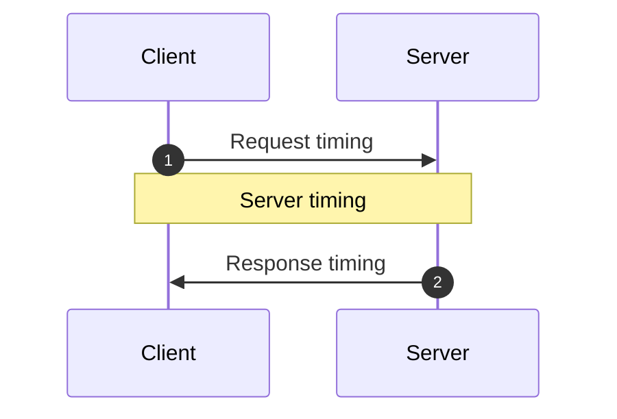

<!-- Generated by `yarn build:skills` from docs/rest/guides/optimistic-updates.md (react). Edit the source doc, not this file. -->

# Optimistic Updates

An optimistic update shows the result of a mutation before the server responds. It assumes the request succeeds, so
the interface does not wait for the network.

Optimistic updates add new race conditions. Reactive Data Client handles them for you.

## Resources

To make a [resource()](./resource.md) optimistic, set [optimistic: true](./resource.md#optimistic).

```ts title="TodoResource" {16}
import { Entity, resource } from '@data-client/rest';

export class Todo extends Entity {
  id = 0;
  userId = 0;
  title = '';
  completed = false;

  static key = 'Todo';
}
export const TodoResource = resource({
  urlPrefix: 'https://jsonplaceholder.typicode.com',
  path: '/todos/:id',
  searchParams: {} as { userId?: string | number } | undefined,
  schema: Todo,
  optimistic: true,
});
```

```tsx title="TodoItem"
import { useController } from '@data-client/react';
import { TodoResource, type Todo } from './TodoResource';

export default function TodoItem({ todo }: { todo: Todo }) {
  const ctrl = useController();
  const handleChange = e =>
    ctrl.fetch(
      TodoResource.partialUpdate,
      { id: todo.id },
      { completed: e.currentTarget.checked },
    );
  const handleDelete = () =>
    ctrl.fetch(TodoResource.delete, {
      id: todo.id,
    });
  return (
    <div className="listItem nogap">
      <label>
        <input
          type="checkbox"
          checked={todo.completed}
          onChange={handleChange}
        />
        {todo.title}
      </label>
      <CancelButton onClick={handleDelete} />
    </div>
  );
}
```

```tsx title="CreateTodo"
import { useController } from '@data-client/react';
import { TodoResource } from './TodoResource';

export default function CreateTodo({ userId }: { userId: number }) {
  const ctrl = useController();
  const handleKeyDown = async e => {
    if (e.key === 'Enter') {
      ctrl.fetch(TodoResource.getList.push, {
        userId,
        title: e.currentTarget.value,
      });
      e.currentTarget.value = '';
    }
  };
  return (
    <div className="listItem nogap">
      <label>
        <input type="checkbox" name="new" checked={false} disabled />
        <input
          type="text"
          aria-label="New todo"
          placeholder="New todo"
          onKeyDown={handleKeyDown}
        />
      </label>
      <CancelButton />
    </div>
  );
}
```

```tsx title="TodoList"
import { useSuspense } from '@data-client/react';
import { TodoResource } from './TodoResource';
import TodoItem from './TodoItem';
import CreateTodo from './CreateTodo';

function TodoList() {
  const userId = 1;
  const todos = useSuspense(TodoResource.getList, { userId });
  return (
    <div className="list">
      {todos.map(todo => (
        <TodoItem key={todo.pk()} todo={todo} />
      ))}
      <CreateTodo userId={userId} />
    </div>
  );
}
render(<TodoList />);
```

All its mutations then use these default optimistic responses:

### update/getList.push/getList.unshift

```ts
function optimisticUpdate(
  snap: SnapshotInterface,
  params: any,
  body: any,
) {
  return {
    ...params,
    ...ensureBodyPojo(body),
  };
}

function ensureBodyPojo(body: any) {
  return body instanceof FormData
    ? Object.fromEntries((body as any).entries())
    : body;
}
```

A create (push/unshift) body usually has no `id` to compute a pk from. So
Data Client creates a random `pk`.

Mutations on the new object usually fail until the server creates it. So disable other mutations on it until the
`POST` completes. For example, check that the entity has a real `id`.

### partialUpdate

```ts
function optimisticPartial(schema: Queryable) {
  return function (snap: SnapshotInterface, params: any, body: any) {
    const data = snap.get(schema, params);
    if (!data) throw snap.abort;
    return {
      ...params,
      ...data,
      // even tho we don't always have two arguments, the extra one will simply be undefined which spreads fine
      ...ensurePojo(body),
    };
  };
}
```

Partial updates do not send the entire body. Fields the expected response leaves out keep their
cached values, so an Entity only needs its [primary key](https://dataclient.io/rest/api/Entity#pk) and the changed fields.
If the entity is not in the store yet, the update [aborts](https://dataclient.io/docs/api/Snapshot#abort) instead of showing an Entity
made only of the changed fields. [Snapshots](https://dataclient.io/docs/api/Snapshot) read the current store value safely, with no race
conditions.

### delete

```ts
function optimisticDelete(snap: SnapshotInterface, params: any) {
  return params;
}
```

To make only some endpoints optimistic, or to match an unusual API, set
[getOptimisticResponse()](./RestEndpoint.md#getoptimisticresponse) with
[Resource.extend()](./resource.md#extend).

## Heavy screens {#transition}

Like React's [useOptimistic()](https://react.dev/reference/react/useOptimistic), an optimistic update renders
before the browser paints the click. If many components read the changed data, that render can make the click feel
slow. First make the render cheaper, for example with [React Compiler](https://react.dev/learn/react-compiler) or
`memo()` on expensive components. If the click still feels slow, put the call in
[startTransition()](https://react.dev/reference/react/startTransition), so the click paints first:

```tsx
import { startTransition } from 'react';
import { useController } from '@data-client/react';
import { TodoResource, type Todo } from './TodoResource';

export function ToggleTodo({ todo }: { todo: Todo }) {
  const ctrl = useController();
  const toggle = () => {
    startTransition(() => {
      ctrl.fetch(
        TodoResource.partialUpdate,
        { id: todo.id },
        { completed: !todo.completed },
      );
    });
  };
  return <input type="checkbox" checked={todo.completed} onChange={toggle} />;
}
```

React then renders the optimistic update at transition priority, which yields to input. If it makes a component
suspend, React keeps the current UI until that data loads.

Use a block body, as above. A callback that returns the `fetch()` promise is an async Action in React 19, so React
holds the optimistic update until the server responds.

## Optimistic Transforms

Some updates depend on the previous value, such as toggling a boolean or incrementing a counter. This example uses a
counter.

```ts title="count"
import { Entity, RestEndpoint } from '@data-client/rest';

export class CountEntity extends Entity {
  count = 0;

  pk() {
    return `SINGLETON`;
  }
}
export const getCount = new RestEndpoint({
  path: '/api/count',
  schema: CountEntity,
  name: 'get',
});
```

```ts title="increment" {10-16}
import { RestEndpoint } from '@data-client/rest';
import { CountEntity, getCount } from './count';

export const increment = new RestEndpoint({
  path: '/api/count/increment',
  method: 'POST',
  body: undefined,
  name: 'increment',
  schema: CountEntity,
  getOptimisticResponse(snap) {
    const data = snap.get(CountEntity, {});
    if (!data) throw snap.abort;
    return {
      count: data.count + 1,
    };
  },
});
```

```tsx title="CounterPage"
import React from 'react';
import { useController, useSuspense } from '@data-client/react';
import NumberFlow from '@number-flow/react';
import { getCount } from './count';
import { increment } from './increment';

function CounterPage() {
  const ctrl = useController();
  const { count } = useSuspense(getCount);
  const [stateCount, setStateCount] = React.useState(0);
  const [responseCount, setResponseCount] = React.useState(0);
  const clickHandler = async () => {
    setStateCount(stateCount + 1);
    const val = await ctrl.fetch(increment);
    setResponseCount(val.count);
    setStateCount(val.count);
  };
  return (
    <>
      <header className="appHeader">
        <h1 className="appTitle">Votes</h1>
      </header>
      <div className="listItem">
        <button className="upvote" onClick={clickHandler} aria-label="Upvote" />
        <dl className="stats">
          <div>
            <dt>Data Client</dt>
            <dd><NumberFlow value={count} /></dd>
          </div>
          <div>
            <dt>Other, optimistic</dt>
            <dd><NumberFlow value={stateCount} /></dd>
          </div>
          <div>
            <dt>Other, on response</dt>
            <dd><NumberFlow value={responseCount} /></dd>
          </div>
        </dl>
      </div>
    </>
  );
}
render(<CounterPage />);
```

Reactive Data Client handles race conditions from network timing. It tracks when each fetch starts, pairs each
response with its optimistic update, and rolls the update back when the request resolves or fails.

Other libraries have these race conditions even without optimistic updates. Optimistic updates make them worse.

### Example race condition

This example requests two increments. The first response arrives after the second.

Other libraries show 0, 2, then 1 without optimistic updates, and 0, 1, 2, 2, then 1 with them. Both end on the wrong count, with janky updates along the way. Data Client shows 0, 1, then 2, and keeps 2 when the older response arrives last.

### Compensating for Server timing variations {#server-timings}



Three timings can vary in an async mutation:

1. Request timing
2. Server timing
3. Response timing

Reactive Data Client handles request and response timing for you. This is usually enough, because servers usually
process requests in the order they arrive. If the server saves requests in a different order, a race condition
remains.

To fix it, keep a [total order](https://en.wikipedia.org/wiki/Total_order) with one clock. Server and client clocks
can differ, and optimistic updates happen on the client, so use the client's clock:

1. Send the request time in an `updatedAt` header with [getRequestInit()](./RestEndpoint.md#getRequestInit).
2. The server processes requests in `updatedAt` order, stores `updatedAt` in the entity, and returns it in every
   response.
3. Override [shouldReorder](https://dataclient.io/rest/api/Entity#shouldreorder) to reorder out-of-order responses by `updatedAt`.

[getOptimisticResponse](./RestEndpoint.md#getoptimisticresponse) uses [snap.fetchedAt](https://dataclient.io/docs/api/Snapshot#fetchedat).
It is the moment the fetch starts, the same time as the `updatedAt` header.

```ts title="count" {11-13}
import { Entity, RestEndpoint } from '@data-client/rest';

export class CountEntity extends Entity {
  count = 0;
  updatedAt = 0;

  pk() {
    return `SINGLETON`;
  }

  static shouldReorder(existingMeta, incomingMeta, existing, incoming) {
    return incoming.updatedAt < existing.updatedAt;
  }
}
export const getCount = new RestEndpoint({
  path: '/api/count',
  schema: CountEntity,
  name: 'get',
});
```

```ts title="increment" {10-16,22}
import { RestEndpoint } from '@data-client/rest';
import { CountEntity } from './count';

export const increment = new RestEndpoint({
  path: '/api/count/increment',
  method: 'POST',
  body: undefined,
  name: 'increment',
  schema: CountEntity,
  getRequestInit() {
    // this is a substitute for super.getRequestInit()
    // since we aren't in a class context
    return RestEndpoint.prototype.getRequestInit.call(this, {
      updatedAt: Date.now(),
    });
  },
  getOptimisticResponse(snap) {
    const data = snap.get(CountEntity, {});
    if (!data) throw snap.abort;
    return {
      count: data.count + 1,
      updatedAt: snap.fetchedAt,
    };
  },
});
```

```tsx title="CounterPage"
import React from 'react';
import { useController, useSuspense } from '@data-client/react';
import NumberFlow from '@number-flow/react';
import { getCount } from './count';
import { increment } from './increment';

function CounterPage() {
  const ctrl = useController();
  const { count } = useSuspense(getCount);
  const [clicks, setClicks] = React.useState(count);
  const clickHandler = () => {
    setClicks(c => c + 1);
    return ctrl.fetch(increment);
  };
  return (
    <>
      <header className="appHeader">
        <h1 className="appTitle">Votes</h1>
      </header>
      <div className="listItem">
        <button className="upvote" onClick={clickHandler} aria-label="Upvote" />
        <dl className="stats">
          <div>
            <dt>Data Client</dt>
            <dd><NumberFlow value={count} /></dd>
          </div>
          <div>
            <dt>Clicks</dt>
            <dd><NumberFlow value={clicks} /></dd>
          </div>
        </dl>
      </div>
    </>
  );
}
render(<CounterPage />);
```
