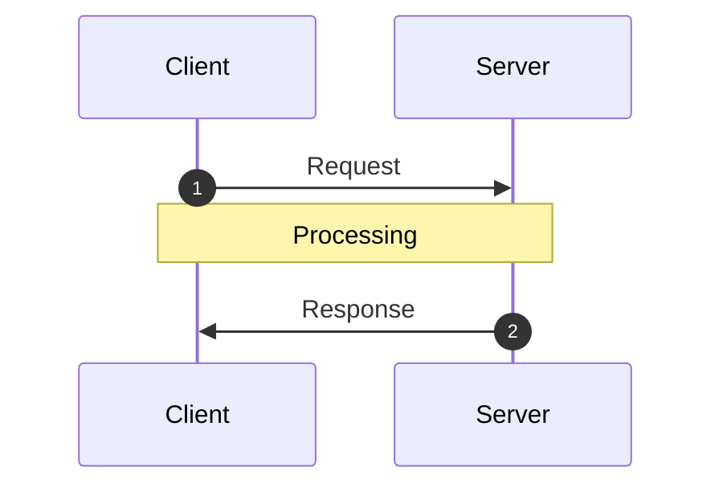

<!-- Generated by `yarn build:skills` from docs/rest/guides/optimistic-updates.md (vue). Edit the source doc, not this file. -->

# Optimistic Updates

An optimistic update shows a mutation's result before the server responds, so the UI does not wait for the network.
Reactive Data Client replaces it with the server's response when that arrives, rolls it back if the request fails, and
resolves the race conditions that overlapping requests cause.

## Resources

To make a [resource()](./resource.vue.md) optimistic, set [optimistic: true](./resource.vue.md#optimistic).

```ts title="TodoResource" {16}
import { Entity, resource } from '@data-client/rest';

export class Todo extends Entity {
  id = 0;
  userId = 0;
  title = '';
  completed = false;

  static key = 'Todo';
}
export const TodoResource = resource({
  urlPrefix: 'https://jsonplaceholder.typicode.com',
  path: '/todos/:id',
  searchParams: {} as { userId?: string | number } | undefined,
  schema: Todo,
  optimistic: true,
});
```

```html title="TodoItem.vue"
<script setup lang="ts">
  import { useController } from '@data-client/vue';
  import { TodoResource, type Todo } from './TodoResource';

  const props = defineProps<{ todo: Todo }>();
  const ctrl = useController();
  const handleChange = e =>
    ctrl.fetch(
      TodoResource.partialUpdate,
      { id: props.todo.id },
      { completed: e.currentTarget.checked },
    );
  const handleDelete = () =>
    ctrl.fetch(TodoResource.delete, {
      id: props.todo.id,
    });
</script>

<template>
  <div class="listItem nogap">
    <label>
      <input type="checkbox" :checked="todo.completed" @change="handleChange" />
      {{ todo.title }}
    </label>
    <CancelButton @click="handleDelete" />
  </div>
</template>
```

```html title="CreateTodo.vue"
<script setup lang="ts">
  import { useController } from '@data-client/vue';
  import { TodoResource } from './TodoResource';

  const props = defineProps<{ userId: number }>();
  const ctrl = useController();
  const handleKeyDown = async e => {
    if (e.key === 'Enter') {
      ctrl.fetch(TodoResource.getList.push, {
        userId: props.userId,
        title: e.currentTarget.value,
      });
      e.currentTarget.value = '';
    }
  };
</script>

<template>
  <div class="listItem nogap">
    <label>
      <input type="checkbox" name="new" :checked="false" disabled />
      <input
        type="text"
        aria-label="New todo"
        placeholder="New todo"
        @keydown="handleKeyDown"
      />
    </label>
    <CancelButton />
  </div>
</template>
```

```html title="TodoList.vue"
<script setup lang="ts">
  import { useSuspense } from '@data-client/vue';
  import { TodoResource } from './TodoResource';
  import TodoItem from './TodoItem.vue';
  import CreateTodo from './CreateTodo.vue';

  const userId = 1;
  const todos = await useSuspense(TodoResource.getList, { userId });
</script>

<template>
  <div class="list">
    <TodoItem v-for="todo in todos" :key="todo.pk()" :todo="todo" />
    <CreateTodo :userId="userId" />
  </div>
</template>
```

Each mutation then predicts the server's response:

| Endpoint                                                                                        | Optimistic response                                                |
| ----------------------------------------------------------------------------------------------- | ------------------------------------------------------------------ |
| `update`, `getList.push`, `getList.unshift`, `getList.assign`, `getList.remove`, `getList.move` | The URL params merged with the body (`FormData` becomes an object) |
| `partialUpdate`                                                                                 | The cached entity with the body merged in                          |
| `delete`                                                                                        | The params, which remove the entity                                |

A new item from `getList.push` or `getList.unshift` usually has no `id` yet, so Data Client gives it a temporary
random primary key. Until the server responds, the client does not know the item's real `id`, so other mutations on
it fail. Disable them until the item has its real `id`.

If the entity is not in the cache, `partialUpdate` [aborts](https://dataclient.io/vue/api/Snapshot#abort) its optimistic update and waits
for the server, rather than show an entity made only of the changed fields.

To make only some endpoints optimistic, or to predict a different response, set
[getOptimisticResponse()](./RestEndpoint.vue.md#getoptimisticresponse) with
[Resource.extend()](./resource.vue.md#extend). For an Entity, it only needs to return the
[primary key](https://dataclient.io/rest/api/Entity#pk) and the changed fields: the other fields keep their cached values.

## Optimistic Transforms

When the new value depends on the current one, such as a counter or a toggle, read the current value with
[snap.get()](https://dataclient.io/vue/api/Snapshot#get) and compute the update from it:

```ts title="count"
import { Entity, RestEndpoint } from '@data-client/rest';

export class CountEntity extends Entity {
  count = 0;

  pk() {
    return `SINGLETON`;
  }
}
export const getCount = new RestEndpoint({
  path: '/api/count',
  schema: CountEntity,
  name: 'get',
});
```

```ts title="increment" {10-16}
import { RestEndpoint } from '@data-client/rest';
import { CountEntity, getCount } from './count';

export const increment = new RestEndpoint({
  path: '/api/count/increment',
  method: 'POST',
  body: undefined,
  name: 'increment',
  schema: CountEntity,
  getOptimisticResponse(snap) {
    const data = snap.get(CountEntity, {});
    if (!data) throw snap.abort;
    return {
      count: data.count + 1,
    };
  },
});
```

```html title="CounterPage.vue"
<script setup lang="ts">
  import { ref } from 'vue';
  import { useController, useSuspense } from '@data-client/vue';
  import NumberFlow from '@number-flow/vue';
  import { getCount } from './count';
  import { increment } from './increment';

  const ctrl = useController();
  const data = await useSuspense(getCount);
  const stateCount = ref(0);
  const responseCount = ref(0);
  const clickHandler = async () => {
    stateCount.value = stateCount.value + 1;
    const val = await ctrl.fetch(increment);
    responseCount.value = val.count;
    stateCount.value = val.count;
  };
</script>

<template>
  <header class="appHeader">
    <h1 class="appTitle">Votes</h1>
  </header>
  <div class="listItem">
    <button class="upvote" @click="clickHandler" aria-label="Upvote" />
    <dl class="stats">
      <div>
        <dt>Data Client</dt>
        <dd><NumberFlow :value="data.count" /></dd>
      </div>
      <div>
        <dt>Other, optimistic</dt>
        <dd><NumberFlow :value="stateCount" /></dd>
      </div>
      <div>
        <dt>Other, on response</dt>
        <dd><NumberFlow :value="responseCount" /></dd>
      </div>
    </dl>
  </div>
</template>
```

Data Client records when each fetch starts and keeps its optimistic update until that request resolves or fails. When
responses arrive out of order, an Entity keeps the data from the request that started later.

### Example race condition

This example sends two increments, and the first response arrives after the second.

A library that applies each response as it arrives shows 0, 2, then 1. With naive optimistic updates, it shows 0, 1,
2, then falls back to 1. Both end on the wrong count. Data Client shows 0, 1, then 2, and keeps 2 when the older
response arrives last.

### Servers that reorder requests {#server-timings}



A mutation's timing varies in three places: the request, the server's processing, and the response. Data Client
handles out-of-order responses. If requests can reach the server, or be saved, in a different order than they were
sent, a race condition remains.

To fix it, order every update by one clock. Use the client's clock, because optimistic updates happen on the client and
the server's clock can differ:

1. Send the client's current time as `updatedAt` in the body, with [getRequestInit()](./RestEndpoint.vue.md#getRequestInit).
2. On the server, apply requests in `updatedAt` order, store `updatedAt` on the entity, and return it in every response.
3. Override [shouldReorder()](https://dataclient.io/rest/api/Entity#shouldreorder), so a response with an older `updatedAt` does not
   overwrite a newer one.

In [getOptimisticResponse()](./RestEndpoint.vue.md#getoptimisticresponse), set `updatedAt` to
[snap.fetchedAt](https://dataclient.io/vue/api/Snapshot#fetchedat), the time the fetch started, so the optimistic update uses the same clock.

```ts title="count" {11-13}
import { Entity, RestEndpoint } from '@data-client/rest';

export class CountEntity extends Entity {
  count = 0;
  updatedAt = 0;

  pk() {
    return `SINGLETON`;
  }

  static shouldReorder(existingMeta, incomingMeta, existing, incoming) {
    return incoming.updatedAt < existing.updatedAt;
  }
}
export const getCount = new RestEndpoint({
  path: '/api/count',
  schema: CountEntity,
  name: 'get',
});
```

```ts title="increment" {10-16,22}
import { RestEndpoint } from '@data-client/rest';
import { CountEntity } from './count';

export const increment = new RestEndpoint({
  path: '/api/count/increment',
  method: 'POST',
  body: undefined,
  name: 'increment',
  schema: CountEntity,
  getRequestInit() {
    // this is a substitute for super.getRequestInit()
    // since we aren't in a class context
    return RestEndpoint.prototype.getRequestInit.call(this, {
      updatedAt: Date.now(),
    });
  },
  getOptimisticResponse(snap) {
    const data = snap.get(CountEntity, {});
    if (!data) throw snap.abort;
    return {
      count: data.count + 1,
      updatedAt: snap.fetchedAt,
    };
  },
});
```

```html title="CounterPage.vue"
<script setup lang="ts">
  import { ref } from 'vue';
  import { useController, useSuspense } from '@data-client/vue';
  import NumberFlow from '@number-flow/vue';
  import { getCount } from './count';
  import { increment } from './increment';

  const ctrl = useController();
  const data = await useSuspense(getCount);
  const clicks = ref(data.value.count);
  const clickHandler = () => {
    clicks.value += 1;
    return ctrl.fetch(increment);
  };
</script>

<template>
  <header class="appHeader">
    <h1 class="appTitle">Votes</h1>
  </header>
  <div class="listItem">
    <button class="upvote" @click="clickHandler" aria-label="Upvote" />
    <dl class="stats">
      <div>
        <dt>Data Client</dt>
        <dd><NumberFlow :value="data.count" /></dd>
      </div>
      <div>
        <dt>Clicks</dt>
        <dd><NumberFlow :value="clicks" /></dd>
      </div>
    </dl>
  </div>
</template>
```
