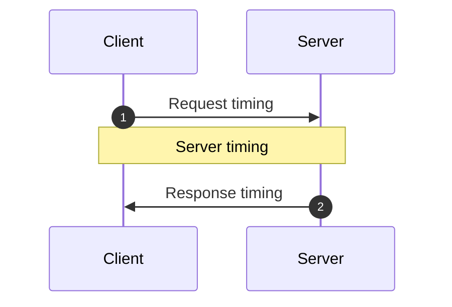

<!-- Generated by `yarn build:skills` from docs/rest/guides/optimistic-updates.md (vue). Edit the source doc, not this file. -->

# Optimistic Updates

An optimistic update shows the result of a mutation before the server responds. It assumes the request succeeds, so
the interface does not wait for the network.

Optimistic updates add new race conditions. Reactive Data Client handles them for you.

## Resources

To make a [resource()](./resource.vue.md) optimistic, set [optimistic: true](./resource.vue.md#optimistic).

```ts title="TodoResource" {16}
import { Entity, resource } from '@data-client/rest';

export class Todo extends Entity {
  id = 0;
  userId = 0;
  title = '';
  completed = false;

  static key = 'Todo';
}
export const TodoResource = resource({
  urlPrefix: 'https://jsonplaceholder.typicode.com',
  path: '/todos/:id',
  searchParams: {} as { userId?: string | number } | undefined,
  schema: Todo,
  optimistic: true,
});
```

```html title="TodoItem.vue"
<script setup lang="ts">
  import { useController } from '@data-client/vue';
  import { TodoResource, type Todo } from './TodoResource';

  const props = defineProps<{ todo: Todo }>();
  const ctrl = useController();
  const handleChange = e =>
    ctrl.fetch(
      TodoResource.partialUpdate,
      { id: props.todo.id },
      { completed: e.currentTarget.checked },
    );
  const handleDelete = () =>
    ctrl.fetch(TodoResource.delete, {
      id: props.todo.id,
    });
</script>

<template>
  <div class="listItem nogap">
    <label>
      <input type="checkbox" :checked="todo.completed" @change="handleChange" />
      {{ todo.title }}
    </label>
    <CancelButton @click="handleDelete" />
  </div>
</template>
```

```html title="CreateTodo.vue"
<script setup lang="ts">
  import { useController } from '@data-client/vue';
  import { TodoResource } from './TodoResource';

  const props = defineProps<{ userId: number }>();
  const ctrl = useController();
  const handleKeyDown = async e => {
    if (e.key === 'Enter') {
      ctrl.fetch(TodoResource.getList.push, {
        userId: props.userId,
        title: e.currentTarget.value,
      });
      e.currentTarget.value = '';
    }
  };
</script>

<template>
  <div class="listItem nogap">
    <label>
      <input type="checkbox" name="new" :checked="false" disabled />
      <input
        type="text"
        aria-label="New todo"
        placeholder="New todo"
        @keydown="handleKeyDown"
      />
    </label>
    <CancelButton />
  </div>
</template>
```

```html title="TodoList.vue"
<script setup lang="ts">
  import { useSuspense } from '@data-client/vue';
  import { TodoResource } from './TodoResource';
  import TodoItem from './TodoItem.vue';
  import CreateTodo from './CreateTodo.vue';

  const userId = 1;
  const todos = await useSuspense(TodoResource.getList, { userId });
</script>

<template>
  <div class="list">
    <TodoItem v-for="todo in todos" :key="todo.pk()" :todo="todo" />
    <CreateTodo :userId="userId" />
  </div>
</template>
```

All its mutations then use these default optimistic responses:

| Endpoint                                                                                        | Optimistic response                                                |
| ----------------------------------------------------------------------------------------------- | ------------------------------------------------------------------ |
| `update`, `getList.push`, `getList.unshift`, `getList.assign`, `getList.remove`, `getList.move` | The URL params merged with the body (`FormData` becomes an object) |
| `partialUpdate`                                                                                 | The cached entity with the body merged in                          |
| `delete`                                                                                        | The params, which remove the entity                                |

A create (push/unshift) body usually has no `id` to compute a pk from. So
Data Client creates a random `pk`.

Mutations on the new object usually fail until the server creates it. So disable other mutations on it until the
`POST` completes. For example, check that the entity has a real `id`.

Partial updates do not send the entire body. Fields the expected response leaves out keep their
cached values, so an Entity only needs its [primary key](https://dataclient.io/rest/api/Entity#pk) and the changed fields.
If the entity is not in the store yet, the update [aborts](https://dataclient.io/vue/api/Snapshot#abort) instead of showing an Entity
made only of the changed fields. [Snapshots](https://dataclient.io/vue/api/Snapshot) read the current store value safely, with no race
conditions.

To make only some endpoints optimistic, or to match an unusual API, set
[getOptimisticResponse()](./RestEndpoint.vue.md#getoptimisticresponse) with
[Resource.extend()](./resource.vue.md#extend).

## Optimistic Transforms

Some updates depend on the previous value, such as toggling a boolean or incrementing a counter. This example uses a
counter.

```ts title="count"
import { Entity, RestEndpoint } from '@data-client/rest';

export class CountEntity extends Entity {
  count = 0;

  pk() {
    return `SINGLETON`;
  }
}
export const getCount = new RestEndpoint({
  path: '/api/count',
  schema: CountEntity,
  name: 'get',
});
```

```ts title="increment" {10-16}
import { RestEndpoint } from '@data-client/rest';
import { CountEntity, getCount } from './count';

export const increment = new RestEndpoint({
  path: '/api/count/increment',
  method: 'POST',
  body: undefined,
  name: 'increment',
  schema: CountEntity,
  getOptimisticResponse(snap) {
    const data = snap.get(CountEntity, {});
    if (!data) throw snap.abort;
    return {
      count: data.count + 1,
    };
  },
});
```

```html title="CounterPage.vue"
<script setup lang="ts">
  import { ref } from 'vue';
  import { useController, useSuspense } from '@data-client/vue';
  import NumberFlow from '@number-flow/vue';
  import { getCount } from './count';
  import { increment } from './increment';

  const ctrl = useController();
  const data = await useSuspense(getCount);
  const stateCount = ref(0);
  const responseCount = ref(0);
  const clickHandler = async () => {
    stateCount.value = stateCount.value + 1;
    const val = await ctrl.fetch(increment);
    responseCount.value = val.count;
    stateCount.value = val.count;
  };
</script>

<template>
  <header class="appHeader">
    <h1 class="appTitle">Votes</h1>
  </header>
  <div class="listItem">
    <button class="upvote" @click="clickHandler" aria-label="Upvote" />
    <dl class="stats">
      <div>
        <dt>Data Client</dt>
        <dd><NumberFlow :value="data.count" /></dd>
      </div>
      <div>
        <dt>Other, optimistic</dt>
        <dd><NumberFlow :value="stateCount" /></dd>
      </div>
      <div>
        <dt>Other, on response</dt>
        <dd><NumberFlow :value="responseCount" /></dd>
      </div>
    </dl>
  </div>
</template>
```

Reactive Data Client handles race conditions from network timing. It tracks when each fetch starts, pairs each
response with its optimistic update, and rolls the update back when the request resolves or fails.

Other libraries have these race conditions even without optimistic updates. Optimistic updates make them worse.

### Example race condition

This example requests two increments. The first response arrives after the second.

Other libraries show 0, 2, then 1 without optimistic updates, and 0, 1, 2, 2, then 1 with them. Both end on the wrong count, with janky updates along the way. Data Client shows 0, 1, then 2, and keeps 2 when the older response arrives last.

### Compensating for Server timing variations {#server-timings}



Three timings can vary in an async mutation:

1. Request timing
2. Server timing
3. Response timing

Reactive Data Client handles response timing for you. This is usually enough, because servers usually
process requests in the order they arrive. If requests arrive or are saved in a different order, a race condition
remains.

To fix it, keep a [total order](https://en.wikipedia.org/wiki/Total_order) with one clock. Server and client clocks
can differ, and optimistic updates happen on the client, so use the client's clock:

1. Send the request time as `updatedAt` in the body with [getRequestInit()](./RestEndpoint.vue.md#getRequestInit).
2. The server processes requests in `updatedAt` order, stores `updatedAt` in the entity, and returns it in every
   response.
3. Override [shouldReorder](https://dataclient.io/rest/api/Entity#shouldreorder) to reorder out-of-order responses by `updatedAt`.

[getOptimisticResponse](./RestEndpoint.vue.md#getoptimisticresponse) uses [snap.fetchedAt](https://dataclient.io/vue/api/Snapshot#fetchedat).
It is the moment the fetch starts, on the same clock as `updatedAt` (a fraction of a millisecond later when several
fetches start in one millisecond).

```ts title="count" {11-13}
import { Entity, RestEndpoint } from '@data-client/rest';

export class CountEntity extends Entity {
  count = 0;
  updatedAt = 0;

  pk() {
    return `SINGLETON`;
  }

  static shouldReorder(existingMeta, incomingMeta, existing, incoming) {
    return incoming.updatedAt < existing.updatedAt;
  }
}
export const getCount = new RestEndpoint({
  path: '/api/count',
  schema: CountEntity,
  name: 'get',
});
```

```ts title="increment" {10-16,22}
import { RestEndpoint } from '@data-client/rest';
import { CountEntity } from './count';

export const increment = new RestEndpoint({
  path: '/api/count/increment',
  method: 'POST',
  body: undefined,
  name: 'increment',
  schema: CountEntity,
  getRequestInit() {
    // this is a substitute for super.getRequestInit()
    // since we aren't in a class context
    return RestEndpoint.prototype.getRequestInit.call(this, {
      updatedAt: Date.now(),
    });
  },
  getOptimisticResponse(snap) {
    const data = snap.get(CountEntity, {});
    if (!data) throw snap.abort;
    return {
      count: data.count + 1,
      updatedAt: snap.fetchedAt,
    };
  },
});
```

```html title="CounterPage.vue"
<script setup lang="ts">
  import { ref } from 'vue';
  import { useController, useSuspense } from '@data-client/vue';
  import NumberFlow from '@number-flow/vue';
  import { getCount } from './count';
  import { increment } from './increment';

  const ctrl = useController();
  const data = await useSuspense(getCount);
  const clicks = ref(data.value.count);
  const clickHandler = () => {
    clicks.value += 1;
    return ctrl.fetch(increment);
  };
</script>

<template>
  <header class="appHeader">
    <h1 class="appTitle">Votes</h1>
  </header>
  <div class="listItem">
    <button class="upvote" @click="clickHandler" aria-label="Upvote" />
    <dl class="stats">
      <div>
        <dt>Data Client</dt>
        <dd><NumberFlow :value="data.count" /></dd>
      </div>
      <div>
        <dt>Clicks</dt>
        <dd><NumberFlow :value="clicks" /></dd>
      </div>
    </dl>
  </div>
</template>
```
