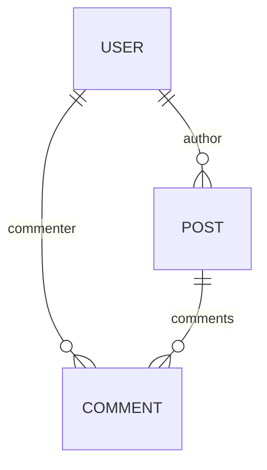

<!-- Generated by `yarn build:skills` from docs/rest/guides/relational-data.md (react). Edit the source doc, not this file. -->

# Relational data

Declare one-to-one, many-to-one and many-to-many relationships between [entities][1] in [Entity.schema][3].

## Nesting

When an Entity defines [Entity.schema][3], normalization stores each nested entity separately. Denormalization joins
them again.

<details>

<summary>Diagram</summary>



 

</details>

```typescript title="resources/Post"
import { Collection, Entity, resource } from '@data-client/rest';

export class User extends Entity {
  id = '';
  name = '';
}

export class Comment extends Entity {
  id = '';
  content = '';
  commenter = User.fromJS();

  static schema = {
    commenter: User,
  };
}

export class Post extends Entity {
  id = '';
  title = '';
  author = User.fromJS();
  comments: Comment[] = [];

  static schema = {
    author: User,
    comments: new Collection([Comment], {
      nestKey: (parent, key) => ({
        postId: parent.id,
      }),
    }),
  };
}

export const PostResource = resource({
  path: '/posts/:id',
  schema: Post,
});
```

```tsx title="PostPage"
import { useSuspense } from '@data-client/react';
import { PostResource } from './resources/Post';

function PostPage() {
  const posts = useSuspense(PostResource.getList);
  return (
    <div>
      {posts.map(post => (
        <div key={post.pk()}>
          <h4>
            {post.title} - <cite>{post.author.name}</cite>
          </h4>
          <ul>
            {post.comments.map(comment => (
              <li key={comment.pk()}>
                {comment.content}{' '}
                <small>
                  <cite>
                    {comment.commenter.name}
                    {comment.commenter === post.author ? ' [OP]' : ''}
                  </cite>
                </small>
              </li>
            ))}
          </ul>
        </div>
      ))}
    </div>
  );
}
render(<PostPage />);
```

## Client side joins

Nesting data when your endpoint doesn't.

When a response does not nest related data, declare the relationship in [Entity.schema](./Entity.md#schema).
Data Client then joins the data on the client.

Here `/todos` only sends each todo's `userId`. [Entity.process()](./Entity.md#process) points
`user` at that id, so every todo in the list carries its whole `User` from `/users`. A component
could look up one user by id itself; joining puts the user in the list, so the list can group by
person. Assign a task to someone else (pick their face, or drag the task into their group),
and only its new `userId` goes to the server, yet it moves to that person's group.

```ts title="resources/User"
import { Entity, resource } from '@data-client/rest';

export class User extends Entity {
  id = 0;
  username = '';
  name = '';
  email = '';

  get profileImage() {
    return `https://i.pravatar.cc/64?img=${this.id + 4}`;
  }
}
export const UserResource = resource({
  urlPrefix: 'https://jsonplaceholder.typicode.com',
  path: '/users/:id',
  schema: User,
});
```

```ts title="resources/Todo" {7,11-17}
import { Entity, resource } from '@data-client/rest';
import { User } from './User';

export class Todo extends Entity {
  id = 0;
  userId = 0;
  user? = User.fromJS();
  title = '';
  completed = false;

  // the API sends userId; join it to the User with that id
  static schema = {
    user: User,
  };
  static process(todo) {
    return { ...todo, user: todo.userId };
  }
}
export const TodoResource = resource({
  urlPrefix: 'https://jsonplaceholder.typicode.com',
  path: '/todos/:id',
  schema: Todo,
  optimistic: true,
});
```

```tsx title="TodoItem"
import React from 'react';
import { useController } from '@data-client/react';
import { TodoResource, type Todo } from './resources/Todo';
import type { User } from './resources/User';

function TodoItem({ todo, users }: Props) {
  const ctrl = useController();
  const update = (body: Partial<Todo>) =>
    ctrl.fetch(TodoResource.partialUpdate, { id: todo.id }, body);
  return (
    <div
      className="listItem"
      // dragged into a person's group, the todo is theirs
      ref={useReorderItem(todo.pk(), {
        onDrop: (userId: number) => update({ userId }),
      })}
    >
      <label>
        <input
          type="checkbox"
          checked={todo.completed}
          onChange={e => update({ completed: e.currentTarget.checked })}
        />
        {todo.title}
      </label>
      <label className="assignee">
        {todo.user && <Avatar src={todo.user.profileImage} size={24} />}
        <select
          aria-label={`Owner of ${todo.title}`}
          value={todo.userId}
          onChange={e => update({ userId: Number(e.currentTarget.value) })}
        >
          {users.map(user => (
            <option key={user.pk()} value={user.id}>
              {user.name}
            </option>
          ))}
        </select>
      </label>
    </div>
  );
}
export default React.memo(TodoItem);

interface Props {
  todo: Todo;
  users: User[];
}
```

```tsx title="TodoGroup"
import TodoItem from './TodoItem';
import type { Todo } from './resources/Todo';
import type { User } from './resources/User';

export default function TodoGroup({ owner, todos, users }: Props) {
  return (
    <section ref={useDropGroup(owner.id)}>
      <h3>
        <Avatar src={owner.profileImage} />
        {owner.name}
      </h3>
      <div className="list">
        {todos.map(todo => (
          <TodoItem key={todo.pk()} todo={todo} users={users} />
        ))}
      </div>
    </section>
  );
}

interface Props {
  owner: User;
  todos: Todo[];
  users: User[];
}
```

```tsx title="TodoList" {11-13}
import { useFetch, useSuspense } from '@data-client/react';
import { TodoResource } from './resources/Todo';
import { UserResource } from './resources/User';
import TodoGroup from './TodoGroup';

function TodoList() {
  // both requests start at once
  useFetch(UserResource.getList);
  const todos = useSuspense(TodoResource.getList);
  const users = useSuspense(UserResource.getList);
  // every todo carries its user, the same object as in users, so
  // the list can group by it
  const byOwner = Map.groupBy(todos, todo => todo.user);
  return (
    // rows glide to wherever a change moves them
    <Reorder layoutDependency={todos}>
      {users.map(user => (
        <TodoGroup
          key={user.pk()}
          owner={user}
          todos={byOwner.get(user) ?? []}
          users={users}
        />
      ))}
    </Reorder>
  );
}
render(<TodoList />);
```

### Key-based joins

When related entities come from separate fetches, use [Entity.process()](./Entity.md#process) to add a key that
references the other Entity. Use this when:

- Related data comes from different API endpoints.
- You do not want to fetch nested data you do not need.
- The relationship is optional or depends on context.

```typescript
import { Entity, resource } from '@data-client/rest';

class Stats extends Entity {
  product_id = '';
  volume = 0;
  price = 0;

  pk() {
    return this.product_id;
  }

  static key = 'Stats';
}

class Currency extends Entity {
  id = '';
  name = '';
  // Default value allows Currency to exist without Stats loaded
  stats = Stats.fromJS();

  pk() {
    return this.id;
  }

  static key = 'Currency';

  // Create a reference key that links to Stats entity
  static process(input: any, parent: any, key: string, args: any[]) {
    // The stats field becomes a reference to Stats with pk `${id}-USD`
    return { ...input, stats: `${input.id}-USD` };
  }

  static schema = {
    // Stats will be looked up by the key from process()
    stats: Stats,
  };
}
```

After both `CurrencyResource.getList` and `StatsResource.getList` resolve, `stats` is the matching `Stats` entity.

### Crypto price example

This list sorts `Currencies` by trade volume. Only the `Stats` Entity has trade volume, and the
`CurrencyResource.getList` response does not include it. So the page also fetches `StatsResource.getList`, and
`Currency`'s [Entity.schema](./Entity.md#schema) adds `Stats` to each `Currency`. The list can then sort:

```ts
entries.sort((a, b) => {
  return b?.stats?.volume_usd - a?.stats?.volume_usd;
});
```

Example app: [coin-app](https://github.com/reactive/data-client/tree/master/examples/coin-app) ([`src/pages/Home/CurrencyList.tsx`](https://github.com/reactive/data-client/blob/master/examples/coin-app/src/pages/Home/CurrencyList.tsx), [`src/resources/Stats.ts`](https://github.com/reactive/data-client/blob/master/examples/coin-app/src/resources/Stats.ts), [`src/resources/Currency.ts`](https://github.com/reactive/data-client/blob/master/examples/coin-app/src/resources/Currency.ts))

## Reverse lookups

Nesting data when your endpoint doesn't (part 2).

A response can nest in one direction only. To add the reverse relationship, override
[Entity.process](./Entity.md#process). You might also need to override [Entity.merge](./Entity.md#merge) to
deep merge those fields.

Then one fetch gives every view of the relationship, with no fetch per view.

Files with a `route` are pages mounted at that path, with its params as props; `Link` and `useNavigate()` stand for your router (with react-router, read params with `useParams()`).

```typescript title="resources/Post"
import { Entity, resource, type Schema } from '@data-client/rest';

export class User extends Entity {
  id = '';
  name = '';
  posts: Post[] = [];
  comments: Comment[] = [];

  static merge(existing, incoming) {
    return {
      ...existing,
      ...incoming,
      posts: [...(existing.posts || []), ...(incoming.posts || [])],
      comments: [
        ...(existing.comments || []),
        ...(incoming.comments || []),
      ],
    };
  }

  static process(value, parent, key) {
    switch (key) {
      case 'author':
        return { ...value, posts: [parent.id] };
      case 'commenter':
        return { ...value, comments: [parent.id] };
      default:
        return { ...value };
    }
  }
}

export class Comment extends Entity {
  id = '';
  content = '';
  commenter = User.fromJS();
  post = Post.fromJS();

  static schema: Record<string, Schema> = {
    commenter: User,
  };
  static process(value, parent, key) {
    return { ...value, post: parent.id };
  }
}

export class Post extends Entity {
  id = '';
  title = '';
  author = User.fromJS();
  comments: Comment[] = [];

  static schema = {
    author: User,
    comments: [Comment],
  };
}

// with cirucular dependencies we must set schema after they are all defined
User.schema = {
  posts: [Post],
  comments: [Comment],
};
Comment.schema = {
  ...Comment.schema,
  post: Post,
};

export const PostResource = resource({
  path: '/posts/:id',
  schema: Post,
  dataExpiryLength: Infinity,
});
export const UserResource = resource({
  path: '/users/:id',
  schema: User,
});
```

```tsx title="UserPage" route="/users/:id"
import { useSuspense } from '@data-client/react';
import { UserResource } from './resources/Post';

export default function UserPage({ id }) {
  const user = useSuspense(UserResource.get, { id });
  return (
    <div>
      <h4>{user.name}</h4>
      {user.posts.length ? (
        <>
          <h5>Posts</h5>
          <ul>
            {user.posts.map(post => (
              <li>{post.title}</li>
            ))}
          </ul>
        </>
      ) : null}
      <h5>Comments</h5>
      <ul>
        {user.comments.map(comment => (
          <li>{comment.content}</li>
        ))}
      </ul>
    </div>
  );
}
```

```tsx title="PostPage" route="/"
import { useSuspense } from '@data-client/react';
import { PostResource } from './resources/Post';

export default function PostPage() {
  const posts = useSuspense(PostResource.getList);
  return (
    <div>
      {posts.map(post => (
        <div key={post.pk()}>
          <h4>
            {post.title} -{' '}
            <Link to={`/users/${post.author.id}`}>{post.author.name}</Link>
          </h4>
          <ul>
            {post.comments.map(comment => (
              <li key={comment.pk()}>
                {comment.content}{' '}
                <small>
                  <Link to={`/users/${comment.commenter.id}`}>
                    {comment.commenter.name}
                    {comment.commenter === post.author ? ' [OP]' : ''}
                  </Link>
                </small>
              </li>
            ))}
          </ul>
        </div>
      ))}
    </div>
  );
}
```

### Circular dependencies

JavaScript does not allow circular imports or circular class definitions. So for [Entities][1] that reference each
other, define the [schema][3] after the class definitions.

```typescript title="resources/Post"
import { Collection, Entity } from '@data-client/rest';
import { User } from './User';

export class Post extends Entity {
  id = '';
  title = '';
  author = User.fromJS();

  static schema = {
    author: User,
  };
}

// both User and Post are now defined, so it's okay to refer to both of them
User.schema = {
  // ensure we keep the 'createdAt' member
  ...User.schema,
  posts: [Post],
};
```

```typescript title="resources/User"
import { Collection, Entity } from '@data-client/rest';
import type { Post } from './Post';
// we can only import the type else we break javascript imports
// thus we change the schema of UserResource above

export class User extends Entity {
  id = '';
  name = '';
  posts: Post[] = [];
  createdAt = Temporal.Instant.fromEpochMilliseconds(0);

  static schema: Record<string, Schema | Date> = {
    createdAt: Temporal.Instant.from,
  };
}
```

> **Tip**
>
> For bidirectional relationships that don't need eager denormalization,
> [Lazy](./Lazy.md) defers resolution and lets you resolve on demand
> via [useQuery](https://dataclient.io/docs/api/useQuery), avoiding deep recursion and improving
> memoization isolation.

[1]: ./Entity.md

[2]: https://dataclient.io/docs/api/useCache

[3]: ./Entity.md#schema
