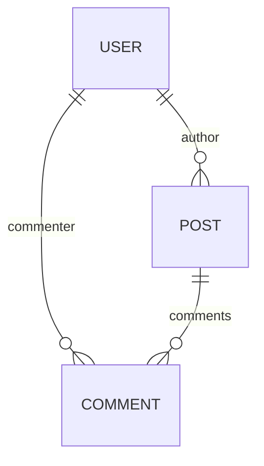

<!-- Generated by `yarn build:skills` from docs/rest/guides/relational-data.md (vue). Edit the source doc, not this file. -->

# Relational data

Declare one-to-one, many-to-one and many-to-many relationships between [entities][1] in [Entity.schema][3].

## Nesting

When an Entity defines [Entity.schema][3], normalization stores each nested entity separately. Denormalization joins
them again.

<details>

<summary>Diagram</summary>



 

</details>

```typescript title="resources/Post"
import { Collection, Entity, resource } from '@data-client/rest';

export class User extends Entity {
  id = '';
  name = '';
}

export class Comment extends Entity {
  id = '';
  content = '';
  commenter = User.fromJS();

  static schema = {
    commenter: User,
  };
}

export class Post extends Entity {
  id = '';
  title = '';
  author = User.fromJS();
  comments: Comment[] = [];

  static schema = {
    author: User,
    comments: new Collection([Comment], {
      nestKey: (parent, key) => ({
        postId: parent.id,
      }),
    }),
  };
}

export const PostResource = resource({
  path: '/posts/:id',
  schema: Post,
});
```

```html title="PostPage.vue"
<script setup lang="ts">
  import { useSuspense } from '@data-client/vue';
  import { PostResource } from './resources/Post';

  const posts = await useSuspense(PostResource.getList);
</script>

<template>
  <div>
    <div v-for="post in posts" :key="post.pk()">
      <h4>{{ post.title }} - <cite>{{ post.author.name }}</cite></h4>
      <ul>
        <li v-for="comment in post.comments" :key="comment.pk()">
          {{ comment.content }}
          <small>
            <cite>
              {{ comment.commenter.name }}{{ comment.commenter ===
              post.author ? ' [OP]' : '' }}
            </cite>
          </small>
        </li>
      </ul>
    </div>
  </div>
</template>
```

## Client side joins

Nesting data when your endpoint doesn't.

When a response does not nest related data, declare the relationship in [Entity.schema](./Entity.vue.md#schema).
Data Client then joins the data on the client.

Here `/todos` only sends each todo's `userId`. [Entity.process()](./Entity.vue.md#process) points
`user` at that id, so every todo in the list carries its whole `User` from `/users`. A component
could look up one user by id itself; joining puts the user in the list, so the list can group by
person. Assign a task to someone else (pick their face),
and only its new `userId` goes to the server, yet it moves to that person's group.

```ts title="resources/User"
import { Entity, resource } from '@data-client/rest';

export class User extends Entity {
  id = 0;
  username = '';
  name = '';
  email = '';

  get profileImage() {
    return `https://i.pravatar.cc/64?img=${this.id + 4}`;
  }
}
export const UserResource = resource({
  urlPrefix: 'https://jsonplaceholder.typicode.com',
  path: '/users/:id',
  schema: User,
});
```

```ts title="resources/Todo" {7,11-17}
import { Entity, resource } from '@data-client/rest';
import { User } from './User';

export class Todo extends Entity {
  id = 0;
  userId = 0;
  user? = User.fromJS();
  title = '';
  completed = false;

  // the API sends userId; join it to the User with that id
  static schema = {
    user: User,
  };
  static process(todo) {
    return { ...todo, user: todo.userId };
  }
}
export const TodoResource = resource({
  urlPrefix: 'https://jsonplaceholder.typicode.com',
  path: '/todos/:id',
  schema: Todo,
  optimistic: true,
});
```

```html title="TodoItem.vue"
<script setup lang="ts">
  import { useController } from '@data-client/vue';
  import { TodoResource, type Todo } from './resources/Todo';
  import type { User } from './resources/User';

  const props = defineProps<{ todo: Todo; users: readonly User[] }>();
  const ctrl = useController();
  const update = (body: Partial<Todo>) =>
    ctrl.fetch(TodoResource.partialUpdate, { id: props.todo.id }, body);
  const toggle = e => update({ completed: e.currentTarget.checked });
  const assign = e => update({ userId: Number(e.currentTarget.value) });
</script>

<template>
  <div class="listItem">
    <label>
      <input type="checkbox" :checked="todo.completed" @change="toggle" />
      {{ todo.title }}
    </label>
    <label class="assignee">
      <Avatar v-if="todo.user" :src="todo.user.profileImage" :size="24" />
      <select
        :aria-label="`Owner of ${todo.title}`"
        :value="todo.userId"
        @change="assign"
      >
        <option v-for="user in users" :key="user.pk()" :value="user.id">
          {{ user.name }}
        </option>
      </select>
    </label>
  </div>
</template>
```

```html title="TodoGroup.vue"
<script setup lang="ts">
  import TodoItem from './TodoItem.vue';
  import type { Todo } from './resources/Todo';
  import type { User } from './resources/User';

  defineProps<{
    owner: User;
    todos: readonly Todo[];
    users: readonly User[];
  }>();
</script>

<template>
  <section>
    <h3>
      <Avatar :src="owner.profileImage" />
      {{ owner.name }}
    </h3>
    <div class="list">
      <TodoItem
        v-for="todo in todos"
        :key="todo.pk()"
        :todo="todo"
        :users="users"
      />
    </div>
  </section>
</template>
```

```html title="TodoList.vue" {12-16}
<script setup lang="ts">
  import { computed } from 'vue';
  import { useFetch, useSuspense } from '@data-client/vue';
  import { TodoResource } from './resources/Todo';
  import { UserResource } from './resources/User';
  import TodoGroup from './TodoGroup.vue';

  // both requests start at once
  useFetch(UserResource.getList);
  const todos = await useSuspense(TodoResource.getList);
  const users = await useSuspense(UserResource.getList);
  // every todo carries its user, the same object as in users, so
  // the list can group by it
  const byOwner = computed(() =>
    Map.groupBy(todos.value, todo => todo.user),
  );
</script>

<template>
  <TodoGroup
    v-for="user in users"
    :key="user.pk()"
    :owner="user"
    :todos="byOwner.get(user) ?? []"
    :users="users"
  />
</template>
```

### Key-based joins

When related entities come from separate fetches, use [Entity.process()](./Entity.vue.md#process) to add a key that
references the other Entity. Use this when:

- Related data comes from different API endpoints.
- You do not want to fetch nested data you do not need.
- The relationship is optional or depends on context.

```typescript
import { Entity, resource } from '@data-client/rest';

class Stats extends Entity {
  product_id = '';
  volume = 0;
  price = 0;

  pk() {
    return this.product_id;
  }

  static key = 'Stats';
}

class Currency extends Entity {
  id = '';
  name = '';
  // Default value allows Currency to exist without Stats loaded
  stats = Stats.fromJS();

  pk() {
    return this.id;
  }

  static key = 'Currency';

  // Create a reference key that links to Stats entity
  static process(input: any, parent: any, key: string, args: any[]) {
    // The stats field becomes a reference to Stats with pk `${id}-USD`
    return { ...input, stats: `${input.id}-USD` };
  }

  static schema = {
    // Stats will be looked up by the key from process()
    stats: Stats,
  };
}
```

After both `CurrencyResource.getList` and `StatsResource.getList` resolve, `stats` is the matching `Stats` entity.

### Crypto price example

This list sorts `Currencies` by trade volume. Only the `Stats` Entity has trade volume, and the
`CurrencyResource.getList` response does not include it. So the page also fetches `StatsResource.getList`, and
`Currency`'s [Entity.schema](./Entity.vue.md#schema) adds `Stats` to each `Currency`. The list can then sort:

```ts
entries.sort((a, b) => {
  return b?.stats?.volume_usd - a?.stats?.volume_usd;
});
```

Example app: [coin-app](https://github.com/reactive/data-client/tree/master/examples/coin-app) ([`src/pages/Home/CurrencyList.tsx`](https://github.com/reactive/data-client/blob/master/examples/coin-app/src/pages/Home/CurrencyList.tsx), [`src/resources/Stats.ts`](https://github.com/reactive/data-client/blob/master/examples/coin-app/src/resources/Stats.ts), [`src/resources/Currency.ts`](https://github.com/reactive/data-client/blob/master/examples/coin-app/src/resources/Currency.ts))

## Reverse lookups

Nesting data when your endpoint doesn't (part 2).

A response nests in one direction only. Here `/posts` nests each post's `author`, but no response lists a user's
posts. A reverse lookup builds that list on the client, so one fetch of `/posts` also gives each user's `posts`
and `comments`. Click a name to see them.

Files with a `route` are pages mounted at that path, with its params as props (vue-router `props: true`).

```typescript title="resources/Post" {9-20,22-30}
import { Entity, resource, type Schema } from '@data-client/rest';

export class User extends Entity {
  id = '';
  name = '';
  posts: Post[] = [];
  comments: Comment[] = [];

  static process(value, parent, key) {
    switch (key) {
      // nested as a post's author: that post is one of this user's
      case 'author':
        return { ...value, posts: [parent.id] };
      // nested as a comment's commenter
      case 'commenter':
        return { ...value, comments: [parent.id] };
      default:
        return { ...value };
    }
  }

  // one user is nested many times, each with one post or comment
  static merge(existing, incoming) {
    return {
      ...existing,
      ...incoming,
      posts: union(existing.posts, incoming.posts),
      comments: union(existing.comments, incoming.comments),
    };
  }
}

/** Adds the ids not listed yet, so a refetch does not add the same ones again.
 * Does not remove repeats within `incoming`: here each copy of a user brings one id. */
function union(existing: string[] = [], incoming: string[] = []) {
  const added = incoming.filter(id => !existing.includes(id));
  return added.length ? [...existing, ...added] : existing;
}

export class Comment extends Entity {
  id = '';
  content = '';
  commenter = User.fromJS();
  post = Post.fromJS();

  static schema: Record<string, Schema> = {
    commenter: User,
  };

  static process(value, parent, key) {
    // only a post's `comments` tells which post this comment is on
    return key === 'comments' ?
        { ...value, post: parent.id }
      : { ...value };
  }
}

export class Post extends Entity {
  id = '';
  title = '';
  author = User.fromJS();
  comments: Comment[] = [];

  static schema = {
    author: User,
    comments: [Comment],
  };
}

// the classes refer to each other, so set these after all are defined
User.schema = {
  posts: [Post],
  comments: [Comment],
};
Comment.schema = {
  ...Comment.schema,
  post: Post,
};

export const PostResource = resource({
  path: '/posts/:id',
  schema: Post,
});
export const UserResource = resource({
  path: '/users/:id',
  schema: User,
});
```

```html title="UserPage.vue" route="/users/:id"
<script setup lang="ts">
  import { useSuspense } from '@data-client/vue';
  import { UserResource } from './resources/Post';

  const props = defineProps<{ id: string }>();
  const user = await useSuspense(UserResource.get, () => ({
    id: props.id,
  }));
</script>

<template>
  <div>
    <h4>{{ user.name }}</h4>
    <template v-if="user.posts.length">
      <h5>Posts</h5>
      <ul>
        <li v-for="post in user.posts" :key="post.pk()">
          {{ post.title }}
        </li>
      </ul>
    </template>
    <h5>Comments</h5>
    <ul>
      <li v-for="comment in user.comments" :key="comment.pk()">
        {{ comment.content }}
      </li>
    </ul>
  </div>
</template>
```

```html title="PostPage.vue" route="/"
<script setup lang="ts">
  import { useSuspense } from '@data-client/vue';
  import { PostResource } from './resources/Post';

  const posts = await useSuspense(PostResource.getList);
</script>

<template>
  <div>
    <div v-for="post in posts" :key="post.pk()">
      <h4>
        {{ post.title }} -
        <RouterLink :to="`/users/${post.author.id}`">
          {{ post.author.name }}
        </RouterLink>
      </h4>
      <ul>
        <li v-for="comment in post.comments" :key="comment.pk()">
          {{ comment.content }}
          <small>
            <RouterLink :to="`/users/${comment.commenter.id}`">
              {{ comment.commenter.name }}{{ comment.commenter ===
              post.author ? ' [OP]' : '' }}
            </RouterLink>
          </small>
        </li>
      </ul>
    </div>
  </div>
</template>
```

`User` overrides two methods. [process()](./Entity.vue.md#process) runs for each nested user, with the `parent`
and `key` that nest it. [merge()](./Entity.vue.md#merge) joins the copies of one user:

```ts
// post 1 nests Paul as its `author`, so process() adds that post's id
User.process({ id: '123', name: 'Paul' }, post1, 'author');
// => { id: '123', name: 'Paul', posts: ['1'] }

// post 2 nests Paul too, so merge() joins both copies
User.merge(
  { id: '123', name: 'Paul', posts: ['1'] },
  { id: '123', name: 'Paul', posts: ['2'] },
);
// => { id: '123', name: 'Paul', posts: ['1', '2'] }
```

Without the override, `merge()` keeps only the last copy's `posts`. `Comment.process()` sets `comment.post` in
the same way.

### When to use

Nest a list in an entity when the data must have it, not only the screen. For example, a
[Query](./Query.vue.md) that sorts users by `user.posts` reads it before any component renders. Then choose by
where the list is:

- **A response has the list** (the user response nests it, or `GET /posts?author=123` returns it): use a
  [Collection](./Collection.vue.md) with [nestKey](./Collection.vue.md#nestKey). Each fetch replaces the list, and
  [push](./Collection.vue.md#push), [remove](./Collection.vue.md#remove) and [move](./Collection.vue.md#move)
  keep it current. It needs no custom `merge()`.
- **No response has the list**: use a reverse lookup.

### After a mutation

- **Create.** A new post or comment runs the same `process()`, so it joins the list. This is true for
  [push](https://dataclient.io/rest/api/RestEndpoint#push) and for each new page.
- **Delete.** A deleted post or comment leaves the list. A list skips entities that are not in the store.
- **Move.** A post with a new `author` joins the new author's `posts`, and stays in the old author's: `merge()`
  only adds ids. When a relationship can move, compute the list where it is read, with a
  [Query](./Query.vue.md) over [All](./All.vue.md).

### Circular dependencies

JavaScript does not allow circular imports or circular class definitions. So for [Entities][1] that reference each
other, define the [schema][3] after the class definitions.

```typescript title="resources/Post"
import { Entity } from '@data-client/rest';
import { User } from './User';

export class Post extends Entity {
  id = '';
  title = '';
  author = User.fromJS();

  static schema = {
    author: User,
  };
}

// both User and Post are now defined, so it's okay to refer to both of them
User.schema = {
  // ensure we keep the 'createdAt' member
  ...User.schema,
  posts: [Post],
};
```

```typescript title="resources/User"
import { Entity, type Schema } from '@data-client/rest';
import { Temporal } from 'temporal-polyfill';
// import only the type: importing the class would be a circular import,
// so resources/Post sets User.schema above
import type { Post } from './Post';

export class User extends Entity {
  id = '';
  name = '';
  posts: Post[] = [];
  createdAt = Temporal.Instant.fromEpochMilliseconds(0);

  static schema: Record<string, Schema> = {
    createdAt: Temporal.Instant.from,
  };
}
```

> **Tip**
>
> For bidirectional relationships that don't need eager denormalization,
> [Lazy](./Lazy.vue.md) defers resolution and lets you resolve on demand
> via [useQuery](https://dataclient.io/vue/api/useQuery), avoiding deep recursion and improving
> memoization isolation.

[1]: ./Entity.md

[2]: https://dataclient.io/vue/api/useCache

[3]: ./Entity.md#schema
