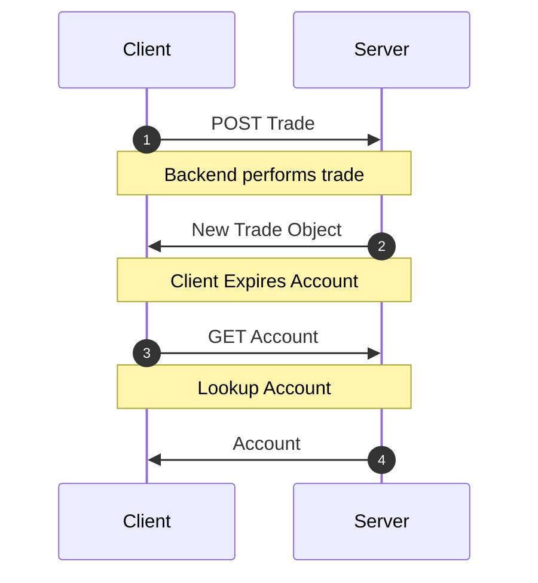
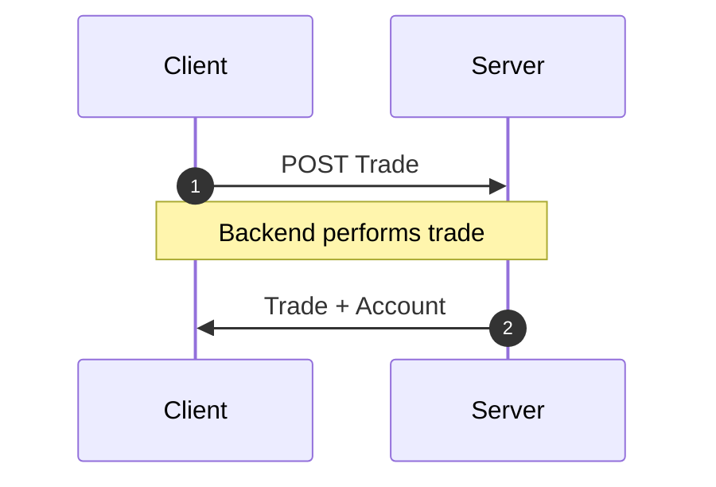

<!-- Generated by `yarn build:skills` from docs/rest/guides/side-effects.md (react). Edit the source doc, not this file. -->

# Mutation Side-Effects

When mutations update more than one resource, it may be tempting to simply
[expire all](https://dataclient.io/docs/api/Controller#expireAll) the other resources.

However, we can still achieve the high performance atomic mutations if we
simply bundle _all_ updated resources in the mutation response, we can
avoid this slow networking cascade.

Network Cascade



&#x20;Response Bundling



## Example

You're running a crypto trading platform called `dogebase`. Every time
a user creates a trade, you need to update some balance information
in their accounts object. So upon `POST`ing to the `/trade/` endpoint,
you nest both the updated accounts object along with the trade you just
created.

```json title="POST /trade/"
{
  "trade": {
    "id": 2893232,
    "user": 1,
    "amount": "50.2335324",
    "coin": "doge",
    "created_at": ""
  },
  "account": {
    "id": 899,
    "user": 1,
    "balance": "1337.00",
    "coin_value": "3.50"
  }
}
```

To handle this, we just need to update the `schema` to include the custom
endpoint.

```typescript title="resources/Trade.ts"
import { resource, Entity } from '@data-client/rest';
import { Account } from './Account';

export class Trade extends Entity {
  id = 0;
  user = 0;
  amount = '0';
  coin = '';
  created_at = '';
}

export const TradeResource = resource({
  path: '/trade/:id',
  schema: Trade,
}).extend(Base => ({
  create: Base.getList.push.extend({
    schema: {
      trade: Base.getList.push.schema,
      account: Account,
    },
  }),
}));
```

Now if when we use the [getList.push](https://dataclient.io/rest/api/resource#push) Endpoint generator method,
we will be happy knowing both the trade and account information will
be updated in the cache after the `POST` request is complete.

```typescript title="CreateTrade.tsx"
export default function CreateTrade() {
  const ctrl = useController();
  const handleSubmit = payload =>
    ctrl.fetch(TradeResource.create, payload);
  //...
}
```

> **Note**
>
> Feel free to create completely new [RestEndpoint](https://dataclient.io/rest/api/RestEndpoint) methods for any custom
> endpoints you have. This endpoint tells `Reactive Data Client` how to process any
> request.

## Counts and other server-computed fields {#server-computed}

Some fields are computed by the server from other data, like a post's `commentCount` or an order's `total`. Creating
or deleting a comment changes the post's count, but the comment endpoint's response holds only the comment. Update
the parent `Post` through its Entity, and every list and detail view that shows it updates.

```typescript title="resources/Post.ts"
export class Post extends Entity {
  id = 0;
  title = '';
  commentCount = 0;
}
export const PostResource = resource({ path: '/posts/:id', schema: Post });
```

### When the API can include the parent

Return the parent in the comment's create and delete responses, and add it to those endpoints' schemas. This needs no
extra request.

```typescript title="resources/Comment.ts"
export const CommentResource = resource({
  path: '/posts/:postId/comments/:id',
  schema: Comment,
}).extend(Base => ({
  // response: { comment: {...}, post: { id, commentCount } }
  create: Base.getList.push.extend({
    schema: { comment: Base.getList.push.schema, post: Post },
  }),
  // response: { comment: { id }, post: { id, commentCount } }
  delete: Base.delete.extend({
    schema: { comment: Base.delete.schema, post: Post },
  }),
}));
```

The real response holds the post, so an [optimistic response](https://dataclient.io/rest/guides/optimistic-updates) can include it too:
`post: { id: postId, commentCount: post.commentCount + 1 }`, with `post` read by `snap.get(Post, { id: postId })`.

### When the API can't change

After the mutation resolves, fetch the parent's own endpoint, in the code that calls the mutation.

```typescript
const ctrl = useController();
const addComment = async (postId: number, body: Partial<Comment>) => {
  await ctrl.fetch(CommentResource.getList.push, { postId }, body);
  ctrl.fetch(PostResource.get, { id: postId });
};
```

That one request updates the `Post` entity, so lists that show the post update too, without a refetch. Do not add the
post to an optimistic response here: the real response lacks it, so the count jumps back until the refetch arrives.
When the parent has no single-item endpoint, call [`ctrl.expireAll(PostResource.getList)`](https://dataclient.io/docs/api/Controller#expireAll)
instead.

### Avoid

- Passing the count, or an `onCountChange` callback, between components. Every view reads the count from the same
  `Post` entity.
- `invalidateAll()` or `resetEntireStore()`. They throw away cached data and show loading states again.
- Counting the loaded comments. With pagination, that is not the total.
