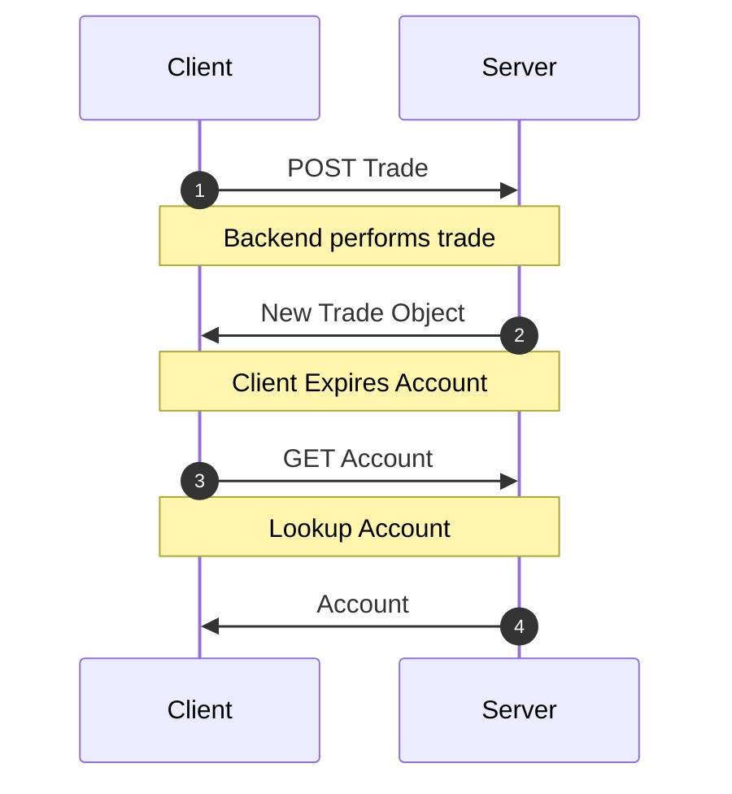
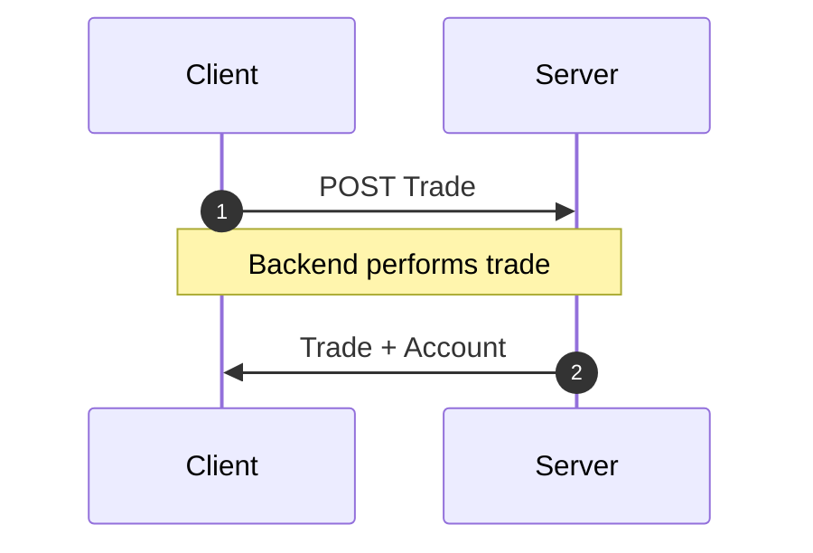

<!-- Generated by `yarn build:skills` from docs/rest/guides/side-effects.md (react). Edit the source doc, not this file. -->

# Mutation Side-Effects

When a mutation changes more than one resource, do not [expire](https://dataclient.io/docs/api/Controller#expireAll) the other
resources. Expiring them causes a slow cascade of refetches. Instead, include _all_ changed resources in the mutation
response. The mutation stays atomic and needs one request.

Network Cascade



&#x20;Response Bundling



## Example

A crypto trading platform updates the user's account balance with each trade. So `POST /trade/` returns the new
trade and the updated account.

```json title="POST /trade/"
{
  "trade": {
    "id": 2893232,
    "user": 1,
    "amount": "50.2335324",
    "coin": "doge",
    "created_at": ""
  },
  "account": {
    "id": 899,
    "user": 1,
    "balance": "1337.00",
    "coin_value": "3.50"
  }
}
```

Add the account to the endpoint's `schema`.

```typescript title="resources/Trade.ts"
import { resource, Entity } from '@data-client/rest';
import { Account } from './Account';

export class Trade extends Entity {
  id = 0;
  user = 0;
  amount = '0';
  coin = '';
  created_at = '';
}

export const TradeResource = resource({
  path: '/trade/:id',
  schema: Trade,
}).extend(Base => ({
  createTrade: Base.getList.push.extend({
    schema: {
      trade: Base.getList.push.schema,
      account: Account,
    },
  }),
}));
```

`createTrade` extends [getList.push](https://dataclient.io/rest/api/resource#push). When the `POST` completes, the store updates both the new
trade and the account.

```typescript title="CreateTrade.tsx"
export default function CreateTrade() {
  const ctrl = useController();
  const handleSubmit = payload =>
    ctrl.fetch(TradeResource.createTrade, {}, payload);
  //...
}
```

> **Note**
>
> Define a new [RestEndpoint](https://dataclient.io/rest/api/RestEndpoint) for any custom endpoint. Its `schema` tells Data Client how to
> store the response.
