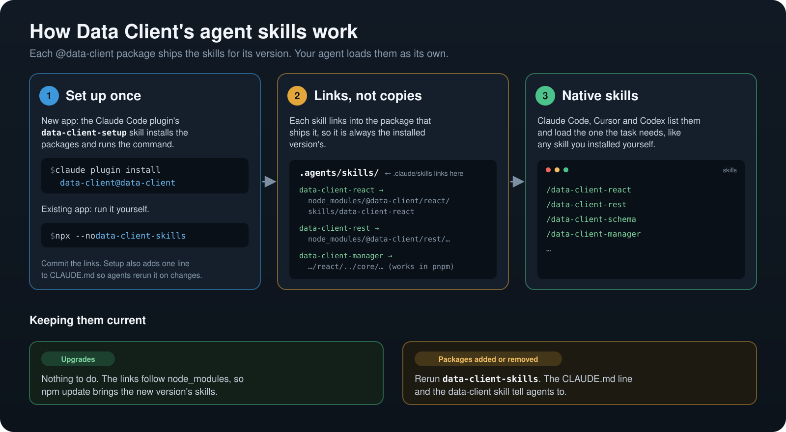

# Claude Code, Codex and Cursor plugin

Everything that publishes Data Client's agent plugin lives in this directory, Cursor's copy included. The plugin only starts new apps: it
carries the `data-client` router and `data-client-setup` skills and no hooks. Every other skill ships in the
`@data-client/*` package it covers (`scripts/pack-skills.mjs`), and `data-client-skills` (a bin on
endpoint, rest, graphql, react and vue, implemented in `packages/core/agents/` and copied into each at pack time) links those into the project's
`.agents/skills` (with `.claude/skills` linking to it), where Claude Code, Cursor and Codex load them as their own.

| File               | What                                                                                                                                                                                                                                                                            |
| ------------------ | ------------------------------------------------------------------------------------------------------------------------------------------------------------------------------------------------------------------------------------------------------------------------------- |
| `marketplace.json` | The marketplace Claude Code reads (`claude plugin marketplace add reactive/data-client`). `data-client` is the plugin; `core`, `react`, `vue` and `migrations` are old names kept as copies so existing installs keep updating (`plans/next-breaking-release.md` removes them). |
| `plugin-dir.mjs`   | Writes the manifests that make `.agents/skills` a self-contained copy of the plugin, for Cursor and Claude's plugin directory (see below).                                                                                                                                      |
| `openai-zip.mjs`   | Packs the plugin as the ZIP OpenAI's plugin directory uploads (see below).                                                                                                                                                                                                      |
| `*.test.mjs`       | `node --test '.claude-plugin/*.test.mjs'`: `marketplace.json` and the plugin directory copies against the repo.                                                                                                                                                                 |

## Codex and Cursor

Codex reads `marketplace.json` as is (`codex plugin add data-client@data-client`). Cursor plugins can't reach files outside their folder, so `plugin-dir.mjs` writes a copy of the `data-client` entry rooted at `.agents/skills` (`.cursor-plugin/marketplace.json`, `.agents/skills/.cursor-plugin/plugin.json`, and the `.agents/skills/.claude-plugin/plugin.json` Claude's directory reads), and `marketplace.test.mjs` fails when they drift. The marketplace source is a `git-subdir` pinned to `master`: Cursor's `/add-plugin` otherwise checks out `main`, which this repo does not have. Cursor's published `marketplace.schema.json` still types `source` as a string; the object form comes from its plugin docs, and the Cursor agent's install resolved it.

## Public listings

Each listing reads the plugin from `.agents/skills`, whose `README.md` is the listing's description.

- **Claude's plugin directory** ([claude.ai/directory/manage](https://claude.ai/directory/manage), plugin path
  `.agents/skills`, branch `master`) reads `.agents/skills/.claude-plugin/plugin.json`, written without a `version` so
  every commit is an update. Check it with `claude plugin validate ./.agents/skills`. The
  directory refuses repositories whose GitHub archive passes 50 MiB.
- **Cursor Marketplace** ([cursor.com/marketplace/publish](https://cursor.com/marketplace/publish)) reviews the
  repository link and `.cursor-plugin/marketplace.json`.
- **OpenAI's plugin directory** (ChatGPT and Codex) takes an uploaded ZIP, not the repository:
  `node .claude-plugin/openai-zip.mjs` writes `data-client-plugin.zip`, versioned by its build time. Upload a new one whenever the plugin's skills
  change.

## What it reads from the rest of the repo

- `.agents/skills/data-client/` and `.agents/skills/data-client-setup/`: the two skills the plugin carries.
- `.agents/skill-packages.json`: which package ships which skill, so the test can check the plugin's skills also ship
  in a package.

## CI

The `agent-rules` workflow runs these tests and the `data-client-skills` tests (`packages/core/agents/*.test.mjs`), with
no install. Its `paths` cover this directory and the inputs above, and `marketplace.test.mjs` fails when the old names
drift from `data-client` or a plugin skill goes missing or stops shipping in a package. `plugin-dir.test.mjs` checks the skill names, logo and README the plugin directory listings read.
