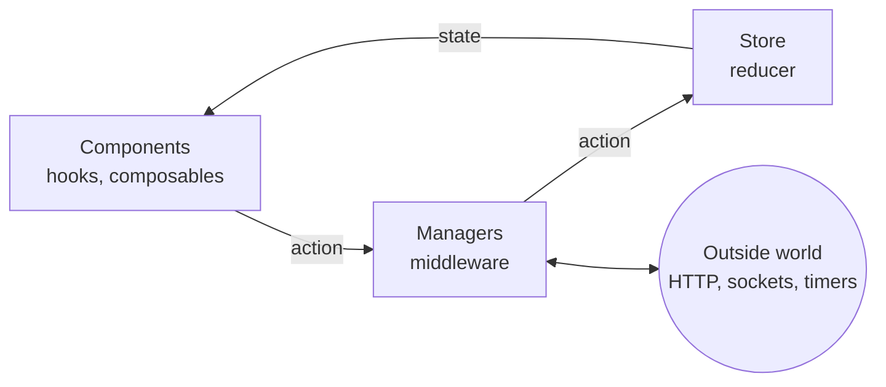

# Architecture

Reactive Data Client keeps three layers apart. Each layer changes for its own reason, so each one can be used, tested
and replaced without the others.

| Layer | Made of | Says | Packages |
|---|---|---|---|
| **API definition** | [Schemas](https://dataclient.io/rest/api/schema) | The declarative data model (nouns): identity, shape, relationships | `endpoint`, `normalizr` |
| | [Endpoints](https://dataclient.io/rest/api/Endpoint) | The methods on that data (verbs): how to get it and change it | `endpoint`, `rest`, `graphql` |
| **Runtime in the view framework** | Hooks (React), composables (Vue) | Data binding: which data a component needs, in the component that renders it | `react`, `vue` |
| **Runtime outside the view framework** | [Managers](https://dataclient.io/docs/api/Manager) | Global side effects: the bridge from the store to the rest of the world (network, sockets, timers, other tabs, logging) | `core` |

Both runtime layers work on one central store (`core`). [Controller](https://dataclient.io/docs/api/Controller) is
their type-safe, imperative access to it.

## Data flow

The store is [flux](https://facebookarchive.github.io/flux/docs/in-depth-overview/): unidirectional data flow.

1. Every change is an [action](https://dataclient.io/docs/api/Actions). Components and Managers dispatch actions
   through Controller: `ctrl.fetch()`, `ctrl.set()`, `ctrl.invalidate()`.
2. Each action passes through every Manager's `middleware`, which works like
   [redux middleware](https://redux.js.org/tutorials/fundamentals/part-4-store#middleware).
3. The reducer computes the next state. It writes data through the action's schema: each Entity's `pk()`, `process()`
   and `merge()` decide what the store keeps.
4. Hooks and composables read the state through the schema, and their components render again.

The reducer is pure, so Managers orchestrate the store's side effects. Fetching is one: `NetworkManager` sees a fetch
action, calls the endpoint, and dispatches the response. A Manager for a websocket does the same with each message.
[Managers and Middleware](https://dataclient.io/docs/concepts/managers) has the full flow.

## Where a concern goes

| The concern | Layer | Examples |
|---|---|---|
| The data model. Also a shape that no response has: joined, derived, or accumulated from responses | Schema | `pk()`, `static schema`, `process()`, `merge()`, `Collection`, `Query` |
| How to get or change data, and that method's policy | Endpoint | `path`, `method`, `dataExpiryLength`, `pollFrequency`, `getOptimisticResponse()` |
| A component's data dependencies, and what the user sees while they load or fail | Hook or composable | `useSuspense()`, `useLive()`, `useQuery()`, `useController()` |
| A global side effect, or an event from outside the app | Manager | `NetworkManager`, a websocket, error reporting, refetch on focus |

## Rules that keep the layers apart

- **One definition, many uses.** API definitions depend on no runtime: `endpoint`, `rest` and `graphql` import neither
  `core` nor a view framework. One definition serves React, Vue, a server, a test and `ctrl.fetch()`.
- **Data enters the store through a schema.** A response, `ctrl.set()` and a Manager's delivery take the same path. So
  a Manager moves data and never defines it.
- **State changes only by an action.** Managers and components dispatch through Controller. Nothing else writes to the
  store.
- **The store is the only cache.** Hooks and composables get the data and its expiry status from the store through
  Controller. From them a hook decides when to fetch and what its component shows meanwhile. So the React and Vue
  packages share one store and Controller.
- **A component binds its data and does not build it.** It passes an endpoint or a `Query` to a hook, in the component
  that renders the data. It does not build a request or join data.

To place a new option or behavior in `packages/*`, see skill "interface-design".
