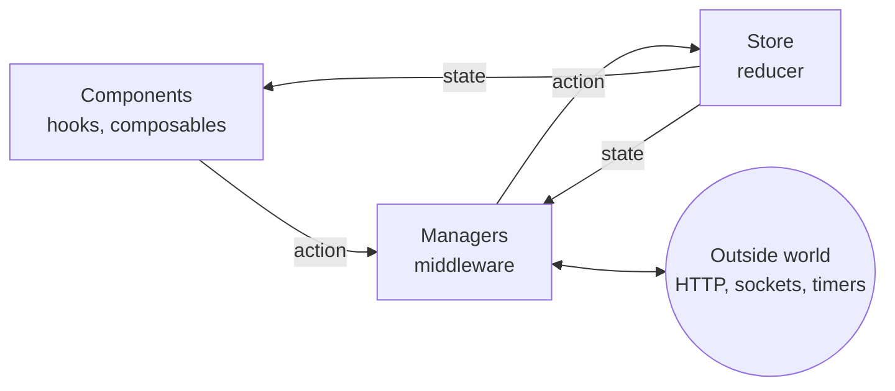

# Architecture

Reactive Data Client keeps three layers apart. Each layer changes for its own reason, so each one can be used, tested
and replaced without the others.

| Layer | Made of | Says | Packages |
|---|---|---|---|
| **Data definition** | [Schemas](https://dataclient.io/rest/api/schema) | The data model (nouns): identity, shape, relationships | `endpoint` |
| | [Endpoints](https://dataclient.io/rest/api/Endpoint), grouped in [resources](https://dataclient.io/rest/api/resource) | The API definition (verbs): the operations on that data model, to get it and change it | `endpoint`, `rest`, `graphql` |
| **Runtime in the view framework** | Hooks (React), composables (Vue) | Data binding: which data a component needs, in the component that renders it | `react`, `vue` |
| **Runtime outside the view framework** | [Managers](https://dataclient.io/docs/api/Manager) | Global side effects: the bridge from the store to the rest of the world (network, sockets, timers, other tabs, logging) | `core` |

Both runtime layers work on one central store. `core` holds its reducer, its actions and
[Controller](https://dataclient.io/docs/api/Controller), the type-safe, imperative access to it. `core` reads and
writes data with `normalizr`, which knows a schema only by its interface. So the runtime imports no data definition
package.

## Data flow

The store is [flux](https://facebookarchive.github.io/flux/docs/in-depth-overview/): unidirectional data flow.

1. Every change is an [action](https://dataclient.io/docs/api/Actions). Components and Managers dispatch actions
   through Controller: `ctrl.fetch()`, `ctrl.set()`, `ctrl.invalidate()`.
2. Actions pass through the Managers' `middleware` in order, as in
   [redux middleware](https://redux.js.org/tutorials/fundamentals/part-4-store#middleware). A Manager can consume an
   action: [NetworkManager](https://dataclient.io/docs/api/NetworkManager) consumes a fetch, and dispatches the
   response as a new action.
3. The reducer computes the next state. It writes data through the action's schema: each Entity's `pk()`, `process()`
   and `merge()` decide what the store keeps.
4. Hooks and composables read the state through the schema, and their components render again.

The reducer has no side effects, and the schema methods and `getOptimisticResponse()` that it calls must have none
either. So Managers orchestrate the store's side effects. Fetching is one: `NetworkManager` calls the endpoint and
dispatches the response. A Manager for a websocket does the same with each message.
[Managers and Middleware](https://dataclient.io/docs/concepts/managers) has the full flow.

## Where a concern goes

| The concern | Goes in | Examples |
|---|---|---|
| The data model. Also a shape that no response has: joined, derived, or accumulated from responses | Schema | `pk()`, `static schema`, `process()`, `merge()`, `Collection`, `Query` |
| How to get or change data, and that method's policy | Endpoint | `path`, `method`, `dataExpiryLength`, `pollFrequency`, `getOptimisticResponse()` |
| A component's data dependencies, and what the user sees while they load or fail | Hook or composable | `useSuspense()`, `useLive()`, `useQuery()`, `useController()` |
| A global side effect, or an event from outside the app | Manager | `NetworkManager`, a websocket, error reporting, refetch on focus |
| How an action becomes state, and how state becomes data, an expiry status or an error | Store: reducer and Controller | `ctrl.fetch()`, `ctrl.getResponseMeta()`, `ExpiryStatus` |

## Rules that keep the layers apart

- **One definition, many uses.** Data definitions depend on no runtime: `endpoint`, `rest` and `graphql` import neither
  `core` nor a view framework. The runtime depends only on their interfaces. One definition serves React, Vue, a
  server, a test and `ctrl.fetch()`.
- **Data enters the store through its schema.** The reducer normalizes a response, `ctrl.setResponse()` and
  `ctrl.set()` alike. So a Manager moves data and never defines it.
- **State changes only by an action.** Managers and components dispatch through Controller. Nothing else writes to the
  store.
- **The store is the single source of truth.** Hooks and composables get the data and its expiry status from the store
  through Controller. From them a hook decides when to fetch and what its component shows meanwhile. So the React and
  Vue packages only bind: both run the reducer and Controller of `core`.
- **Data co-location.** A component binds its data where it renders it: it passes an endpoint, or a schema such as a
  `Query`, to a hook. It does not build a request or join data.

To place a new option or behavior in `packages/*`, see skill "interface-design".
