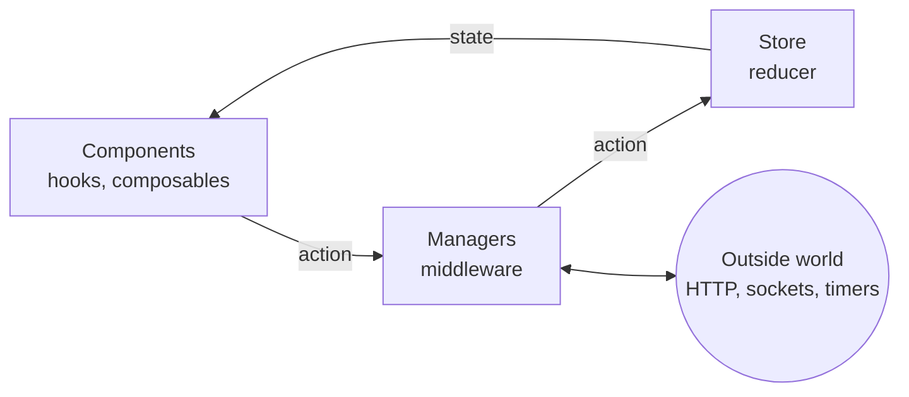

# Architecture

Reactive Data Client keeps three layers apart. Each layer changes for its own reason, so each one can be used, tested
and replaced without the others.

| Layer | Made of | Says | Packages |
|---|---|---|---|
| **Data definition** | [Schemas](https://dataclient.io/rest/api/schema) | What the data is (nouns): identity, shape, relationships | `endpoint`, `normalizr` |
| | [Endpoints](https://dataclient.io/rest/api/Endpoint) | The operations on that data (verbs): how to get it and change it | `endpoint`, `rest`, `graphql` |
| **Runtime in the view framework** | Hooks (React), composables (Vue) | Which data a component needs | `react`, `vue` |
| **Runtime outside the view framework** | [Managers](https://dataclient.io/docs/api/Manager) | How the store meets the rest of the world: network, sockets, timers, other tabs, logging | `core` |

Both runtime layers work on one store (`core`). [Controller](https://dataclient.io/docs/api/Controller) is their one
interface to it.

## Data flow

The store follows [flux](https://facebookarchive.github.io/flux/docs/in-depth-overview/): data flows one way.

1. Every change is an [action](https://dataclient.io/docs/api/Actions). Components and Managers dispatch actions
   through Controller: `ctrl.fetch()`, `ctrl.set()`, `ctrl.invalidate()`.
2. Each action passes through every Manager's `middleware`, which works like
   [redux middleware](https://redux.js.org/tutorials/fundamentals/part-4-store#middleware).
3. The reducer computes the next state. It writes data through the action's schema: each Entity's `pk()`, `process()`
   and `merge()` decide what the store keeps.
4. Hooks and composables read the state through the schema, and their components render again.

The reducer is pure, so the store's side effects are in Managers. Fetching is one: `NetworkManager` sees a fetch action, calls
the endpoint, and dispatches the response. A Manager for a websocket does the same with each message.
[Managers and Middleware](https://dataclient.io/docs/concepts/managers) has the full flow.

## Where a concern goes

| The concern | Layer | Examples |
|---|---|---|
| What the data is. Also a shape that no response has: joined, derived, or accumulated from responses | Schema | `pk()`, `static schema`, `process()`, `merge()`, `Collection`, `Query` |
| How to get or change data, and the policy of that operation | Endpoint | `path`, `method`, `dataExpiryLength`, `pollFrequency`, `getOptimisticResponse()` |
| Which data a component needs, and what the user sees while it loads or fails | Hook or composable | `useSuspense()`, `useLive()`, `useQuery()`, `useController()` |
| A side effect, or an event from outside the app | Manager | `NetworkManager`, a websocket, error reporting, refetch on focus |

## Rules that keep the layers apart

- **Data definitions depend on no runtime.** `endpoint`, `rest` and `graphql` import neither `core` nor a view
  framework. One definition serves React, Vue, a server, a test and `ctrl.fetch()`.
- **Data enters the store through a schema.** A response, `ctrl.set()` and a Manager's delivery take the same path. So
  a Manager moves data and never defines it.
- **State changes only by an action.** Managers and components dispatch through Controller. Nothing else writes to the
  store.
- **Hooks and composables hold no cache logic.** They read the store and dispatch through Controller, so React and Vue
  share one runtime.
- **A component names its data and does not build it.** It passes an endpoint or a `Query` to a hook. It does not
  build a request or join data.

To place a new option or behavior in `packages/*`, see skill "interface-design".
