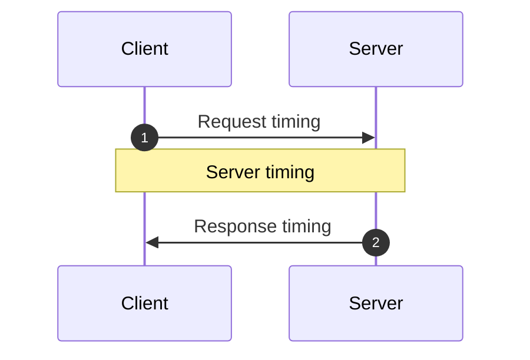

<head>
  <meta name="docsearch:pagerank" content="40"/>
</head>

import FrameworkPlayground from '@site/src/components/FrameworkPlayground';
import {RestEndpoint} from '@data-client/rest';
import { todoFixtures } from '@site/src/fixtures/todos';
import OptimisticTransform from '../shared/\_optimisticTransform.mdx';
import OptimisticRace from '@site/src/components/OptimisticRace';

export const timingDemo = [
  { delay: 800, store: 'open' },
  { delay: 1000, click: 'button.upvote' },
  { delay: 250, click: 'button.upvote' },
  { delay: 250, click: 'button.upvote' },
  { delay: 250, click: 'button.upvote' },
  // past the slowest increment response (the fixture's 4.7s), so the
  // timeline holds every response
  { wait: 5000 },
  { click: { in: 'store', selector: 'button[aria-label="Diff"]' } },
  // the first action (the count's load), then on through each change, time
  // to read each diff: 8 = the 4 clicks' optimistic updates and responses
  {
    click: {
      in: 'store',
      selector: '[role="group"][aria-label^="Scrubber"] button[data-id]',
    },
  },
  ...Array.from({ length: 8 }, () => ({
    delay: 1500,
    click: { in: 'store', selector: 'button[aria-label="Next change"]' },
  })),
  // Store → Code: back to the code that did it
  { delay: 2000, store: 'close' },
];

# Optimistic Updates

Optimistic updates enable highly responsive and fast interfaces by avoiding network wait times.
An update is optimistic by assuming the network is successful.

Doing this amplifies and creates new race conditions; thankfully Reactive Data Client automatically
handles these for you.

## Resources

[resource()](../api/resource.md) can be configured by setting [optimistic: true](../api/resource.md#optimistic).

<FrameworkPlayground defaultOpen="n" row fixtures={todoFixtures}>

```ts title="TodoResource" {16}
import { Entity, resource } from '@data-client/rest';

export class Todo extends Entity {
  id = 0;
  userId = 0;
  title = '';
  completed = false;

  static key = 'Todo';
}
export const TodoResource = resource({
  urlPrefix: 'https://jsonplaceholder.typicode.com',
  path: '/todos/:id',
  searchParams: {} as { userId?: string | number } | undefined,
  schema: Todo,
  optimistic: true,
});
```

:::react

```tsx title="TodoItem" collapsed
import { useController } from '@data-client/react';
import { TodoResource, type Todo } from './TodoResource';

export default function TodoItem({ todo }: { todo: Todo }) {
  const ctrl = useController();
  const handleChange = e =>
    ctrl.fetch(
      TodoResource.partialUpdate,
      { id: todo.id },
      { completed: e.currentTarget.checked },
    );
  const handleDelete = () =>
    ctrl.fetch(TodoResource.delete, {
      id: todo.id,
    });
  return (
    <div className="listItem nogap">
      <label>
        <input
          type="checkbox"
          checked={todo.completed}
          onChange={handleChange}
        />
        {todo.completed ? <s>{todo.title}</s> : todo.title}
      </label>
      <CancelButton onClick={handleDelete} />
    </div>
  );
}
```

```tsx title="CreateTodo" collapsed
import { useController } from '@data-client/react';
import { TodoResource } from './TodoResource';

export default function CreateTodo({ userId }: { userId: number }) {
  const ctrl = useController();
  const handleKeyDown = async e => {
    if (e.key === 'Enter') {
      ctrl.fetch(TodoResource.getList.push, {
        userId,
        title: e.currentTarget.value,
      });
      e.currentTarget.value = '';
    }
  };
  return (
    <div className="listItem nogap">
      <label>
        <input type="checkbox" name="new" checked={false} disabled />
        <TextInput size="small" onKeyDown={handleKeyDown} />
      </label>
      <CancelButton />
    </div>
  );
}
```

```tsx title="TodoList" collapsed
import { useSuspense } from '@data-client/react';
import { TodoResource } from './TodoResource';
import TodoItem from './TodoItem';
import CreateTodo from './CreateTodo';

function TodoList() {
  const userId = 1;
  const todos = useSuspense(TodoResource.getList, { userId });
  return (
    <div>
      {todos.map(todo => (
        <TodoItem key={todo.pk()} todo={todo} />
      ))}
      <CreateTodo userId={userId} />
    </div>
  );
}
render(<TodoList />);
```

:::

:::vue

```html title="TodoItem.vue" collapsed
<script setup lang="ts">
  import { useController } from '@data-client/vue';
  import { TodoResource, type Todo } from './TodoResource';

  const props = defineProps<{ todo: Todo }>();
  const ctrl = useController();
  const handleChange = e =>
    ctrl.fetch(
      TodoResource.partialUpdate,
      { id: props.todo.id },
      { completed: e.currentTarget.checked },
    );
  const handleDelete = () =>
    ctrl.fetch(TodoResource.delete, {
      id: props.todo.id,
    });
</script>

<template>
  <div class="listItem nogap">
    <label>
      <input type="checkbox" :checked="todo.completed" @change="handleChange" />
      <s v-if="todo.completed">{{ todo.title }}</s>
      <template v-else>{{ todo.title }}</template>
    </label>
    <CancelButton @click="handleDelete" />
  </div>
</template>
```

```html title="CreateTodo.vue" collapsed
<script setup lang="ts">
  import { useController } from '@data-client/vue';
  import { TodoResource } from './TodoResource';

  const props = defineProps<{ userId: number }>();
  const ctrl = useController();
  const handleKeyDown = async e => {
    if (e.key === 'Enter') {
      ctrl.fetch(TodoResource.getList.push, {
        userId: props.userId,
        title: e.currentTarget.value,
      });
      e.currentTarget.value = '';
    }
  };
</script>

<template>
  <div class="listItem nogap">
    <label>
      <input type="checkbox" name="new" :checked="false" disabled />
      <TextInput size="small" @keydown="handleKeyDown" />
    </label>
    <CancelButton />
  </div>
</template>
```

```html title="TodoList.vue" collapsed
<script setup lang="ts">
  import { useSuspense } from '@data-client/vue';
  import { TodoResource } from './TodoResource';
  import TodoItem from './TodoItem.vue';
  import CreateTodo from './CreateTodo.vue';

  const userId = 1;
  const todos = await useSuspense(TodoResource.getList, { userId });
</script>

<template>
  <div>
    <TodoItem v-for="todo in todos" :key="todo.pk()" :todo="todo" />
    <CreateTodo :userId="userId" />
  </div>
</template>
```

:::

</FrameworkPlayground>

This makes all mutations optimistic using some sensible default implementations that handle most cases.

### update/getList.push/getList.unshift

```ts
function optimisticUpdate(
  snap: SnapshotInterface,
  params: any,
  body: any,
) {
  return {
    ...params,
    ...ensureBodyPojo(body),
  };
}

function ensureBodyPojo(body: any) {
  return body instanceof FormData
    ? Object.fromEntries((body as any).entries())
    : body;
}
```

For creates (push/unshift) this typically results in no `id` in the response to compute a pk.
<abbr title="Reactive Data Client">Data Client</abbr> will create a random `pk` to make this work.

Until the object is actually created, doing mutations on that object generally does not work.
Therefore, it may be prudent in these cases to disable further mutations until the actual
`POST` is completed. One way to determine this is to simply look for the existence of
a real `id` in the entity.

### partialUpdate

```ts
function optimisticPartial(schema: Queryable) {
  return function (snap: SnapshotInterface, params: any, body: any) {
    const data = snap.get(schema, params);
    if (!data) throw snap.abort;
    return {
      ...params,
      ...data,
      // even tho we don't always have two arguments, the extra one will simply be undefined which spreads fine
      ...ensurePojo(body),
    };
  };
}
```

Partial updates do not send the entire body, so we can use the entity from
the store to compute the expected response. [Snapshots](/docs/api/Snapshot)
give us safe access to the existing store value that is robust against any
race conditions.

### delete

```ts
function optimisticDelete(snap: SnapshotInterface, params: any) {
  return params;
}
```

In case you do not want all endpoints to be optimistic, or if you have unusual API designs,
you can set [getOptimisticResponse()](../api/RestEndpoint.md#getoptimisticresponse) using
[Resource.extend()](../api/resource.md#extend)

## Optimistic Transforms

Sometimes user actions should result in data transformations that are dependent on the previous state of data.
The simplest examples of this are toggling a boolean, or incrementing a counter; but the same principal applies to
more complicated transforms. To make it more obvious we're using a simple counter here.

<OptimisticTransform />

Reactive Data Client automatically handles all race conditions due to network timings. Reactive Data Client both tracks
fetch timings, pairs responses with their respective optimistic update and rollsback in case of resolution or
rejection/failure.

You can see how this is problematic for other libraries even without optimistic updates;
but optimistic updates make it even worse.

### Example race condition

Here's an example of the race condition. Here we request an increment twice; but the first response comes back to
client after the second response.

<OptimisticRace />

Other libraries show 0, 2, then 1 without optimistic updates, and 0, 1, 2, 2, then 1 with them. Both end on the wrong count, with janky updates along the way. Data Client shows 0, 1, then 2, and keeps 2 when the older response arrives last.

### Compensating for Server timing variations {#server-timings}



There are three timings which can vary in an async mutation.

1. Request timing
1. Server timing
1. Response timing

Reactive Data Client is able to automatically handling the network timings, aka request and response timing. Typically this
is sufficient, as servers tend to process requests received first before others. However, in case persist order
varies from request order in the server this could cause another race condition.

This can be be solved by maintaining a [total order](https://en.wikipedia.org/wiki/Total_order). Because the
servers and clients can potentially has different times, we will need to track time from a consistent perspective.
Since we are performing optimistic updates this means we must use the client's clock. This means we will send the request
timing to the server in an `updatedAt` header via [getRequestInit()](../api/RestEndpoint.md#getRequestInit). The server should then ensure processing based on that order, and
then store this `updatedAt` in the entity to return in any request.

Overriding [shouldReorder](../api/Entity.md#shouldreorder), we can reorder out-of-order responses based on the
server timestamp.

We use [snap.fetchedAt](/docs/api/Snapshot#fetchedat) in our [getOptimisticResponse](../api/RestEndpoint.md#getoptimisticresponse). This respresents the moment the fetch is triggered, which will be the same time the `updatedAt` header is computed.

<FrameworkPlayground fixtures={[
{
endpoint: new RestEndpoint({path: '/api/count'}),
args: [],
response: { count: 0, updatedAt: Date.now() }
},
{
endpoint: new RestEndpoint({
path: '/api/count/increment',
method: 'POST',
body: undefined,
}),
fetchResponse(input, init) {
return ({
"count": (this.count = this.count + 1),
"updatedAt": JSON.parse(init.body).updatedAt,
});
},
delay: () => 200 + Math.random() * 4500,
delayCollapse:true,
}
]}
getInitialInterceptorData={() => ({ count: 0 })}
row
autoRun={timingDemo}
>

```ts title="count" {11-13} collapsed
import { Entity, RestEndpoint } from '@data-client/rest';

export class CountEntity extends Entity {
  count = 0;
  updatedAt = 0;

  pk() {
    return `SINGLETON`;
  }

  static shouldReorder(existingMeta, incomingMeta, existing, incoming) {
    return incoming.updatedAt < existing.updatedAt;
  }
}
export const getCount = new RestEndpoint({
  path: '/api/count',
  schema: CountEntity,
  name: 'get',
});
```

```ts title="increment" {10-16,22}
import { RestEndpoint } from '@data-client/rest';
import { CountEntity } from './count';

export const increment = new RestEndpoint({
  path: '/api/count/increment',
  method: 'POST',
  body: undefined,
  name: 'increment',
  schema: CountEntity,
  getRequestInit() {
    // this is a substitute for super.getRequestInit()
    // since we aren't in a class context
    return RestEndpoint.prototype.getRequestInit.call(this, {
      updatedAt: Date.now(),
    });
  },
  getOptimisticResponse(snap) {
    const data = snap.get(CountEntity, {});
    if (!data) throw snap.abort;
    return {
      count: data.count + 1,
      updatedAt: snap.fetchedAt,
    };
  },
});
```

:::react

```tsx title="CounterPage" collapsed
import React from 'react';
import { useController, useSuspense } from '@data-client/react';
import NumberFlow from '@number-flow/react';
import { getCount } from './count';
import { increment } from './increment';

function CounterPage() {
  const ctrl = useController();
  const { count } = useSuspense(getCount);
  const [clicks, setClicks] = React.useState(count);
  const clickHandler = () => {
    setClicks(c => c + 1);
    return ctrl.fetch(increment);
  };
  return (
    <>
      <header className="appHeader">
        <h1 className="appTitle">Votes</h1>
      </header>
      <div className="listItem">
        <button className="upvote" onClick={clickHandler} aria-label="Upvote" />
        <dl className="stats">
          <div>
            <dt>Data Client</dt>
            <dd><NumberFlow value={count} /></dd>
          </div>
          <div>
            <dt>Clicks</dt>
            <dd><NumberFlow value={clicks} /></dd>
          </div>
        </dl>
      </div>
    </>
  );
}
render(<CounterPage />);
```

:::

:::vue

```html title="CounterPage.vue" collapsed
<script setup lang="ts">
  import { ref } from 'vue';
  import { useController, useSuspense } from '@data-client/vue';
  import NumberFlow from '@number-flow/vue';
  import { getCount } from './count';
  import { increment } from './increment';

  const ctrl = useController();
  const data = await useSuspense(getCount);
  const clicks = ref(data.value.count);
  const clickHandler = () => {
    clicks.value += 1;
    return ctrl.fetch(increment);
  };
</script>

<template>
  <header class="appHeader">
    <h1 class="appTitle">Votes</h1>
  </header>
  <div class="listItem">
    <button class="upvote" @click="clickHandler" aria-label="Upvote" />
    <dl class="stats">
      <div>
        <dt>Data Client</dt>
        <dd><NumberFlow :value="data.count" /></dd>
      </div>
      <div>
        <dt>Clicks</dt>
        <dd><NumberFlow :value="clicks" /></dd>
      </div>
    </dl>
  </div>
</template>
```

:::

</FrameworkPlayground>
