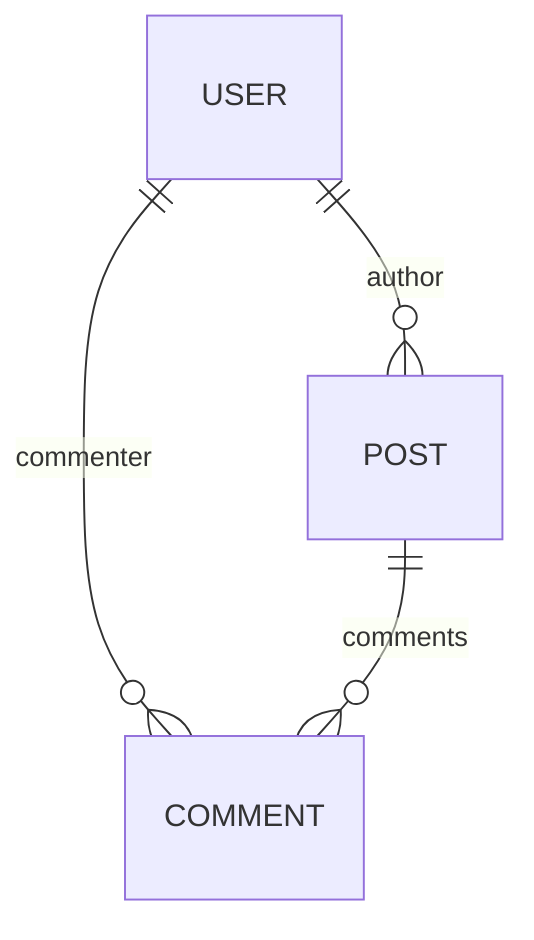

import FrameworkPlayground from '@site/src/components/FrameworkPlayground';
import { Collection, RestEndpoint } from '@data-client/rest';
import StackBlitz from '@site/src/components/StackBlitz';
import { assigneeFixtures, getInitialInterceptorData } from '@site/src/fixtures/assignees';

# Relational data

Declare one-to-one, many-to-one and many-to-many relationships between [entities][1] in [Entity.schema][3].

## Nesting

When an Entity defines [Entity.schema][3], normalization stores each nested entity separately. Denormalization joins
them again.

<details>
<summary><b>Diagram</b></summary>

<div style={{float:'left'}}>



</div>
<div style={{clear: 'both'}}>&nbsp;</div>
</details>

<FrameworkPlayground groupId="schema" defaultOpen="store" fixtures={[
{
endpoint: new RestEndpoint({ path: '/posts' }),
response: [
{
"id": "1",
"title": "My first post!",
"author": {
"id": "123",
"name": "Paul"
},
"comments": [
{
"id": "249",
"content": "Nice post!",
"commenter": {
"id": "245",
"name": "Jane"
}
},
{
"id": "250",
"content": "Thanks!",
"commenter": {
"id": "123",
"name": "Paul"
}
}
]
},
{
"id": "2",
"title": "This other post",
"author": {
"id": "123",
"name": "Paul"
},
"comments": [
{
"id": "251",
"content": "Your other post was nicer",
"commenter": {
"id": "245",
"name": "Jane"
}
},
{
"id": "252",
"content": "I am a spammer!",
"commenter": {
"id": "246",
"name": "Spambot5000"
}
}
]
}
],
delay: 150,
},
]}>

```typescript title="resources/Post"
import { Collection, Entity, resource } from '@data-client/rest';

export class User extends Entity {
  id = '';
  name = '';
}

export class Comment extends Entity {
  id = '';
  content = '';
  commenter = User.fromJS();

  static schema = {
    commenter: User,
  };
}

export class Post extends Entity {
  id = '';
  title = '';
  author = User.fromJS();
  comments: Comment[] = [];

  static schema = {
    author: User,
    comments: new Collection([Comment], {
      nestKey: (parent, key) => ({
        postId: parent.id,
      }),
    }),
  };
}

export const PostResource = resource({
  path: '/posts/:id',
  schema: Post,
});
```

:::react

```tsx title="PostPage" collapsed
import { useSuspense } from '@data-client/react';
import { PostResource } from './resources/Post';

function PostPage() {
  const posts = useSuspense(PostResource.getList);
  return (
    <div>
      {posts.map(post => (
        <div key={post.pk()}>
          <h4>
            {post.title} - <cite>{post.author.name}</cite>
          </h4>
          <ul>
            {post.comments.map(comment => (
              <li key={comment.pk()}>
                {comment.content}{' '}
                <small>
                  <cite>
                    {comment.commenter.name}
                    {comment.commenter === post.author ? ' [OP]' : ''}
                  </cite>
                </small>
              </li>
            ))}
          </ul>
        </div>
      ))}
    </div>
  );
}
render(<PostPage />);
```

:::

:::vue

```html title="PostPage.vue" collapsed
<script setup lang="ts">
  import { useSuspense } from '@data-client/vue';
  import { PostResource } from './resources/Post';

  const posts = await useSuspense(PostResource.getList);
</script>

<template>
  <div>
    <div v-for="post in posts" :key="post.pk()">
      <h4>{{ post.title }} - <cite>{{ post.author.name }}</cite></h4>
      <ul>
        <li v-for="comment in post.comments" :key="comment.pk()">
          {{ comment.content }}
          <small>
            <cite>
              {{ comment.commenter.name }}{{ comment.commenter ===
              post.author ? ' [OP]' : '' }}
            </cite>
          </small>
        </li>
      </ul>
    </div>
  </div>
</template>
```

:::

</FrameworkPlayground>

## Client side joins

Nesting data when your endpoint doesn't.

When a response does not nest related data, declare the relationship in [Entity.schema](../api/Entity.md#schema).
Data Client then joins the data on the client.

Here `/todos` only sends each todo's `userId`. [Entity.process()](../api/Entity.md#process) points
`user` at that id, so every todo in the list carries its whole `User` from `/users`. A component
could look up one user by id itself; joining puts the user in the list, so the list can group by
person. Assign a task to someone else (pick their face:react[, or drag the task into their group]),
and only its new `userId` goes to the server, yet it moves to that person's group.

<FrameworkPlayground
row
fixtures={assigneeFixtures}
getInitialInterceptorData={getInitialInterceptorData}
>

```ts title="resources/User" collapsed
import { Entity, resource } from '@data-client/rest';

export class User extends Entity {
  id = 0;
  username = '';
  name = '';
  email = '';

  get profileImage() {
    return `https://i.pravatar.cc/64?img=${this.id + 4}`;
  }
}
export const UserResource = resource({
  urlPrefix: 'https://jsonplaceholder.typicode.com',
  path: '/users/:id',
  schema: User,
});
```

```ts title="resources/Todo" {7,11-17}
import { Entity, resource } from '@data-client/rest';
import { User } from './User';

export class Todo extends Entity {
  id = 0;
  userId = 0;
  user? = User.fromJS();
  title = '';
  completed = false;

  // the API sends userId; join it to the User with that id
  static schema = {
    user: User,
  };
  static process(todo) {
    return { ...todo, user: todo.userId };
  }
}
export const TodoResource = resource({
  urlPrefix: 'https://jsonplaceholder.typicode.com',
  path: '/todos/:id',
  schema: Todo,
  optimistic: true,
});
```

:::react

```tsx title="TodoItem" collapsed
import React from 'react';
import { useController } from '@data-client/react';
import { TodoResource, type Todo } from './resources/Todo';
import type { User } from './resources/User';

function TodoItem({ todo, users }: Props) {
  const ctrl = useController();
  const update = (body: Partial<Todo>) =>
    ctrl.fetch(TodoResource.partialUpdate, { id: todo.id }, body);
  return (
    <div
      className="listItem"
      // dragged into a person's group, the todo is theirs
      ref={useReorderItem(todo.pk(), {
        onDrop: (userId: number) => update({ userId }),
      })}
    >
      <label>
        <input
          type="checkbox"
          checked={todo.completed}
          onChange={e => update({ completed: e.currentTarget.checked })}
        />
        {todo.title}
      </label>
      <label className="assignee">
        {todo.user && <Avatar src={todo.user.profileImage} size={24} />}
        <select
          aria-label={`Owner of ${todo.title}`}
          value={todo.userId}
          onChange={e => update({ userId: Number(e.currentTarget.value) })}
        >
          {users.map(user => (
            <option key={user.pk()} value={user.id}>
              {user.name}
            </option>
          ))}
        </select>
      </label>
    </div>
  );
}
export default React.memo(TodoItem);

interface Props {
  todo: Todo;
  users: User[];
}
```

```tsx title="TodoGroup" collapsed
import TodoItem from './TodoItem';
import type { Todo } from './resources/Todo';
import type { User } from './resources/User';

export default function TodoGroup({ owner, todos, users }: Props) {
  return (
    <section ref={useDropGroup(owner.id)}>
      <h3>
        <Avatar src={owner.profileImage} />
        {owner.name}
      </h3>
      <div className="list">
        {todos.map(todo => (
          <TodoItem key={todo.pk()} todo={todo} users={users} />
        ))}
      </div>
    </section>
  );
}

interface Props {
  owner: User;
  todos: Todo[];
  users: User[];
}
```

```tsx title="TodoList" collapsed {11-13}
import { useFetch, useSuspense } from '@data-client/react';
import { TodoResource } from './resources/Todo';
import { UserResource } from './resources/User';
import TodoGroup from './TodoGroup';

function TodoList() {
  // both requests start at once
  useFetch(UserResource.getList);
  const todos = useSuspense(TodoResource.getList);
  const users = useSuspense(UserResource.getList);
  // every todo carries its user, the same object as in users, so
  // the list can group by it
  const byOwner = Map.groupBy(todos, todo => todo.user);
  return (
    // rows glide to wherever a change moves them
    <Reorder layoutDependency={todos}>
      {users.map(user => (
        <TodoGroup
          key={user.pk()}
          owner={user}
          todos={byOwner.get(user) ?? []}
          users={users}
        />
      ))}
    </Reorder>
  );
}
render(<TodoList />);
```

:::

:::vue

```html title="TodoItem.vue" collapsed
<script setup lang="ts">
  import { useController } from '@data-client/vue';
  import { TodoResource, type Todo } from './resources/Todo';
  import type { User } from './resources/User';

  const props = defineProps<{ todo: Todo; users: readonly User[] }>();
  const ctrl = useController();
  const update = (body: Partial<Todo>) =>
    ctrl.fetch(TodoResource.partialUpdate, { id: props.todo.id }, body);
  const toggle = e => update({ completed: e.currentTarget.checked });
  const assign = e => update({ userId: Number(e.currentTarget.value) });
</script>

<template>
  <div class="listItem">
    <label>
      <input type="checkbox" :checked="todo.completed" @change="toggle" />
      {{ todo.title }}
    </label>
    <label class="assignee">
      <Avatar v-if="todo.user" :src="todo.user.profileImage" :size="24" />
      <select
        :aria-label="`Owner of ${todo.title}`"
        :value="todo.userId"
        @change="assign"
      >
        <option v-for="user in users" :key="user.pk()" :value="user.id">
          {{ user.name }}
        </option>
      </select>
    </label>
  </div>
</template>
```

```html title="TodoGroup.vue" collapsed
<script setup lang="ts">
  import TodoItem from './TodoItem.vue';
  import type { Todo } from './resources/Todo';
  import type { User } from './resources/User';

  defineProps<{
    owner: User;
    todos: readonly Todo[];
    users: readonly User[];
  }>();
</script>

<template>
  <section>
    <h3>
      <Avatar :src="owner.profileImage" />
      {{ owner.name }}
    </h3>
    <div class="list">
      <TodoItem
        v-for="todo in todos"
        :key="todo.pk()"
        :todo="todo"
        :users="users"
      />
    </div>
  </section>
</template>
```

```html title="TodoList.vue" collapsed {12-16}
<script setup lang="ts">
  import { computed } from 'vue';
  import { useFetch, useSuspense } from '@data-client/vue';
  import { TodoResource } from './resources/Todo';
  import { UserResource } from './resources/User';
  import TodoGroup from './TodoGroup.vue';

  // both requests start at once
  useFetch(UserResource.getList);
  const todos = await useSuspense(TodoResource.getList);
  const users = await useSuspense(UserResource.getList);
  // every todo carries its user, the same object as in users, so
  // the list can group by it
  const byOwner = computed(() =>
    Map.groupBy(todos.value, todo => todo.user),
  );
</script>

<template>
  <TodoGroup
    v-for="user in users"
    :key="user.pk()"
    :owner="user"
    :todos="byOwner.get(user) ?? []"
    :users="users"
  />
</template>
```

:::

</FrameworkPlayground>

### Key-based joins

When related entities come from separate fetches, use [Entity.process()](/rest/api/Entity#process) to add a key that
references the other Entity. Use this when:

- Related data comes from different API endpoints.
- You do not want to fetch nested data you do not need.
- The relationship is optional or depends on context.

```typescript
import { Entity, resource } from '@data-client/rest';

class Stats extends Entity {
  product_id = '';
  volume = 0;
  price = 0;

  pk() {
    return this.product_id;
  }

  static key = 'Stats';
}

class Currency extends Entity {
  id = '';
  name = '';
  // Default value allows Currency to exist without Stats loaded
  stats = Stats.fromJS();

  pk() {
    return this.id;
  }

  static key = 'Currency';

  // Create a reference key that links to Stats entity
  static process(input: any, parent: any, key: string, args: any[]) {
    // The stats field becomes a reference to Stats with pk `${id}-USD`
    return { ...input, stats: `${input.id}-USD` };
  }

  static schema = {
    // Stats will be looked up by the key from process()
    stats: Stats,
  };
}
```

After both `CurrencyResource.getList` and `StatsResource.getList` resolve, `stats` is the matching `Stats` entity.

### Crypto price example

This list sorts `Currencies` by trade volume. Only the `Stats` Entity has trade volume, and the
`CurrencyResource.getList` response does not include it. So the page also fetches `StatsResource.getList`, and
`Currency`'s [Entity.schema](../api/Entity.md#schema) adds `Stats` to each `Currency`. The list can then sort:

```ts
entries.sort((a, b) => {
  return b?.stats?.volume_usd - a?.stats?.volume_usd;
});
```

<StackBlitz app="coin-app" file="src/pages/Home/CurrencyList.tsx,src/resources/Stats.ts,src/resources/Currency.ts" height="700" view="editor" />

## Reverse lookups

Nesting data when your endpoint doesn't (part 2).

A response nests in one direction only. Here `/posts` nests each post's `author`, but no response lists a user's
posts. A reverse lookup builds that list on the client, so one fetch of `/posts` also gives each user's `posts`
and `comments`. Here the People table sorts by them.

<FrameworkPlayground groupId="schema" defaultOpen="store" fixtures={[
{
endpoint: new RestEndpoint({ path: '/posts' }),
response: [
{
"id": "101",
"title": "Search is live",
"author": {
"id": "1",
"name": "Ada"
},
"comments": [
{
"id": "201",
"content": "Does it find archived posts?",
"commenter": {
"id": "2",
"name": "Grace"
}
},
{
"id": "202",
"content": "Yes, all of them",
"commenter": {
"id": "1",
"name": "Ada"
}
},
{
"id": "203",
"content": "Works on my phone",
"commenter": {
"id": "3",
"name": "Linus"
}
}
]
},
{
"id": "102",
"title": "Dark mode next?",
"author": {
"id": "1",
"name": "Ada"
},
"comments": [
{
"id": "204",
"content": "Yes please",
"commenter": {
"id": "2",
"name": "Grace"
}
},
{
"id": "205",
"content": "Only if it follows the system setting",
"commenter": {
"id": "3",
"name": "Linus"
}
}
]
},
{
"id": "103",
"title": "Office hours move to Thursday",
"author": {
"id": "2",
"name": "Grace"
},
"comments": [
{
"id": "206",
"content": "Starting next week",
"commenter": {
"id": "2",
"name": "Grace"
}
}
]
}
],
delay: 150,
},
{
endpoint: new RestEndpoint({ path: '/users/:id' }),
response({ id }) {
return { id, name: { 1: 'Ada', 2: 'Grace', 3: 'Linus' }[id] };
},
delay: 150,
},
]}>

```typescript title="resources/Post" {15-26,28-36}
import {
  All,
  Entity,
  Query,
  resource,
  type Schema,
} from '@data-client/rest';

export class User extends Entity {
  id = '';
  name = '';
  posts: Post[] = [];
  comments: Comment[] = [];

  static process(value, parent, key) {
    switch (key) {
      // nested as a post's author: that post is one of this user's
      case 'author':
        return { ...value, posts: [parent.id] };
      // nested as a comment's commenter
      case 'commenter':
        return { ...value, comments: [parent.id] };
      default:
        return { ...value };
    }
  }

  // one user is nested many times, each with one post or comment
  static merge(existing, incoming) {
    return {
      ...existing,
      ...incoming,
      posts: union(existing.posts, incoming.posts),
      comments: union(existing.comments, incoming.comments),
    };
  }
}

/** Adds the ids not listed yet, so a refetch does not add the same ones again.
 * Does not remove repeats within `incoming`: here each copy of a user brings one id. */
function union(existing: string[] = [], incoming: string[] = []) {
  const added = incoming.filter(id => !existing.includes(id));
  return added.length ? [...existing, ...added] : existing;
}

export class Comment extends Entity {
  id = '';
  content = '';
  commenter = User.fromJS();
  post = Post.fromJS();

  static schema: Record<string, Schema> = {
    commenter: User,
  };

  static process(value, parent, key) {
    // only a post's `comments` tells which post this comment is on
    return key === 'comments' ?
        { ...value, post: parent.id }
      : { ...value };
  }
}

export class Post extends Entity {
  id = '';
  title = '';
  author = User.fromJS();
  comments: Comment[] = [];

  static schema = {
    author: User,
    comments: [Comment],
  };
}

// the classes refer to each other, so set these after all are defined
User.schema = {
  posts: [Post],
  comments: [Comment],
};
Comment.schema = {
  ...Comment.schema,
  post: Post,
};

export const PostResource = resource({
  path: '/posts/:id',
  schema: Post,
});
export const UserResource = resource({
  path: '/users/:id',
  schema: User,
});

export type SortBy = 'posts' | 'comments';

// `posts` and `comments` are in each user, so a Query can sort by them
export const queryUsers = new Query(
  new All(User),
  (users, { sortBy }: { sortBy: SortBy }) =>
    [...users].sort((a, b) => b[sortBy].length - a[sortBy].length),
);
```

:::react

```tsx title="PeoplePage" route="/users" start="/users" collapsed
import React from 'react';
import { useQuery, useSuspense } from '@data-client/react';
import { PostResource, queryUsers, type SortBy } from './resources/Post';

export default function PeoplePage() {
  useSuspense(PostResource.getList);
  const [sortBy, setSortBy] = React.useState<SortBy>('posts');
  const users = useQuery(queryUsers, { sortBy }) ?? [];
  return (
    <table>
      <thead>
        <tr>
          <th>Name</th>
          <SortHeader column="posts" sortBy={sortBy} onSort={setSortBy}>
            Posts
          </SortHeader>
          <SortHeader column="comments" sortBy={sortBy} onSort={setSortBy}>
            Comments
          </SortHeader>
        </tr>
      </thead>
      <tbody>
        {users.map(user => (
          <tr key={user.pk()}>
            <td>
              <Link to={`/users/${user.id}`}>{user.name}</Link>
            </td>
            <td className="value">{user.posts.length}</td>
            <td className="value">{user.comments.length}</td>
          </tr>
        ))}
      </tbody>
    </table>
  );
}

function SortHeader({ column, sortBy, onSort, children }: HeaderProps) {
  return (
    <th
      className="value"
      aria-sort={sortBy === column ? 'descending' : undefined}
    >
      <button className="sort" onClick={() => onSort(column)}>
        {children}
      </button>
    </th>
  );
}
interface HeaderProps {
  column: SortBy;
  sortBy: SortBy;
  onSort: (sortBy: SortBy) => void;
  children: React.ReactNode;
}
```

```tsx title="UserPage" route="/users/:id" collapsed
import { useSuspense } from '@data-client/react';
import { UserResource } from './resources/Post';

export default function UserPage({ id }: { id: string }) {
  const user = useSuspense(UserResource.get, { id });
  return (
    <>
      <h2>{user.name}</h2>
      {user.posts.length > 0 && (
        <section>
          <h3>Posts</h3>
          <div className="list">
            {user.posts.map(post => (
              <div className="listItem" key={post.pk()}>
                {post.title}
              </div>
            ))}
          </div>
        </section>
      )}
      {user.comments.length > 0 && (
        <section>
          <h3>Comments</h3>
          <div className="list">
            {user.comments.map(comment => (
              <div className="listItem" key={comment.pk()}>
                {comment.content}
                <span className="meta">{comment.post.title}</span>
              </div>
            ))}
          </div>
        </section>
      )}
    </>
  );
}
```

```tsx title="PostPage" route="/" collapsed docs-only
import { useSuspense } from '@data-client/react';
import { PostResource } from './resources/Post';

export default function PostPage() {
  const posts = useSuspense(PostResource.getList);
  return (
    <>
      {posts.map(post => (
        <section key={post.pk()}>
          <h3>
            {post.title} by{' '}
            <Link to={`/users/${post.author.id}`}>{post.author.name}</Link>
          </h3>
          <div className="list">
            {post.comments.map(comment => (
              <div className="listItem" key={comment.pk()}>
                {comment.content}
                <Link className="meta" to={`/users/${comment.commenter.id}`}>
                  {comment.commenter.name}
                </Link>
              </div>
            ))}
          </div>
        </section>
      ))}
    </>
  );
}
```

```tsx title="Forum" layout collapsed docs-only
import React from 'react';
import { useFetch } from '@data-client/react';
import { PostResource } from './resources/Post';

export default function Forum({ children }: { children: React.ReactNode }) {
  // every page reads what the posts nest, so the posts load with the app
  useFetch(PostResource.getList);
  return (
    <>
      <header className="appHeader">
        <h1 className="appTitle">Forum</h1>
        <nav>
          <Link to="/">Posts</Link>
          <Link to="/users">People</Link>
        </nav>
      </header>
      {children}
    </>
  );
}
```

:::

:::vue

```html title="PeoplePage.vue" route="/users" start="/users" collapsed
<script setup lang="ts">
  import { ref } from 'vue';
  import { useQuery, useSuspense } from '@data-client/vue';
  import { PostResource, queryUsers, type SortBy } from './resources/Post';

  await useSuspense(PostResource.getList);
  const sortBy = ref<SortBy>('posts');
  const users = useQuery(queryUsers, () => ({ sortBy: sortBy.value }));
  const columns: Record<SortBy, string> = {
    posts: 'Posts',
    comments: 'Comments',
  };
</script>

<template>
  <table>
    <thead>
      <tr>
        <th>Name</th>
        <th
          v-for="(label, column) in columns"
          :key="column"
          class="value"
          :aria-sort="sortBy === column ? 'descending' : undefined"
        >
          <button class="sort" @click="sortBy = column">{{ label }}</button>
        </th>
      </tr>
    </thead>
    <tbody>
      <tr v-for="user in users" :key="user.pk()">
        <td>
          <RouterLink :to="`/users/${user.id}`">{{ user.name }}</RouterLink>
        </td>
        <td class="value">{{ user.posts.length }}</td>
        <td class="value">{{ user.comments.length }}</td>
      </tr>
    </tbody>
  </table>
</template>
```

```html title="UserPage.vue" route="/users/:id" collapsed
<script setup lang="ts">
  import { useSuspense } from '@data-client/vue';
  import { UserResource } from './resources/Post';

  const props = defineProps<{ id: string }>();
  const user = await useSuspense(UserResource.get, () => ({
    id: props.id,
  }));
</script>

<template>
  <h2>{{ user.name }}</h2>
  <section v-if="user.posts.length">
    <h3>Posts</h3>
    <div class="list">
      <div v-for="post in user.posts" :key="post.pk()" class="listItem">
        {{ post.title }}
      </div>
    </div>
  </section>
  <section v-if="user.comments.length">
    <h3>Comments</h3>
    <div class="list">
      <div
        v-for="comment in user.comments"
        :key="comment.pk()"
        class="listItem"
      >
        {{ comment.content }}
        <span class="meta">{{ comment.post.title }}</span>
      </div>
    </div>
  </section>
</template>
```

```html title="PostPage.vue" route="/" collapsed docs-only
<script setup lang="ts">
  import { useSuspense } from '@data-client/vue';
  import { PostResource } from './resources/Post';

  const posts = await useSuspense(PostResource.getList);
</script>

<template>
  <section v-for="post in posts" :key="post.pk()">
    <h3>
      {{ post.title }} by
      <RouterLink :to="`/users/${post.author.id}`">
        {{ post.author.name }}
      </RouterLink>
    </h3>
    <div class="list">
      <div
        v-for="comment in post.comments"
        :key="comment.pk()"
        class="listItem"
      >
        {{ comment.content }}
        <RouterLink class="meta" :to="`/users/${comment.commenter.id}`">
          {{ comment.commenter.name }}
        </RouterLink>
      </div>
    </div>
  </section>
</template>
```

```html title="Forum.vue" layout collapsed docs-only
<script setup lang="ts">
  import { useFetch } from '@data-client/vue';
  import { PostResource } from './resources/Post';

  // every page reads what the posts nest, so the posts load with the app
  useFetch(PostResource.getList);
</script>

<template>
  <header class="appHeader">
    <h1 class="appTitle">Forum</h1>
    <nav>
      <RouterLink to="/">Posts</RouterLink>
      <RouterLink to="/users">People</RouterLink>
    </nav>
  </header>
  <RouterView v-slot="{ Component, route }">
    <Suspense timeout="0">
      <component
        :is="Component"
        :key="route.fullPath"
        :id="route.params.id"
      />
      <template #fallback><Loading /></template>
    </Suspense>
  </RouterView>
</template>
```

:::

</FrameworkPlayground>

[Entity.process()](../api/Entity.md#process) runs for each nested entity, with the `parent` and `key` that nest
it. [Entity.merge()](../api/Entity.md#merge) then joins the copies of one entity:

```ts
// post 101 nests Ada as its `author`, so process() adds that post's id
User.process({ id: '1', name: 'Ada' }, post101, 'author');
// => { id: '1', name: 'Ada', posts: ['101'] }

// post 102 nests Ada too, so merge() joins both copies
User.merge(
  { id: '1', name: 'Ada', posts: ['101'] },
  { id: '1', name: 'Ada', posts: ['102'] },
);
// => { id: '1', name: 'Ada', posts: ['101', '102'] }
```

The default `merge()` keeps only the last copy's `posts`. `Comment.process()` sets `comment.post` in the same way.

### When to use

Nest a list in an entity when the data must have it, not only the screen. For example, `queryUsers`
sorts users by `user.posts` before any component renders. Then choose by
where the list is:

- **A response has the list** (the user response nests it, or `GET /posts?author=123` returns it): use a
  [Collection](../api/Collection.md) with [nestKey](../api/Collection.md#nestKey). Each fetch replaces the list, and
  [push](../api/Collection.md#push), [remove](../api/Collection.md#remove) and [move](../api/Collection.md#move)
  keep it current. It needs no custom `merge()`.
- **No response has the list**: use a reverse lookup.

### After a mutation

- **Create.** A new post or comment runs the same `process()`, so it joins the list. This is true for
  [push](../api/RestEndpoint.md#push) and for each new page.
- **Delete.** A deleted post or comment leaves the list. A list skips entities that are not in the store.
- **Move.** A post with a new `author` joins the new author's `posts`, and stays in the old author's: `merge()`
  only adds ids. When a relationship can move, compute the list where it is read, with a
  [Query](../api/Query.md) over [All](../api/All.md).

### Circular dependencies

JavaScript does not allow circular imports or circular class definitions. So for [Entities][1] that reference each
other, define the [schema][3] after the class definitions.

```typescript title="resources/Post"
import { Entity } from '@data-client/rest';
import { User } from './User';

export class Post extends Entity {
  id = '';
  title = '';
  author = User.fromJS();

  static schema = {
    author: User,
  };
}

// both User and Post are now defined, so it's okay to refer to both of them
// highlight-start
User.schema = {
  // ensure we keep the 'createdAt' member
  ...User.schema,
  posts: [Post],
};
// highlight-end
```

```typescript title="resources/User"
import { Entity, type Schema } from '@data-client/rest';
import { Temporal } from 'temporal-polyfill';
// import only the type: importing the class would be a circular import,
// so resources/Post sets User.schema above
import type { Post } from './Post';

export class User extends Entity {
  id = '';
  name = '';
  posts: Post[] = [];
  createdAt = Temporal.Instant.fromEpochMilliseconds(0);

  static schema: Record<string, Schema> = {
    createdAt: Temporal.Instant.from,
  };
}
```

:::tip

For bidirectional relationships that don't need eager denormalization,
[Lazy](../api/Lazy.md) defers resolution and lets you resolve on demand
via [useQuery](/docs/api/useQuery), avoiding deep recursion and improving
memoization isolation.

:::

[1]: ../api/Entity.md
[2]: /docs/api/useCache
[3]: ../api/Entity.md#schema
