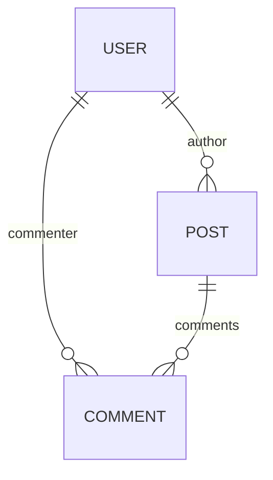

import FrameworkPlayground from '@site/src/components/FrameworkPlayground';
import { Collection, RestEndpoint } from '@data-client/rest';
import StackBlitz from '@site/src/components/StackBlitz';
import { assigneeFixtures, getInitialInterceptorData } from '@site/src/fixtures/assignees';

# Relational data

Reactive Data Client handles one-to-one, many-to-one and many-to-many relationships on [entities][1]
using [Entity.schema][3]

## Nesting

Nested members are hoisted during normalization when [Entity.schema][3] is defined.
They are then rejoined during denormalization

<details>
<summary><b>Diagram</b></summary>

<div style={{float:'left'}}>



</div>
<div style={{clear: 'both'}}>&nbsp;</div>
</details>

<FrameworkPlayground groupId="schema" defaultOpen="y" fixtures={[
{
endpoint: new RestEndpoint({ path: '/posts' }),
response: [
{
"id": "1",
"title": "My first post!",
"author": {
"id": "123",
"name": "Paul"
},
"comments": [
{
"id": "249",
"content": "Nice post!",
"commenter": {
"id": "245",
"name": "Jane"
}
},
{
"id": "250",
"content": "Thanks!",
"commenter": {
"id": "123",
"name": "Paul"
}
}
]
},
{
"id": "2",
"title": "This other post",
"author": {
"id": "123",
"name": "Paul"
},
"comments": [
{
"id": "251",
"content": "Your other post was nicer",
"commenter": {
"id": "245",
"name": "Jane"
}
},
{
"id": "252",
"content": "I am a spammer!",
"commenter": {
"id": "246",
"name": "Spambot5000"
}
}
]
}
],
delay: 150,
},
]}>

```typescript title="resources/Post"
import { Collection, Entity, resource } from '@data-client/rest';

export class User extends Entity {
  id = '';
  name = '';
}

export class Comment extends Entity {
  id = '';
  content = '';
  commenter = User.fromJS();

  static schema = {
    commenter: User,
  };
}

export class Post extends Entity {
  id = '';
  title = '';
  author = User.fromJS();
  comments: Comment[] = [];

  static schema = {
    author: User,
    comments: new Collection([Comment], {
      nestKey: (parent, key) => ({
        postId: parent.id,
      }),
    }),
  };
}

export const PostResource = resource({
  path: '/posts/:id',
  schema: Post,
});
```

:::react

```tsx title="PostPage" collapsed
import { useSuspense } from '@data-client/react';
import { PostResource } from './resources/Post';

function PostPage() {
  const posts = useSuspense(PostResource.getList);
  return (
    <div>
      {posts.map(post => (
        <div key={post.pk()}>
          <h4>
            {post.title} - <cite>{post.author.name}</cite>
          </h4>
          <ul>
            {post.comments.map(comment => (
              <li key={comment.pk()}>
                {comment.content}{' '}
                <small>
                  <cite>
                    {comment.commenter.name}
                    {comment.commenter === post.author ? ' [OP]' : ''}
                  </cite>
                </small>
              </li>
            ))}
          </ul>
        </div>
      ))}
    </div>
  );
}
render(<PostPage />);
```

:::

:::vue

```html title="PostPage.vue" collapsed
<script setup lang="ts">
  import { useSuspense } from '@data-client/vue';
  import { PostResource } from './resources/Post';

  const posts = await useSuspense(PostResource.getList);
</script>

<template>
  <div>
    <div v-for="post in posts" :key="post.pk()">
      <h4>{{ post.title }} - <cite>{{ post.author.name }}</cite></h4>
      <ul>
        <li v-for="comment in post.comments" :key="comment.pk()">
          {{ comment.content }}
          <small>
            <cite>
              {{ comment.commenter.name }}{{ comment.commenter ===
              post.author ? ' [OP]' : '' }}
            </cite>
          </small>
        </li>
      </ul>
    </div>
  </div>
</template>
```

:::

</FrameworkPlayground>

## Client side joins

Nesting data when your endpoint doesn't.

Even if the network responses don't nest data, we can perform client-side joins by specifying
the relationship in [Entity.schema](../api/Entity.md#schema).

Here `/todos` only sends each todo's `userId`. [Entity.process()](../api/Entity.md#process) points
`user` at that id, so every todo in the list carries its whole `User` from `/users`. A component
could look up one user by id itself; joining puts the user in the list, so the list can group by
person. Assign a task to someone else (pick their face, or drag the task into their group), and
only its new `userId` goes to the server, yet it moves to that person's group.

<FrameworkPlayground
row
fixtures={assigneeFixtures}
getInitialInterceptorData={getInitialInterceptorData}
>

```ts title="resources/User" collapsed
import { Entity, resource } from '@data-client/rest';

export class User extends Entity {
  id = 0;
  username = '';
  name = '';
  email = '';

  get profileImage() {
    return `https://i.pravatar.cc/64?img=${this.id + 4}`;
  }
}
export const UserResource = resource({
  urlPrefix: 'https://jsonplaceholder.typicode.com',
  path: '/users/:id',
  schema: User,
});
```

```ts title="resources/Todo" {7,11-17}
import { Entity, resource } from '@data-client/rest';
import { User } from './User';

export class Todo extends Entity {
  id = 0;
  userId = 0;
  user? = User.fromJS();
  title = '';
  completed = false;

  // the API sends userId; join it to the User with that id
  static schema = {
    user: User,
  };
  static process(todo) {
    return { ...todo, user: todo.userId };
  }
}
export const TodoResource = resource({
  urlPrefix: 'https://jsonplaceholder.typicode.com',
  path: '/todos/:id',
  schema: Todo,
  optimistic: true,
});
```

:::react

```tsx title="TodoItem" collapsed
import React from 'react';
import { useController } from '@data-client/react';
import { TodoResource, type Todo } from './resources/Todo';
import type { User } from './resources/User';

function TodoItem({ todo, users }: Props) {
  const ctrl = useController();
  const update = (body: Partial<Todo>) =>
    ctrl.fetch(TodoResource.partialUpdate, { id: todo.id }, body);
  return (
    <div
      className="listItem"
      // dragged into a person's group, the todo is theirs
      ref={useReorderItem(todo.pk(), {
        onDrop: (userId: number) => update({ userId }),
      })}
    >
      <label>
        <input
          type="checkbox"
          checked={todo.completed}
          onChange={e => update({ completed: e.currentTarget.checked })}
        />
        {todo.title}
      </label>
      <label className="assignee">
        {todo.user && <Avatar src={todo.user.profileImage} size={24} />}
        <select
          aria-label={`Owner of ${todo.title}`}
          value={todo.userId}
          onChange={e => update({ userId: Number(e.currentTarget.value) })}
        >
          {users.map(user => (
            <option key={user.pk()} value={user.id}>
              {user.name}
            </option>
          ))}
        </select>
      </label>
    </div>
  );
}
export default React.memo(TodoItem);

interface Props {
  todo: Todo;
  users: User[];
}
```

```tsx title="TodoGroup" collapsed
import TodoItem from './TodoItem';
import type { Todo } from './resources/Todo';
import type { User } from './resources/User';

export default function TodoGroup({ owner, todos, users }: Props) {
  return (
    <section
      ref={useReorderItem(`owner ${owner?.pk()}`, {
        dropValue: owner?.id,
      })}
    >
      <h3>
        {owner && <Avatar src={owner.profileImage} size={20} />}
        {owner?.name ?? 'Unassigned'}
      </h3>
      <div className="list">
        {todos.map(todo => (
          <TodoItem key={todo.pk()} todo={todo} users={users} />
        ))}
      </div>
    </section>
  );
}

interface Props {
  owner: User | undefined;
  todos: Todo[];
  users: User[];
}
```

```tsx title="TodoList" collapsed {11-12}
import { useFetch, useSuspense } from '@data-client/react';
import { TodoResource } from './resources/Todo';
import { UserResource } from './resources/User';
import TodoGroup from './TodoGroup';

function TodoList() {
  // both requests start at once
  useFetch(UserResource.getList);
  const todos = useSuspense(TodoResource.getList);
  const users = useSuspense(UserResource.getList);
  // every todo carries its user, so the list can group by it
  const byOwner = Map.groupBy(todos, todo => todo.user);
  return (
    // rows and groups glide to wherever a change moves them
    <Reorder layoutDependency={todos}>
      {[...byOwner].map(([owner, ownerTodos]) => (
        <TodoGroup
          key={owner?.pk() ?? 'unassigned'}
          owner={owner}
          todos={ownerTodos}
          users={users}
        />
      ))}
    </Reorder>
  );
}
render(<TodoList />);
```

:::

:::vue

```html title="TodoItem.vue" collapsed
<script setup lang="ts">
  import { useController } from '@data-client/vue';
  import { TodoResource, type Todo } from './resources/Todo';
  import type { User } from './resources/User';

  const props = defineProps<{ todo: Todo; users: readonly User[] }>();
  const ctrl = useController();
  const update = (body: Partial<Todo>) =>
    ctrl.fetch(TodoResource.partialUpdate, { id: props.todo.id }, body);
  const toggle = e => update({ completed: e.currentTarget.checked });
  const assign = e => update({ userId: Number(e.currentTarget.value) });
</script>

<template>
  <div class="listItem">
    <label>
      <input type="checkbox" :checked="todo.completed" @change="toggle" />
      {{ todo.title }}
    </label>
    <label class="assignee">
      <Avatar v-if="todo.user" :src="todo.user.profileImage" :size="24" />
      <select
        :aria-label="`Owner of ${todo.title}`"
        :value="todo.userId"
        @change="assign"
      >
        <option v-for="user in users" :key="user.pk()" :value="user.id">
          {{ user.name }}
        </option>
      </select>
    </label>
  </div>
</template>
```

```html title="TodoGroup.vue" collapsed
<script setup lang="ts">
  import TodoItem from './TodoItem.vue';
  import type { Todo } from './resources/Todo';
  import type { User } from './resources/User';

  defineProps<{
    owner: User | undefined;
    todos: readonly Todo[];
    users: readonly User[];
  }>();
</script>

<template>
  <section>
    <h3>
      <Avatar v-if="owner" :src="owner.profileImage" :size="20" />
      {{ owner?.name ?? 'Unassigned' }}
    </h3>
    <div class="list">
      <TodoItem
        v-for="todo in todos"
        :key="todo.pk()"
        :todo="todo"
        :users="users"
      />
    </div>
  </section>
</template>
```

```html title="TodoList.vue" collapsed {12-15}
<script setup lang="ts">
  import { computed } from 'vue';
  import { useFetch, useSuspense } from '@data-client/vue';
  import { TodoResource } from './resources/Todo';
  import { UserResource } from './resources/User';
  import TodoGroup from './TodoGroup.vue';

  // both requests start at once
  useFetch(UserResource.getList);
  const todos = await useSuspense(TodoResource.getList);
  const users = await useSuspense(UserResource.getList);
  // every todo carries its user, so the list can group by it
  const byOwner = computed(() =>
    Map.groupBy(todos.value, todo => todo.user),
  );
</script>

<template>
  <TodoGroup
    v-for="[owner, ownerTodos] in byOwner"
    :key="owner?.pk() ?? 'unassigned'"
    :owner="owner"
    :todos="ownerTodos"
    :users="users"
  />
</template>
```

:::

</FrameworkPlayground>

### Key-based joins

For more complex scenarios where related entities are fetched separately, use [Entity.process()](/rest/api/Entity#process)
to create a reference key that links to another Entity. This is useful when:

- Related data comes from different API endpoints
- You want to avoid over-fetching nested data
- The relationship is optional or varies by context

```typescript
import { Entity, resource } from '@data-client/rest';

class Stats extends Entity {
  product_id = '';
  volume = 0;
  price = 0;

  pk() {
    return this.product_id;
  }

  static key = 'Stats';
}

class Currency extends Entity {
  id = '';
  name = '';
  // Default value allows Currency to exist without Stats loaded
  stats = Stats.fromJS();

  pk() {
    return this.id;
  }

  static key = 'Currency';

  // Create a reference key that links to Stats entity
  static process(input: any, parent: any, key: string, args: any[]) {
    // The stats field becomes a reference to Stats with pk `${id}-USD`
    return { ...input, stats: `${input.id}-USD` };
  }

  static schema = {
    // Stats will be looked up by the key from process()
    stats: Stats,
  };
}
```

When both `CurrencyResource.getList` and `StatsResource.getList` are fetched, the `stats`
field will automatically resolve to the matching `Stats` entity.

### Crypto price example

Here we want to sort `Currencies` by their trade volume. However, trade volume is only available in the `Stats`
Entity. Even though `CurrencyResource.getList` fetch does not include `Stats` in the response, we can additionally
call `StatsResource.getList`, while adding it to our `Currency's` [Entity.schema](../api/Entity.md#schema) - enabling
`Stats` inclusion in our `Currency` Entity, which enables sorting with:

```ts
entries.sort((a, b) => {
  return b?.stats?.volume_usd - a?.stats?.volume_usd;
});
```

<StackBlitz app="coin-app" file="src/pages/Home/CurrencyList.tsx,src/resources/Stats.ts,src/resources/Currency.ts" height="700" view="editor" />

## Reverse lookups

Nesting data when your endpoint doesn't (part 2).

Even though a response may only nest in one direction, Reactive Data Client can handle reverse relationships
by overriding [Entity.process](../api/Entity.md#process). Additionally, [Entity.merge](../api/Entity.md#merge)
may need overriding to ensure deep merging of those expected fields.

This allows you to traverse the relationship after processing only one fetch request, rather than having to fetch
each time you want access to a different view.

<FrameworkPlayground groupId="schema" defaultOpen="y" fixtures={[
{
endpoint: new RestEndpoint({ path: '/posts' }),
response: [
{
"id": "1",
"title": "My first post!",
"author": {
"id": "123",
"name": "Paul"
},
"comments": [
{
"id": "249",
"content": "Nice post!",
"commenter": {
"id": "245",
"name": "Jane"
}
},
{
"id": "250",
"content": "Thanks!",
"commenter": {
"id": "123",
"name": "Paul"
}
}
]
},
{
"id": "2",
"title": "This other post",
"author": {
"id": "123",
"name": "Paul"
},
"comments": [
{
"id": "251",
"content": "Your other post was nicer",
"commenter": {
"id": "245",
"name": "Jane"
}
},
{
"id": "252",
"content": "I am a spammer!",
"commenter": {
"id": "246",
"name": "Spambot5000"
}
}
]
}
],
delay: 150,
},
]}>

```typescript title="resources/Post"
import { Entity, resource, type Schema } from '@data-client/rest';

export class User extends Entity {
  id = '';
  name = '';
  posts: Post[] = [];
  comments: Comment[] = [];

  static merge(existing, incoming) {
    return {
      ...existing,
      ...incoming,
      posts: [...(existing.posts || []), ...(incoming.posts || [])],
      comments: [
        ...(existing.comments || []),
        ...(incoming.comments || []),
      ],
    };
  }

  static process(value, parent, key) {
    switch (key) {
      case 'author':
        return { ...value, posts: [parent.id] };
      case 'commenter':
        return { ...value, comments: [parent.id] };
      default:
        return { ...value };
    }
  }
}

export class Comment extends Entity {
  id = '';
  content = '';
  commenter = User.fromJS();
  post = Post.fromJS();

  static schema: Record<string, Schema> = {
    commenter: User,
  };
  static process(value, parent, key) {
    return { ...value, post: parent.id };
  }
}

export class Post extends Entity {
  id = '';
  title = '';
  author = User.fromJS();
  comments: Comment[] = [];

  static schema = {
    author: User,
    comments: [Comment],
  };
}

// with cirucular dependencies we must set schema after they are all defined
User.schema = {
  posts: [Post],
  comments: [Comment],
};
Comment.schema = {
  ...Comment.schema,
  post: Post,
};

export const PostResource = resource({
  path: '/posts/:id',
  schema: Post,
  dataExpiryLength: Infinity,
});
export const UserResource = resource({
  path: '/users/:id',
  schema: User,
});
```

:::react

```tsx title="UserPage" route="/users/:id" collapsed
import { useSuspense } from '@data-client/react';
import { UserResource } from './resources/Post';

export default function UserPage({ id }) {
  const user = useSuspense(UserResource.get, { id });
  return (
    <div>
      <h4>{user.name}</h4>
      {user.posts.length ? (
        <>
          <h5>Posts</h5>
          <ul>
            {user.posts.map(post => (
              <li>{post.title}</li>
            ))}
          </ul>
        </>
      ) : null}
      <h5>Comments</h5>
      <ul>
        {user.comments.map(comment => (
          <li>{comment.content}</li>
        ))}
      </ul>
    </div>
  );
}
```

```tsx title="PostPage" route="/" collapsed
import { useSuspense } from '@data-client/react';
import { PostResource } from './resources/Post';

export default function PostPage() {
  const posts = useSuspense(PostResource.getList);
  return (
    <div>
      {posts.map(post => (
        <div key={post.pk()}>
          <h4>
            {post.title} -{' '}
            <Link to={`/users/${post.author.id}`}>{post.author.name}</Link>
          </h4>
          <ul>
            {post.comments.map(comment => (
              <li key={comment.pk()}>
                {comment.content}{' '}
                <small>
                  <Link to={`/users/${comment.commenter.id}`}>
                    {comment.commenter.name}
                    {comment.commenter === post.author ? ' [OP]' : ''}
                  </Link>
                </small>
              </li>
            ))}
          </ul>
        </div>
      ))}
    </div>
  );
}
```

:::

:::vue

```html title="UserPage.vue" route="/users/:id" collapsed
<script setup lang="ts">
  import { useSuspense } from '@data-client/vue';
  import { UserResource } from './resources/Post';

  const props = defineProps<{ id: string }>();
  const user = await useSuspense(UserResource.get, () => ({
    id: props.id,
  }));
</script>

<template>
  <div>
    <h4>{{ user.name }}</h4>
    <template v-if="user.posts.length">
      <h5>Posts</h5>
      <ul>
        <li v-for="post in user.posts" :key="post.pk()">
          {{ post.title }}
        </li>
      </ul>
    </template>
    <h5>Comments</h5>
    <ul>
      <li v-for="comment in user.comments" :key="comment.pk()">
        {{ comment.content }}
      </li>
    </ul>
  </div>
</template>
```

```html title="PostPage.vue" route="/" collapsed
<script setup lang="ts">
  import { useSuspense } from '@data-client/vue';
  import { PostResource } from './resources/Post';

  const posts = await useSuspense(PostResource.getList);
</script>

<template>
  <div>
    <div v-for="post in posts" :key="post.pk()">
      <h4>
        {{ post.title }} -
        <RouterLink :to="`/users/${post.author.id}`">
          {{ post.author.name }}
        </RouterLink>
      </h4>
      <ul>
        <li v-for="comment in post.comments" :key="comment.pk()">
          {{ comment.content }}
          <small>
            <RouterLink :to="`/users/${comment.commenter.id}`">
              {{ comment.commenter.name }}{{ comment.commenter ===
              post.author ? ' [OP]' : '' }}
            </RouterLink>
          </small>
        </li>
      </ul>
    </div>
  </div>
</template>
```

:::

</FrameworkPlayground>

### Circular dependencies

Because circular imports and circular class definitions are not allowed, sometimes it
will be necessary to define the [schema][3] after the [Entities][1] definition.

```typescript title="resources/Post"
import { Collection, Entity } from '@data-client/rest';
import { User } from './User';

export class Post extends Entity {
  id = '';
  title = '';
  author = User.fromJS();

  static schema = {
    author: User,
  };
}

// both User and Post are now defined, so it's okay to refer to both of them
// highlight-start
User.schema = {
  // ensure we keep the 'createdAt' member
  ...User.schema,
  posts: [Post],
};
// highlight-end
```

```typescript title="resources/User"
import { Collection, Entity } from '@data-client/rest';
import type { Post } from './Post';
// we can only import the type else we break javascript imports
// thus we change the schema of UserResource above

export class User extends Entity {
  id = '';
  name = '';
  posts: Post[] = [];
  createdAt = Temporal.Instant.fromEpochMilliseconds(0);

  static schema: Record<string, Schema | Date> = {
    createdAt: Temporal.Instant.from,
  };
}
```

:::tip

For bidirectional relationships that don't need eager denormalization,
[Lazy](../api/Lazy.md) defers resolution and lets you resolve on demand
via [useQuery](/docs/api/useQuery), avoiding deep recursion and improving
memoization isolation.

:::

[1]: ../api/Entity.md
[2]: /docs/api/useCache
[3]: ../api/Entity.md#schema
