import Link from '@docusaurus/Link';

Además de las ventajas de rendimiento e integridad de datos de [normalizar el estado](https://react.dev/learn/choosing-the-state-structure),
obtenemos el beneficio adicional de poder acceder al store y consultarlo directamente de forma segura.

En esta versión ajustamos y simplificamos esta funcionalidad unificándola en torno al concepto de [Schemas Queryable](/docs/api/useQuery#queryable). Estos incluyen
[Entity](/rest/api/Entity), [All](/rest/api/All), [Collection](/rest/api/Collection), [Query](/rest/api/Query)
y [Union](/rest/api/Union)

El mayor impacto de este cambio es la introducción de un nuevo hook, [useQuery()](/blog/2024/04/08/v0.11-queries-querable-usequery#usequery), que permite búsquedas directas en el store
usando los [Schemas Queryable](/docs/api/useQuery#queryable).

```ts
class User extends Entity {
  username = '';
  id = '';
  groupId = '';
  pk() {
    return this.id;
  }
  static index = ['username' as const];
}

const bob = useQuery(User, { username: 'bob' });
const bob = useQuery(User, { id: '5' });
```

De manera similar, podemos buscar Queryables con el controller y el snapshot usando [controller.get](/blog/2024/04/08/v0.11-queries-querable-usequery#controllerget)

```ts
const bob = snapshot.get(User, { username: 'bob' });
```

Adicionalmente, hemos invertido en más [mejoras de rendimiento](/blog/2024/04/08/v0.11-queries-querable-usequery#performance), que resultan en un aumento de rendimiento de alrededor de 2x
para la mayoría de las operaciones y en que las [Queries](/rest/api/Query) sean 16x más rápidas.

<center>

<Link className="button button--secondary" to="/blog/2024/04/08/v0.11-queries-querable-usequery#migration-guide">Guía de migración</Link>

</center>

**Cambios incompatibles:**

- [useCache(new Index(MyEntity)) -> useQuery(MyEntity)](/blog/2024/04/08/v0.11-queries-querable-usequery#removed-index)
- [new Query -> new schema.Query](/blog/2024/04/08/v0.11-queries-querable-usequery#query-migration)
  - useCache(myQuery) -> useQuery(myQuery)
- [new AbortOptimistic() -> snapshot.abort](/blog/2024/04/08/v0.11-queries-querable-usequery#snap.abort)
- [Entity.useIncoming → Entity.shouldUpdate](/blog/2024/04/08/v0.11-queries-querable-usequery#shouldupdate)

[**Otros puntos destacados:**](/blog/2024/04/08/v0.11-queries-querable-usequery#other-improvements)

- useCache() acepta Endpoints con sideEffects (como [Resource.update](/rest/api/resource#update))
- Se permite que Entity.pk() devuelva números.
- [Mejoras de rendimiento](/blog/2024/04/08/v0.11-queries-querable-usequery#performance) de 2-16x

<!--truncate-->

import TypeScriptEditor from '@site/src/components/TypeScriptEditor';
import DiffEditor from '@site/src/components/DiffEditor';

### Querable {#querable}

Los schemas [Queryable](/rest/api/schema#queryable) requieren un método `queryKey()` que devuelva algo. Estos incluyen
[Entity](/rest/api/Entity), [All](/rest/api/All), [Collection](/rest/api/Collection), [Query](/rest/api/Query)
y [Union](/rest/api/Union).

```ts
interface Queryable {
  queryKey(
    args: readonly any[],
    queryKey: (...args: any) => any,
    getEntity: GetEntity,
    getIndex: GetIndex,
    // `{}` means non-void
  ): {};
}
```

### schema.Query {#schemaquery}

`Query` antes se implementaba como un Endpoint. Como ahora tenemos métodos para recuperar schemas Queryable
directamente, podemos simplemente convertir Query en otro schema Queryable más. Debería ser básicamente igual,
permitiendo cálculos arbitrarios sobre el valor de un store. [#2921](https://github.com/reactive/data-client/pull/2921)

```ts
const getUserCount = new schema.Query(
  new schema.All(User),
  (entries, { isAdmin } = {}) => {
    if (isAdmin !== undefined)
      return entries.filter(user => user.isAdmin === isAdmin).length;
    return entries.length;
  },
);

const userCount = useQuery(getUserCount);
const adminCount = useQuery(getUserCount, { isAdmin: true });
```

schema.Query ahora rechaza los schemas que no son Queryable.

<TypeScriptEditor>

```ts
const getBob = new schema.Query(
  // Array is not Queryable
  new schema.Array({ bob: '' }),
  thing => {
    return thing;
  },
);
```

</TypeScriptEditor>

### controller.get / snapshot.get {#controllerget}

Ahora podemos [acceder al store](/docs/api/Controller#get) con solo un Schema Queryable; ya no necesitamos un Endpoint completo.
[#2921](https://github.com/reactive/data-client/pull/2921)

<DiffEditor>

```ts title="Before"
getOptimisticResponse(snapshot, { id }) {
  // highlight-next-line
  const { data: post } = snapshot.getResponse(Base.get, { id });
  if (!post) throw snapshot.abort;
  return {
    id,
    votes: post.votes + 1,
  };
}
```

```ts title="After"
getOptimisticResponse(snapshot, { id }) {
  // highlight-next-line
  const post = snapshot.get(Post, { id });
  if (!post) throw snapshot.abort;
  return {
    id,
    votes: post.votes + 1,
  };
}
```
</DiffEditor>

Como ya no necesitamos acceder a otros [miembros del Resource](/rest/api/resource#members) para obtener `Post`,
podemos usar la sobrecarga mucho más simple de [Resource.extend()](/rest/api/resource#extend-new).

<DiffEditor>

```ts title="Before"
export const PostResource = createResource({
  path: '/posts/:id',
  schema: Post,
// highlight-next-line
}).extend(Base => ({
  vote: new RestEndpoint({
    path: '/posts/:id/vote',
    method: 'POST',
    body: undefined,
    schema: Post,
    getOptimisticResponse(snapshot, { id }) {
      const { data: post } = snapshot.getResponse(Base.get, { id });
      if (!post) throw snapshot.abort;
      return {
        id,
        votes: post.votes + 1,
      };
    },
  }),
}));
```

```ts title="After"
export const PostResource = createResource({
  path: '/posts/:id',
  schema: Post,
// highlight-next-line
}).extend('vote', {
  path: '/posts/:id/vote',
  method: 'POST',
  body: undefined,
  schema: Post,
  getOptimisticResponse(snapshot, { id }) {
    const post = snapshot.get(Post, { id });
    if (!post) throw snapshot.abort;
    return {
      id,
      votes: post.votes + 1,
    };
  },
});
```

</DiffEditor>

### useQuery {#usequery}

Renderiza cualquier [Schema Queryable](/rest/api/schema#queryable) desde el store.
Las [Queries](/rest/api/Query) son un gran complemento para renderizar eficientemente cálculos agregados como los que usan [groupBy](https://developer.mozilla.org/en-US/docs/Web/JavaScript/Reference/Global_Objects/Object/groupBy#browser_compatibility),
[map](https://developer.mozilla.org/en-US/docs/Web/JavaScript/Reference/Global_Objects/Array/map), [reduce](https://developer.mozilla.org/en-US/docs/Web/JavaScript/Reference/Global_Objects/Array/reduce) y [filter](https://developer.mozilla.org/en-US/docs/Web/JavaScript/Reference/Global_Objects/Array/filter). [#2921](https://github.com/reactive/data-client/pull/2921)

```ts
class User extends Entity {
  username = '';
  id = '';
  groupId = '';
  pk() {
    return this.id;
  }
  static index = ['username' as const];
}

const bob = useQuery(User, { username: 'bob' });
```

```ts
const getUserCount = new schema.Query(
  new schema.All(User),
  (entries, { isAdmin } = {}) => {
    if (isAdmin !== undefined)
      return entries.filter(user => user.isAdmin === isAdmin).length;
    return entries.length;
  },
);

const userCount = useQuery(getUserCount);
const adminCount = useQuery(getUserCount, { isAdmin: true });
```

```ts
const UserCollection = new schema.Collection([User], {
  argsKey: (urlParams: { groupId?: string }) => ({
    ...urlParams,
  }),
});

const usersInGroup = useQuery(UserCollection, { groupId: '5' });
```

## Rendimiento {#performance}

Nuevas optimizaciones tanto del sistema de caché como de todas las rutas de código críticas han dado un
impulso considerable de 2x a las operaciones más comunes. Con la incorporación de la [capacidad de caché de queries](https://github.com/reactive/data-client/pull/2978), vemos una mejora aún más impresionante de 16x en nuestro benchmark de ordenamiento de Query.

Esto se suma a la [ventaja existente (de hasta 23x) sobre la biblioteca normalizr heredada](/docs/concepts/normalization#benchmarks).

```mermaid
xychart-beta
    title "Performance vs v0.10"
    x-axis ["get large", "get small", "get Query", "get (null args)", "set large"]
    y-axis "Percentage gain" 0 --> 1600
    bar [163, 177, 1571, 295, 182]
    bar [100, 100, 100, 100, 100]
```

<center>
<div style={{maxWidth:'600px'}}>



</div>

[Benchmarks a lo largo del tiempo](https://reactive.github.io/data-client/dev/bench/) | [Ver benchmark](https://github.com/reactive/data-client/tree/master/examples/benchmark)

</center>

## Otras mejoras {#other-improvements}

- useCache() acepta Endpoints con sideEffects (como [Resource.update](/rest/api/resource#update)) [#2963](https://github.com/reactive/data-client/pull/2963)
  ```ts
  const lastCreated = useCache(MyResource.getList.push);
  ```
- Se permite que pk devuelva números [#2961](https://github.com/reactive/data-client/pull/2961)
  <DiffEditor>
  ```ts title="Before"
  class MyEntity extends Entity {
    id = 0;
    pk() {
      // highlight-next-line
      return `${this.id}`;
    }
  }
  ```
  ```ts title="After"
  class MyEntity extends Entity {
    id = 0;
    pk() {
      // highlight-next-line
      return this.id;
    }
  }
  ```
  </DiffEditor>
- Tipado
  - Mejora del tipado de .extend() al usar [comprobaciones de null laxas](https://www.typescriptlang.org/tsconfig#strictNullChecks) y sin parámetro body [#2962](https://github.com/reactive/data-client/pull/2962)
    ```ts
    Parameters<typeof new RestEndpoint({ path: '/test' }).extend({ path: '/test2' })> === []
    ```
  - El tipo predeterminado de Args de Collection es: [8377e](https://github.com/reactive/data-client/commit/8377e0a157419f0f4c237c392a895fec1772854d)
    ```ts
    | []
    | [urlParams: Record<string, any>]
    | [urlParams: Record<string, any>, body: any]
    ```
- Correcciones
  - El caso INVALID al desnormalizar schema.All también debe funcionar cuando se alteran los nombres de clase (mangling) en builds de producción [#2954](https://github.com/reactive/data-client/pull/2954)
    - `unvisit()` siempre devuelve `undefined` cuando recibe `undefined` como entrada.
    - `All` devuelve INVALID desde `queryKey()` para invalidar lo que antes era un caso especial en `unvisit()` (cuando no hay entrada en la tabla para la entidad dada)
  - Las entidades anidadas faltantes deben aparecer una vez que estén presentes [#2956](https://github.com/reactive/data-client/pull/2956), [#2961](https://github.com/reactive/data-client/pull/2961)

## Guía de migración {#migration-guide}

import PkgTabs from '@site/src/components/PkgTabs';

Esta actualización requiere actualizar todas las versiones de los paquetes simultáneamente.

<PkgTabs pkgs="@data-client/react@^0.11.0 @data-client/rest@^0.11.0 @data-client/test@^0.11.0 @data-client/img@^0.11.0 @data-client/hooks@^0.11.0" upgrade />

### Index eliminado {#removed-index}

Simplemente usa las Entities directamente en [useQuery](/docs/api/useQuery)

<DiffEditor>

```tsx title="Before"
const UserIndex = new Index(User);

const bob = useCache(UserIndex, { username: 'bob' });
```

```tsx title="After"
const bob = useQuery(User, { username: 'bob' });
```
</DiffEditor>

### new Query -> new schema.Query {#query-migration}

[Query](/rest/api/Query) ahora es un schema; se usa con [useQuery](/docs/api/useQuery)

<DiffEditor>

```tsx title="Before"
// highlight-next-line
const getUserCount = new Query(
  new schema.All(User),
  (entries, { isAdmin } = {}) => {
    if (isAdmin !== undefined)
      return entries.filter(user => user.isAdmin === isAdmin).length;
    return entries.length;
  },
);

const userCount = useCache(getUserCount);
const adminCount = useCache(getUserCount, { isAdmin: true });
```

```tsx title="After"
// highlight-next-line
const getUserCount = new schema.Query(
  new schema.All(User),
  (entries, { isAdmin } = {}) => {
    if (isAdmin !== undefined)
      return entries.filter(user => user.isAdmin === isAdmin).length;
    return entries.length;
  },
);

const userCount = useQuery(getUserCount);
const adminCount = useQuery(getUserCount, { isAdmin: true });
```
</DiffEditor>

### new AbortOptimistic() -> snapshot.abort {#snap.abort}

[snapshot.abort](https://dataclient.io/docs/api/Snapshot#abort) elimina la necesidad de importar AbortOptimistic [#2957](https://github.com/reactive/data-client/pull/2957)

<DiffEditor>

```ts title="Before"
getOptimisticResponse(snapshot, { id }) {
  const { data } = snapshot.getResponse(Base.get, { id });
  // highlight-next-line
  if (!data) throw new AbortOptimistic();
  return {
    id,
    votes: data.votes + 1,
  };
}
```

```ts title="After"
getOptimisticResponse(snapshot, { id }) {
  const { data } = snapshot.getResponse(Base.get, { id });
  // highlight-next-line
  if (!data) throw snapshot.abort;
  return {
    id,
    votes: data.votes + 1,
  };
}
```
</DiffEditor>

### Entity.useIncoming → Entity.shouldUpdate {#shouldupdate}

Hace que el nombre de [Entity.shouldUpdate](/rest/api/Entity#shouldupdate) sea consistente con [Entity.shouldReorder](/rest/api/Entity#shouldreorder) [#2972](https://github.com/reactive/data-client/pull/2972)

<DiffEditor>

```ts title="Before"
class MyEntity extends Entity {
  // highlight-next-line
  static useIncoming(
    existingMeta: { date: number },
    incomingMeta: { date: number },
    existing: any,
    incoming: any,
  ) {
    return !deepEquals(existing, incoming);
  }
}
```

```ts title="After"
class MyEntity extends Entity {
  // highlight-next-line
  static shouldUpdate(
    existingMeta: { date: number },
    incomingMeta: { date: number },
    existing: any,
    incoming: any,
  ) {
    return !deepEquals(existing, incoming);
  }
}
```
</DiffEditor>

### Manejo de foco en React Native con useDLE() {#usedle-reactive-native-focus-handling}

Al igual que [useSuspense()](/docs/api/useSuspense) y [useFetch()](/docs/api/useFetch), [useDLE()](/docs/api/useDLE) ahora
podrá revalidar los datos ante eventos de foco.

Al usar React Navigation, useDLE() disparará obtenciones de datos al recibir el foco si los datos se consideran
obsoletos.

Esto podría resultar en más obtenciones de datos de las que ocurrían antes.

### Cambios potencialmente incompatibles, aunque poco probables {#potential-but-unlikely-breaking-changes}

#### Schema.infer() -> Schema.queryKey() [#2977](https://github.com/reactive/data-client/pull/2977) {#schemainfer---schemaquerykey-2977}

La mayoría de las personas no ha sobrescrito el método `infer()`. Si lo hiciste, necesitas renombrarlo a `queryKey()`,
además de actualizar la lista de parámetros.

<DiffEditor>

```ts title="Before"
class MyEntity extends Entity {
  // highlight-start
  static infer(
    args: readonly any[],
    indexes: NormalizedIndex,
    recurse: any,
    entities: any,
  ): any {
    // highlight-end
    if (SILLYCONDITION) return undefined;
    if (entities[this.key]?.[someId]) return someId;
    return super.infer(args, indexes, recurse, entities);
  }
}
```

```ts title="After"
class MyEntity extends Entity {
  // highlight-start
  static queryKey(
    args: readonly any[],
    queryKey: (...args: any) => any,
    getEntity: GetEntity,
    getIndex: GetIndex,
  ): any {
    // highlight-end
    if (SILLYCONDITION) return undefined;
    if (getEntity(this.key, someId)) return someId;
    return super.queryKey(args, queryKey, getEntity, getIndex);
  }
}
```
</DiffEditor>

##### getEntity(key, pk?) {#getentitykey-pk}

Obtiene todas las entidades de un tipo con un argumento, o una sola entidad con dos

```ts title="One argument"
const entitiesEntry = getEntity(this.schema.key);
if (entitiesEntry === undefined) return INVALID;
return Object.values(entitiesEntry).map(
  entity => entity && this.schema.pk(entity),
);
```

```ts title="Two arguments"
if (getEntity(this.key, id)) return id;
```

##### getIndex(key, indexName, value) {#getindexkey-indexname-value}

Devuelve la entrada del índice (mapa de valor->pk)

```ts
const value = args[0][indexName];
return getIndex(schema.key, indexName, value)[value];
```

#### Siempre se normaliza pk al tipo string [#2961](https://github.com/reactive/data-client/pull/2961) {#always-normalize-pk-to-string-type-2961}

Cambio sutil en lo que habrá en el store. Probablemente solo importe al usar [@data-client/normalizr](https://www.npmjs.com/package/@data-client/normalizr)
directamente.

<DiffEditor>

```json title="Before"
{
  "Article": {
    "123": {
      // highlight-next-line
      "author": 8472,
      "id": 123,
      "title": "A Great Article"
    }
  },
  "User": {
    "8472": {
      "id": 8472,
      "name": "Paul"
    }
  }
}
```

```json title="After"
{
  "Article": {
    "123": {
      // highlight-next-line
      "author": "8472",
      "id": 123,
      "title": "A Great Article"
    }
  },
  "User": {
    "8472": {
      "id": 8472,
      "name": "Paul"
    }
  }
}
```
</DiffEditor>

#### state.results -> state.endpoints [#2971](https://github.com/reactive/data-client/pull/2971) {#stateresults---stateendpoints-2971}

Probablemente solo importe al consumir [@data-client/core](https://www.npmjs.com/package/@data-client/core) directamente, ya que la estructura del estado interno
es opaca para [@data-client/react](https://www.npmjs.com/package/@data-client/react).

<DiffEditor>

```json "Before"
{
  "entities": {
    "Article": {
      "5": {
        "content": "more things here",
        "id": 5,
        "title": "hi"
      }
    }
  },
  // highlight-next-line
  "results": {
    "GET http://test.com/articles/5": "5"
  }
}
```

```json "After"
{
  "entities": {
    "Article": {
      "5": {
        "content": "more things here",
        "id": 5,
        "title": "hi"
      }
    }
  },
  // highlight-next-line
  "endpoints": {
    "GET http://test.com/articles/5": "5"
  }
}
```
</DiffEditor>

#### inferResults() -> memo.buildQueryKey() [#2977](https://github.com/reactive/data-client/pull/2977), [#2978](https://github.com/reactive/data-client/pull/2978) {#inferresults---memobuildquerykey-2977-2978}

Estos métodos se exportan en [@data-client/core](https://www.npmjs.com/package/@data-client/core) y [@data-client/normalizr](https://www.npmjs.com/package/@data-client/normalizr).

#### denormalizeCached() -> memo.denormalize() [#2978](https://github.com/reactive/data-client/pull/2978) {#denormalizecached---memodenormalize-2978}

Exportado en [@data-client/normalizr](https://www.npmjs.com/package/@data-client/normalizr)

<DiffEditor>

```ts title="Before"
const endpointCache = new WeakEntityMap();
const entityCache = {};
denormalizeCached(
  input,
  schema,
  state.entities,
  entityCache,
  endpointCache,
  args,
);
```

```ts title="After"
const memo = new MemoCached();
memo.denormalize(
  input,
  schema,
  state.entities,
  args,
);
```
</DiffEditor>

#### WeakEntityMap -> WeakDependencyMap [#2978](https://github.com/reactive/data-client/pull/2978) {#weakentitymap---weakdependencymap-2978}

Exportado en [@data-client/normalizr](https://www.npmjs.com/package/@data-client/normalizr)

Generalizamos este tipo de datos para que pueda usarse con otras dependencias.

<DiffEditor>

```ts title="Before"
new WeakEntityMap();
```

```ts title="After"
new WeakDependencyMap<EntityPath>();
```
</DiffEditor>

### Soporte para la actualización {#upgrade-support}

Como siempre, si tienes algún problema o pregunta, no dudes en unirte a nuestro [](https://discord.gg/wXGV27xm6t) o [reportar un error](https://github.com/reactive/data-client/issues/new/choose)
