**Managers:**

Las APIs de Manager se han simplificado: formas de acción más planas reducen la complejidad del código y mejoran el rendimiento al minimizar las entradas distintas de la caché inline, mientras que APIs de configuración más simples hacen que la personalización sea más agradable.

- [Formas de acción simplificadas](/blog/2024/07/13/v0.14-release-announcement#action-shapes)
- Propiedad [Manager.middleware](/blog/2024/07/13/v0.14-release-announcement#manager-middleware)
- Configuración de [getDefaultManagers()](/blog/2024/07/13/v0.14-release-announcement#getdefaultmanagers)

**Rendimiento:**
- [Llamadas fetch inmediatas](/blog/2024/07/13/v0.14-release-announcement#immediate-fetching): ya no se espera a que el sistema esté inactivo
- [Bundles 30% más pequeños](/blog/2024/07/13/v0.14-release-announcement#bundle-size) al eliminar polyfills innecesarios
- [Normalización 10% más rápida, desnormalización 32% más rápida](/blog/2024/07/13/v0.14-release-announcement#normalization-performance)

**Schema/Modelado de datos:**
- [Joins con Query](/blog/2024/07/13/v0.14-release-announcement#query-joins) usando Object Schemas
- [EntityMixin](/blog/2024/07/13/v0.14-release-announcement#entitymixin) para componer el comportamiento de Entity
- [Valor predeterminado de Entity.pk()](/blog/2024/07/13/v0.14-release-announcement#entity-pk-default) usa `id`
- [Invalidación dinámica](/blog/2024/07/13/v0.14-release-announcement#dynamic-invalidation) mediante Entity.process()

**Pruebas:**
- [renderDataHook()](/blog/2024/07/13/v0.14-release-announcement#renderdatahook) para pruebas más simples

**Recolección de basura:**
- [GCPolicy](/blog/2024/07/13/v0.14-release-announcement#gcpolicy): recolección de basura automática de datos obsoletos

**[Cambios incompatibles:](/blog/2024/07/13/v0.14-release-announcement#migration-guide)**

- [NetworkManager obtiene los datos de inmediato](/blog/2024/07/13/v0.14-release-announcement#networkmanager)
- [action.payload -> action.response](/blog/2024/07/13/v0.14-release-announcement#action-response)
- [action.meta.args -> action.args](/blog/2024/07/13/v0.14-release-announcement#action-args)

{/* truncate */}

import DiffEditor from '@site/src/components/DiffEditor';

## Managers {#managers}

Las APIs de Manager se han simplificado: formas de acción más planas reducen la complejidad del código y mejoran el rendimiento al minimizar las entradas distintas de la caché inline, mientras que APIs de configuración más simples hacen que la personalización sea más agradable.

### Formas de acción {#action-shapes}

Las formas de acción son más simples y consistentes. [#3143](https://github.com/reactive/data-client/pull/3143), [#3139](https://github.com/reactive/data-client/pull/3139)

- `action.meta.args` -> `action.args`
- `action.meta.key` -> `action.key`
- `action.meta.nm` eliminado (no se usaba)
- `action.payload` -> `action.response` (para SET_RESPONSE)


<DiffEditor>
```json title="Before"
{
  "type": "rdc/setresponse",
  "meta": {
    "key": "PATCH https://jsonplaceholder.typicode.com/todos/1",
    "payload": {
      "userId": 1,
      "id": 1,
      "title": "delectus aut autem",
      "completed": true
    },
    "args": [
      { "id": 1 },
      { "completed": true }
    ],
    "nm": true,
    "endpoint": {
      "name": "Todo.partialUpdate",
      "schema": {
        "key": "Todo",
        "schema": {}
      },
      "sideEffect": true,
    },
    "fetchedAt": "12:44:24.206 PM",
    "date": "12:44:24.334 PM",
    "expiresAt": "1:44:24.334 PM"
  },
  "error": false
}
```

```json title="After"
{
  "type": "rdc/setresponse",
  "key": "PATCH https://jsonplaceholder.typicode.com/todos/1",
  "response": {
    "userId": 1,
    "id": 1,
    "title": "delectus aut autem",
    "completed": true
  },
  "args": [
    { "id": 1 },
    { "completed": true }
  ],
  "endpoint": {
    "name": "Todo.partialUpdate",
    "schema": {
      "key": "Todo",
      "schema": {}
    },
    "sideEffect": true,
  },
  "meta": {
    "fetchedAt": "12:44:24.206 PM",
    "date": "12:44:24.334 PM",
    "expiresAt": "1:44:24.334 PM"
  },
  "error": false
}
```
</DiffEditor>


### Manager.middleware {#manager-middleware}

Los Managers ahora pueden usar una propiedad `middleware` en lugar del método `getMiddleware()`. [#3164](https://github.com/reactive/data-client/pull/3164)

<DiffEditor>

```ts title="Before"
class MyManager implements Manager {
  getMiddleware = (): Middleware => controller => next => async action => {
    // handle action
    return next(action);
  };

  cleanup() {}
}
```

```ts title="After"
class MyManager implements Manager {
  middleware: Middleware = controller => next => async action => {
    // handle action
    return next(action);
  };

  cleanup() {}
}
```

</DiffEditor>

:::tip
`getMiddleware()` sigue funcionando por compatibilidad hacia atrás.
:::

### actionTypes sin el sufijo _TYPE {#actiontypes-without-_type-suffix}

Ya están disponibles nombres de tipos de acción más limpios (no es un cambio incompatible: también conservamos los nombres anteriores). [#3244](https://github.com/reactive/data-client/pull/3244)

<DiffEditor>

```ts title="Before"
import type { Manager, Middleware } from '@data-client/react';
import { actionTypes } from '@data-client/react';

export default class LoggingManager implements Manager {
  middleware: Middleware = controller => next => async action => {
    switch (action.type) {
      case actionTypes.SET_RESPONSE_TYPE:
        console.info(
          `${action.endpoint.name} ${JSON.stringify(action.response)}`,
        );
      default:
        return next(action);
    }
  };

  cleanup() {}
}
```

```ts title="After"
import type { Manager, Middleware } from '@data-client/react';
import { actionTypes } from '@data-client/react';

export default class LoggingManager implements Manager {
  middleware: Middleware = controller => next => async action => {
    switch (action.type) {
      case actionTypes.SET_RESPONSE:
        console.info(
          `${action.endpoint.name} ${JSON.stringify(action.response)}`,
        );
      default:
        return next(action);
    }
  };

  cleanup() {}
}
```

</DiffEditor>

### getDefaultManagers() {#getdefaultmanagers}

[getDefaultManagers()](/docs/api/getDefaultManagers) ahora acepta opciones de configuración. [#3161](https://github.com/reactive/data-client/pull/3161)

```ts
import { getDefaultManagers } from '@data-client/react';

// Remove DevToolsManager
const managers = getDefaultManagers({ devToolsManager: null });

// Configure DevToolsManager
const managers = getDefaultManagers({
  devToolsManager: {
    latency: 1000,
    predicate: (state, action) => action.type !== actionTypes.SET_RESPONSE,
  },
});

// Use custom NetworkManager
const managers = getDefaultManagers({
  networkManager: new IdlingNetworkManager(),
});
```

### Constructor de NetworkManager {#networkmanager-constructor}

El constructor de [NetworkManager](/docs/api/NetworkManager) ahora usa argumentos con nombre para mayor claridad.

<DiffEditor>

```ts title="Before"
new NetworkManager(42, 7);
```

```ts title="After"
new NetworkManager({ dataExpiryLength: 42, errorExpiryLength: 7 });
```

</DiffEditor>

## Rendimiento {#performance}

El modo concurrente y el batching automático de React 18+ cambian cómo debemos optimizar. Esperar a los callbacks de inactividad ya no es lo óptimo: obtener los datos de inmediato ahora da mejores resultados. Los cambios internos aprovechan closures y estructuras de datos `Map` para una normalización y búsqueda más rápidas, mientras que eliminar dependencias de polyfills infladas reduce significativamente los bundles.

### Obtención inmediata {#immediate-fetching}

[NetworkManager](/docs/api/NetworkManager) ahora obtiene los datos de inmediato en lugar de esperar a los callbacks de inactividad. [#3146](https://github.com/reactive/data-client/pull/3146)

Esto se traduce en una carga de datos más rápida, especialmente en aplicaciones con árboles de renderizado complejos.

`IdlingNetworkManager` sigue disponible para quienes prefieran el comportamiento anterior:

```ts
import { IdlingNetworkManager, getDefaultManagers } from '@data-client/react';

const managers = getDefaultManagers({
  networkManager: new IdlingNetworkManager(),
});
```

### Tamaño del bundle {#bundle-size}

Los paquetes ahora son **30% más pequeños** tras eliminar paquetes de polyfills inflados. [#3384](https://github.com/reactive/data-client/pull/3384)

Además, los polyfills ya no contaminan el ámbito global. [#3353](https://github.com/reactive/data-client/pull/3353)

### Rendimiento de la normalización {#normalization-performance}

Los cambios internos en la interfaz de schema aportan una **mejora del 10% en el rendimiento de la normalización**. [#3134](https://github.com/reactive/data-client/pull/3134)

Usar `Map` en lugar de objetos planos para almacenar entidades ofrece búsquedas **hasta 32% más rápidas** con conjuntos de datos grandes. [#3390](https://github.com/reactive/data-client/pull/3390)

```mermaid
xychart-beta
    title "Performance vs v0.13"
    x-axis ["normalize", "denormalize (large)", "denormalize (small)"]
    y-axis "Percentage gain" 0 --> 140
    bar [110, 132, 115]
    bar [100, 100, 100]
```

<center>
<div style={{maxWidth:'500px'}}>



</div>

[Benchmarks a lo largo del tiempo](https://reactive.github.io/data-client/dev/bench/) | [Ver benchmark](https://github.com/reactive/data-client/tree/master/examples/benchmark)

</center>

## Schema/Modelado de datos {#schemadata-modeling}

Las APIs de schema reducen el código repetitivo en los patrones comunes y a la vez permiten casos de uso más avanzados. Los joins del lado del cliente ahora funcionan entre entidades arbitrarias (no solo relaciones anidadas), la invalidación dinámica cubre la lógica de eliminación que solo conoce el servidor, y valores predeterminados sensatos como `Entity.pk()` usando `id` eliminan código repetitivo.

### Joins con Query {#query-joins}

[Query](/rest/api/Query) ahora puede recibir [Object Schemas](/rest/api/Object), lo que permite joins entre varios tipos de entidad. [#3165](https://github.com/reactive/data-client/pull/3165)

```ts
class Ticker extends Entity {
  product_id = '';
  price = 0;
  pk() { return this.product_id; }
}

class Stats extends Entity {
  product_id = '';
  last = 0;
  pk() { return this.product_id; }
}

// Join Ticker and Stats by product_id
const queryPrice = new schema.Query(
  { ticker: Ticker, stats: Stats },
  ({ ticker, stats }) => ticker?.price ?? stats?.last,
);

// Use in components
const price = useQuery(queryPrice, { product_id: 'BTC-USD' });
```

### EntityMixin {#entitymixin}

Nuevo [EntityMixin](/rest/api/EntityMixin) para componer el comportamiento de Entity con clases existentes. [#3243](https://github.com/reactive/data-client/pull/3243)

```ts
import { EntityMixin } from '@data-client/rest';

// Your existing class
export class Article {
  id = '';
  title = '';
  content = '';
  tags: string[] = [];
}

// Add Entity behavior
export class ArticleEntity extends EntityMixin(Article) {}
```

### Valor predeterminado de Entity.pk() {#entity-pk-default}

[Entity.pk()](/rest/api/Entity#pk) ahora devuelve `this.id` de forma predeterminada. [#3188](https://github.com/reactive/data-client/pull/3188)

<DiffEditor>

```ts title="Before"
class Todo extends Entity {
  id = '';
  title = '';
  completed = false;

  pk() {
    return this.id;
  }
}
```

```ts title="After"
class Todo extends Entity {
  id = '';
  title = '';
  completed = false;
}
```

</DiffEditor>

### Invalidación dinámica {#dynamic-invalidation}

Devuelve `undefined` desde [Entity.process()](/rest/api/Entity#process) para [invalidar](/docs/concepts/expiry-policy#invalidate-entity) entidades dinámicamente según los datos de la respuesta. [#3407](https://github.com/reactive/data-client/pull/3407)

```ts
class PriceLevel extends Entity {
  price = 0;
  amount = 0;

  pk() { return `${this.price}`; }

  static process(input: [number, number], parent: any, key: string | undefined) {
    const [price, amount] = input;
    // Invalidate when amount is 0
    // highlight-next-line
    if (amount === 0) return undefined;
    return { price, amount };
  }
}
```

### resource() {#resource}

`createResource()` pasa a llamarse `resource()` por brevedad. [#3158](https://github.com/reactive/data-client/pull/3158)

<DiffEditor>

```ts
import { createResource } from '@data-client/rest';

const TodoResource = createResource({
  path: '/todos/:id',
  schema: Todo,
});
```

```ts
import { resource } from '@data-client/rest';

const TodoResource = resource({
  path: '/todos/:id',
  schema: Todo,
});
```

</DiffEditor>

:::note
`createResource` sigue exportándose por compatibilidad hacia atrás.
:::

## Pruebas {#testing}

Probar debería ser simple. Los nuevos helpers usan valores predeterminados sensatos para eliminar el código repetitivo en los escenarios de prueba más comunes.

### renderDataHook() {#renderdatahook}

El nuevo [renderDataHook()](/docs/api/renderDataHook) usa el [DataProvider](/docs/api/DataProvider) predeterminado, eliminando código repetitivo. [#3238](https://github.com/reactive/data-client/pull/3238)

Además, `makeRenderDataClient()` pasa a llamarse [makeRenderDataHook()](/docs/api/makeRenderDataHook) por consistencia (el nombre anterior sigue funcionando).

```ts
import { renderDataHook } from '@data-client/test';

const { result } = renderDataHook(
  () => useSuspense(ArticleResource.get, { id: 5 }),
  {
    initialFixtures: [
      {
        endpoint: ArticleResource.get,
        args: [{ id: 5 }],
        response: { id: 5, title: 'Test' },
      },
    ],
  },
);
```

## Recolección de basura {#garbage-collection}

Las aplicaciones de larga duración acumulan datos obsoletos en memoria. Las nuevas políticas de recolección de basura limpian automáticamente las entradas caducadas usando conteo de referencias para saber qué datos están activamente vinculados a componentes.

### GCPolicy {#gcpolicy}

GCPolicy habilita la recolección de basura automática de datos obsoletos. [#3343](https://github.com/reactive/data-client/pull/3343)

```tsx
import { GCPolicy, DataProvider } from '@data-client/react';

// Run GC sweep every 10 minutes
<DataProvider gcPolicy={new GCPolicy({ intervalMS: 60 * 1000 * 10 })}>
  {children}
</DataProvider>
```

Configura el comportamiento de caducidad:

```ts
new GCPolicy({
  intervalMS: 60 * 1000 * 5,  // How often to run GC
  expiryMultiplier: 2,        // How many stale lifetimes before GC
})
```

Usa `ImmortalGCPolicy` para desactivar la recolección de basura (el comportamiento predeterminado anterior):

```tsx
import { ImmortalGCPolicy, DataProvider } from '@data-client/react';

<DataProvider gcPolicy={new ImmortalGCPolicy()}>
  {children}
</DataProvider>
```

## Otras mejoras {#other-improvements}

- Las Collections funcionan con schemas polimórficos como Union [#3151](https://github.com/reactive/data-client/pull/3151)
- Las Collections funcionan con argumentos anidados (compatibilidad con la biblioteca qs) [#3281](https://github.com/reactive/data-client/pull/3281)
- Los interceptors funcionan con acciones despachadas por managers [#3365](https://github.com/reactive/data-client/pull/3365)
- Los mensajes de NetworkError incluyen la URL para facilitar la depuración
- React Native: `InteractionManager.runAfterInteractions` para reducir la pérdida de frames [#3127](https://github.com/reactive/data-client/pull/3127)
- React Native: entrada `react-native` en los exports de package.json [#3371](https://github.com/reactive/data-client/pull/3371)
- Mejor compatibilidad con React 19 [#3279](https://github.com/reactive/data-client/pull/3279)

## Guía de migración {#migration-guide}

import PkgTabs from '@site/src/components/PkgTabs';

Esta actualización requiere actualizar todas las versiones de los paquetes al mismo tiempo.

<PkgTabs pkgs="@data-client/react@^0.14.0 @data-client/rest@^0.14.0 @data-client/test@^0.14.0 @data-client/img@^0.14.0" upgrade />

### Para todos los usuarios {#for-all-users}

#### NetworkManager obtiene los datos de inmediato {#networkmanager}

[NetworkManager](/docs/api/NetworkManager) ahora obtiene los datos de inmediato en lugar de esperar a la inactividad. Esto mejora el rendimiento con React 18+. [#3146](https://github.com/reactive/data-client/pull/3146)

Para conservar el comportamiento anterior, usa `IdlingNetworkManager`:

```ts
import { IdlingNetworkManager, getDefaultManagers } from '@data-client/react';

const managers = getDefaultManagers({
  networkManager: new IdlingNetworkManager(),
});
```

### Para autores de Managers personalizados {#custom-managers}

Omite esta sección si no tienes [Managers](/docs/concepts/managers) personalizados.

#### action.payload -> action.response {#action-response}

Para [Managers](/docs/concepts/managers) personalizados que manejan [SET_RESPONSE](/docs/api/Actions#set_response): [#3141](https://github.com/reactive/data-client/pull/3141)

  <DiffEditor>

  ```ts title="Before"
  import {
    SET_RESPONSE_TYPE,
    type Manager,
    type Middleware,
  } from '@data-client/react';

  export default class MyManager implements Manager {
    getMiddleware = (): Middleware => controller => next => async action => {
      switch (action.type) {
        case SET_RESPONSE_TYPE:
          console.log('Resolved with value', action.payload);
          return next(action);
        default:
          return next(action);
      }
    };

    cleanup() {}
  }
  ```

  ```ts title="After"
  import {
    SET_RESPONSE_TYPE,
    type Manager,
    type Middleware,
  } from '@data-client/react';

  export default class MyManager implements Manager {
    getMiddleware = (): Middleware => controller => next => async action => {
      switch (action.type) {
        case SET_RESPONSE_TYPE:
          console.log('Resolved with value', action.response);
          return next(action);
        default:
          return next(action);
      }
    };

    cleanup() {}
  }
  ```

  </DiffEditor>

#### fetchAction.payload eliminado {#fetch-payload}

Para [Managers](/docs/concepts/managers) personalizados que manejan [FETCH](/docs/api/Actions#fetch): [#3141](https://github.com/reactive/data-client/pull/3141)

  <DiffEditor>

  ```ts title="Before"
  import {
    FETCH_TYPE,
    type Manager,
    type Middleware,
  } from '@data-client/react';

  export default class MyManager implements Manager {
    getMiddleware = (): Middleware => controller => next => async action => {
      switch (action.type) {
        case FETCH_TYPE:
          // consume fetch, and print the resolution
          action.payload().then(response => console.log(response));
        default:
          return next(action);
      }
    };

    cleanup() {}
  }
  ```

  ```ts title="After"
  import {
    FETCH_TYPE,
    type Manager,
    type Middleware,
  } from '@data-client/react';

  export default class MyManager implements Manager {
    getMiddleware = (): Middleware => controller => next => async action => {
      switch (action.type) {
        case FETCH_TYPE:
          // consume fetch, and print the resolution
          action
          .endpoint(...action.args)
            .then(response => console.log(response));
        default:
          return next(action);
      }
    };

    cleanup() {}
  }
  ```

  </DiffEditor>

#### action.meta.args -> action.args {#action-args}

Los argumentos de la acción se movieron de `meta` al nivel superior. [#3143](https://github.com/reactive/data-client/pull/3143)

<DiffEditor>

```ts title="Before"
const { args, key } = action.meta;
```

```ts title="After"
const { args, key } = action;
```

</DiffEditor>

### Para autores de Schemas personalizados {#custom-schemas}

Omite esta sección si no tienes schemas personalizados que implementen `normalize()` o `denormalize()`.

#### Cambios en la interfaz de Schema {#schema-interface}

Las interfaces `normalize()` y `denormalize()` han cambiado. [#3134](https://github.com/reactive/data-client/pull/3134)

Esto aporta una mejora de rendimiento del 10% para todos los usuarios.

#### visit() de Schema.normalize {#schemanormalize-visit}

La interfaz `visit()` ahora elimina los argumentos que no dependen del contexto:

```ts
/** Visits next data + schema while recurisvely normalizing */
export interface Visit {
  (schema: any, value: any, parent: any, key: any, args: readonly any[]): any;
  creating?: boolean;
}
```

<DiffEditor>

```ts title="Before"
processedEntity[key] = visit(
  processedEntity[key],
  processedEntity,
  key,
  this.schema[key],
  addEntity,
  visitedEntities,
  storeEntities,
  args,
);
```

```ts title="After"
processedEntity[key] = visit(
  this.schema[key],
  processedEntity[key],
  processedEntity,
  key,
  args,
);
```

</DiffEditor>

La información que se necesitaba de esos argumentos se obtiene [encerrando](<https://en.wikipedia.org/wiki/Closure_(computer_programming)>) `visit()` sobre ellos en un closure.

#### Interfaz de Schema.normalize {#schemanormalize-interface}

Cambió del acceso directo a los datos al uso de funciones como `getEntity`:

```ts
interface SchemaSimple {
  normalize(
    input: any,
    parent: any,
    key: any,
    args: any[],
    visit: (
      schema: any,
      value: any,
      parent: any,
      key: any,
      args: readonly any[],
    ) => any,
    addEntity: (...args: any) => any,
    getEntity: (...args: any) => any,
    checkLoop: (...args: any) => any,
  ): any;
}
```

También agregamos `checkLoop()`, que traslada parte de la lógica de [Entity](/rest/api/Entity)
al algoritmo central de normalización.

```ts
/** Returns true if a circular reference is found */
export interface CheckLoop {
  (entityKey: string, pk: string, input: object): boolean;
}
```

#### unvisit() de Schema.denormalize {#schemadenormalize-unvisit}

El argumento `unvisit` ahora recibe primero el argumento [schema](/rest/api/schema):

```ts
interface SchemaSimple {
  denormalize(
    input: {},
    args: readonly any[],
    unvisit: (schema: any, input: any) => any,
  ): T;
}
```

### Soporte para la actualización {#upgrade-support}

Como siempre, si tienes algún problema o pregunta, no dudes en unirte a nuestro [](https://discord.gg/wXGV27xm6t) o [reportar un error](https://github.com/reactive/data-client/issues/new/choose)
