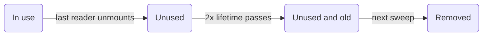

v0.19 permite que un [Manager](/docs/concepts/managers) escriba un lote completo de filas recibidas por streaming en una sola actualización del store, verifica los tipos
del código de endpoints unas 2 veces más rápido y corrige una ronda de problemas de TypeScript y Vue.
Los agentes de programación también reciben un plugin de Claude Code, skills de Vue y llms.txt; consulta
Data Client para agentes de programación.

**Nuevas APIs:**

- [Controller.set() con schemas Array](/blog/2026/10/03/v0.19-batch-set#batch-set) - Escribe muchas entidades en una sola actualización del store con `ctrl.set([Entity], rows)`, [hasta 95 veces más rápido](/blog/2026/10/03/v0.19-batch-set#batch-set-performance) que un `set()` por fila

**Rendimiento:**

- [TypeScript más rápido](/blog/2026/10/03/v0.19-batch-set#faster-types) - Los editores y `tsc` verifican el código de [RestEndpoint](/rest/api/RestEndpoint) y [resource()](/rest/api/resource) [unas 2 veces más rápido con 40% menos memoria](/blog/2026/10/03/v0.19-batch-set#faster-types-results), detectando todos los errores que detectaban antes

**Otras mejoras:**

- Se corrige la resolución de módulos de TypeScript 7 para los `exports` del paquete; los imports ahora resuelven a los archivos de declaración ([#4019](https://github.com/reactive/data-client/pull/4019))
- [renderDataHook()](/docs/api/renderDataHook) ejecuta los efectos de montaje del provider cuando el primer renderizado suspende ([#4099](https://github.com/reactive/data-client/pull/4099))
- [Los valores de Controller.set() se tipan según el schema](/blog/2026/10/03/v0.19-batch-set#typed-set), así que `ctrl.set(new schema.All(Todo), 42)` es un error de TypeScript ([#4133](https://github.com/reactive/data-client/pull/4133))
- [Controller.set() elimina una sola entidad con un schema Invalidate](/blog/2026/10/03/v0.19-batch-set#set-invalidate) sin la solución alternativa del lote de una fila ([#4230](https://github.com/reactive/data-client/pull/4230))
- [process() recibe params tipados](/blog/2026/10/03/v0.19-batch-set#extend-process-params) en `new RestEndpoint()`, `.extend()` y `resource().extend()`, así que un parámetro de ruta incorrecto es un error de TypeScript en lugar de `undefined` en tiempo de ejecución ([#4183](https://github.com/reactive/data-client/pull/4183), [#4184](https://github.com/reactive/data-client/pull/4184))
- [Los valores de retorno de getOptimisticResponse() se tipan según el schema](/blog/2026/10/03/v0.19-batch-set#typed-optimistic-response), así que un tipo de campo incorrecto es un error de TypeScript en lugar de un destello de datos erróneos ([#4198](https://github.com/reactive/data-client/pull/4198))
- [useSuspense()](/vue/api/useSuspense) y [useLive()](/vue/api/useLive) de Vue conservan los datos anteriores mientras cargan los nuevos argumentos, en lugar de devolver `undefined` ([#4131](https://github.com/reactive/data-client/pull/4131))
- [useSuspense()](/vue/api/useSuspense) y [useLive()](/vue/api/useLive) de Vue envían los errores de obtención posteriores a un cambio de argumentos a `onErrorCaptured()` en lugar de producir un rechazo de promesa no manejado ([#4135](https://github.com/reactive/data-client/pull/4135))
- [useSuspense()](/vue/api/useSuspense), [useDLE()](/vue/api/useDLE) y [useFetch()](/vue/api/useFetch) de Vue ya no vuelven a obtener los datos obsoletos en cada actualización del store, así que un `controller.set()` no se sobrescribe ([#4134](https://github.com/reactive/data-client/pull/4134))
- [useSuspense()](/vue/api/useSuspense) de Vue [muestra los datos obsoletos al montarse](/blog/2026/10/03/v0.19-batch-set#vue-stale-while-revalidate) y vuelve a obtenerlos en segundo plano, como en React, en lugar de mostrar el fallback de `<Suspense>` hasta que termina la nueva obtención ([#4169](https://github.com/reactive/data-client/pull/4169))
- [useDLE()](/vue/api/useDLE) y [useCache()](/vue/api/useCache) de Vue conservan los datos `invalidIfStale` caducados a través de actualizaciones del store no relacionadas, en lugar de quedarse atascados cargando ([#4142](https://github.com/reactive/data-client/pull/4142))
- `DataClientPlugin` de Vue se instala en versiones de Vue anteriores a 3.5 en lugar de lanzar `app.onUnmount is not a function` ([#4146](https://github.com/reactive/data-client/pull/4146))
- [DataClientPlugin](/vue/api/DataClientPlugin#gcPolicy) de Vue recolecta basura de forma predeterminada, igual que [DataProvider](/docs/api/DataProvider) de React, así que ya no necesitas pasar `gcPolicy`; [cómo decide qué eliminar](/blog/2026/10/03/v0.19-batch-set#vue-gc) ([#4148](https://github.com/reactive/data-client/pull/4148))
- Los composables de Vue aceptan [argumentos getter](/blog/2026/10/03/v0.19-batch-set#vue-getter-args) como `() => ({ id: props.id })`; estaban tipados para permitirlos pero pasaban la propia función al endpoint ([#4115](https://github.com/reactive/data-client/pull/4115))
- Se corrigen los errores `Cannot find name 'NoInfer'` y `export type` en TypeScript 4.x con `skipLibCheck` desactivado ([#4138](https://github.com/reactive/data-client/pull/4138))
- Se corrigen los errores de tipo de `Entity`, `Endpoint`, `Union` y `RestEndpoint` en TypeScript 4.0–4.5 con `skipLibCheck` desactivado ([#4140](https://github.com/reactive/data-client/pull/4140))
- Se corrigen los errores `',' expected` al importar `@data-client/react/redux`, `@data-client/react/nextjs` o `@data-client/test` en TypeScript 4.0–4.4 ([#4232](https://github.com/reactive/data-client/pull/4232))
- Se corrige que `act` y `renderHook` de `@data-client/test` se tiparan como `any` en TypeScript 4.0–4.4 ([#4251](https://github.com/reactive/data-client/pull/4251))
- Las clases [Entity](/rest/api/Entity) pueden usarse donde se espera un `EntityInterface` ([#4149](https://github.com/reactive/data-client/pull/4149)); [prepara las sobrescrituras de `pk()`](/blog/2026/10/03/v0.19-batch-set#entity-pk-args) para una versión futura
- [useCache()](/docs/api/useCache) y [useDLE()](/docs/api/useDLE) devuelven `undefined` para una entidad eliminada cuya nueva obtención falló, en lugar de un `Symbol` verdadero que se colaba por las comprobaciones `if (!data)`; [elimina cualquier solución alternativa](/blog/2026/10/03/v0.19-batch-set#deleted-entity-undefined) ([#4150](https://github.com/reactive/data-client/pull/4150))
- [useFetch()](/vue/api/useFetch) de Vue evita que sus datos sean recolectados como basura mientras está montado, como [useSuspense()](/vue/api/useSuspense), así que un `gcPolicy` configurado ya no expulsa los datos precargados que los componentes leen después ([#4152](https://github.com/reactive/data-client/pull/4152))
- Las aplicaciones con [Redux DevTools](/docs/getting-started/debugging) abierto ya no se entrecortan en desarrollo con stores grandes o actualizaciones frecuentes; cada actualización [se serializa entre 40 y 60 veces más rápido](/blog/2026/10/03/v0.19-batch-set#devtools-perf) ([#4163](https://github.com/reactive/data-client/pull/4163))
- [resource().extend()](/rest/api/resource#extend) con un objeto de sobrescrituras de endpoints conserva en su tipo los endpoints añadidos antes con `.extend('name', options)`, así que usarlos ya no es un error de TypeScript ([#4184](https://github.com/reactive/data-client/pull/4184))
- [RestEndpoint.push](/blog/2026/10/03/v0.19-batch-set#query-collection-push), `unshift` y `remove` aceptan los campos de la Entity como cuerpo cuando un [Query](/rest/api/Query) o [Lazy](/rest/api/Lazy) envuelve la [Collection](/rest/api/Collection), en lugar de solo `FormData` ([#4226](https://github.com/reactive/data-client/pull/4226))
- [useFetch()](/vue/api/useFetch) de Vue se tipa como el `Ref` de solo lectura que devuelve, así que `promise.resolved` (siempre `undefined`) es ahora un error de TypeScript; lee `promise.value.resolved` en su lugar ([#4114](https://github.com/reactive/data-client/pull/4114))
- Una subclase de `Controller` pasada a [DataProvider](/docs/api/DataProvider#Controller) o [DataClientPlugin](/vue/api/DataClientPlugin#Controller) ya no necesita una conversión de tipo para verificar los tipos ([#4228](https://github.com/reactive/data-client/pull/4228))
- El `store` de [prepareStore()](/docs/guides/redux) puede pasarse al `<Provider>` de react-redux sin una conversión de tipo, y tiene `dispatch()` en su tipo ([#4238](https://github.com/reactive/data-client/pull/4238))
- [resource().create acepta FormData](/blog/2026/10/03/v0.19-batch-set#create-formdata) sin una conversión de tipo, como `update`, `partialUpdate` y `getList.push` ([#4235](https://github.com/reactive/data-client/pull/4235))
- [RestEndpoint.push](/rest/api/RestEndpoint#push), `unshift` y `remove` envían un cuerpo de tipo array como JSON, así que crear o eliminar varios elementos a la vez ya no envía `"[object Object]"` a tu servidor; `resource().create` también acepta un array ([#4262](https://github.com/reactive/data-client/pull/4262))
- `createDataClient()` de Vue queda obsoleto, ya que es interno de [DataClientPlugin](/vue/api/DataClientPlugin); instala el plugin con `app.use(DataClientPlugin, options)` en lugar de llamarlo directamente ([#4193](https://github.com/reactive/data-client/pull/4193))
- `waitForNextUpdate()` de `renderDataCompose()` de Vue queda obsoleto, ya que se rinde en silencio después de 1 segundo y deja pasar una prueba mientras sigue suspendida; usa `await result` en su lugar, o `await allSettled()` después de un cambio, que ahora también espera las obtenciones que inicia un cambio de prop ([pruebas unitarias de composables](/vue/guides/unit-testing-composables#renderdatacompose-api), [#4221](https://github.com/reactive/data-client/pull/4221))

**[Cambios incompatibles:](/blog/2026/10/03/v0.19-batch-set#migration-guide)**

- [Se requiere TypeScript 4.0 o posterior](/blog/2026/10/03/v0.19-batch-set#typescript-4) - se eliminan las declaraciones para TypeScript 3.x ([#4151](https://github.com/reactive/data-client/pull/4151))

**[Prepárate para versiones futuras:](/blog/2026/10/03/v0.19-batch-set#future-releases)**

- [Tipa `args` como `readonly` en las sobrescrituras de `Entity.pk()`](/blog/2026/10/03/v0.19-batch-set#future-pk-args)
- [Usa `DataClientPlugin` en lugar de `createDataClient()` de Vue](/blog/2026/10/03/v0.19-batch-set#future-create-data-client)
- [Reemplaza `waitForNextUpdate()` en las pruebas de Vue](/blog/2026/10/03/v0.19-batch-set#future-wait-for-next-update)

{/* truncate */}

import useBaseUrl from '@docusaurus/useBaseUrl';
import AutoPlayVideo from '@site/src/components/AutoPlayVideo';
import DiffEditor from '@site/src/components/DiffEditor';
import BatchSetDemo from '../../docs/core/shared/\_BatchSetDemo.mdx';
import PerfChart from '@site/src/components/PerfChart';
import PerfTable from '@site/src/components/PerfTable';
import StackBlitz from '@site/src/components/StackBlitz';
import TypeScriptEditor from '@site/src/components/TypeScriptEditor';

## Controller.set() por lotes {#batch-set}

Un [Manager](/docs/concepts/managers) que recibe un flujo de filas (como cotizaciones de precios por un websocket) ahora puede escribirlas
todas con un solo [Controller.set()](/docs/api/Controller#set-array) pasando un schema [Array](/rest/api/Array).
Antes de v0.19, `[Ticker]` era un error de TypeScript, así que la solución alternativa habitual era un `set()` por fila:

<DiffEditor>

```ts title="Before"
ws.onmessage = event => {
  const rows = JSON.parse(event.data);
  for (const row of rows) {
    ctrl.set(Ticker, { product_id: row.product_id }, row);
  }
};
```

```ts title="After"
ws.onmessage = event => {
  const rows = JSON.parse(event.data);
  ctrl.set([Ticker], rows);
};
```

</DiffEditor>

Cada fila se fusiona con su entidad almacenada, y las entidades que no están en la lista quedan intactas. Los schemas Array no reciben `args` ni
función actualizadora. Para agrupar en un lote tipos de Entity mixtos, eliminaciones o filas identificadas por id, pasa un schema [Union](/rest/api/Union),
[Invalidate](/rest/api/Invalidate#batch-invalidation) o [Values](/rest/api/Values); consulta
[Controller.set()](/docs/api/Controller#set-array) para ver ejemplos.
[#4103](https://github.com/reactive/data-client/pull/4103)

<BatchSetDemo />

### Rendimiento {#batch-set-performance}

Cada `set()` es una actualización del store independiente, y cada actualización del store copia la tabla de ese tipo de entidad. Escribir las filas una
por una repite esa copia por cada fila, así que el costo crece tanto con el tamaño del lote como con el tamaño del store. Un lote
paga esa copia una sola vez.

El gráfico es el benchmark `setMany` de node en
[examples/benchmark/core.js](https://github.com/reactive/data-client/blob/master/examples/benchmark/core.js):
un store que ya contiene 500 entidades, y luego un `set()` sincrónico por fila frente a un solo `set([Ticker], rows)`.
Mide la actualización del store: **20 veces** más rápido para 50 filas y **95 veces** más rápido para 500 filas.
[#4103](https://github.com/reactive/data-client/pull/4103)

<PerfChart
  title="setMany de Node en un store de 500 entidades"
  baselineLabel="One set() per row"
  valueLabel="set([Ticker], rows)"
  rows={[
    { label: '50 rows', baseline: 10.8, value: 0.54 },
    { label: '500 rows', baseline: 103, value: 1.08 },
  ]}
/>

<center>

[Benchmarks a lo largo del tiempo](https://reactive.github.io/data-client/dev/bench/) | [Ver el benchmark setMany](https://github.com/reactive/data-client/blob/master/examples/benchmark/core.js)

</center>

En un [Manager](/docs/concepts/managers), almacena en un búfer los mensajes entrantes y vacía cada lote con un solo `set()`, como se describe en
[Agrupar actualizaciones de alta frecuencia](/docs/concepts/managers#batching). El `StreamManager` de la aplicación de criptomonedas ahora
vacía los mensajes de cotización de Coinbase de esta manera.

<AutoPlayVideo
  src={useBaseUrl('/videos/blog/batch-set-devtools.webm')}
  type="video/webm"
  style={{ width: '100%' }}
  alt="Redux DevTools para dos copias del StreamManager de la aplicación de criptomonedas recibiendo tres ráfagas de 500 mensajes de cotización. Llamar a set() por cada mensaje registra 1,500 acciones set, mientras que almacenar los mensajes en un búfer y vaciarlos con set([Ticker], rows) registra 3."
/>

```ts title="StreamManager.ts"
handleMessage(msg: any) {
  if (msg.type in this.entities) {
    (this.buffer[msg.type] ??= {})[msg.product_id] = msg;
    this.flushTimeout ??= setTimeout(this.flush, 50);
  }
}

flush = () => {
  const buffer = this.buffer;
  this.buffer = {};
  this.flushTimeout = undefined;
  for (const type in buffer) {
    this.controller.set([this.entities[type]], Object.values(buffer[type]));
  }
};
```

<StackBlitz app="coin-app" file="src/resources/StreamManager.ts,src/getManagers.ts,src/resources/Ticker.ts" height="600" view="editor" />

:::tip

Si filtras las acciones de [DevToolsManager](/docs/api/DevToolsManager) por schema, el `action.schema` de una escritura por lotes
es el schema Array, así que compara con `action.schema[0]` para `[Ticker]` en lugar de con la propia Entity.

:::

## TypeScript más rápido {#faster-types}

TypeScript vuelve a verificar tu código con cada pulsación de tecla en el editor y en cada build de CI. En aplicaciones con muchos endpoints,
los tipos pesados de las bibliotecas se manifiestan como un autocompletado lento, subrayados rojos que tardan segundos en aparecer y builds más lentos.
v0.19 hace que [RestEndpoint](/rest/api/RestEndpoint), [resource()](/rest/api/resource) y `.extend()` sean mucho más baratos
de verificar, sin cambios de código de tu parte. TypeScript sigue reportando todos los errores que reportaba antes
([#4173](https://github.com/reactive/data-client/pull/4173)).

### Resultados {#faster-types-results}

Nuestra prueba de estrés más pesada, un archivo de 150 RestEndpoints con rutas largas, `.extend()` y `.paginated()`, ahora se verifica
**2 veces más rápido en TypeScript 6** y **2.2 veces más rápido en TypeScript 7**, usando alrededor de **40% menos memoria**. Todas las cifras comparan
los paquetes publicados de v0.18.1 con v0.19; los tiempos de verificación son el mejor de 10 ejecuciones.

<PerfChart
  title="Verificación de 150 RestEndpoints con rutas largas"
  scaleMax={2.4}
  baselineLabel="v0.18"
  valueLabel="v0.19"
  unit="s"
  rows={[
    { label: 'TypeScript 6', baseline: 3.83, value: 1.98 },
    { label: 'TypeScript 7', baseline: 1.5, value: 0.69 },
  ]}
/>

<PerfChart
  title="Memoria para el mismo archivo"
  scaleMax={2.4}
  baselineLabel="v0.18"
  valueLabel="v0.19"
  unit="MB"
  rows={[
    { label: 'TypeScript 6', baseline: 365, value: 211 },
    { label: 'TypeScript 7', baseline: 220, value: 128 },
  ]}
/>

El código con muchos endpoints hace mucho menos trabajo de tipos. Las instanciaciones de tipos son la unidad de trabajo de TypeScript: son
deterministas, así que se comparan limpiamente entre máquinas. Union hace más trabajo que en v0.18, porque v0.19 ahora
[verifica los tipos de los valores de set()](#typed-set) (ver más abajo).

<PerfChart
  title="Instanciaciones de tipos por prueba de estrés"
  scaleMax={2.4}
  baselineLabel="v0.18"
  valueLabel="v0.19"
  unit="K"
  rows={[
    { label: 'Long paths', baseline: 822, value: 341 },
    { label: 'Typical app', baseline: 20.2, value: 13.4 },
    { label: 'React hooks', baseline: 145, value: 122 },
    { label: 'Vue', baseline: 62.6, value: 47.3 },
    { label: '300 fields', baseline: 17.0, value: 12.8 },
    { label: 'Schemas', baseline: 118, value: 99.3 },
    { label: 'Union', baseline: 9.0, value: 16.1 },
  ]}
/>

Pasa el cursor o toca una celda para ver las cifras exactas.

<PerfTable
  columns={[
    { label: 'TS 6 check time', unit: 's' },
    { label: 'TS 7 check time', unit: 's' },
    { label: 'TS 6 memory', unit: 'MB' },
  ]}
  rows={[
    {
      label: 'Long paths',
      description: <>150 RestEndpoints with 6-param paths, <code>.extend()</code> and <code>.paginated()</code></>,
      values: [[3.83, 1.98], [1.5, 0.69], [365, 211]],
    },
    {
      label: 'Typical app',
      description: <>A few resources with <code>.extend()</code>, <code>.paginated()</code> and hooks</>,
      values: [[0.42, 0.42], [0.062, 0.053], [106, 109]],
    },
    {
      label: 'React hooks',
      description: <>40 resources through every hook, plus <code>ctrl.fetch()</code> and <code>ctrl.set()</code></>,
      values: [[1.24, 1.12], [0.41, 0.38], [167, 157]],
    },
    {
      label: 'Vue',
      description: 'The same 40 resources through every composable',
      values: [[0.68, 0.68], [0.17, 0.15], [145, 139]],
    },
    {
      label: '300 fields',
      description: 'One Entity with 300 fields, read and updated 100 times',
      values: [[0.44, 0.38], [0.086, 0.052], [111, 101]],
    },
    {
      label: 'Schemas',
      description: 'All, Query, Invalidate, Array, Object and Collection',
      values: [[1.1, 1.07], [0.36, 0.31], [156, 150]],
    },
    {
      label: 'Union',
      description: 'A 30-member Union in a Collection and Values',
      values: [[0.42, 0.41], [0.071, 0.068], [107, 101]],
    },
    {
      label: 'set() values',
      description: <>1000 <code>ctrl.set()</code> calls on a 30-member Union, a Collection of it and a 300-field Entity</>,
      values: [[1.49, 1.07], [0.54, 0.25], [176, 131]],
    },
    {
      label: 'set() updaters',
      description: <>1000 <code>ctrl.set(Union, args, prev =&gt; ...)</code> updaters on a 30-member Union</>,
      values: [[3.58, 3.43], [1.67, 1.85], [381, 384]],
    },
  ]}
/>

Las filas de set() miden los [valores tipados de set()](#typed-set), que v0.18 no verificaba en absoluto. Los valores simples siguen verificándose
más rápido que antes, y las funciones actualizadoras sobre Unions grandes se verifican aproximadamente en el mismo tiempo aunque TypeScript ahora
verifica el valor de retorno de cada actualizadora ([#4179](https://github.com/reactive/data-client/pull/4179)).

Los archivos pequeños están dominados por el costo fijo de arranque de TypeScript (cargar `lib.dom.d.ts` por sí solo ocupa unos 100MB), así que
su tiempo y memoria apenas cambian. El ahorro se acumula a medida que crece una base de código.

### Qué cambió {#faster-types-how}

- `.extend()` y `.paginated()` se comparten entre todos los endpoints en lugar de recrearse para cada tipo de endpoint.
- Las opciones de los endpoints se infieren como tipos de objeto simples, así que TypeScript deja de reconstruirlas en cada uso.
- Los parámetros de ruta como `/users/:id` se leen en una sola pasada.

Antes de publicar, desactivamos todos los `@ts-expect-error` del conjunto de pruebas en TypeScript 4.0 a 7 y confirmamos
que cada error sigue apareciendo en el mismo lugar.

En TypeScript 5.x y anteriores, un método `process(value, params)` pasado a `.extend()` tampoco falla ya con
"implicitly has an 'any' type" bajo `strict`.

## Otras mejoras {#other-improvements}

### Valores tipados de set() {#typed-set}

[Controller.set()](/docs/api/Controller#set) antes aceptaba cualquier valor para un schema, así que un error tipográfico o un tipo de campo
incorrecto solo se manifestaba como datos erróneos en tiempo de ejecución. Los valores ahora se tipan según el schema: una
[Entity](/rest/api/Entity) recibe sus campos, mientras que una [Collection](/rest/api/Collection), [All](/rest/api/All) o
Array recibe una lista de filas. Todos los campos son opcionales, ya que `set()` se fusiona con lo que ya está almacenado, y
los números y las cadenas son intercambiables, igual que en las respuestas de la API.
[#4133](https://github.com/reactive/data-client/pull/4133)

Pasa el cursor sobre los subrayados rojos para ver cada error.

<TypeScriptEditor>

```ts title="Todo" collapsed
import { Entity, resource } from '@data-client/rest';

export class Todo extends Entity {
  id = 0;
  userId = 0;
  title = '';
  completed = false;

  static key = 'Todo';
}

export const TodoResource = resource({
  urlPrefix: 'https://jsonplaceholder.typicode.com',
  path: '/todos/:id',
  schema: Todo,
});
```

```ts title="updateTodos"
import type { Controller } from '@data-client/react';
import { schema } from '@data-client/rest';
import { Todo, TodoResource } from './Todo';

export function updateTodos(ctrl: Controller) {
  // ✅ rows are partial Todos; ids may be strings or numbers
  ctrl.set(TodoResource.getList.schema, [{ id: '5', completed: true }]);
  ctrl.set(Todo, { id: 5 }, todo => ({ completed: !todo.completed }));
  ctrl.set([Todo], [{ id: 1, title: 'first' }, { id: 2 }]);

  // ❌ All takes a list of rows
  ctrl.set(new schema.All(Todo), 42);
  // ❌ completed is a boolean
  ctrl.set(Todo, { id: 5 }, { id: 5, completed: 'yes' });
  // ❌ Todo has no done field
  ctrl.set(TodoResource.getList.schema, [{ id: 5, done: true }]);
  // ❌ updaters must return Todo fields
  ctrl.set(Todo, { id: 5 }, todo => ({ title: todo.completed }));
}
```

</TypeScriptEditor>

Un [Query](/rest/api/Query) recibe la entrada del schema que envuelve, ya que `set()` normaliza ese schema en lugar de
revertir `process()`. Cuando cada miembro declara su discriminador como un literal (como `readonly type = 'post'`), una
fila de [Union](/rest/api/Union) se verifica contra el miembro que selecciona, así que no puede mezclar campos de miembros distintos; consulta [Unions](/docs/api/Controller#set).

Si código que antes compilaba ahora falla aquí, estaba escribiendo datos que su schema no describe. Corrige el valor,
o amplía los tipos de los campos de la Entity si los datos realmente pueden tener esa forma.

### Eliminar una sola entidad con set() {#set-invalidate}

Pasar un schema [Invalidate](/rest/api/Invalidate) a [Controller.set()](/docs/api/Controller#set-array) elimina la
entidad que identifica su fila, pero la forma individual era un error de TypeScript, así que el código la envolvía en un lote de una fila. Ahora
verifica los tipos correctamente, con la fila tipada según los campos de la Entity
([#4230](https://github.com/reactive/data-client/pull/4230)):

<DiffEditor>

```ts title="Before"
ctrl.set([new Invalidate(Todo)], [{ id: '5' }]);
```

```ts title="After"
ctrl.set(new Invalidate(Todo), { id: '5' });
```

</DiffEditor>

Como el `set()` por lotes, no recibe `args` ni función actualizadora.

### Params tipados de process() {#extend-process-params}

Un método [process()](/rest/api/RestEndpoint#process) pasado a `new RestEndpoint()`,
[.extend()](/rest/api/RestEndpoint#extend) o [resource().extend()](/rest/api/resource#extend) recibía `params` tipado como
`any`, así que leer un parámetro que el endpoint no tiene compilaba y devolvía `undefined` en tiempo de ejecución. `params` y
`body` ahora se tipan a partir del endpoint, incluido un `path` definido en la misma llamada a `.extend()`
([#4183](https://github.com/reactive/data-client/pull/4183), [#4184](https://github.com/reactive/data-client/pull/4184)):

<TypeScriptEditor>

```ts
import { RestEndpoint } from '@data-client/rest';

const getUser = new RestEndpoint({ path: '/users/:id' });

export const getUserById = getUser.extend({
  path: '/users/by-id/:userId',
  process(value, params) {
    const userId: string | number = params.userId;
    // @ts-expect-error 'id' is not a param of '/users/by-id/:userId'
    params.id;
    return { ...value, userId };
  },
});
```

</TypeScriptEditor>

Cuando todos los params son opcionales, `params` puede ser `undefined`, así que léelo con `params?.page`.

Esto puede hacer aparecer nuevos errores de TypeScript en métodos `process()` existentes. Cada uno marca una lectura que podría ser `undefined`
o lanzar una excepción en tiempo de ejecución, así que corrige el nombre del parámetro o añade la comprobación que falta.

### Respuestas optimistas tipadas {#typed-optimistic-response}

[getOptimisticResponse()](/rest/api/RestEndpoint#getoptimisticresponse) podía devolver cualquier cosa a menos que el endpoint tuviera
un `process()` tipado, así que un tipo de campo incorrecto solo se manifestaba como datos erróneos en la interfaz hasta que el servidor respondía. El valor
de retorno ahora se verifica contra el schema del endpoint, como un [valor tipado de set()](#typed-set): una Entity recibe cualquiera de sus
campos, y una [Collection](/rest/api/Collection) recibe una lista de ellos
([#4198](https://github.com/reactive/data-client/pull/4198)):

<TypeScriptEditor>

```ts
import { Entity, RestEndpoint } from '@data-client/rest';

class Todo extends Entity {
  id = 0;
  title = '';
  completed = false;
}

export const toggleTodo = new RestEndpoint({
  path: '/todos/:id',
  method: 'PATCH',
  schema: Todo,
  // @ts-expect-error completed is a boolean; 'false' is truthy, so the checkbox would stay checked
  getOptimisticResponse(snap, { id }) {
    const todo = snap.get(Todo, { id });
    if (!todo) throw snap.abort;
    return { id, completed: todo.completed ? 'false' : 'true' };
  },
});
```

</TypeScriptEditor>

Esto puede hacer aparecer nuevos errores de TypeScript en métodos `getOptimisticResponse()` existentes. Cada uno marca un valor que se
almacenaría con el tipo incorrecto hasta que el servidor responda, así que devuelve el tipo real del campo (aquí `!todo.completed`).

### push() tipado en Collections ordenadas {#query-collection-push}

Envolver una [Collection](/rest/api/Collection) en un [Query](/rest/api/Query) para ordenarla o filtrarla hacía que
[push](/rest/api/RestEndpoint#push), `unshift` y `remove` rechazaran cualquier cuerpo excepto `FormData`, aunque sí agregan a la
lista en tiempo de ejecución. El cuerpo ahora se tipa a partir de la Entity de la Collection, así que la conversión de tipo puede eliminarse y un campo incorrecto es un
error de TypeScript. Lo mismo aplica a una Collection envuelta en [Lazy](/rest/api/Lazy)
([#4226](https://github.com/reactive/data-client/pull/4226)).

<DiffEditor>

```ts title="Before"
import { useController } from '@data-client/react';
import { getPosts } from './getPosts';

export function useAddPost() {
  const ctrl = useController();
  return (title: string, author: string) =>
    ctrl.fetch(getPosts.push, { group: 'react' }, { title, author } as any);
}
```

```ts title="After"
import { useController } from '@data-client/react';
import { getPosts } from './getPosts';

export function useAddPost() {
  const ctrl = useController();
  return (title: string, author: string) =>
    ctrl.fetch(getPosts.push, { group: 'react' }, { title, author });
}
```

</DiffEditor>

donde `getPosts` ordena su Collection con un Query:

```ts title="getPosts.ts"
import { Collection, Entity, Query, RestEndpoint } from '@data-client/rest';

export class Post extends Entity {
  id = '';
  title = '';
  group = '';
  author = '';
}

export const getPosts = new RestEndpoint({
  path: '/:group/posts',
  searchParams: {} as { orderBy?: 'title' | 'author' },
  schema: new Query(
    new Collection([Post], { nonFilterArgumentKeys: /orderBy/ }),
    (posts, { orderBy }: { orderBy?: 'title' | 'author' } = {}) =>
      orderBy ?
        [...posts].sort((a, b) => a[orderBy].localeCompare(b[orderBy]))
      : posts,
  ),
});
```

### FormData en resource().create {#create-formdata}

El `create` de [resource()](/rest/api/resource) envía un cuerpo `FormData` tal cual, como `update`, `partialUpdate` y
[getList.push](/rest/api/resource#push), pero su tipo solo permitía un objeto, así que enviar un formulario necesitaba una conversión de tipo
([#4235](https://github.com/reactive/data-client/pull/4235)). Elimina la conversión:

<DiffEditor>

```tsx title="Before"
<form
  onSubmit={e => {
    e.preventDefault();
    ctrl.fetch(PostResource.create, new FormData(e.currentTarget) as any);
  }}
>
```

```tsx title="After"
<form
  onSubmit={e => {
    e.preventDefault();
    ctrl.fetch(PostResource.create, new FormData(e.currentTarget));
  }}
>
```

</DiffEditor>

`create` está obsoleto; [getList.push](/rest/api/resource#push) es su reemplazo y también acepta `FormData`.

### Argumentos getter en Vue {#vue-getter-args}

Los composables de Vue como [useSuspense()](/vue/api/useSuspense) y [useLive()](/vue/api/useLive) estaban tipados para aceptar una
función getter como argumento, pero pasaban la propia función al endpoint en lugar de llamarla. Los getters ahora
funcionan igual que los refs y `computed`, y el composable vuelve a obtener los datos cuando cambia cualquier cosa que el getter lee
([#4115](https://github.com/reactive/data-client/pull/4115)). Elimina el envoltorio `computed()` si solo lo usabas para hacer
reactivos los argumentos:

<DiffEditor>

```ts title="Before"
import { computed } from 'vue';

const props = defineProps<{ id: number }>();
const article = await useSuspense(
  ArticleResource.get,
  computed(() => ({ id: props.id })),
);
```

```ts title="After"
const props = defineProps<{ id: number }>();
const article = await useSuspense(ArticleResource.get, () => ({
  id: props.id,
}));
```

</DiffEditor>

Esto aplica a todos los composables que reciben argumentos de endpoint: [useSuspense()](/vue/api/useSuspense),
[useLive()](/vue/api/useLive), [useCache()](/vue/api/useCache), [useDLE()](/vue/api/useDLE),
[useFetch()](/vue/api/useFetch), [useQuery()](/vue/api/useQuery) y [useSubscription()](/vue/api/useSubscription).

### Vue recolecta basura de forma predeterminada {#vue-gc}

El [DataClientPlugin](/vue/api/DataClientPlugin#gcPolicy) de Vue solo eliminaba los datos sin uso si pasabas un `gcPolicy`
tú mismo. Ahora usa `new GCPolicy()` de forma predeterminada, igual que el [DataProvider](/docs/api/DataProvider) de React, así que puedes
eliminar la opción a menos que la personalices ([#4148](https://github.com/reactive/data-client/pull/4148)).

<DiffEditor>

```ts title="Before"
import { DataClientPlugin, GCPolicy } from '@data-client/vue';

app.use(DataClientPlugin, { gcPolicy: new GCPolicy() });
```

```ts title="After"
import { DataClientPlugin } from '@data-client/vue';

app.use(DataClientPlugin);
```

</DiffEditor>

Los datos se eliminan solo cuando ningún componente montado los lee _y_ ha pasado el doble de su tiempo de frescura desde que se
obtuvieron (al menos dos minutos). Un barrido comprueba cada cinco minutos. Todo lo que un componente vuelva a leer antes de eso
vuelve a estar en uso.

<center>

<div style={{maxWidth:'640px'}}>



</div>

</center>

Un componente que se monta después de la eliminación trata los datos como si nunca se hubieran obtenido: [useSuspense()](/vue/api/useSuspense) los
obtiene de nuevo, mientras que [useCache()](/vue/api/useCache) devuelve `undefined`. Para conservar los datos sin uso más tiempo o barrer con menos frecuencia,
pasa tu propio [gcPolicy](/vue/api/DataClientPlugin#gcPolicy).

### Stale-while-revalidate en Vue {#vue-stale-while-revalidate}

Cuando un componente se monta con datos que están [obsoletos](/docs/concepts/expiry-policy#stale) pero siguen siendo válidos, el
[useSuspense()](/vue/api/useSuspense) de Vue ahora los renderiza de inmediato y vuelve a obtenerlos en segundo plano, como en React. Antes,
mostraba el fallback de `<Suspense>` hasta que terminaba la nueva obtención ([#4169](https://github.com/reactive/data-client/pull/4169)).

<AutoPlayVideo
  src={useBaseUrl('/videos/blog/vue-suspense-stale.mp4')}
  type="video/mp4"
  width="720"
  alt="Dos componentes de Vue lado a lado, antes y después de v0.19. Ambos muestran Loading en el primer montaje. Tras desmontarlos y esperar hasta que el precio queda obsoleto, al volver a montarlos la versión anterior muestra Loading de nuevo, mientras que la versión posterior muestra el precio obsoleto de inmediato y vuelve a obtenerlo en segundo plano."
/>

### Las clases Entity verifican tipos como EntityInterface {#entity-pk-args}

Las funciones auxiliares tipadas para aceptar cualquier Entity con `EntityInterface` rechazaban las clases Entity, porque
[Entity.pk()](/rest/api/Entity#pk) tipaba sus `args` como un array mutable. Ahora es `readonly any[]`, así que esto
verifica los tipos correctamente ([#4149](https://github.com/reactive/data-client/pull/4149)):

<TypeScriptEditor>

```ts
import { Entity } from '@data-client/rest';
import type { EntityInterface } from '@data-client/react';

class User extends Entity {
  id = '';
  name = '';
}

function entityName(schema: EntityInterface) {
  return schema.key;
}

entityName(User);
```

</TypeScriptEditor>

Si sobrescribes `static pk()` y tipas `args` como un array mutable, todavía compila, pero una futura versión con cambios incompatibles
exigirá `readonly`; [actualízalo ahora](#future-pk-args).

### Las entidades eliminadas se leen como undefined {#deleted-entity-undefined}

Cuando una entidad se eliminaba y su nueva obtención fallaba, [useCache()](/docs/api/useCache) y [useDLE()](/docs/api/useDLE)
(React y Vue) devolvían un `Symbol` interno como datos. Un `Symbol` es verdadero, así que la comprobación habitual de "todavía no cargado" lo dejaba
pasar y el componente se renderizaba como si tuviera una entidad
([#4150](https://github.com/reactive/data-client/pull/4150)):

```tsx
function TodoDetail({ id }: { id: number }) {
  const todo = useCache(TodoResource.get, { id });
  // a deleted todo used to get past this guard, so todo.title.trim() threw
  if (!todo) return <TodoPlaceholder />;
  return <h3>{todo.title.trim()}</h3>;
}
```

Ahora `data` es `undefined`, en consonancia con su tipo y con [Controller.get()](/docs/api/Controller#get). Lo mismo aplica a
[Controller.getResponse()](/docs/api/Controller#getResponse) y
[Controller.fetchIfStale()](/docs/api/Controller#fetchIfStale), por ejemplo en [Managers](/docs/api/Manager) personalizados.

Si tenías una solución alternativa para esto, puedes eliminarla. Una simple comprobación de veracidad es suficiente:

<DiffEditor>

```tsx title="Before"
function TodoDetail({ id }: { id: number }) {
  const todo = useCache(TodoResource.get, { id });
  if (!todo || typeof todo === 'symbol') return <TodoPlaceholder />;
  return <h3>{todo.title.trim()}</h3>;
}
```

```tsx title="After"
function TodoDetail({ id }: { id: number }) {
  const todo = useCache(TodoResource.get, { id });
  if (!todo) return <TodoPlaceholder />;
  return <h3>{todo.title.trim()}</h3>;
}
```

</DiffEditor>

Para mostrar algo específico cuando la nueva obtención falló (por ejemplo, un 404 tras la eliminación), lee `error` de
[useDLE()](/docs/api/useDLE) en lugar de inspeccionar `data`.

### Redux DevTools más rápido {#devtools-perf}

Con la extensión [Redux DevTools](/docs/getting-started/debugging) abierta, cada actualización del store en desarrollo
serializa todo el store para la extensión, y cada marca de tiempo en él se formateaba de la manera lenta. Los stores grandes o las
actualizaciones frecuentes, como el sondeo (polling), los datos en vivo o muchas llamadas a `controller.set()`, hacían que la página se entrecortara. Cada actualización ahora
se serializa **entre 40 y 60 veces más rápido**, y las marcas de tiempo siguen leyéndose como `10:42:07.123 AM`
([#4163](https://github.com/reactive/data-client/pull/4163)). Los builds de producción no incluyen DevTools, así que no se ven
afectados.

<PerfChart
  title="Serialización de DevTools por actualización del store"
  baselineLabel="v0.18"
  valueLabel="v0.19"
  rows={[
    { label: '50 entities', baseline: 18.6, value: 0.31 },
    { label: '500 entities', baseline: 201, value: 5.0 },
  ]}
/>

## Guía de migración {#migration-guide}

import PkgTabs from '@site/src/components/PkgTabs';

Esta actualización requiere actualizar todas las versiones de los paquetes al mismo tiempo.

<PkgTabs pkgs="@data-client/react@^0.19.0 @data-client/rest@^0.19.0 @data-client/endpoint@^0.19.0 @data-client/core@^0.19.0 @data-client/vue@^0.19.0 @data-client/test@^0.19.0 @data-client/img@^0.19.0" upgrade />

### TypeScript 4.0 o posterior {#typescript-4}

Omite esta sección si ya usas TypeScript 4.0 o posterior.

Se eliminan las declaraciones para TypeScript 3.x, ya que dejaron de verificar tipos correctamente en todas las versiones de TypeScript 3.x. Sube
`typescript` a `^4.0.0` o posterior en tus `devDependencies`. [#4151](https://github.com/reactive/data-client/pull/4151)

### Prepárate para versiones futuras {#future-releases}

Nada de esto es necesario para actualizar a 0.19; tu código sigue funcionando tal cual. Cada elemento se romperá en una versión futura,
así que actualizarlo ahora convierte esa actualización en algo trivial.

#### Los args de Entity.pk() son readonly {#future-pk-args}

Omite esto si no sobrescribes `static pk()` con un parámetro `args` tipado.

[Entity.pk()](/rest/api/Entity#pk) ahora tipa `args` como `readonly any[]`. Las sobrescrituras que lo anotan como un array
mutable todavía compilan por ahora, pero una versión futura exigirá `readonly`.

<DiffEditor>

```ts title="Before"
class User extends Entity {
  static pk(value: any, parent?: any, key?: string, args?: any[]) {
    return `${value.id}-${args?.[0]?.org}`;
  }
}
```

```ts title="After"
class User extends Entity {
  static pk(value: any, parent?: any, key?: string, args?: readonly any[]) {
    return `${value.id}-${args?.[0]?.org}`;
  }
}
```

</DiffEditor>

#### createDataClient() de Vue {#future-create-data-client}

Omite esto si instalas el store con `app.use(DataClientPlugin)`.

`createDataClient()` y `ProvidedDataClient` son internos de [DataClientPlugin](/vue/api/DataClientPlugin) y
dejarán de exportarse. Instala el plugin en su lugar, y lee el controller con
[useController()](/vue/api/useController). [#4193](https://github.com/reactive/data-client/pull/4193)

<DiffEditor>

```ts title="Before"
import { createDataClient } from '@data-client/vue';

const { controller } = createDataClient({ managers, initialState });
```

```ts title="After"
import { DataClientPlugin, useController } from '@data-client/vue';

app.use(DataClientPlugin, { managers, initialState });
// in a component's setup()
const controller = useController();
```

</DiffEditor>

#### waitForNextUpdate() de renderDataCompose() en Vue {#future-wait-for-next-update}

Omite esto si tus pruebas de Vue no llaman a `waitForNextUpdate()`.

`waitForNextUpdate()` de [renderDataCompose()](/vue/guides/unit-testing-composables#renderdatacompose-api) se rinde
en silencio después de 1 segundo, así que una prueba puede pasar mientras el composable sigue suspendido. Se eliminará. Usa `await` sobre el
resultado en su lugar, y llama a `allSettled()` después de cambiar props o llamar al controller; ahora también espera la
obtención que inicia un cambio de prop. [#4221](https://github.com/reactive/data-client/pull/4221)

<DiffEditor>

```ts title="Before"
const { result, waitForNextUpdate } = await renderDataCompose(
  (props: { id: number }) =>
    useSuspense(ArticleResource.get, () => ({ id: props.id })),
  { props, resolverFixtures },
);
await waitForNextUpdate();
const article = await result;

props.id = 6;
await waitForNextUpdate();
```

```ts title="After"
const { result, allSettled } = await renderDataCompose(
  (props: { id: number }) =>
    useSuspense(ArticleResource.get, () => ({ id: props.id })),
  { props, resolverFixtures },
);
const article = await result;

props.id = 6;
await allSettled();
```

</DiffEditor>

### Soporte para la actualización {#upgrade-support}

Como siempre, si tienes algún problema o pregunta, no dudes en unirte a nuestro [](https://discord.gg/wXGV27xm6t) o [reportar un error](https://github.com/reactive/data-client/issues/new/choose)
