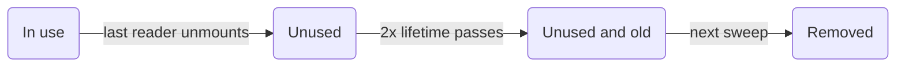

import useBaseUrl from '@docusaurus/useBaseUrl';
import AutoPlayVideo from '@site/src/components/AutoPlayVideo';
import CartBefore from '@site/src/components/CartBefore';
import DiffEditor from '@site/src/components/DiffEditor';
import HooksPlayground from '@site/src/components/HooksPlayground';
import BatchSetDemo from '../../docs/core/shared/\_BatchSetDemo.mdx';
import PerfChart from '@site/src/components/PerfChart';
import PerfTable from '@site/src/components/PerfTable';
import StackBlitz from '@site/src/components/StackBlitz';
import TypeScriptEditor from '@site/src/components/TypeScriptEditor';
import {
  cartFixtures,
  getInitialInterceptorData,
} from '@site/src/fixtures/cart';

export const readdDemo = [
  { delay: 1200, click: 'button[aria-label="Remove Ceramic mug"]' },
  { wait: 1500 },
  { click: '.toast button' },
];

v0.19 permite que un [Manager](/docs/concepts/managers) escriba un lote completo de filas transmitidas en una sola actualización del store, comprueba los tipos
del código de endpoints cerca de 2 veces más rápido y corrige una tanda de problemas de TypeScript y Vue.

**[Controller.set() por lotes](/blog/2026/11/18/v0.19-batch-set#batch-set)** escribe un flujo completo de filas, como los precios de un ticker que llegan por un websocket, en una sola
actualización del store con `ctrl.set([Ticker], rows)`. Eso es [hasta 95 veces más rápido](/blog/2026/11/18/v0.19-batch-set#batch-set-performance) que un `set()` por fila.

<BatchSetDemo />

<PerfChart
  title="setMany de Node en un store de 500 entidades"
  baselineLabel="One set() per row"
  valueLabel="set([Ticker], rows)"
  rows={[
    { label: '50 rows', baseline: 10.8, value: 0.54 },
    { label: '500 rows', baseline: 103, value: 1.08 },
  ]}
/>

**[TypeScript más rápido](/blog/2026/11/18/v0.19-batch-set#faster-types)**: los editores y `tsc` comprueban el código de [RestEndpoint](/rest/api/RestEndpoint) y
[resource()](/rest/api/resource) cerca de 2 veces más rápido y con un 40% menos de memoria, y siguen reportando todos los errores que reportaban
antes.

<PerfChart
  title="Comprobación de 150 RestEndpoints con rutas largas"
  scaleMax={2.4}
  baselineLabel="v0.18"
  valueLabel="v0.19"
  unit="s"
  rows={[
    { label: 'TypeScript 6', baseline: 3.83, value: 1.98 },
    { label: 'TypeScript 7', baseline: 1.5, value: 0.69 },
  ]}
/>

**Más en v0.19:**

- [Rendimiento](/blog/2026/11/18/v0.19-batch-set#performance): [Redux DevTools más rápido](/blog/2026/11/18/v0.19-batch-set#devtools-perf), [pausas de GC más cortas en React Native](/blog/2026/11/18/v0.19-batch-set#native-gc) y [bundles divididos más pequeños](/blog/2026/11/18/v0.19-batch-set#smaller-chunks)
- [Cliente](/blog/2026/11/18/v0.19-batch-set#client): [eliminar una entidad con set()](/blog/2026/11/18/v0.19-batch-set#set-invalidate), [las lecturas sin await no necesitan `.catch()`](/blog/2026/11/18/v0.19-batch-set#fetch-read-prehandled), [`<Activity>` sobre DataProvider](/blog/2026/11/18/v0.19-batch-set#loading-error-fixes) y [correcciones de carga y error](/blog/2026/11/18/v0.19-batch-set#loading-error-states)
- [Plataformas](/blog/2026/11/18/v0.19-batch-set#platforms): [React Native 0.87 y Babel 8](/blog/2026/11/18/v0.19-batch-set#platforms)
- [Vue](/blog/2026/11/18/v0.19-batch-set#vue): [recolección de basura por defecto](/blog/2026/11/18/v0.19-batch-set#vue-gc), [stale-while-revalidate](/blog/2026/11/18/v0.19-batch-set#vue-stale-while-revalidate) y [argumentos getter](/blog/2026/11/18/v0.19-batch-set#vue-getter-args)
- [Collections](/blog/2026/11/18/v0.19-batch-set#collection-updates): [listas de elementos](/blog/2026/11/18/v0.19-batch-set#push-list) en cada actualización y [cada elemento se muestra una sola vez](/blog/2026/11/18/v0.19-batch-set#collection-order)
- [Validación](/blog/2026/11/18/v0.19-batch-set#validation): [valores tipados de `set()`](/blog/2026/11/18/v0.19-batch-set#typed-set), [parámetros de `process()`](/blog/2026/11/18/v0.19-batch-set#extend-process-params) y [respuestas optimistas](/blog/2026/11/18/v0.19-batch-set#typed-optimistic-response); correcciones de [pruebas](/blog/2026/11/18/v0.19-batch-set#testing) y de [advertencias](/blog/2026/11/18/v0.19-batch-set#warnings)

**[Cambios incompatibles:](/blog/2026/11/18/v0.19-batch-set#migration-guide)**

- [Para todos los usuarios](/blog/2026/11/18/v0.19-batch-set#migrate-all)
  - [El Pages Router de Next.js no es compatible](/blog/2026/11/18/v0.19-batch-set#nextjs-pages-router); usa el App Router ([#4648](https://github.com/reactive/data-client/pull/4648))
  - [Se requiere TypeScript 4.0 o posterior](/blog/2026/11/18/v0.19-batch-set#typescript-4): se eliminan las declaraciones de TypeScript 3.x ([#4151](https://github.com/reactive/data-client/pull/4151))
  - [`managers` es una función que crea los Managers de cada store](/blog/2026/11/18/v0.19-batch-set#managers-function); `npx @data-client/codemods v0.19 src/` convierte los arrays ([#4601](https://github.com/reactive/data-client/pull/4601))
  - [Controller.fetchIfStale() siempre devuelve una Promise](/blog/2026/11/18/v0.19-batch-set#fetch-if-stale-promise), así que las precargas no necesitan `.catch()` ([#4657](https://github.com/reactive/data-client/pull/4657))
  - [`__DC_CONTROLLERS__` ahora es `__DC__`](/blog/2026/11/18/v0.19-batch-set#dc-global) para los scripts de depuración ([#4435](https://github.com/reactive/data-client/pull/4435))
- [Para autores de Managers personalizados](/blog/2026/11/18/v0.19-batch-set#custom-managers)
  - [Los Managers deben definir `middleware`](/blog/2026/11/18/v0.19-batch-set#manager-middleware): se elimina `getMiddleware()` ([#4378](https://github.com/reactive/data-client/pull/4378), [#4382](https://github.com/reactive/data-client/pull/4382))
  - [`cleanup()` de un Manager ya no significa que el store haya desaparecido](/blog/2026/11/18/v0.19-batch-set#manager-cleanup): inicia los temporizadores y las conexiones en `init()`, y se elimina `NetworkManager.cleanupDate` ([#4593](https://github.com/reactive/data-client/pull/4593))
- [Para autores de pruebas](/blog/2026/11/18/v0.19-batch-set#migrate-tests)
  - [@data-client/test requiere @data-client/react 0.19](/blog/2026/11/18/v0.19-batch-set#test-react-0.19) ([#4414](https://github.com/reactive/data-client/pull/4414), [#4601](https://github.com/reactive/data-client/pull/4601))
  - [Las pruebas de React Native necesitan @testing-library/react-native](/blog/2026/11/18/v0.19-batch-set#test-react-native) ([#4595](https://github.com/reactive/data-client/pull/4595))

**[Prepárate para futuras versiones:](/blog/2026/11/18/v0.19-batch-set#future-releases)**

- [Tipa `args` como `readonly` en las sobrescrituras de `Entity.pk()`](/blog/2026/11/18/v0.19-batch-set#future-pk-args)
- [Usa `DataClientPlugin` en lugar de `createDataClient()` de Vue](/blog/2026/11/18/v0.19-batch-set#future-create-data-client)
- [Reemplaza `waitForNextUpdate()` en las pruebas de Vue](/blog/2026/11/18/v0.19-batch-set#future-wait-for-next-update)

**[Adopta las nuevas funcionalidades:](/blog/2026/11/18/v0.19-batch-set#adopt-features)** `npx @data-client/codemods v0.19 src/ --improvements=only` agrupa en lotes los bucles de `set()` y elimina los workarounds que 0.19 vuelve innecesarios

{/* truncate */}

## Rendimiento {#performance}

TypeScript se ejecuta con cada pulsación de tecla, el store se actualiza con cada mensaje transmitido y tu bundle se carga en cada visita a una página.

### Controller.set() por lotes {#batch-set}

`react` `vue`

Un [Manager](/docs/concepts/managers) que recibe un flujo de filas (como los precios de un ticker por un websocket) ahora puede escribirlas
todas con un solo [Controller.set()](/docs/api/Controller#set-array) pasando un schema de [Array](/rest/api/Array).
Antes de v0.19, `[Ticker]` era un error de TypeScript, así que el workaround habitual era un `set()` por fila:

<DiffEditor>

```ts title="Before"
ws.onmessage = event => {
  const rows = JSON.parse(event.data);
  for (const row of rows) {
    ctrl.set(Ticker, { product_id: row.product_id }, row);
  }
};
```

```ts title="After"
ws.onmessage = event => {
  const rows = JSON.parse(event.data);
  ctrl.set([Ticker], rows);
};
```

</DiffEditor>

Cada fila se combina con su entidad almacenada, y las entidades que no están en la lista no se tocan. Los schemas Array no aceptan `args` ni
función actualizadora. Para agrupar en lotes tipos de Entity mezclados, eliminaciones o filas indexadas por id, pasa un schema [Union](/rest/api/Union),
[Invalidate](/rest/api/Invalidate#batch-invalidation) o [Values](/rest/api/Values); consulta
[Controller.set()](/docs/api/Controller#set-array) para ver ejemplos.
[#4103](https://github.com/reactive/data-client/pull/4103)

#### Rendimiento {#batch-set-performance}

Cada `set()` es una actualización independiente del store, y cada actualización del store copia la tabla de ese tipo de entidad. Escribir las filas una
por una repite esa copia para cada fila, así que el costo crece tanto con el tamaño del lote como con el del store. Un lote
paga esa copia una sola vez.

El gráfico al inicio de esta publicación es el benchmark `setMany` de Node en
[examples/benchmark/core.js](https://github.com/reactive/data-client/blob/master/examples/benchmark/core.js):
un store que ya contiene 500 entidades, y luego un `set()` síncrono por fila frente a un solo `set([Ticker], rows)`.
Mide la actualización del store: **20 veces** más rápido con 50 filas y **95 veces** más rápido con 500 filas.
[#4103](https://github.com/reactive/data-client/pull/4103)

<center>

[Benchmarks a lo largo del tiempo](https://reactive.github.io/data-client/dev/bench/) | [Ver el benchmark setMany](https://github.com/reactive/data-client/blob/master/examples/benchmark/core.js)

</center>

En un [Manager](/docs/concepts/managers), acumula los mensajes entrantes y envía cada lote con un solo `set()`, como se describe en
[Agrupar actualizaciones de alta frecuencia](/docs/concepts/managers#batching). El `StreamManager` de la app coin ahora
envía así los mensajes del ticker de Coinbase.

<AutoPlayVideo
  src={useBaseUrl('/videos/blog/batch-set-devtools.webm')}
  type="video/webm"
  style={{ width: '100%' }}
  alt="Redux DevTools de dos copias del StreamManager de la app coin que reciben tres ráfagas de 500 mensajes de ticker. Llamar a set() por cada mensaje registra 1,500 acciones set, mientras que acumular los mensajes y enviarlos con set([Ticker], rows) registra 3."
/>

```ts title="StreamManager.ts"
handleMessage(msg: any) {
  if (msg.type in this.entities) {
    (this.buffer[msg.type] ??= {})[msg.product_id] = msg;
    this.flushTimeout ??= setTimeout(this.flush, 50);
  }
}

flush = () => {
  const buffer = this.buffer;
  this.buffer = {};
  this.flushTimeout = undefined;
  for (const type in buffer) {
    this.controller.set([this.entities[type]], Object.values(buffer[type]));
  }
};
```

<StackBlitz app="coin-app" file="src/resources/StreamManager.ts,src/getManagers.ts,src/resources/Ticker.ts" height="600" view="editor" />

:::tip

Si filtras las acciones de [DevToolsManager](/docs/api/DevToolsManager) por schema, el `action.schema` de una escritura por lotes
es el schema Array, así que compara con `action.schema[0]` para `[Ticker]` en lugar de con la Entity en sí.

:::

### Redux DevTools más rápido {#devtools-perf}

`react` `vue`

Con la extensión [Redux DevTools](/docs/getting-started/debugging) abierta, cada actualización del store en desarrollo
serializa todo el store para la extensión, y cada marca de tiempo se formateaba de la forma lenta. Los stores grandes o las
actualizaciones frecuentes, como el sondeo (polling), los datos en tiempo real o muchas llamadas a `controller.set()`, hacían que la página se entrecortara. Ahora cada actualización
se serializa **40-60 veces más rápido**, y las marcas de tiempo siguen leyéndose como `10:42:07.123 AM`
([#4163](https://github.com/reactive/data-client/pull/4163)). Las compilaciones de producción no incluyen DevTools, así que no
se ven afectadas.

<PerfChart
  title="Serialización de DevTools por actualización del store"
  baselineLabel="v0.18"
  valueLabel="v0.19"
  rows={[
    { label: '50 entities', baseline: 18.6, value: 0.31 },
    { label: '500 entities', baseline: 201, value: 5.0 },
  ]}
/>

### Pausas de GC más cortas en React Native {#native-gc}

`react`

Las apps de React Native ya no se congelan entre 0.5 y 3 s seguidos mientras leen un resultado grande que no deja de actualizarse, como unos
pocos miles de entidades unidas con precios en vivo ([#4594](https://github.com/reactive/data-client/pull/4594)). La
lectura más larga, pausas incluidas, ahora es entre 10 y 90 veces más rápida.

<PerfChart
  title="Aceleración de la lectura más larga en Hermes, pausas de GC incluidas"
  rows={[
    { label: 'Long nested list, first read', baseline: 405, value: 39 },
    { label: 'Long and short reads, entity cache only', baseline: 407, value: 4.5 },
    { label: '50-deep bidirectional chain', baseline: 549, value: 11.7 },
    { label: '500 one-entity reads', baseline: 243, value: 13.8 },
    { label: 'All() query key', baseline: 200, value: 3.5 },
  ]}
/>

Cada congelamiento era una pausa de recolección de basura (GC) en Hermes, el motor de JavaScript de React Native. La caché de memoización de Data Client
anidaba un `WeakMap` por cada dependencia, y Hermes se pausaba en cada nivel. En React Native, la caché ahora tiene un solo nivel.

La caché también ocupa hasta un 10% menos de memoria. Medimos el heap que mantiene en Node, así que los tamaños en Hermes difieren.

<PerfTable
  columns={[{ label: 'Memory the cache holds', unit: 'MB' }]}
  rows={[
    { label: 'Streaming join', description: '3,736 symbols joined to live tickers', values: [[9.68, 8.72]] },
    { label: 'Large refetch', description: '10,000 rows refetched 20 times', values: [[14.71, 13.6]] },
    { label: 'Trade tape', description: '100 rows of streaming trades', values: [[2.39, 2.3]] },
  ]}
/>

Las lecturas entre pausas también son hasta 2.7 veces más rápidas. Las lecturas pequeñas en caché (las filas rojas de 0.8x) son la excepción: son
un 20% más lentas.

<PerfChart
  title="Aceleración por lectura en Hermes, entre pausas"
  unit="µs"
  rows={[
    { label: '500-row screen, after a store change', baseline: 4428, value: 1646 },
    { label: '500-row screen, same store again', baseline: 668, value: 302 },
    { label: 'Long nested list, cached', baseline: 337, value: 274 },
    { label: 'All() query, cached', baseline: 364, value: 266 },
    { label: '500 one-entity reads, cached', baseline: 669, value: 805 },
    { label: '500 one-entity queries, cached', baseline: 1121, value: 1328 },
  ]}
/>

Medimos una compilación de release en un emulador de Android, con la mediana de 5 arranques. Las compilaciones web no cambian.

<center>

[Detalles del benchmark](https://github.com/reactive/data-client/pull/4594#benchmarks) | [Ver los benchmarks de lectura](https://github.com/reactive/data-client/blob/master/examples/benchmark/normalizr.js)

</center>

### TypeScript más rápido {#faster-types}

`rest` `endpoint` `graphql`

TypeScript vuelve a comprobar tu código con cada pulsación de tecla en el editor y en cada compilación de CI. En apps con muchos endpoints,
los tipos pesados de las bibliotecas se notan como autocompletado lento, subrayados rojos que tardan segundos en aparecer y compilaciones más lentas.
v0.19 hace que [RestEndpoint](/rest/api/RestEndpoint), [resource()](/rest/api/resource) y `.extend()` sean mucho más baratos
de comprobar, sin cambios de código de tu parte. TypeScript sigue reportando todos los errores que reportaba antes
([#4173](https://github.com/reactive/data-client/pull/4173)).

#### Resultados {#faster-types-results}

Nuestra prueba de estrés más pesada, un archivo de 150 RestEndpoints con rutas largas, `.extend()` y `.paginated()`, ahora se comprueba
**2 veces más rápido en TypeScript 6** y **2.2 veces más rápido en TypeScript 7** (gráfico al inicio de esta publicación), usando cerca de un **40% menos de memoria**. Todas las cifras comparan
los paquetes publicados v0.18.1 con v0.19; los tiempos de comprobación son el mejor de 10 ejecuciones.

<PerfChart
  title="Memoria para el mismo archivo"
  scaleMax={2.4}
  baselineLabel="v0.18"
  valueLabel="v0.19"
  unit="MB"
  rows={[
    { label: 'TypeScript 6', baseline: 365, value: 211 },
    { label: 'TypeScript 7', baseline: 220, value: 128 },
  ]}
/>

El código con muchos endpoints hace mucho menos trabajo de tipos. Las instanciaciones de tipos son la unidad de trabajo de TypeScript: son
deterministas, así que se comparan limpiamente entre máquinas. Union hace más trabajo que en v0.18, porque v0.19 ahora
[comprueba los tipos de los valores de set()](#typed-set) (ver más abajo).

<PerfChart
  title="Instanciaciones de tipos por prueba de estrés"
  scaleMax={2.4}
  baselineLabel="v0.18"
  valueLabel="v0.19"
  unit="K"
  rows={[
    { label: 'Long paths', baseline: 822, value: 341 },
    { label: 'Typical app', baseline: 20.2, value: 13.4 },
    { label: 'React hooks', baseline: 145, value: 122 },
    { label: 'Vue', baseline: 62.6, value: 47.3 },
    { label: '300 fields', baseline: 17.0, value: 12.8 },
    { label: 'Schemas', baseline: 118, value: 99.3 },
    { label: 'Union', baseline: 9.0, value: 16.1 },
  ]}
/>

Pasa el cursor o toca una celda para ver las cifras exactas.

<PerfTable
  columns={[
    { label: 'TS 6 check time', unit: 's' },
    { label: 'TS 7 check time', unit: 's' },
    { label: 'TS 6 memory', unit: 'MB' },
  ]}
  rows={[
    {
      label: 'Long paths',
      description: <>150 RestEndpoints with 6-param paths, <code>.extend()</code> and <code>.paginated()</code></>,
      values: [[3.83, 1.98], [1.5, 0.69], [365, 211]],
    },
    {
      label: 'Typical app',
      description: <>A few resources with <code>.extend()</code>, <code>.paginated()</code> and hooks</>,
      values: [[0.42, 0.42], [0.062, 0.053], [106, 109]],
    },
    {
      label: 'React hooks',
      description: <>40 resources through every hook, plus <code>ctrl.fetch()</code> and <code>ctrl.set()</code></>,
      values: [[1.24, 1.12], [0.41, 0.38], [167, 157]],
    },
    {
      label: 'Vue',
      description: 'The same 40 resources through every composable',
      values: [[0.68, 0.68], [0.17, 0.15], [145, 139]],
    },
    {
      label: '300 fields',
      description: 'One Entity with 300 fields, read and updated 100 times',
      values: [[0.44, 0.38], [0.086, 0.052], [111, 101]],
    },
    {
      label: 'Schemas',
      description: 'All, Query, Invalidate, Array, Object and Collection',
      values: [[1.1, 1.07], [0.36, 0.31], [156, 150]],
    },
    {
      label: 'Union',
      description: 'A 30-member Union in a Collection and Values',
      values: [[0.42, 0.41], [0.071, 0.068], [107, 101]],
    },
    {
      label: 'set() values',
      description: <>1000 <code>ctrl.set()</code> calls on a 30-member Union, a Collection of it and a 300-field Entity</>,
      values: [[1.49, 1.07], [0.54, 0.25], [176, 131]],
    },
    {
      label: 'set() updaters',
      description: <>1000 <code>ctrl.set(Union, args, prev =&gt; ...)</code> updaters on a 30-member Union</>,
      values: [[3.58, 3.43], [1.67, 1.85], [381, 384]],
    },
  ]}
/>

Las filas de set() miden los [valores tipados de set()](#typed-set), que v0.18 no comprobaba en absoluto. Los valores simples se siguen comprobando
más rápido que antes, y los actualizadores sobre Unions grandes se comprueban en casi el mismo tiempo aunque TypeScript ahora
comprueba el valor de retorno de cada actualizador ([#4179](https://github.com/reactive/data-client/pull/4179)).

Los archivos pequeños están dominados por el costo fijo de arranque de TypeScript (cargar solo `lib.dom.d.ts` toma cerca de 100MB), así que
su tiempo y su memoria casi no cambian. El ahorro se acumula a medida que crece el código.

#### Qué cambió {#faster-types-how}

- `.extend()` y `.paginated()` se comparten entre todos los endpoints en lugar de recrearse para cada tipo de endpoint.
- Las opciones del endpoint se infieren como tipos de objeto simples, así que TypeScript deja de reconstruirlas en cada uso.
- Los parámetros de ruta como `/users/:id` se leen en una sola pasada.

Antes de publicar, desactivamos todos los `@ts-expect-error` de la suite de pruebas en TypeScript 4.0 a 7 y confirmamos que
cada error sigue apareciendo en el mismo lugar.

En TypeScript 5.x y anteriores, un método `process(value, params)` pasado a `.extend()` tampoco vuelve a fallar con
"implicitly has an 'any' type" bajo `strict`.

### Bundles divididos más pequeños {#smaller-chunks}

Las apps que dividen su bundle por página o por proveedor con webpack, rspack o Turbopack ahora envían menos código de Data Client
([#4487](https://github.com/reactive/data-client/pull/4487)). JavaScript comprimido con Brotli de una app de dos páginas con rutas
diferidas, compilada desde 0.19 sin y con este cambio:

<PerfTable
  columns={[{ label: 'Total JS', unit: 'B', delta: 'absolute' }]}
  rows={[
    { label: 'rspack 2', description: 'tracks webpack', values: [[77401, 76609]] },
    { label: 'Next.js 16 (Turbopack)', values: [[175072, 174706]] },
  ]}
/>

Vite y las apps de un solo bundle se mantienen con un tamaño parecido.

Este ahorro nos permitió enviar más funcionalidad en 0.19 con casi el mismo tamaño. Frente a 0.18.2, la misma app cambia
−171 B con rspack, +257 B con Turbopack y +480 B con Vite.

Todos los archivos de Data Client estaban marcados con `sideEffects: false`. Por eso los bundlers omitían el archivo index de cada paquete y enlazaban
cada importación, como `Entity` o `resource`, con el archivo que la define. Con Data Client dividido en chunks,
webpack dividía entonces cada paquete en varios grupos y envolvía el código que comparten. Ahora los archivos de entrada de
`@data-client/rest`, `endpoint`, `graphql`, `core`, `normalizr` y `react` están marcados como con efectos secundarios.
Los bundlers entran a cada paquete por su index y lo fusionan en un solo módulo. El código que no usas, como
[Lazy](/rest/api/Lazy), se sigue eliminando.

## Cliente {#client}

Toda app con `@data-client/react` o `@data-client/vue` escribe en el store con Controller y lo lee con hooks o composables. Estos cambios simplifican las escrituras y mantienen la pantalla sincronizada con el store.

### Eliminar una entidad con set() {#set-invalidate}

`react` `vue`

Pasar un schema [Invalidate](/rest/api/Invalidate) a [Controller.set()](/docs/api/Controller#set-array) elimina la
entidad que identifica su fila, pero la forma individual era un error de TypeScript, así que el código la envolvía en un lote de una fila. Ahora
pasa la comprobación de tipos, con la fila tipada por los campos de la Entity
([#4230](https://github.com/reactive/data-client/pull/4230)):

<DiffEditor>

```ts title="Before"
ctrl.set([new Invalidate(Todo)], [{ id: '5' }]);
```

```ts title="After"
ctrl.set(new Invalidate(Todo), { id: '5' });
```

</DiffEditor>

Como `set()` por lotes, no acepta `args` ni función actualizadora.

### Corrección: las listas con sondeo se actualizan con las mutaciones {#poll-schema}

`react` `vue`

Un endpoint al que se le da un [pollFrequency](/rest/api/RestEndpoint#pollfrequency) con `.extend()` ahora conserva su schema cuando
hace sondeo. Así, una lista de [useLive()](/docs/api/useLive) con sondeo se actualiza de inmediato con las mutaciones y las actualizaciones optimistas,
en lugar de esperar al siguiente sondeo ([#4437](https://github.com/reactive/data-client/pull/4437)).

### Acciones recientes en `__DC__` {#dc-actions}

`react` `vue`

En desarrollo, `__DC__.actions` lista las acciones recientes del store, incluidos los fetch hechos mientras cargaba la página.
Los agentes de programación y la consola del navegador pueden ver lo que hizo el store sin la extensión Redux DevTools, y
`__DC__.controller` lee el store con los métodos de [Controller](/docs/api/Controller) que ya conocen. Los stores con
el mismo nombre de devtools ahora reciben claves propias, como `'Data Client: My App (2)'`, en lugar de que el segundo oculte al primero.
Esto reemplaza a `__DC_CONTROLLERS__`; consulta las [notas de actualización](#dc-global) ([#4393](https://github.com/reactive/data-client/pull/4393)).

```js title="Browser DevTools console"
__DC__.actions.slice(-10);
```

### Estados de carga y error {#loading-error-states}

La pantalla debe coincidir con los datos: sin spinner interminable, sin un error viejo después de que un reintento tiene éxito, sin un elemento eliminado renderizado como presente.

#### Corrección: las entidades eliminadas se leen como undefined {#deleted-entity-undefined}

`react` `vue`

Cuando se eliminaba una entidad y fallaba su refetch, [useCache()](/docs/api/useCache) y [useDLE()](/docs/api/useDLE)
(React y Vue) devolvían un `Symbol` interno como dato. Un `Symbol` es truthy, así que la guarda habitual de "aún no cargado" lo
dejaba pasar y el componente se renderizaba como si tuviera una entidad
([#4150](https://github.com/reactive/data-client/pull/4150)):

```tsx
function TodoDetail({ id }: { id: number }) {
  const todo = useCache(TodoResource.get, { id });
  // a deleted todo used to get past this guard, so todo.title.trim() threw
  if (!todo) return <TodoPlaceholder />;
  return <h3>{todo.title.trim()}</h3>;
}
```

Ahora `data` es `undefined`, igual que su tipo y que [Controller.get()](/docs/api/Controller#get). Lo mismo aplica a
[Controller.getResponse()](/docs/api/Controller#getResponse), por ejemplo en [Managers](/docs/api/Manager) personalizados.

Si usabas un workaround, ya puedes quitarlo. Basta con una comprobación simple de truthiness:

<DiffEditor>

```tsx title="Before"
function TodoDetail({ id }: { id: number }) {
  const todo = useCache(TodoResource.get, { id });
  if (!todo || typeof todo === 'symbol') return <TodoPlaceholder />;
  return <h3>{todo.title.trim()}</h3>;
}
```

```tsx title="After"
function TodoDetail({ id }: { id: number }) {
  const todo = useCache(TodoResource.get, { id });
  if (!todo) return <TodoPlaceholder />;
  return <h3>{todo.title.trim()}</h3>;
}
```

</DiffEditor>

Para mostrar algo específico cuando falló el refetch (por ejemplo un 404 tras la eliminación), lee `error` de
[useDLE()](/docs/api/useDLE) en lugar de inspeccionar `data`.

#### Otros cambios {#loading-error-fixes}

- `react` [Controller.fetch()](/docs/api/Controller#fetch) de un endpoint sin `sideEffect` nunca rechaza sin manejar, así que una lectura a la que no haces await no necesita `.catch()`: los componentes que leen ese endpoint muestran su error almacenado. Las mutaciones siguen rechazando. Esto también evita la advertencia de rechazo no manejado de React Native cuando falla un refetch al enfocar la pantalla. [Notas de actualización](#fetch-read-prehandled) ([#4670](https://github.com/reactive/data-client/pull/4670))
- `react` Se admite React [`<Activity>`](https://react.dev/reference/react/Activity) por encima de [DataProvider](/docs/api/DataProvider). Antes, ocultar `DataProvider` descartaba respuestas, fetches y suscripciones, lo que dejaba [useSuspense()](/docs/api/useSuspense) cargando para siempre. La mayoría de las apps deberían seguir poniendo `DataProvider` en la raíz, por encima de `<Activity>`, lo que funciona como antes. La respuesta a un fetch iniciado antes de [resetEntireStore()](/docs/api/Controller#resetEntireStore) siempre se descarta, así que los managers personalizados deben pasar el `fetchedAt` propio del fetch a [controller.resolve()](/docs/api/Controller#resolve); el codemod de v0.19 hace esto donde un Manager resuelve `action.endpoint` bajo una comprobación de `actionTypes.FETCH` ([#4593](https://github.com/reactive/data-client/pull/4593))
- `react` `vue` **Corrección:** [useLoading()](/docs/api/useLoading) borra `error` cuando se vuelve a llamar a la función envuelta, así que un formulario ya no muestra un error viejo después de que un envío posterior tiene éxito. Cuando las llamadas se superponen, `loading` y `error` de React y Vue siguen la última llamada, y una llamada que termina dentro de un `<Activity>` oculto muestra su resultado cuando se hace visible ([#4614](https://github.com/reactive/data-client/pull/4614))
- `react` `vue` **Corrección:** Un resultado en caché ya no sigue mostrando como ausente una entidad anidada después de que esa entidad fuera `INVALID` o `null` y vuelva a ser válida ([#4460](https://github.com/reactive/data-client/pull/4460))
- `react` **Corrección:** [useCancelling()](/docs/api/useCancelling) ya no aborta la petición que espera su propio componente cuando se vuelve a renderizar estando suspendido, lo que podía dejar cargando para siempre a las peticiones lentas ([#4516](https://github.com/reactive/data-client/pull/4516))
- `react` **Corrección:** [ExternalDataProvider](/docs/api/ExternalDataProvider) y el [`DataProvider` de Redux](/docs/guides/redux) renderizan las actualizaciones despachadas desde los Effects de montaje de los hijos, como un `controller.fetch()` optimista, en lugar de esperar al siguiente cambio del store ([#4663](https://github.com/reactive/data-client/pull/4663))

## Plataformas {#platforms}

Actualizar Data Client no debería frenar tu configuración de React Native, Babel o imágenes.

- `react` Se admite React Native 0.87. Eliminó `InteractionManager`, así que las apps con esa versión fallaban en cuanto un componente llamaba a `useSuspense()`, `useFetch()` o `useDLE()`. En 0.87 y posteriores, Data Client espera tiempo de inactividad con `requestIdleCallback()`, como recomienda React Native ([#4355](https://github.com/reactive/data-client/pull/4355))
- `all` Se admite `@babel/runtime` 8: las apps con Babel 8 comparten su runtime con Data Client en lugar de instalar una segunda copia. Las apps con Babel 7 siguen funcionando ([#4209](https://github.com/reactive/data-client/pull/4209))
- `img` Se admite `@data-client/react` 0.19 ([#4636](https://github.com/reactive/data-client/pull/4636))
- `react` **Corrección:** Las apps de React Native ya no se congelan entre 0.5 y 3 s seguidos mientras leen un resultado grande cuyas entidades siguen actualizándose. Consulta [Pausas de GC más cortas en React Native](#native-gc) ([#4594](https://github.com/reactive/data-client/pull/4594))
- `react` **Corrección:** En React Native, [useSuspense()](/docs/api/useSuspense), [useFetch()](/docs/api/useFetch) y [useDLE()](/docs/api/useDLE) vuelven a obtener los datos al enfocar la pantalla solo cuando los datos actuales están obsoletos o son inválidos, en lugar de volver a obtener datos frescos en cada reenfoque ([#4378](https://github.com/reactive/data-client/pull/4378))
- `img` **Corrección:** El `import` de Node, y las herramientas que se ejecutan sobre él como Vitest, cargan la compilación ESM de `@data-client/img` en lugar de CommonJS ([#4617](https://github.com/reactive/data-client/pull/4617))

## Vue {#vue}

Los composables de Vue ahora manejan la caché, la recolección de basura y los errores como los hooks de React, así que un patrón que conoces de React funciona igual en Vue.

### Recolección de basura por defecto {#vue-gc}

`vue`

El [DataClientPlugin](/vue/api/DataClientPlugin#gcPolicy) de Vue solo eliminaba los datos sin uso si pasabas tú mismo un `gcPolicy`.
Ahora por defecto es `new GCPolicy()`, igual que el [DataProvider](/docs/api/DataProvider) de React, así que puedes
quitar la opción a menos que la personalices ([#4148](https://github.com/reactive/data-client/pull/4148)).

<DiffEditor>

```ts title="Before"
import { DataClientPlugin, GCPolicy } from '@data-client/vue';

app.use(DataClientPlugin, { gcPolicy: new GCPolicy() });
```

```ts title="After"
import { DataClientPlugin } from '@data-client/vue';

app.use(DataClientPlugin);
```

</DiffEditor>

Los datos se eliminan solo cuando ningún componente montado los lee _y_ han pasado el doble de su tiempo de vigencia desde que se
obtuvieron (al menos dos minutos). Un barrido revisa cada cinco minutos. Todo lo que un componente vuelva a leer antes de eso
vuelve a estar en uso.

<center>

<div style={{maxWidth:'640px'}}>



</div>

</center>

Un componente que se monta después de la eliminación trata los datos como nunca obtenidos: [useSuspense()](/vue/api/useSuspense) los obtiene
de nuevo, mientras que [useCache()](/vue/api/useCache) devuelve `undefined`. Para conservar los datos sin uso por más tiempo o barrer con menos frecuencia,
pasa tu propio [gcPolicy](/vue/api/DataClientPlugin#gcPolicy).

### Stale-while-revalidate {#vue-stale-while-revalidate}

`vue`

Cuando un componente se monta con datos [obsoletos](/docs/concepts/expiry-policy#stale) pero todavía válidos, el
[useSuspense()](/vue/api/useSuspense) de Vue ahora los renderiza de inmediato y vuelve a obtenerlos en segundo plano, como React. Antes,
mostraba el fallback de `<Suspense>` hasta que terminaba el refetch ([#4169](https://github.com/reactive/data-client/pull/4169)).

<AutoPlayVideo
  src={useBaseUrl('/videos/blog/vue-suspense-stale.mp4')}
  type="video/mp4"
  width="720"
  alt="Dos componentes de Vue lado a lado, antes y después de v0.19. Ambos muestran Loading en el primer montaje. Tras desmontar y esperar a que el precio quede obsoleto, volver a montar muestra Loading otra vez en la versión anterior, mientras que la versión nueva muestra de inmediato el precio obsoleto y lo vuelve a obtener en segundo plano."
/>

### Corrección: argumentos getter {#vue-getter-args}

`vue`

Los composables de Vue como [useSuspense()](/vue/api/useSuspense) y [useLive()](/vue/api/useLive) estaban tipados para aceptar una
función getter como argumento, pero pasaban la función misma al endpoint en lugar de llamarla. Ahora los getters
funcionan igual que los refs y `computed`, y el composable vuelve a obtener los datos cuando cambia cualquier cosa que lea el getter
([#4115](https://github.com/reactive/data-client/pull/4115)). Quita el envoltorio `computed()` si solo lo usabas para hacer reactivos los
argumentos:

<DiffEditor>

```ts title="Before"
import { computed } from 'vue';

const props = defineProps<{ id: number }>();
const article = await useSuspense(
  ArticleResource.get,
  computed(() => ({ id: props.id })),
);
```

```ts title="After"
const props = defineProps<{ id: number }>();
const article = await useSuspense(ArticleResource.get, () => ({
  id: props.id,
}));
```

</DiffEditor>

Esto aplica a todos los composables que reciben argumentos de endpoint: [useSuspense()](/vue/api/useSuspense),
[useLive()](/vue/api/useLive), [useCache()](/vue/api/useCache), [useDLE()](/vue/api/useDLE),
[useFetch()](/vue/api/useFetch), [useQuery()](/vue/api/useQuery) y [useSubscription()](/vue/api/useSubscription).

### Otros cambios de Vue {#vue-fixes}

- `vue` Se exporta `GCPolicy` desde `@data-client/vue`, así que un `gcPolicy` personalizado ya no necesita `@data-client/core` ([#4143](https://github.com/reactive/data-client/pull/4143))
- `vue` Se exporta `__INTERNAL__`, como en `@data-client/react`, para que las herramientas puedan usar `createReducer` e `initialState` sin depender de `@data-client/core` ([#4270](https://github.com/reactive/data-client/pull/4270))
- `vue` **Corrección:** [useSuspense()](/vue/api/useSuspense) y [useLive()](/vue/api/useLive) conservan los datos anteriores mientras cargan los argumentos nuevos, en lugar de devolver `undefined` ([#4131](https://github.com/reactive/data-client/pull/4131))
- `vue` **Corrección:** [useSuspense()](/vue/api/useSuspense) y [useLive()](/vue/api/useLive) envían los errores de fetch posteriores a un cambio de argumentos a `onErrorCaptured()` en lugar de a un rechazo de promesa no manejado ([#4135](https://github.com/reactive/data-client/pull/4135))
- `vue` **Corrección:** [useSuspense()](/vue/api/useSuspense), [useDLE()](/vue/api/useDLE) y [useFetch()](/vue/api/useFetch) ya no vuelven a obtener datos obsoletos en cada actualización del store, así que un `controller.set()` no se sobrescribe ([#4134](https://github.com/reactive/data-client/pull/4134))
- `vue` **Corrección:** [useDLE()](/vue/api/useDLE) y [useCache()](/vue/api/useCache) conservan los datos `invalidIfStale` caducados durante actualizaciones del store no relacionadas, en lugar de quedarse cargando ([#4142](https://github.com/reactive/data-client/pull/4142))
- `vue` **Corrección:** [useFetch()](/vue/api/useFetch) evita que sus datos se recolecten como basura mientras está montado, como [useSuspense()](/vue/api/useSuspense), así que un `gcPolicy` configurado ya no expulsa datos precargados que los componentes leen después ([#4152](https://github.com/reactive/data-client/pull/4152))
- `vue` **Corrección:** [useFetch()](/vue/api/useFetch) está tipado como el `Ref` de solo lectura que devuelve, así que `promise.resolved` (siempre `undefined`) ahora es un error de TypeScript; lee `promise.value.resolved` en su lugar ([#4114](https://github.com/reactive/data-client/pull/4114))
- `vue` **Corrección:** `DataClientPlugin` se instala en versiones de Vue anteriores a 3.5 en lugar de lanzar `app.onUnmount is not a function` ([#4146](https://github.com/reactive/data-client/pull/4146))

## Actualizaciones de Collection {#collection-updates}

Las listas fallan en los bordes: un elemento aparece dos veces, cae en el lugar equivocado, o una respuesta tardía descarta una actualización.

[push](/rest/api/RestEndpoint#push), [unshift](/rest/api/RestEndpoint#unshift), [remove](/rest/api/RestEndpoint#remove),
[move](/rest/api/RestEndpoint#move) y [getPage](/rest/api/RestEndpoint#getpage) ahora manejan todos los casos: un elemento o
una lista, una [Collection](/rest/api/Collection) simple u ordenada, y respuestas en cualquier orden.

### Listas de elementos {#push-list}

`rest` `endpoint` `graphql` `react` `vue`

Envía un array a `push` o `unshift` para crear todos los elementos, o a `remove` para eliminarlos. Ahora el array llega al
servidor como JSON en lugar de `"[object Object]"`, y el `resource().create` obsoleto también acepta un array
([#4262](https://github.com/reactive/data-client/pull/4262)).

[Controller.fetch()](/docs/api/Controller#fetch) tipaba el resultado como un solo elemento, aunque es un array. Leer el array
era un error de TypeScript, mientras que `created.id` compilaba y era `undefined` en tiempo de ejecución. Ahora el resultado es un array, así que el
cast puede desaparecer ([#4421](https://github.com/reactive/data-client/pull/4421)):

<DiffEditor>

```ts title="Before"
import { useController } from '@data-client/react';
import { TodoResource, type Todo } from './TodoResource';

export function useImportTodos() {
  const ctrl = useController();
  return async (titles: string[]) => {
    const todos = (await ctrl.fetch(
      TodoResource.getList.push,
      titles.map(title => ({ title })),
    )) as unknown as Todo[];
    return todos.map(todo => todo.id);
  };
}
```

```ts title="After"
import { useController } from '@data-client/react';
import { TodoResource } from './TodoResource';

export function useImportTodos() {
  const ctrl = useController();
  return async (titles: string[]) => {
    const todos = await ctrl.fetch(
      TodoResource.getList.push,
      titles.map(title => ({ title })),
    );
    return todos.map(todo => todo.id);
  };
}
```

</DiffEditor>

Una lista se tipa como array en cualquier endpoint cuyo schema sea el `push` o `unshift` de una Collection, como el
`resource().create` obsoleto o tu propio `new RestEndpoint()` con un schema [Collection.push](/rest/api/Collection#push). Un
solo elemento, `FormData` o un body tipado `any` se sigue tipando como un solo elemento.

[Controller.set()](/docs/api/Controller#set) con [Collection.push](/rest/api/Collection#push) o `unshift` ahora recibe
los args de la Collection, que eligen las listas a las que agregar, y una fila o una lista de filas. Antes, recibía los
campos de la Entity, así que los args necesitaban un cast y cada fila su propia llamada:

<DiffEditor>

```ts title="Before"
function addTodos(ctrl: Controller, userId: string, todos: Todo[]) {
  for (const todo of todos) {
    ctrl.set(TodoResource.getList.schema.push, { userId } as any, todo);
  }
}
```

```ts title="After"
function addTodos(ctrl: Controller, userId: string, todos: Todo[]) {
  ctrl.set(TodoResource.getList.schema.push, { userId }, todos);
}
```

</DiffEditor>

Un actualizador (`previous => value`) ahora es un error de TypeScript ahí, ya que una fila agregada no tiene valor previo y
la función nunca se ejecutaba. Llamado sin args, `push` agrega solo a las listas sin claves de filtro, en lugar de lanzar un error y
descartar la escritura cuando hay una lista filtrada en el store.

### Corrección: Collections ordenadas y lazy {#query-collection-push}

`rest`

Envolver una [Collection](/rest/api/Collection) en una [Query](/rest/api/Query) para ordenarla o filtrarla hacía que
[push](/rest/api/RestEndpoint#push), `unshift` y `remove` rechazaran todos los bodies excepto `FormData`, aunque agregan a la
lista en tiempo de ejecución. Ahora el body se tipa desde la Entity de la Collection, así que el cast puede desaparecer y un campo incorrecto es un
error de TypeScript. Lo mismo aplica a una Collection envuelta en [Lazy](/rest/api/Lazy)
([#4226](https://github.com/reactive/data-client/pull/4226)).

<DiffEditor>

```ts title="Before"
import { useController } from '@data-client/react';
import { getPosts } from './getPosts';

export function useAddPost() {
  const ctrl = useController();
  return (title: string, author: string) =>
    ctrl.fetch(getPosts.push, { group: 'react' }, { title, author } as any);
}
```

```ts title="After"
import { useController } from '@data-client/react';
import { getPosts } from './getPosts';

export function useAddPost() {
  const ctrl = useController();
  return (title: string, author: string) =>
    ctrl.fetch(getPosts.push, { group: 'react' }, { title, author });
}
```

</DiffEditor>

donde `getPosts` ordena su Collection con una Query:

```ts title="getPosts.ts"
import { Collection, Entity, Query, RestEndpoint } from '@data-client/rest';

export class Post extends Entity {
  id = '';
  title = '';
  group = '';
  author = '';
}

export const getPosts = new RestEndpoint({
  path: '/:group/posts',
  searchParams: {} as { orderBy?: 'title' | 'author' },
  schema: new Query(
    new Collection([Post], { nonFilterArgumentKeys: /orderBy/ }),
    (posts, { orderBy }: { orderBy?: 'title' | 'author' } = {}) =>
      orderBy ?
        [...posts].sort((a, b) => a[orderBy].localeCompare(b[orderBy]))
      : posts,
  ),
});
```

### Corrección: elementos vueltos a agregar y respuestas tardías {#collection-order}

`rest` `endpoint` `graphql`

Las actualizaciones de Collection ahora muestran cada elemento una sola vez, en su lugar. No necesitas cambiar código.

- Un elemento que eliminas y luego vuelves a agregar con `push` o `unshift` se muestra una vez, no dos
  ([#4487](https://github.com/reactive/data-client/pull/4487)).
- Una actualización que se resuelve después de un refetch más reciente de su lista se sigue aplicando a esa lista
  ([#4566](https://github.com/reactive/data-client/pull/4566)). `push` agrega al final, `remove` y `move` cambian solo
  su elemento, y `getPage` agrega debajo de la primera página.
- Un create muestra su elemento una sola vez cuando un fetch de la lista empieza justo después, en el mismo milisegundo, y ya tiene el
  elemento ([#4677](https://github.com/reactive/data-client/pull/4677)).

Elimina la taza y luego deshaz. La repetición de v0.18 la lista dos veces. El carrito en vivo de v0.19 la lista una sola vez:

<HooksPlayground
row
before={<CartBefore />}
beforeLabel="v0.18"
fixtures={cartFixtures}
getInitialInterceptorData={getInitialInterceptorData}
defaultTab="CartPage"
autoRun={readdDemo}
>

```ts title="resources/Cart" collapsed
import { Entity, resource } from '@data-client/rest';

export class Product extends Entity {
  id = '';
  name = '';
  price = 0;
}

/** A line in the cart, keyed by its product's id */
export class CartItem extends Entity {
  id = '';
  product = Product.fromJS();
  quantity = 1;

  get total() {
    return this.quantity * this.product.price;
  }

  static schema = { product: Product };
}
export const CartResource = resource({
  path: '/cart/items/:id',
  schema: CartItem,
  optimistic: true,
});

export const usd = (value: number) =>
  value.toLocaleString('en-US', { style: 'currency', currency: 'USD' });
```

```tsx title="CartPage" {8,11}
import { useController, useSuspense } from '@data-client/react';
import { type CartItem, CartResource, usd } from './resources/Cart';

function CartPage() {
  const ctrl = useController();
  const items = useSuspense(CartResource.getList);
  const remove = (item: CartItem) => {
    ctrl.fetch(CartResource.delete, { id: item.id });
    toast.info(`${item.product.name} removed`, {
      label: 'Undo',
      onClick: () => ctrl.fetch(CartResource.getList.push, item),
    });
  };

  return (
    <>
      <header className="appHeader">
        <h1 className="appTitle">Daily Grind</h1>
        <span className="meta">{items.length} in cart</span>
      </header>
      <div className="list">
        <Reorder layoutDependency={items}>
          {items.map(item => (
            <CartRow key={item.id} item={item} onRemove={remove} />
          ))}
        </Reorder>
      </div>
      <Toaster />
    </>
  );
}

function CartRow({ item, onRemove }: Props) {
  return (
    <div className="listItem" ref={useReorderItem(item.id)}>
      <div>
        {item.product.name}
        <div className="meta">
          {item.quantity} × {usd(item.product.price)}
        </div>
      </div>
      <span className="value">{usd(item.total)}</span>
      <CancelButton
        label={`Remove ${item.product.name}`}
        onClick={() => onRemove(item)}
      />
    </div>
  );
}
interface Props {
  item: CartItem;
  onRemove: (item: CartItem) => void;
}
render(<CartPage />);
```

</HooksPlayground>

### Otros cambios de REST {#rest-changes}

- `rest` **Corrección:** Un endpoint `DELETE` que declara `body` lo envía. Antes, la petición salía sin body y el último argumento pasaba a ser parámetros de URL (`DELETE /posts?0=5&1=13`). Si llamas a un endpoint así sin body, quita `body` o define `body: undefined` ([#4528](https://github.com/reactive/data-client/pull/4528))
- `rest` **Corrección:** el `delete` de [resource()](/rest/api/resource) ejecuta el [process()](/rest/api/RestEndpoint#process) de tu clase `Endpoint`, o la opción `process` del resource. Antes, `delete` definía su propio `process()`, que reemplazaba al de la clase base, así que una clase base que desenvolvía `{ "data": ... }` o convertía el formato de las claves devolvía el body sin procesar solo en `delete`. Un body vacío, o uno que tu `process()` vacía, sigue convirtiéndose en los params ([#4698](https://github.com/reactive/data-client/pull/4698))

## Validación {#validation}

Los errores son más baratos de corregir cuando los detecta TypeScript, una prueba o una advertencia de desarrollo, antes de que los vea un usuario.

### Seguridad de tipos {#types}

Un valor incorrecto que compila aparece después como datos erróneos o `undefined`. Un cast sobre código correcto oculta el siguiente error real.

#### Valores tipados de set() {#typed-set}

`react` `vue`

[Controller.set()](/docs/api/Controller#set) antes aceptaba cualquier valor para un schema, así que un error tipográfico o un
tipo de campo incorrecto solo aparecía como datos erróneos en tiempo de ejecución. Ahora los valores se tipan según el schema: una
[Entity](/rest/api/Entity) recibe sus campos, mientras que una [Collection](/rest/api/Collection), [All](/rest/api/All) o
Array recibe una lista de filas. Todos los campos son opcionales, ya que `set()` se combina con lo que ya está almacenado, y
los números y las cadenas son intercambiables, igual que en las respuestas de la API.
[#4133](https://github.com/reactive/data-client/pull/4133)

Pasa el cursor sobre los subrayados rojos para ver cada error.

<TypeScriptEditor>

```ts title="Todo" collapsed
import { Entity, resource } from '@data-client/rest';

export class Todo extends Entity {
  id = 0;
  userId = 0;
  title = '';
  completed = false;

  static key = 'Todo';
}

export const TodoResource = resource({
  urlPrefix: 'https://jsonplaceholder.typicode.com',
  path: '/todos/:id',
  schema: Todo,
});
```

```ts title="updateTodos"
import type { Controller } from '@data-client/react';
import { schema } from '@data-client/rest';
import { Todo, TodoResource } from './Todo';

export function updateTodos(ctrl: Controller) {
  // ✅ rows are partial Todos; ids may be strings or numbers
  ctrl.set(TodoResource.getList.schema, [{ id: '5', completed: true }]);
  ctrl.set(Todo, { id: 5 }, todo => ({ completed: !todo.completed }));
  ctrl.set([Todo], [{ id: 1, title: 'first' }, { id: 2 }]);

  // ❌ All takes a list of rows
  ctrl.set(new schema.All(Todo), 42);
  // ❌ completed is a boolean
  ctrl.set(Todo, { id: 5 }, { id: 5, completed: 'yes' });
  // ❌ Todo has no done field
  ctrl.set(TodoResource.getList.schema, [{ id: 5, done: true }]);
  // ❌ updaters must return Todo fields
  ctrl.set(Todo, { id: 5 }, todo => ({ title: todo.completed }));
}
```

</TypeScriptEditor>

Una [Query](/rest/api/Query) recibe la entrada del schema que envuelve, ya que `set()` normaliza ese schema en lugar de
revertir `process()`. Cuando cada miembro declara su discriminador como literal (como `readonly type = 'post'`), una fila de
[Union](/rest/api/Union) se comprueba contra el miembro que selecciona, así que no puede mezclar campos de miembros distintos; consulta [Unions](/docs/api/Controller#set).

Si código que antes compilaba ahora falla aquí, estaba escribiendo datos que su schema no describe. Corrige el valor,
o amplía los tipos de campo de la Entity si los datos realmente pueden tener esa forma.

#### Parámetros tipados de process() {#extend-process-params}

`rest`

A un método [process()](/rest/api/RestEndpoint#process) pasado a `new RestEndpoint()`,
[.extend()](/rest/api/RestEndpoint#extend) o [resource().extend()](/rest/api/resource#extend) se le tipaban los `params` como
`any`, así que leer un parámetro que el endpoint no tiene compilaba y devolvía `undefined` en tiempo de ejecución. Ahora `params` y
`body` se tipan desde el endpoint, incluido un `path` definido en la misma llamada a `.extend()`
([#4183](https://github.com/reactive/data-client/pull/4183), [#4184](https://github.com/reactive/data-client/pull/4184)):

<TypeScriptEditor>

```ts
import { RestEndpoint } from '@data-client/rest';

const getUser = new RestEndpoint({ path: '/users/:id' });

export const getUserById = getUser.extend({
  path: '/users/by-id/:userId',
  process(value, params) {
    const userId: string | number = params.userId;
    // @ts-expect-error 'id' is not a param of '/users/by-id/:userId'
    params.id;
    return { ...value, userId };
  },
});
```

</TypeScriptEditor>

Cuando todos los params son opcionales, `params` puede ser `undefined`, así que léelo con `params?.page`.

Esto puede hacer aparecer nuevos errores de TypeScript en métodos `process()` existentes. Cada uno marca una lectura que podría ser `undefined`
o lanzar un error en tiempo de ejecución, así que corrige el nombre del parámetro o agrega la comprobación que falta.

#### Respuestas optimistas tipadas {#typed-optimistic-response}

`rest` `endpoint` `graphql`

[getOptimisticResponse()](/rest/api/RestEndpoint#getoptimisticresponse) podía devolver cualquier cosa a menos que el endpoint tuviera
un `process()` tipado, así que un tipo de campo incorrecto solo aparecía como datos erróneos en la interfaz hasta que respondía el servidor. Ahora el valor
devuelto se comprueba contra el schema del endpoint, como un [valor tipado de set()](#typed-set): una Entity acepta cualquiera de sus
campos, y una [Collection](/rest/api/Collection) acepta una lista de ellos
([#4198](https://github.com/reactive/data-client/pull/4198)):

<TypeScriptEditor>

```ts
import { Entity, RestEndpoint } from '@data-client/rest';

class Todo extends Entity {
  id = 0;
  title = '';
  completed = false;
}

export const toggleTodo = new RestEndpoint({
  path: '/todos/:id',
  method: 'PATCH',
  schema: Todo,
  // @ts-expect-error completed is a boolean; 'false' is truthy, so the checkbox would stay checked
  getOptimisticResponse(snap, { id }) {
    const todo = snap.get(Todo, { id });
    if (!todo) throw snap.abort;
    return { id, completed: todo.completed ? 'false' : 'true' };
  },
});
```

</TypeScriptEditor>

Esto puede hacer aparecer nuevos errores de TypeScript en métodos `getOptimisticResponse()` existentes. Cada uno marca un valor que se
almacenaría con el tipo incorrecto hasta que responda el servidor, así que devuelve el tipo real del campo (aquí `!todo.completed`).

#### Signal tipado en Endpoint {#endpoint-signal}

`endpoint` `rest` `graphql`

Ahora todo [Endpoint](/rest/api/Endpoint#signal) tipa `this.signal`, así que una llamada de SDK envuelta puede cancelarse
sin declararlo. Pásalo desde la función fetch y manténlo fuera de los argumentos, que son la
clave de caché ([#4658](https://github.com/reactive/data-client/pull/4658)):

<TypeScriptEditor>

```ts
import { Endpoint, Entity } from '@data-client/rest';

class Post extends Entity {
  id = 0;
  title = '';
}
declare const client: {
  getPosts(options: { page: number; signal?: AbortSignal }): Promise<Post[]>;
};

export const getPosts = new Endpoint(
  function ({ page }: { page: number }) {
    return client.getPosts({ page, signal: this.signal });
  },
  { name: 'getPosts', schema: [Post] },
);
```

</TypeScriptEditor>

[useCancelling()](/docs/api/useCancelling) y `extend({ signal })` lo definen.

#### Corrección: FormData en resource().create {#create-formdata}

`rest`

El `create` de [resource()](/rest/api/resource) envía un body `FormData` tal cual, como `update`, `partialUpdate` y
[getList.push](/rest/api/resource#push), pero su tipo solo permitía un objeto, así que enviar un formulario necesitaba un cast
([#4235](https://github.com/reactive/data-client/pull/4235)). Quita el cast:

<DiffEditor>

```tsx title="Before"
<form
  onSubmit={e => {
    e.preventDefault();
    ctrl.fetch(PostResource.create, new FormData(e.currentTarget) as any);
  }}
>
```

```tsx title="After"
<form
  onSubmit={e => {
    e.preventDefault();
    ctrl.fetch(PostResource.create, new FormData(e.currentTarget));
  }}
>
```

</DiffEditor>

`create` está obsoleto; [getList.push](/rest/api/resource#push) es su reemplazo y también acepta `FormData`.

#### Corrección: bodies de Union {#union-body}

`rest`

Un [RestEndpoint](/rest/api/RestEndpoint) cuyo `body` se tipaba como una union, como una unión discriminada de zod o
`A & (B | C)`, rechazaba todos los valores de esa union, así que llamarlo necesitaba un cast
([#4591](https://github.com/reactive/data-client/pull/4591)). Quita el cast:

<DiffEditor>

```ts title="Before"
type Register = { email: string } & (
  { teamId: string } | { teamName: string }
);

const register = new RestEndpoint({
  path: '/auth/register',
  method: 'POST',
  body: {} as Register,
});

function signUp(ctrl: Controller, input: Register) {
  return ctrl.fetch(register, input as any);
}
```

```ts title="After"
type Register = { email: string } & (
  { teamId: string } | { teamName: string }
);

const register = new RestEndpoint({
  path: '/auth/register',
  method: 'POST',
  body: {} as Register,
});

function signUp(ctrl: Controller, input: Register) {
  return ctrl.fetch(register, input);
}
```

</DiffEditor>

Antes de v0.19, TypeScript solo aceptaba un body que coincidiera con todos los miembros de la union a la vez. Un `body` de union agregado
con `.extend({ body })` se tipaba como `never`, así que solo compilaba con un cast.

#### Corrección: las clases Entity pasan la comprobación como EntityInterface {#entity-pk-args}

`endpoint` `rest` `graphql`

Los helpers tipados para aceptar cualquier Entity con `EntityInterface` rechazaban las clases Entity, porque
[Entity.pk()](/rest/api/Entity#pk) tipaba sus `args` como un array mutable. Ahora es `readonly any[]`, así que esto
pasa la comprobación de tipos ([#4149](https://github.com/reactive/data-client/pull/4149)):

<TypeScriptEditor>

```ts
import { Entity } from '@data-client/rest';
import type { EntityInterface } from '@data-client/react';

class User extends Entity {
  id = '';
  name = '';
}

function entityName(schema: EntityInterface) {
  return schema.key;
}

entityName(User);
```

</TypeScriptEditor>

Si sobrescribes `static pk()` y tipas `args` como un array mutable, sigue compilando, pero una futura versión incompatible
exigirá `readonly`; [actualízalo ahora](#future-pk-args).

#### Otros cambios de tipos {#type-fixes}

- `react` `vue` [useQuery()](/docs/api/useQuery) acepta `null` para omitir, como los otros hooks, así que `useQuery(Todo, id ? { id } : null)` pasa la comprobación de tipos y devuelve `undefined` hasta que `id` esté definido ([#4661](https://github.com/reactive/data-client/pull/4661))
- `react` `vue` **Corrección:** Una subclase de `Controller` pasada a [DataProvider](/docs/api/DataProvider#Controller) o [DataClientPlugin](/vue/api/DataClientPlugin#Controller) ya no necesita un cast para pasar la comprobación de tipos ([#4228](https://github.com/reactive/data-client/pull/4228))
- `react` **Corrección:** El `store` de [prepareStore()](/docs/guides/redux) se puede pasar al `<Provider>` de react-redux sin un cast, y tiene `dispatch()` en su tipo ([#4238](https://github.com/reactive/data-client/pull/4238))
- `rest` **Corrección:** [resource().extend()](/rest/api/resource#extend) con un objeto de sobrescrituras de endpoints conserva en su tipo los endpoints agregados antes con `.extend('name', options)`, así que usarlos ya no es un error de TypeScript ([#4184](https://github.com/reactive/data-client/pull/4184))
- `rest` **Corrección:** La [obtención condicional](/docs/api/useSuspense#conditional) funciona para un [RestEndpoint](/rest/api/RestEndpoint) sin parámetros de ruta ni de búsqueda: acepta `{}`, así que `useSuspense(getTeams, showTeams ? {} : null)` ya no es un error de TypeScript ([#4612](https://github.com/reactive/data-client/pull/4612))
- `react` `vue` **Corrección:** El `meta.promise` de una acción FETCH se tipa como `Promise`, así que un [Manager](/docs/api/Manager) puede llamar a `.finally()` y `.catch()` sobre él. Estaba tipado como `PromiseLike`, que solo tiene `.then()` ([#4227](https://github.com/reactive/data-client/pull/4227))
- `react` `vue` **Corrección:** `ExpiryStatus` compila con `isolatedModules` de TypeScript (el valor por defecto en las apps de Vite y Next.js), en lugar de fallar con `TS2748: Cannot access ambient const enums` ([#4671](https://github.com/reactive/data-client/pull/4671))
- `endpoint` `rest` `graphql` **Corrección:** Los documentos al pasar el cursor en el editor para `Entity.maxEntityDepth` muestran su valor por defecto real, 64, no 128 ([#4224](https://github.com/reactive/data-client/pull/4224))

#### Corrección: TypeScript 4.0–4.5 y 7 {#typescript-versions}

`all`

- Se corrige la resolución de módulos de TypeScript 7 para los `exports` de los paquetes; las importaciones ahora se resuelven a archivos de declaración ([#4019](https://github.com/reactive/data-client/pull/4019))
- Se corrigen los errores `Cannot find name 'NoInfer'` y de `export type` en TypeScript 4.x con `skipLibCheck` desactivado ([#4138](https://github.com/reactive/data-client/pull/4138))
- Se corrigen los errores de tipos de `Entity`, `Endpoint`, `Union` y `RestEndpoint` en TypeScript 4.0–4.5 con `skipLibCheck` desactivado ([#4140](https://github.com/reactive/data-client/pull/4140))
- Se corrigen los errores `',' expected` al importar `@data-client/react/redux`, `@data-client/react/nextjs` o `@data-client/test` en TypeScript 4.0–4.4 ([#4232](https://github.com/reactive/data-client/pull/4232))
- Se corrige que `act` y `renderHook` de `@data-client/test` se tiparan como `any` en TypeScript 4.0–4.4 ([#4251](https://github.com/reactive/data-client/pull/4251))

### Pruebas {#testing}

Una prueba que se cuelga, o que pasa estando todavía suspendida, oculta errores reales.

- `test` [renderDataHook()](/docs/api/renderDataHook) funciona con React Native Testing Library 14 y sigue siendo síncrono, así que las llamadas a `renderDataHook()` no necesitan `await` ([#4374](https://github.com/reactive/data-client/pull/4374))
- `test` `react` `vue` Los [Fixtures](/docs/api/Fixtures) respetan el AbortSignal del fetch, rechazando con un `AbortError` como `fetch()`, y los interceptores de [fetchResponse()](/docs/api/Fixtures#fetchResponse) pueden ser asíncronos ([#4516](https://github.com/reactive/data-client/pull/4516))
- `test` **Corrección:** [renderDataHook()](/docs/api/renderDataHook#optionsmanagers) acepta una opción `managers`, así que una prueba puede ejecutar su propio [Manager](/docs/api/Manager); antes, la opción se ignoraba ([#4602](https://github.com/reactive/data-client/pull/4602))
- `test` **Corrección:** [renderDataHook()](/docs/api/renderDataHook) ejecuta los efectos de montaje del provider cuando el primer render se suspende ([#4099](https://github.com/reactive/data-client/pull/4099))
- `test` **Corrección:** Los fixtures de un [Endpoint](/rest/api/Endpoint) simple en [renderDataHook()](/docs/api/renderDataHook) o [MockResolver](/docs/api/MockResolver) resuelven `controller.fetch()` en lugar de colgarse ([#4625](https://github.com/reactive/data-client/pull/4625))
- `react` **Corrección:** [DataProvider](/docs/api/DataProvider) se renderiza en pruebas de Vitest 2 con el entorno `jsdom` y la configuración por defecto de Vitest, así que puedes quitar un workaround de `server.deps.inline`; antes, lanzaba `useEnhancedReducer is not a function` ([#4613](https://github.com/reactive/data-client/pull/4613))
- `react` `rest` **Corrección:** En Vitest y otras configuraciones ESM de Node sin bundler, los hooks ahora ven los providers de `@data-client/react/redux`, `/ssr` y `/nextjs`. Antes, actuaban como si no se hubiera renderizado ningún provider: registraban "It appears you are trying to use Reactive Data Client without a provider" y no obtenían nada. Ahora los subpaths comparten el código de la entrada principal, así que una prueba que importa uno, en Vitest o Jest, carga hasta un 72% menos de código de data-client. Los bundles del navegador no cambian ([#4626](https://github.com/reactive/data-client/pull/4626))
- `test` `react` `vue` **Corrección:** Los fixtures escritos con `args: [...] as const` pasan la comprobación de tipos en [MockResolver](/docs/api/MockResolver), `renderDataHook()`, `renderDataCompose()` de Vue y `mockInitialState()` ([#4250](https://github.com/reactive/data-client/pull/4250))
- `test` `react` **Corrección:** Los tipos de fixtures ya no necesitan tener instalado `@data-client/endpoint`, así que los proyectos con solo `@data-client/react` y `@data-client/test` (por ejemplo con el layout estricto de pnpm) pasan la comprobación de tipos ([#4420](https://github.com/reactive/data-client/pull/4420))
- `vue` **Corrección:** `@data-client/vue/test` carga en Jest y Node. Antes, `require()` lanzaba `Cannot find module`, y el `import` de Node dejaba `mountDataClient`, `renderDataCompose` y `MockPlugin` sin definir ([#4617](https://github.com/reactive/data-client/pull/4617))

### Advertencias de desarrollo {#warnings}

Una advertencia solo debe dispararse ante un problema real, y decir cómo solucionarlo.

- `react` `vue` Cuando [getOptimisticResponse()](/rest/api/RestEndpoint#getoptimisticresponse) devuelve una Entity sin su clave primaria, las compilaciones de desarrollo registran una vez un error breve `Optimistic update skipped` con la solución probable, en lugar de un error largo de procesamiento en cada actualización del store ([#4616](https://github.com/reactive/data-client/pull/4616))
- `react` La advertencia "Uncaught suspense" indica que se pongan los límites de Suspense dentro de [DataProvider](/docs/api/DataProvider), ya que uno por encima nunca captura nada ([#4609](https://github.com/reactive/data-client/pull/4609))
- `rest` Cuando el [getRequestInit()](/rest/api/RestEndpoint#getRequestInit) de una mutación no devuelve `method`, las compilaciones de desarrollo registran un error, ya que `fetch()` enviaría un GET. Esto detecta una sobrescritura que expande `super.getRequestInit()` sin `await` ([#4647](https://github.com/reactive/data-client/pull/4647))
- `react` **Corrección:** [DataProvider](/docs/api/DataProvider) solo advierte que no se actualiza durante el SSR cuando algo hace fetch mientras el servidor renderiza, en lugar de en cada render del servidor, así que las páginas que cargan datos después del montaje (como la salida web estática de Expo Router) se mantienen en silencio ([#4449](https://github.com/reactive/data-client/pull/4449))
- `react` **Corrección:** El renderizado en el servidor con React 19 ya no registra "Uncaught suspense" cuando nada se suspendió; React renderiza y descarta los fallbacks de los límites grandes, y ahora la advertencia espera a un fallback que realmente se muestre ([#4450](https://github.com/reactive/data-client/pull/4450))

## Guía de migración {#migration-guide}

import PkgTabs from '@site/src/components/PkgTabs';
import SkillTabs from '@site/src/components/SkillTabs';

Esta actualización requiere actualizar todas las versiones de los paquetes al mismo tiempo.

<PkgTabs pkgs="@data-client/react@^0.19.0 @data-client/rest@^0.19.0 @data-client/endpoint@^0.19.0 @data-client/core@^0.19.0 @data-client/vue@^0.19.0 @data-client/test@^0.19.0 @data-client/img@^0.19.0" upgrade />

Los codemods ahora se distribuyen como el paquete [@data-client/codemods](https://www.npmjs.com/package/@data-client/codemods), así que `npx @data-client/codemods v0.19 src/` ejecuta el codemod de esta versión ([#4409](https://github.com/reactive/data-client/pull/4409)).

**¿Usas un agente de IA?** Instala el skill de migración. Ejecuta el [codemod](https://www.npmjs.com/package/@data-client/codemods)
y corrige lo que este señala:

<SkillTabs repo="reactive/data-client" skill="data-client-v0.19-migration" />

### Para todos los usuarios {#migrate-all}

#### El Pages Router de Next.js no es compatible {#nextjs-pages-router}

`react`

Omite esta sección si usas el App Router de Next.js o no usas Next.js.

`@data-client/ssr` solo admite `@data-client/react` hasta 0.14, así que el Pages Router (`pages/_document` y
`pages/_app` con `DataClientDocument` y `AppDataProvider`) no funciona con 0.19. Pasa al
[App Router](/docs/guides/ssr#app-router) y renderiza `DataProvider` de `@data-client/react/nextjs` en tu layout raíz:

```tsx title="app/layout.tsx"
import { DataProvider } from '@data-client/react/nextjs';

export default function RootLayout({ children }) {
  return (
    <html>
      <body>
        <DataProvider>{children}</DataProvider>
      </body>
    </html>
  );
}
```

Luego desinstala `@data-client/ssr`, y `@data-client/redux` si nada más lo usa.

#### TypeScript 4.0 o posterior {#typescript-4}

`all`

Omite esta sección si ya usas TypeScript 4.0 o posterior.

Se eliminan las declaraciones de TypeScript 3.x, ya que dejaron de pasar la comprobación de tipos en cualquier versión de TypeScript 3.x. Sube
`typescript` a `^4.0.0` o posterior en tus `devDependencies`. [#4151](https://github.com/reactive/data-client/pull/4151)

#### `managers` es una función {#managers-function}

`react` `vue`

Omite esta sección si no pasas `managers` a [DataProvider](/docs/api/DataProvider#managers),
[DataClientPlugin](/vue/api/DataClientPlugin#managers) ni `prepareStore()`.

`managers` recibe una función en lugar de un array. `DataProvider` la llama una vez por cada store, así que un
`DataProvider` vuelto a montar obtiene Managers nuevos. Antes, cada store que usaba un array compartía sus instancias, y el estado del
store anterior se filtraba al nuevo. Define la función a nivel de módulo y crea cada Manager dentro de ella. El
constructor de un Manager guarda solo sus opciones; consulta [Ciclo de vida de los Managers](/docs/api/Manager#lifetimes) para saber qué va dónde.

<DiffEditor>

```tsx title="Before"
const managers = [new MyManager(), ...getDefaultManagers()];

<DataProvider managers={managers}>
```

```tsx title="After"
const managers = () => [new MyManager(), ...getDefaultManagers()];

<DataProvider managers={managers}>
```

</DiffEditor>

El codemod de v0.19 convierte los arrays, `getDefaultManagers()`, las opciones del plugin de Vue y el `managers` de
`renderDataHook()` y `renderDataCompose()`. Donde solo puede envolver un array definido en otro lugar como `() => managers`,
agrega un comentario `TODO(data-client)`: mueve las llamadas `new` dentro de la función para que los stores no compartan instancias.

```bash
npx @data-client/codemods v0.19 src/
```

Los providers personalizados dejan el tercer argumento de `initManager()`, ya que `init()` recibe el estado actual del store. El codemod
también hace esto. [#4601](https://github.com/reactive/data-client/pull/4601)

#### Controller.fetchIfStale() siempre devuelve una Promise {#fetch-if-stale-promise}

`react` `vue`

[Controller.fetchIfStale()](/docs/api/Controller#fetchIfStale) ahora siempre devuelve una Promise con el resultado del último fetch,
y hace fetch solo cuando la caché está obsoleta. Una llamada a la que no haces await no puede rechazar sin manejar, porque el error ya
está almacenado como cualquier error de fetch, así que los componentes que leen ese endpoint lo manejan como de costumbre.

| Pregunta | Antes | Después |
| --- | --- | --- |
| ¿Qué devuelve la llamada? | Los datos cuando están frescos, una Promise cuando están obsoletos | Siempre una Promise |
| Falla el fetch de una llamada sin await. ¿Qué pasa? | Rechazo no manejado | Sin rechazo no manejado; el error se almacena, como antes |
| ¿Qué da `await` cuando falló el último fetch dentro de [errorExpiryLength](/rest/api/Endpoint#errorexpirylength)? | `undefined` | Rechaza con ese error |
| ¿Cómo compruebo si los datos están frescos sin hacer fetch? | Comprueba el resultado con `instanceof Promise` | [getResponse()](/docs/api/Controller#getResponse) |

```ts
async function issueLoader(ctrl: Controller, id: number) {
  // start the comments request without waiting for it; no .catch() needed
  ctrl.fetchIfStale(CommentResource.getList, { issueId: id });
  // wait for the issue; rejects if its fetch fails
  await ctrl.fetchIfStale(IssueResource.get, { id });
}
```

Antes, un loader que iniciaba una precarga con `.catch()` lanzaba un `TypeError` en una segunda visita, porque los datos frescos volvían
de forma síncrona y no tenían `.catch()`. Sin `.catch()`, una precarga fallida era un rechazo no manejado, que
hace caer a Node en los loaders del lado del servidor. Ninguna forma natural de escribir una precarga era segura.

Por qué cada decisión:

- **Siempre una Promise.** `fetchIfStale()` primero devolvía `undefined` para datos frescos
  ([#2743](https://github.com/reactive/data-client/pull/2743)). [#2745](https://github.com/reactive/data-client/pull/2745)
  devolvió en su lugar los datos en caché, para que `await fetchIfStale()` resuelva los datos en ambos casos. El valor síncrono
  fue un efecto secundario de esa corrección, y `await` sigue funcionando. Una llamada no puede devolver datos simples y también admitir `.catch()`.
  El tipo de retorno anterior era una union, así que el código tipado ya comprobaba `instanceof Promise` o hacía await antes de usarlo, y
  los loaders de los routers (React Router, TanStack Router) hacen await de lo que reciban. `await` toma un microtask
  tanto con datos simples como con una Promise resuelta, así que quienes hacen await no ven ningún retraso adicional.
- **Las llamadas sin await nunca rechazan sin manejar.** El error ya está almacenado para los componentes que leen el endpoint,
  así que una copia sin manejar solo agrega un fallo fatal. Las llamadas con `await` siguen rechazando. Un método `prefetch()` aparte que no rechace
  habría dejado roto `fetchIfStale().catch()`, y ese es el código que escriben las personas y los agentes.
- **`await` rechaza cuando el último fetch falló dentro de errorExpiryLength.** La Promise informa del resultado del último fetch,
  y ese fetch falló, así que rechaza igual que [useSuspense()](/docs/api/useSuspense) lanza el mismo error.
  Antes, resolvía `undefined`, así que el código que hacía await y luego leía un campo fallaba.

Para comprobar si los datos están en caché y frescos sin hacer fetch, lee [getResponse()](/docs/api/Controller#getResponse)
de forma síncrona. Ejecuta la misma comprobación que `fetchIfStale()`:

```ts
const { data, expiryStatus, expiresAt } = ctrl.getResponse(
  IssueResource.get,
  { id },
  ctrl.getState(),
);
const fresh = expiryStatus !== ExpiryStatus.Invalid && Date.now() <= expiresAt;
```

Qué revisar al actualizar. El codemod de v0.19 se encarga de los tres primeros:

```bash
npx @data-client/codemods v0.19 src/
```

- **Código que lee el resultado como datos**, como `instanceof Promise`, `.title`, desestructuración o un `if` sobre él:
  hazle `await` (abajo). Donde una comprobación `instanceof Promise` o `isPromise()` tiene una rama que hace await del resultado y
  lee los datos (o la otra rama está vacía), el codemod conserva esa rama y elimina la otra. Agrega un comentario `TODO(data-client)` sobre cada otra lectura que
  encuentra. El verificador de tipos señala las lecturas de propiedades que se le escapan, como los resultados pasados a través de otras funciones.
- **Pruebas que simulan el retorno anterior**: `spyOn(ctrl, 'fetchIfStale').mockReturnValue(data)` pasa a ser
  `.mockResolvedValue(data)`, y `fetchIfStale: jest.fn(() => data)` resuelve su valor.
- Los envoltorios **`Promise.resolve(ctrl.fetchIfStale(...))`** ya no son necesarios, y el codemod los elimina, junto con
  un `.catch(() => {})` sin efecto en una llamada a la que no haces await.
- **Monitoreo de errores**: los fallos de las llamadas a las que no haces await ya no llegan a los manejadores globales de rechazos no manejados: el
  error "Uncaught (in promise)" de la consola del navegador, los rastreadores de errores que capturan rechazos no manejados (como Sentry) y
  el evento `unhandledRejection` de Node. Lo mismo vale ahora para las lecturas a las que no haces await con `fetch()`
  ([abajo](#fetch-read-prehandled)). Para reportar cada fetch fallido, con await o sin él, agrega un
  [Manager de reporte de errores](/docs/concepts/managers#error-reporting).
- **Los loaders que le hacen await** ahora rechazan cuando el último fetch falló dentro de errorExpiryLength, como ya hacían cuando
  fallaba un fetch obsoleto, así que la interfaz de error del router muestra el error en lugar del error boundary del componente. Para seguir
  esperando pero dejar el error al componente, agrega `.catch(() => {})` a esa llamada. El código que manejaba un resultado ausente
  después de `await`, como `?? fallback`, recibe un comentario `TODO(data-client)` del codemod: mueve ese manejo a
  `.catch()`.
- **Cadenas `.then()`**: un `.then()` sobre el resultado crea una nueva Promise, así que termina la cadena con `.catch()` como de costumbre.
- **Las subclases de Controller** que sobrescriben `fetchIfStale()` deben devolver una Promise.

<DiffEditor>

```ts title="Before"
const issue = ctrl.fetchIfStale(IssueResource.get, { id });
if (!(issue instanceof Promise)) render(issue);
```

```ts title="After"
const issue = await ctrl.fetchIfStale(IssueResource.get, { id });
render(issue);
```

</DiffEditor>

[#4657](https://github.com/reactive/data-client/pull/4657)

#### Las lecturas sin await con Controller.fetch() nunca rechazan sin manejar {#fetch-read-prehandled}

`react`

[Controller.fetch()](/docs/api/Controller#fetch) de un endpoint sin `sideEffect` (una lectura) ahora funciona como
`fetchIfStale()`: una llamada a la que no haces await no puede rechazar sin manejar, porque su error se almacena para los componentes que
leen ese endpoint. `await` y `.catch()` siguen recibiendo el error. Las mutaciones (`sideEffect: true`) siguen rechazando sin manejar.
Nada se rompe, así que no es un cambio incompatible, pero te permite eliminar código y cambia lo que ven los rastreadores de errores.

Por qué cada decisión:

- **Solo lecturas.** El error de una lectura ya tiene un lector: los componentes que renderizan ese endpoint. Una copia sin manejar
  solo agrega un fallo fatal en los loaders de servidor de Node, o una advertencia en React Native. El error de una mutación no tiene otro lector, así que
  su rechazo sigue siendo la señal de que una escritura falló.
- **En fetch(), no en cada llamador.** Cada llamador tenía que acordarse de `.catch(() => {})`. La propia biblioteca lo omitió en
  el refetch al enfocar la pantalla de React Native de `useSuspense()`, `useDLE()` y `useFetch()`, que advertía en cada
  refetch fallido.

Qué revisar al actualizar:

- **`.catch(() => {})` en lecturas a las que no haces await** ya no es necesario; elimínalo. Conserva un catch que haga algo,
  los catch en mutaciones y los que terminan una cadena `.then()`, ya que `.then()` devuelve una nueva Promise. El codemod
  de v0.19 lo elimina en `fetch()` de `get`, `getList` o `getList.getPage` de un resource cuando nada usa el resultado.
- **Reporte de errores (opcional)**: una lectura fallida a la que no haces await ya no llega a los manejadores globales de rechazos no manejados,
  como la configuración por defecto de Sentry. Los fetch iniciados por hooks nunca llegaban. Para enviar cada fetch fallido a Sentry u otro
  rastreador, agrega un [Manager de reporte de errores](/docs/concepts/managers#error-reporting).
- **Una lectura que ningún componente renderiza**, como el `getPage` de un botón "cargar más": nada muestra su error, así que envuelve la llamada en
  [useLoading()](/docs/api/useLoading) o hazle `await`.
- **Un [Endpoint](/rest/api/Endpoint) escrito a mano que cambia datos** necesita `sideEffect: true`, como antes; sin él,
  sus fallos ahora también pasan en silencio.

<DiffEditor>

```ts title="Before"
// .catch() kept a failed refresh from rejecting unhandled
const refresh = () => ctrl.fetch(TodoResource.getList).catch(() => {});
```

```ts title="After"
// the error is stored for the components rendering the list
const refresh = () => ctrl.fetch(TodoResource.getList);
```

</DiffEditor>

[#4670](https://github.com/reactive/data-client/pull/4670)

#### `__DC_CONTROLLERS__` ahora es `__DC__` {#dc-global}

`react` `vue`

Omite esta sección si ningún script o herramienta de depuración tuyo lee `globalThis.__DC_CONTROLLERS__`.

En desarrollo, [DevToolsManager](/docs/api/DevToolsManager#controllers) ahora pone el store en `globalThis.__DC__`,
cuyos `controller` y `actions` leen el store de la página, en lugar del Map `__DC_CONTROLLERS__`. Con varios stores,
`__DC__.stores` lista sus claves y asignar `__DC__.store` elige uno.

<DiffEditor>

```js title="Before"
__DC_CONTROLLERS__.get('Data Client: My App').getState();
```

```js title="After"
__DC__.store = 'Data Client: My App'; // only needed with several stores
__DC__.controller.getState();
```

</DiffEditor>

El codemod de v0.19 hace este cambio en los archivos JavaScript y TypeScript que le pases, incluidos los scripts que no
importan Data Client, y agrega un comentario `TODO(data-client)` en los demás usos de `__DC_CONTROLLERS__`. Entre ellos está el código que
maneja un store ausente, ya que `__DC__.controller` lanza un error donde `.get(name)` devolvía `undefined`.
[#4393](https://github.com/reactive/data-client/pull/4393), [#4435](https://github.com/reactive/data-client/pull/4435)

### Para autores de Managers personalizados {#custom-managers}

#### Manager.middleware es obligatorio {#manager-middleware}

`react` `vue`

Omite esta sección si tus [Managers](/docs/api/Manager) ya definen `middleware`.

`getMiddleware()` fue reemplazado por la propiedad [middleware](/docs/api/Manager#middleware) en
[v0.14](/blog/2024/07/13/v0.14-release-announcement); ahora se elimina. Un Manager que todavía lo define, o que no tiene
ningún middleware, es un error de TypeScript y lanza un error cuando `DataProvider` o `DataClientPlugin` se monta en desarrollo.
Renombra `getMiddleware()` a una propiedad `middleware`. El codemod de v0.19 lo hace cuando `getMiddleware()` solo devuelve una
función, y da a un Manager sin middleware uno de paso. Donde no puede convertir con seguridad, como
`super.getMiddleware()`, deja el código y agrega un comentario `TODO(data-client)`:

<DiffEditor>

```ts title="Before"
class LoggingManager implements Manager {
  getMiddleware = (): Middleware => controller => next => async action => {
    console.log('before', action, controller.getState());
    await next(action);
    console.log('after', action, controller.getState());
  };

  cleanup() {}
}
```

```ts title="After"
class LoggingManager implements Manager {
  middleware: Middleware = controller => next => async action => {
    console.log('before', action, controller.getState());
    await next(action);
    console.log('after', action, controller.getState());
  };

  cleanup() {}
}
```

</DiffEditor>

[#4382](https://github.com/reactive/data-client/pull/4382)

#### El cleanup() de un Manager ya no significa que el store haya desaparecido {#manager-cleanup}

`react`

Omite esta sección si tus [Managers](/docs/api/Manager) personalizados no inician temporizadores, conexiones ni listeners.

[cleanup()](/docs/api/Manager#cleanup) ahora pausa un Manager. No termina el store. `DataProvider` ejecuta
[init()](/docs/api/Manager#init) y `cleanup()` como el
[setup y cleanup](https://react.dev/learn/synchronizing-with-effects#how-to-handle-the-effect-firing-twice-in-development) de un Effect.
Así, React StrictMode, y [`<Activity>`](https://react.dev/reference/react/Activity) al ocultar un `DataProvider`, llaman a
`cleanup()` y luego a `init()` sobre el mismo store. El store sigue aplicando acciones entre medias. Inicia los temporizadores y las
conexiones en `init()`, y deténlos en `cleanup()`. No reinicies el estado sobre el store en `cleanup()`. Aún pueden
llegar acciones después de `cleanup()`, así que protege los efectos secundarios con un campo que `cleanup()` limpie, como `this.channel?.postMessage()`.
`init()` recibe el estado actual del store, también al reanudar.

<DiffEditor>

```ts title="Before"
class TimeManager implements Manager {
  declare protected intervalID?: ReturnType<typeof setInterval>;

  middleware: Middleware = controller => {
    this.intervalID = setInterval(() => {
      controller.set(CurrentTime, { id: 1 }, { id: 1, time: Date.now() });
    }, 1000);
    return next => async action => next(action);
  };

  cleanup() {
    clearInterval(this.intervalID);
  }
}
```

```ts title="After"
class TimeManager implements Manager {
  declare protected controller: Controller;
  declare protected intervalID?: ReturnType<typeof setInterval>;

  middleware: Middleware = controller => {
    this.controller = controller;
    return next => async action => next(action);
  };

  init() {
    this.intervalID = setInterval(() => {
      this.controller.set(
        CurrentTime,
        { id: 1 },
        { id: 1, time: Date.now() },
      );
    }, 1000);
  }

  cleanup() {
    clearInterval(this.intervalID);
  }
}
```

</DiffEditor>

En React 18 y posteriores, un `DataProvider` desmontado ahora pasa las acciones a sus Managers, así que se envía su `fetch()`. React ignora la actualización del store, así que las promesas que la esperan nunca se resuelven: `set()`, `setResponse()`, `resetEntireStore()` y `fetch()` de un endpoint sin `sideEffect`. No les hagas `await` después del desmontaje. React 16 y 17 siguen descartando estas acciones. `NetworkManager.cleanupDate` se elimina, ya que nada lo lee. Elimina el código que lo lee o lo define; el codemod de v0.19 agrega un comentario `TODO(data-client)` sobre cada uso. [#4593](https://github.com/reactive/data-client/pull/4593)

### Para autores de pruebas {#migrate-tests}

#### @data-client/test requiere @data-client/react 0.19 {#test-react-0.19}

`test`

Omite esta sección si no usas [@data-client/test](https://www.npmjs.com/package/@data-client/test).

Se elimina la compatibilidad con `@data-client/react` 0.12 a 0.18. Actualiza `@data-client/react` a la misma versión que
`@data-client/test`, como hace el comando de instalación de arriba. Los tipos de fixtures importados de `@data-client/test` y de
`@data-client/react/mock` ahora son los mismos tipos. [#4414](https://github.com/reactive/data-client/pull/4414)

[makeRenderDataHook()](/docs/api/makeRenderDataHook) ahora pasa `managers` a su Provider como una función, la forma que
recomienda 0.19. Un Provider personalizado debe aceptar `managers: () => Manager[]`, como lo hace
[DataProvider](/docs/api/DataProvider#managers). [#4601](https://github.com/reactive/data-client/pull/4601)

[renderDataHook()](/docs/api/renderDataHook#optionsmanagers) antes ignoraba su opción `managers` y siempre ejecutaba un
`NetworkManager` y un `SubscriptionManager`. Ahora la lista que pasas los reemplaza, y `renderDataHook()` lanza un error si no
tiene `NetworkManager`. Para que las pruebas sigan ejecutándose como antes, el codemod de v0.19 agrega ambos a una lista `managers` de Managers `new`
que no los tiene. [#4602](https://github.com/reactive/data-client/pull/4602)

#### Las pruebas de React Native necesitan @testing-library/react-native {#test-react-native}

`test`

Los proyectos de React Native que prueban con `@data-client/test` necesitan tener instalado
[@testing-library/react-native](https://www.npmjs.com/package/@testing-library/react-native).
[#4595](https://github.com/reactive/data-client/pull/4595)

### Prepárate para futuras versiones {#future-releases}

Nada de esto es necesario para actualizar a 0.19; tu código sigue funcionando tal cual. Cada elemento dejará de funcionar en una versión futura,
así que actualizarlo ahora hace que esa actualización no requiera cambios. El codemod de v0.19 también abandona APIs obsoletas más antiguas: renombra las
opciones `actionsBlacklist` / `actionsWhitelist` de DevTools a `actionsDenylist` / `actionsAllowlist`, renombra
`resource().create` a [getList.push](/rest/api/resource#push) donde se ejecuta el endpoint (para un resource declarado en
el archivo o importado desde una ruta relativa o un alias de tsconfig), hace los dos cambios siguientes y agrega un
comentario `TODO(data-client)` en el resto. Pasa `--deprecations=only` para hacerlo en su propio commit, después de `--deprecations=false` para la
actualización. [#4669](https://github.com/reactive/data-client/pull/4669)

#### Los args de Entity.pk() son readonly {#future-pk-args}

`endpoint` `rest` `graphql`

Omite esto si no sobrescribes `static pk()` con un parámetro `args` tipado.

[Entity.pk()](/rest/api/Entity#pk) ahora tipa `args` como `readonly any[]`. Las sobrescrituras que lo anotan como un array
mutable siguen compilando por ahora, pero una versión futura exigirá `readonly`. El codemod de v0.19 hace este cambio y
agrega un comentario `TODO(data-client)` donde la sobrescritura modifica `args` o lo tipa con un tipo con nombre.

<DiffEditor>

```ts title="Before"
class User extends Entity {
  static pk(value: any, parent?: any, key?: string, args?: any[]) {
    return `${value.id}-${args?.[0]?.org}`;
  }
}
```

```ts title="After"
class User extends Entity {
  static pk(value: any, parent?: any, key?: string, args?: readonly any[]) {
    return `${value.id}-${args?.[0]?.org}`;
  }
}
```

</DiffEditor>

#### createDataClient() de Vue {#future-create-data-client}

`vue`

Omite esto si instalas el store con `app.use(DataClientPlugin)`.

`createDataClient()` y `ProvidedDataClient` son internos de [DataClientPlugin](/vue/api/DataClientPlugin) y dejarán
de exportarse. Instala el plugin en su lugar y lee el controller con
[useController()](/vue/api/useController). [#4193](https://github.com/reactive/data-client/pull/4193)

<DiffEditor>

```ts title="Before"
import { createDataClient } from '@data-client/vue';

const { controller } = createDataClient({ managers, initialState });
```

```ts title="After"
import { DataClientPlugin, useController } from '@data-client/vue';

app.use(DataClientPlugin, { managers, initialState });
// in a component's setup()
const controller = useController();
```

</DiffEditor>

#### waitForNextUpdate() de renderDataCompose() en Vue {#future-wait-for-next-update}

`vue`

Omite esto si tus pruebas de Vue no llaman a `waitForNextUpdate()`.

`waitForNextUpdate()` de [renderDataCompose()](/vue/guides/unit-testing-composables#renderdatacompose-api) se rinde
en silencio después de 1 segundo, así que una prueba puede pasar mientras el composable sigue suspendido. Se eliminará. Haz `await` del
resultado en su lugar, y llama a `allSettled()` después de cambiar props o de llamar al controller; ahora también espera al
fetch que inicia un cambio de props. El codemod de v0.19 hace este cambio. Justo después del render, elimina la espera cuando la
siguiente línea hace await de `result`, y en otro caso agrega un comentario `TODO(data-client)`, ya que la llamada anterior también esperaba a un
`result` que fuera una Promise.
[#4221](https://github.com/reactive/data-client/pull/4221)

<DiffEditor>

```ts title="Before"
const { result, waitForNextUpdate } = await renderDataCompose(
  (props: { id: number }) =>
    useSuspense(ArticleResource.get, () => ({ id: props.id })),
  { props, resolverFixtures },
);
await waitForNextUpdate();
const article = await result;

props.id = 6;
await waitForNextUpdate();
```

```ts title="After"
const { result, allSettled } = await renderDataCompose(
  (props: { id: number }) =>
    useSuspense(ArticleResource.get, () => ({ id: props.id })),
  { props, resolverFixtures },
);
const article = await result;

props.id = 6;
await allSettled();
```

</DiffEditor>

### Adopta las nuevas funcionalidades {#adopt-features}

Opcional una vez que estés en 0.19. Ejecuta el codemod en su propio commit:

```bash
npx @data-client/codemods v0.19 src/ --improvements=only
```

Agrupa en un [set() por lotes](#batch-set) los bucles de `ctrl.set()`, y elimina el código que 0.19 vuelve innecesario: las
[eliminaciones](#set-invalidate) de una sola fila, el [`gcPolicy`](#vue-gc) por defecto de Vue y los [argumentos `computed()`](#vue-getter-args), y las
[comprobaciones](#deleted-entity-undefined) de `typeof data === 'symbol'`. Tras agrupar en lotes, un Manager que compara acciones SET por
`action.schema` verá `[Ticker]` en lugar de `Ticker` ([#4697](https://github.com/reactive/data-client/pull/4697)).

### Soporte de actualización {#upgrade-support}

Como siempre, si tienes algún problema o pregunta, puedes unirte a nuestro [](https://discord.gg/wXGV27xm6t) o [reportar un bug](https://github.com/reactive/data-client/issues/new/choose)
