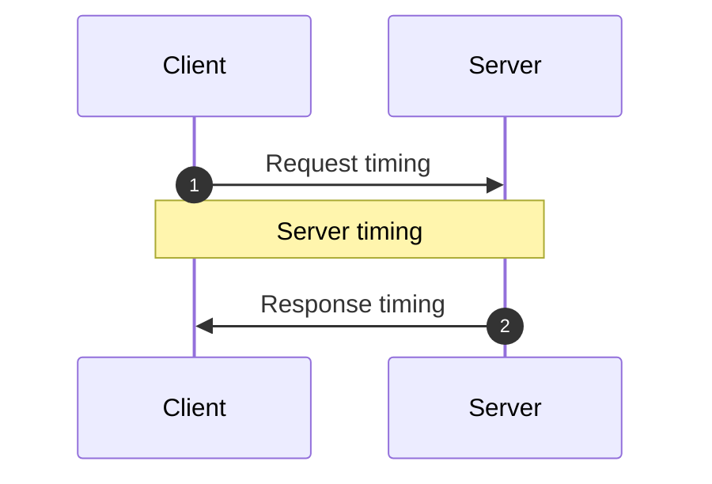

<head>
  <meta name="docsearch:pagerank" content="40"/>
</head>

import FrameworkPlayground from '@site/src/components/FrameworkPlayground';
import {RestEndpoint} from '@data-client/rest';
import { todoFixtures } from '@site/src/fixtures/todos';
import OptimisticTransform from '../shared/\_optimisticTransform.mdx';
import OptimisticRace from '@site/src/components/OptimisticRace';

export const timingDemo = [
  { delay: 800, store: 'open' },
  { delay: 1000, click: 'button.upvote' },
  { delay: 250, click: 'button.upvote' },
  { delay: 250, click: 'button.upvote' },
  { delay: 250, click: 'button.upvote' },
  // past the slowest increment response (the fixture's 4.7s), so the
  // timeline holds every response
  { wait: 5000 },
  { click: { in: 'store', selector: 'button[aria-label="Diff"]' } },
  // the first action (the count's load), then on through each change, time
  // to read each diff: 5 = the changes the 4 clicks make, as Diff's "Next
  // change" counts them (more would idle at the end before the close)
  {
    click: {
      in: 'store',
      selector: '[role="group"][aria-label^="Scrubber"] button[data-id]',
    },
  },
  ...Array.from({ length: 5 }, () => ({
    delay: 1500,
    click: { in: 'store', selector: 'button[aria-label="Next change"]' },
  })),
  // Store → Code: back to the code that did it
  { delay: 2000, store: 'close' },
];

# Actualizaciones optimistas

Una actualización optimista muestra el resultado de una mutación antes de que responda el servidor. Asume que la petición tiene éxito, así que
la interfaz no espera a la red.

Las actualizaciones optimistas añaden nuevas condiciones de carrera. Reactive Data Client las maneja por ti.

## Resources {#resources}

Para hacer optimista un [resource()](../api/resource.md), establece [optimistic: true](../api/resource.md#optimistic).

<FrameworkPlayground defaultOpen="n" row fixtures={todoFixtures}>

```ts title="TodoResource" {16}
import { Entity, resource } from '@data-client/rest';

export class Todo extends Entity {
  id = 0;
  userId = 0;
  title = '';
  completed = false;

  static key = 'Todo';
}
export const TodoResource = resource({
  urlPrefix: 'https://jsonplaceholder.typicode.com',
  path: '/todos/:id',
  searchParams: {} as { userId?: string | number } | undefined,
  schema: Todo,
  optimistic: true,
});
```

:::react

```tsx title="TodoItem" collapsed
import { useController } from '@data-client/react';
import { TodoResource, type Todo } from './TodoResource';

export default function TodoItem({ todo }: { todo: Todo }) {
  const ctrl = useController();
  const handleChange = e =>
    ctrl.fetch(
      TodoResource.partialUpdate,
      { id: todo.id },
      { completed: e.currentTarget.checked },
    );
  const handleDelete = () =>
    ctrl.fetch(TodoResource.delete, {
      id: todo.id,
    });
  return (
    <div className="listItem nogap">
      <label>
        <input
          type="checkbox"
          checked={todo.completed}
          onChange={handleChange}
        />
        {todo.title}
      </label>
      <CancelButton onClick={handleDelete} />
    </div>
  );
}
```

```tsx title="CreateTodo" collapsed
import { useController } from '@data-client/react';
import { TodoResource } from './TodoResource';

export default function CreateTodo({ userId }: { userId: number }) {
  const ctrl = useController();
  const handleKeyDown = async e => {
    if (e.key === 'Enter') {
      ctrl.fetch(TodoResource.getList.push, {
        userId,
        title: e.currentTarget.value,
      });
      e.currentTarget.value = '';
    }
  };
  return (
    <div className="listItem nogap">
      <label>
        <input type="checkbox" name="new" checked={false} disabled />
        <input
          type="text"
          aria-label="New todo"
          placeholder="New todo"
          onKeyDown={handleKeyDown}
        />
      </label>
      <CancelButton />
    </div>
  );
}
```

```tsx title="TodoList" collapsed
import { useSuspense } from '@data-client/react';
import { TodoResource } from './TodoResource';
import TodoItem from './TodoItem';
import CreateTodo from './CreateTodo';

function TodoList() {
  const userId = 1;
  const todos = useSuspense(TodoResource.getList, { userId });
  return (
    <div className="list">
      {todos.map(todo => (
        <TodoItem key={todo.pk()} todo={todo} />
      ))}
      <CreateTodo userId={userId} />
    </div>
  );
}
render(<TodoList />);
```

:::

:::vue

```html title="TodoItem.vue" collapsed
<script setup lang="ts">
  import { useController } from '@data-client/vue';
  import { TodoResource, type Todo } from './TodoResource';

  const props = defineProps<{ todo: Todo }>();
  const ctrl = useController();
  const handleChange = e =>
    ctrl.fetch(
      TodoResource.partialUpdate,
      { id: props.todo.id },
      { completed: e.currentTarget.checked },
    );
  const handleDelete = () =>
    ctrl.fetch(TodoResource.delete, {
      id: props.todo.id,
    });
</script>

<template>
  <div class="listItem nogap">
    <label>
      <input type="checkbox" :checked="todo.completed" @change="handleChange" />
      {{ todo.title }}
    </label>
    <CancelButton @click="handleDelete" />
  </div>
</template>
```

```html title="CreateTodo.vue" collapsed
<script setup lang="ts">
  import { useController } from '@data-client/vue';
  import { TodoResource } from './TodoResource';

  const props = defineProps<{ userId: number }>();
  const ctrl = useController();
  const handleKeyDown = async e => {
    if (e.key === 'Enter') {
      ctrl.fetch(TodoResource.getList.push, {
        userId: props.userId,
        title: e.currentTarget.value,
      });
      e.currentTarget.value = '';
    }
  };
</script>

<template>
  <div class="listItem nogap">
    <label>
      <input type="checkbox" name="new" :checked="false" disabled />
      <input
        type="text"
        aria-label="New todo"
        placeholder="New todo"
        @keydown="handleKeyDown"
      />
    </label>
    <CancelButton />
  </div>
</template>
```

```html title="TodoList.vue" collapsed
<script setup lang="ts">
  import { useSuspense } from '@data-client/vue';
  import { TodoResource } from './TodoResource';
  import TodoItem from './TodoItem.vue';
  import CreateTodo from './CreateTodo.vue';

  const userId = 1;
  const todos = await useSuspense(TodoResource.getList, { userId });
</script>

<template>
  <div class="list">
    <TodoItem v-for="todo in todos" :key="todo.pk()" :todo="todo" />
    <CreateTodo :userId="userId" />
  </div>
</template>
```

:::

</FrameworkPlayground>

Todas sus mutaciones usan entonces estas respuestas optimistas por defecto:

### update/getList.push/getList.unshift {#updategetlistpushgetlistunshift}

```ts
function optimisticUpdate(
  snap: SnapshotInterface,
  params: any,
  body: any,
) {
  return {
    ...params,
    ...ensureBodyPojo(body),
  };
}

function ensureBodyPojo(body: any) {
  return body instanceof FormData
    ? Object.fromEntries((body as any).entries())
    : body;
}
```

El cuerpo de una creación (push/unshift) normalmente no tiene un `id` con el que calcular una pk. Por eso
<abbr title="Reactive Data Client">Data Client</abbr> crea una `pk` aleatoria.

Las mutaciones sobre el nuevo objeto suelen fallar hasta que el servidor lo crea. Por eso deshabilita las demás mutaciones sobre él hasta que el
`POST` se complete. Por ejemplo, comprueba que la entidad tenga un `id` real.

### partialUpdate {#partialupdate}

```ts
function optimisticPartial(schema: Queryable) {
  return function (snap: SnapshotInterface, params: any, body: any) {
    const data = snap.get(schema, params);
    if (!data) throw snap.abort;
    return {
      ...params,
      ...data,
      // even tho we don't always have two arguments, the extra one will simply be undefined which spreads fine
      ...ensurePojo(body),
    };
  };
}
```

Las actualizaciones parciales no envían el cuerpo completo. Los campos que la respuesta esperada omite conservan sus
valores en caché, así que una Entity solo necesita su [clave primaria](../api/Entity.md#pk) y los campos modificados.
Si la entidad aún no está en el store, la actualización [se aborta](/docs/api/Snapshot#abort) en lugar de mostrar una Entity
formada solo por los campos modificados. Los [Snapshots](/docs/api/Snapshot) leen de forma segura el valor actual del store, sin condiciones
de carrera.

### delete {#delete}

```ts
function optimisticDelete(snap: SnapshotInterface, params: any) {
  return params;
}
```

Para hacer optimistas solo algunos endpoints, o para ajustarte a una API poco habitual, define
[getOptimisticResponse()](../api/RestEndpoint.md#getoptimisticresponse) con
[Resource.extend()](../api/resource.md#extend).

## Transformaciones optimistas {#optimistic-transforms}

Algunas actualizaciones dependen del valor anterior, como alternar un booleano o incrementar un contador. Este ejemplo usa un
contador.

<OptimisticTransform />

Reactive Data Client maneja las condiciones de carrera debidas a los tiempos de red. Registra cuándo empieza cada fetch, empareja cada
respuesta con su actualización optimista y revierte la actualización cuando la petición se resuelve o falla.

Otras bibliotecas tienen estas condiciones de carrera incluso sin actualizaciones optimistas. Las actualizaciones optimistas las empeoran.

### Ejemplo de condición de carrera {#example-race-condition}

Este ejemplo solicita dos incrementos. La primera respuesta llega después de la segunda.

<OptimisticRace />

Otras bibliotecas muestran 0, 2 y luego 1 sin actualizaciones optimistas, y 0, 1, 2, 2 y luego 1 con ellas. Ambas terminan en un valor incorrecto, con actualizaciones entrecortadas por el camino. Data Client muestra 0, 1 y luego 2, y mantiene el 2 cuando la respuesta más antigua llega al final.

### Compensar las variaciones de tiempo del servidor {#server-timings}



Tres tiempos pueden variar en una mutación asíncrona:

1. Tiempo de la petición
1. Tiempo del servidor
1. Tiempo de la respuesta

Reactive Data Client maneja por ti los tiempos de la petición y de la respuesta. Normalmente esto es suficiente, porque los servidores
suelen procesar las peticiones en el orden en que llegan. Si el servidor las guarda en un orden distinto, sigue existiendo una condición
de carrera.

Para resolverlo, mantén un [orden total](https://en.wikipedia.org/wiki/Total_order) con un único reloj. Los relojes del servidor y del cliente
pueden diferir, y las actualizaciones optimistas ocurren en el cliente, así que usa el reloj del cliente:

1. Envía el tiempo de la petición en un header `updatedAt` con [getRequestInit()](../api/RestEndpoint.md#getRequestInit).
1. El servidor procesa las peticiones en el orden de `updatedAt`, almacena `updatedAt` en la entidad y lo devuelve en cada
   respuesta.
1. Sobrescribe [shouldReorder](../api/Entity.md#shouldreorder) para reordenar por `updatedAt` las respuestas que llegan desordenadas.

[getOptimisticResponse](../api/RestEndpoint.md#getoptimisticresponse) usa [snap.fetchedAt](/docs/api/Snapshot#fetchedat).
Es el momento en que empieza el fetch, el mismo instante en que se calcula el header `updatedAt`.

<FrameworkPlayground fixtures={[
{
endpoint: new RestEndpoint({path: '/api/count'}),
args: [],
response: { count: 0, updatedAt: Date.now() }
},
{
endpoint: new RestEndpoint({
path: '/api/count/increment',
method: 'POST',
body: undefined,
}),
fetchResponse(input, init) {
return ({
"count": (this.count = this.count + 1),
"updatedAt": JSON.parse(init.body).updatedAt,
});
},
delay: () => 200 + Math.random() * 4500,
delayCollapse:true,
}
]}
getInitialInterceptorData={() => ({ count: 0 })}
row
autoRun={timingDemo}
>

```ts title="count" {11-13} collapsed
import { Entity, RestEndpoint } from '@data-client/rest';

export class CountEntity extends Entity {
  count = 0;
  updatedAt = 0;

  pk() {
    return `SINGLETON`;
  }

  static shouldReorder(existingMeta, incomingMeta, existing, incoming) {
    return incoming.updatedAt < existing.updatedAt;
  }
}
export const getCount = new RestEndpoint({
  path: '/api/count',
  schema: CountEntity,
  name: 'get',
});
```

```ts title="increment" {10-16,22}
import { RestEndpoint } from '@data-client/rest';
import { CountEntity } from './count';

export const increment = new RestEndpoint({
  path: '/api/count/increment',
  method: 'POST',
  body: undefined,
  name: 'increment',
  schema: CountEntity,
  getRequestInit() {
    // this is a substitute for super.getRequestInit()
    // since we aren't in a class context
    return RestEndpoint.prototype.getRequestInit.call(this, {
      updatedAt: Date.now(),
    });
  },
  getOptimisticResponse(snap) {
    const data = snap.get(CountEntity, {});
    if (!data) throw snap.abort;
    return {
      count: data.count + 1,
      updatedAt: snap.fetchedAt,
    };
  },
});
```

:::react

```tsx title="CounterPage" collapsed
import React from 'react';
import { useController, useSuspense } from '@data-client/react';
import NumberFlow from '@number-flow/react';
import { getCount } from './count';
import { increment } from './increment';

function CounterPage() {
  const ctrl = useController();
  const { count } = useSuspense(getCount);
  const [clicks, setClicks] = React.useState(count);
  const clickHandler = () => {
    setClicks(c => c + 1);
    return ctrl.fetch(increment);
  };
  return (
    <>
      <header className="appHeader">
        <h1 className="appTitle">Votes</h1>
      </header>
      <div className="listItem">
        <button className="upvote" onClick={clickHandler} aria-label="Upvote" />
        <dl className="stats">
          <div>
            <dt>Data Client</dt>
            <dd><NumberFlow value={count} /></dd>
          </div>
          <div>
            <dt>Clicks</dt>
            <dd><NumberFlow value={clicks} /></dd>
          </div>
        </dl>
      </div>
    </>
  );
}
render(<CounterPage />);
```

:::

:::vue

```html title="CounterPage.vue" collapsed
<script setup lang="ts">
  import { ref } from 'vue';
  import { useController, useSuspense } from '@data-client/vue';
  import NumberFlow from '@number-flow/vue';
  import { getCount } from './count';
  import { increment } from './increment';

  const ctrl = useController();
  const data = await useSuspense(getCount);
  const clicks = ref(data.value.count);
  const clickHandler = () => {
    clicks.value += 1;
    return ctrl.fetch(increment);
  };
</script>

<template>
  <header class="appHeader">
    <h1 class="appTitle">Votes</h1>
  </header>
  <div class="listItem">
    <button class="upvote" @click="clickHandler" aria-label="Upvote" />
    <dl class="stats">
      <div>
        <dt>Data Client</dt>
        <dd><NumberFlow :value="data.count" /></dd>
      </div>
      <div>
        <dt>Clicks</dt>
        <dd><NumberFlow :value="clicks" /></dd>
      </div>
    </dl>
  </div>
</template>
```

:::

</FrameworkPlayground>
