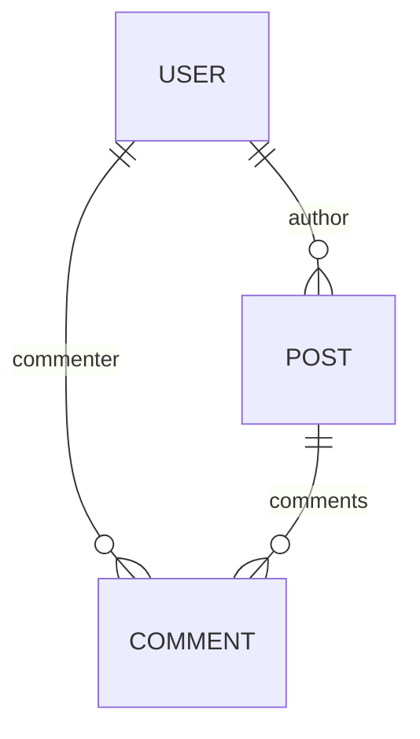

import FrameworkPlayground from '@site/src/components/FrameworkPlayground';
import { Collection, RestEndpoint } from '@data-client/rest';
import StackBlitz from '@site/src/components/StackBlitz';
import { assigneeFixtures, getInitialInterceptorData } from '@site/src/fixtures/assignees';

# Datos relacionales

Declara las relaciones uno a uno, muchos a uno y muchos a muchos entre [entities][1] en [Entity.schema][3].

## Anidamiento {#nesting}

Cuando una Entity define [Entity.schema][3], la normalización almacena cada entity anidada por separado. La desnormalización
las vuelve a unir.

<details>
<summary><b>Diagrama</b></summary>

<div style={{float:'left'}}>



</div>
<div style={{clear: 'both'}}>&nbsp;</div>
</details>

<FrameworkPlayground groupId="schema" defaultOpen="store" fixtures={[
{
endpoint: new RestEndpoint({ path: '/posts' }),
response: [
{
"id": "1",
"title": "My first post!",
"author": {
"id": "123",
"name": "Paul"
},
"comments": [
{
"id": "249",
"content": "Nice post!",
"commenter": {
"id": "245",
"name": "Jane"
}
},
{
"id": "250",
"content": "Thanks!",
"commenter": {
"id": "123",
"name": "Paul"
}
}
]
},
{
"id": "2",
"title": "This other post",
"author": {
"id": "123",
"name": "Paul"
},
"comments": [
{
"id": "251",
"content": "Your other post was nicer",
"commenter": {
"id": "245",
"name": "Jane"
}
},
{
"id": "252",
"content": "I am a spammer!",
"commenter": {
"id": "246",
"name": "Spambot5000"
}
}
]
}
],
delay: 150,
},
]}>

```typescript title="resources/Post"
import { Collection, Entity, resource } from '@data-client/rest';

export class User extends Entity {
  id = '';
  name = '';
}

export class Comment extends Entity {
  id = '';
  content = '';
  commenter = User.fromJS();

  static schema = {
    commenter: User,
  };
}

export class Post extends Entity {
  id = '';
  title = '';
  author = User.fromJS();
  comments: Comment[] = [];

  static schema = {
    author: User,
    comments: new Collection([Comment], {
      nestKey: (parent, key) => ({
        postId: parent.id,
      }),
    }),
  };
}

export const PostResource = resource({
  path: '/posts/:id',
  schema: Post,
});
```

:::react

```tsx title="PostPage" collapsed
import { useSuspense } from '@data-client/react';
import { PostResource } from './resources/Post';

function PostPage() {
  const posts = useSuspense(PostResource.getList);
  return (
    <div>
      {posts.map(post => (
        <div key={post.pk()}>
          <h4>
            {post.title} - <cite>{post.author.name}</cite>
          </h4>
          <ul>
            {post.comments.map(comment => (
              <li key={comment.pk()}>
                {comment.content}{' '}
                <small>
                  <cite>
                    {comment.commenter.name}
                    {comment.commenter === post.author ? ' [OP]' : ''}
                  </cite>
                </small>
              </li>
            ))}
          </ul>
        </div>
      ))}
    </div>
  );
}
render(<PostPage />);
```

:::

:::vue

```html title="PostPage.vue" collapsed
<script setup lang="ts">
  import { useSuspense } from '@data-client/vue';
  import { PostResource } from './resources/Post';

  const posts = await useSuspense(PostResource.getList);
</script>

<template>
  <div>
    <div v-for="post in posts" :key="post.pk()">
      <h4>{{ post.title }} - <cite>{{ post.author.name }}</cite></h4>
      <ul>
        <li v-for="comment in post.comments" :key="comment.pk()">
          {{ comment.content }}
          <small>
            <cite>
              {{ comment.commenter.name }}{{ comment.commenter ===
              post.author ? ' [OP]' : '' }}
            </cite>
          </small>
        </li>
      </ul>
    </div>
  </div>
</template>
```

:::

</FrameworkPlayground>

## Joins del lado del cliente {#client-side-joins}

Anidar datos cuando tu endpoint no lo hace.

Cuando una respuesta no anida los datos relacionados, declara la relación en [Entity.schema](../api/Entity.md#schema).
Data Client realiza entonces el join de los datos en el cliente.

Aquí `/todos` solo envía el `userId` de cada todo. [Entity.process()](../api/Entity.md#process) apunta
`user` a ese id, de modo que cada todo de la lista lleva su `User` completo desde `/users`. Un componente
podría buscar un usuario por id por sí mismo; el join pone al usuario en la lista, para que la lista pueda agrupar por
persona. Asigna una tarea a otra persona (elige su avatar:react[, o arrastra la tarea a su grupo]),
y solo su nuevo `userId` se envía al servidor, pero la tarea pasa al grupo de esa persona.

<FrameworkPlayground
row
fixtures={assigneeFixtures}
getInitialInterceptorData={getInitialInterceptorData}
>

```ts title="resources/User" collapsed
import { Entity, resource } from '@data-client/rest';

export class User extends Entity {
  id = 0;
  username = '';
  name = '';
  email = '';

  get profileImage() {
    return `https://i.pravatar.cc/64?img=${this.id + 4}`;
  }
}
export const UserResource = resource({
  urlPrefix: 'https://jsonplaceholder.typicode.com',
  path: '/users/:id',
  schema: User,
});
```

```ts title="resources/Todo" {7,11-17}
import { Entity, resource } from '@data-client/rest';
import { User } from './User';

export class Todo extends Entity {
  id = 0;
  userId = 0;
  user? = User.fromJS();
  title = '';
  completed = false;

  // the API sends userId; join it to the User with that id
  static schema = {
    user: User,
  };
  static process(todo) {
    return { ...todo, user: todo.userId };
  }
}
export const TodoResource = resource({
  urlPrefix: 'https://jsonplaceholder.typicode.com',
  path: '/todos/:id',
  schema: Todo,
  optimistic: true,
});
```

:::react

```tsx title="TodoItem" collapsed
import React from 'react';
import { useController } from '@data-client/react';
import { TodoResource, type Todo } from './resources/Todo';
import type { User } from './resources/User';

function TodoItem({ todo, users }: Props) {
  const ctrl = useController();
  const update = (body: Partial<Todo>) =>
    ctrl.fetch(TodoResource.partialUpdate, { id: todo.id }, body);
  return (
    <div
      className="listItem"
      // dragged into a person's group, the todo is theirs
      ref={useReorderItem(todo.pk(), {
        onDrop: (userId: number) => update({ userId }),
      })}
    >
      <label>
        <input
          type="checkbox"
          checked={todo.completed}
          onChange={e => update({ completed: e.currentTarget.checked })}
        />
        {todo.title}
      </label>
      <label className="assignee">
        {todo.user && <Avatar src={todo.user.profileImage} size={24} />}
        <select
          aria-label={`Owner of ${todo.title}`}
          value={todo.userId}
          onChange={e => update({ userId: Number(e.currentTarget.value) })}
        >
          {users.map(user => (
            <option key={user.pk()} value={user.id}>
              {user.name}
            </option>
          ))}
        </select>
      </label>
    </div>
  );
}
export default React.memo(TodoItem);

interface Props {
  todo: Todo;
  users: User[];
}
```

```tsx title="TodoGroup" collapsed
import TodoItem from './TodoItem';
import type { Todo } from './resources/Todo';
import type { User } from './resources/User';

export default function TodoGroup({ owner, todos, users }: Props) {
  return (
    <section ref={useDropGroup(owner.id)}>
      <h3>
        <Avatar src={owner.profileImage} />
        {owner.name}
      </h3>
      <div className="list">
        {todos.map(todo => (
          <TodoItem key={todo.pk()} todo={todo} users={users} />
        ))}
      </div>
    </section>
  );
}

interface Props {
  owner: User;
  todos: Todo[];
  users: User[];
}
```

```tsx title="TodoList" collapsed {11-13}
import { useFetch, useSuspense } from '@data-client/react';
import { TodoResource } from './resources/Todo';
import { UserResource } from './resources/User';
import TodoGroup from './TodoGroup';

function TodoList() {
  // both requests start at once
  useFetch(UserResource.getList);
  const todos = useSuspense(TodoResource.getList);
  const users = useSuspense(UserResource.getList);
  // every todo carries its user, the same object as in users, so
  // the list can group by it
  const byOwner = Map.groupBy(todos, todo => todo.user);
  return (
    // rows glide to wherever a change moves them
    <Reorder layoutDependency={todos}>
      {users.map(user => (
        <TodoGroup
          key={user.pk()}
          owner={user}
          todos={byOwner.get(user) ?? []}
          users={users}
        />
      ))}
    </Reorder>
  );
}
render(<TodoList />);
```

:::

:::vue

```html title="TodoItem.vue" collapsed
<script setup lang="ts">
  import { useController } from '@data-client/vue';
  import { TodoResource, type Todo } from './resources/Todo';
  import type { User } from './resources/User';

  const props = defineProps<{ todo: Todo; users: readonly User[] }>();
  const ctrl = useController();
  const update = (body: Partial<Todo>) =>
    ctrl.fetch(TodoResource.partialUpdate, { id: props.todo.id }, body);
  const toggle = e => update({ completed: e.currentTarget.checked });
  const assign = e => update({ userId: Number(e.currentTarget.value) });
</script>

<template>
  <div class="listItem">
    <label>
      <input type="checkbox" :checked="todo.completed" @change="toggle" />
      {{ todo.title }}
    </label>
    <label class="assignee">
      <Avatar v-if="todo.user" :src="todo.user.profileImage" :size="24" />
      <select
        :aria-label="`Owner of ${todo.title}`"
        :value="todo.userId"
        @change="assign"
      >
        <option v-for="user in users" :key="user.pk()" :value="user.id">
          {{ user.name }}
        </option>
      </select>
    </label>
  </div>
</template>
```

```html title="TodoGroup.vue" collapsed
<script setup lang="ts">
  import TodoItem from './TodoItem.vue';
  import type { Todo } from './resources/Todo';
  import type { User } from './resources/User';

  defineProps<{
    owner: User;
    todos: readonly Todo[];
    users: readonly User[];
  }>();
</script>

<template>
  <section>
    <h3>
      <Avatar :src="owner.profileImage" />
      {{ owner.name }}
    </h3>
    <div class="list">
      <TodoItem
        v-for="todo in todos"
        :key="todo.pk()"
        :todo="todo"
        :users="users"
      />
    </div>
  </section>
</template>
```

```html title="TodoList.vue" collapsed {12-16}
<script setup lang="ts">
  import { computed } from 'vue';
  import { useFetch, useSuspense } from '@data-client/vue';
  import { TodoResource } from './resources/Todo';
  import { UserResource } from './resources/User';
  import TodoGroup from './TodoGroup.vue';

  // both requests start at once
  useFetch(UserResource.getList);
  const todos = await useSuspense(TodoResource.getList);
  const users = await useSuspense(UserResource.getList);
  // every todo carries its user, the same object as in users, so
  // the list can group by it
  const byOwner = computed(() =>
    Map.groupBy(todos.value, todo => todo.user),
  );
</script>

<template>
  <TodoGroup
    v-for="user in users"
    :key="user.pk()"
    :owner="user"
    :todos="byOwner.get(user) ?? []"
    :users="users"
  />
</template>
```

:::

</FrameworkPlayground>

### Joins basados en claves {#key-based-joins}

Cuando las entities relacionadas provienen de fetches separados, usa [Entity.process()](/rest/api/Entity#process) para añadir una clave que
haga referencia a la otra Entity. Úsalo cuando:

- Los datos relacionados provienen de distintos endpoints de la API.
- No quieres obtener datos anidados que no necesitas.
- La relación es opcional o depende del contexto.

```typescript
import { Entity, resource } from '@data-client/rest';

class Stats extends Entity {
  product_id = '';
  volume = 0;
  price = 0;

  pk() {
    return this.product_id;
  }

  static key = 'Stats';
}

class Currency extends Entity {
  id = '';
  name = '';
  // Default value allows Currency to exist without Stats loaded
  stats = Stats.fromJS();

  pk() {
    return this.id;
  }

  static key = 'Currency';

  // Create a reference key that links to Stats entity
  static process(input: any, parent: any, key: string, args: any[]) {
    // The stats field becomes a reference to Stats with pk `${id}-USD`
    return { ...input, stats: `${input.id}-USD` };
  }

  static schema = {
    // Stats will be looked up by the key from process()
    stats: Stats,
  };
}
```

Después de que se resuelvan tanto `CurrencyResource.getList` como `StatsResource.getList`, `stats` es la entity `Stats` correspondiente.

### Ejemplo de precios de criptomonedas {#crypto-price-example}

Esta lista ordena las `Currencies` por volumen de operaciones. Solo la Entity `Stats` tiene el volumen de operaciones, y la
respuesta de `CurrencyResource.getList` no lo incluye. Por eso la página también hace fetch de `StatsResource.getList`, y el
[Entity.schema](../api/Entity.md#schema) de `Currency` añade `Stats` a cada `Currency`. La lista puede entonces ordenar con:

```ts
entries.sort((a, b) => {
  return b?.stats?.volume_usd - a?.stats?.volume_usd;
});
```

<StackBlitz app="coin-app" file="src/pages/Home/CurrencyList.tsx,src/resources/Stats.ts,src/resources/Currency.ts" height="700" view="editor" />

## Búsquedas inversas {#reverse-lookups}

Anidar datos cuando tu endpoint no lo hace (parte 2).

Una respuesta puede anidar en una sola dirección. Para añadir la relación inversa, sobrescribe
[Entity.process](../api/Entity.md#process). Quizás también debas sobrescribir [Entity.merge](../api/Entity.md#merge) para
combinar en profundidad esos campos.

Así, un solo fetch da todas las vistas de la relación, sin un fetch por vista.

<FrameworkPlayground groupId="schema" defaultOpen="store" fixtures={[
{
endpoint: new RestEndpoint({ path: '/posts' }),
response: [
{
"id": "1",
"title": "My first post!",
"author": {
"id": "123",
"name": "Paul"
},
"comments": [
{
"id": "249",
"content": "Nice post!",
"commenter": {
"id": "245",
"name": "Jane"
}
},
{
"id": "250",
"content": "Thanks!",
"commenter": {
"id": "123",
"name": "Paul"
}
}
]
},
{
"id": "2",
"title": "This other post",
"author": {
"id": "123",
"name": "Paul"
},
"comments": [
{
"id": "251",
"content": "Your other post was nicer",
"commenter": {
"id": "245",
"name": "Jane"
}
},
{
"id": "252",
"content": "I am a spammer!",
"commenter": {
"id": "246",
"name": "Spambot5000"
}
}
]
}
],
delay: 150,
},
]}>

```typescript title="resources/Post"
import { Entity, resource, type Schema } from '@data-client/rest';

export class User extends Entity {
  id = '';
  name = '';
  posts: Post[] = [];
  comments: Comment[] = [];

  static merge(existing, incoming) {
    return {
      ...existing,
      ...incoming,
      posts: [...(existing.posts || []), ...(incoming.posts || [])],
      comments: [
        ...(existing.comments || []),
        ...(incoming.comments || []),
      ],
    };
  }

  static process(value, parent, key) {
    switch (key) {
      case 'author':
        return { ...value, posts: [parent.id] };
      case 'commenter':
        return { ...value, comments: [parent.id] };
      default:
        return { ...value };
    }
  }
}

export class Comment extends Entity {
  id = '';
  content = '';
  commenter = User.fromJS();
  post = Post.fromJS();

  static schema: Record<string, Schema> = {
    commenter: User,
  };
  static process(value, parent, key) {
    return { ...value, post: parent.id };
  }
}

export class Post extends Entity {
  id = '';
  title = '';
  author = User.fromJS();
  comments: Comment[] = [];

  static schema = {
    author: User,
    comments: [Comment],
  };
}

// with cirucular dependencies we must set schema after they are all defined
User.schema = {
  posts: [Post],
  comments: [Comment],
};
Comment.schema = {
  ...Comment.schema,
  post: Post,
};

export const PostResource = resource({
  path: '/posts/:id',
  schema: Post,
  dataExpiryLength: Infinity,
});
export const UserResource = resource({
  path: '/users/:id',
  schema: User,
});
```

:::react

```tsx title="UserPage" route="/users/:id" collapsed
import { useSuspense } from '@data-client/react';
import { UserResource } from './resources/Post';

export default function UserPage({ id }) {
  const user = useSuspense(UserResource.get, { id });
  return (
    <div>
      <h4>{user.name}</h4>
      {user.posts.length ? (
        <>
          <h5>Posts</h5>
          <ul>
            {user.posts.map(post => (
              <li>{post.title}</li>
            ))}
          </ul>
        </>
      ) : null}
      <h5>Comments</h5>
      <ul>
        {user.comments.map(comment => (
          <li>{comment.content}</li>
        ))}
      </ul>
    </div>
  );
}
```

```tsx title="PostPage" route="/" collapsed
import { useSuspense } from '@data-client/react';
import { PostResource } from './resources/Post';

export default function PostPage() {
  const posts = useSuspense(PostResource.getList);
  return (
    <div>
      {posts.map(post => (
        <div key={post.pk()}>
          <h4>
            {post.title} -{' '}
            <Link to={`/users/${post.author.id}`}>{post.author.name}</Link>
          </h4>
          <ul>
            {post.comments.map(comment => (
              <li key={comment.pk()}>
                {comment.content}{' '}
                <small>
                  <Link to={`/users/${comment.commenter.id}`}>
                    {comment.commenter.name}
                    {comment.commenter === post.author ? ' [OP]' : ''}
                  </Link>
                </small>
              </li>
            ))}
          </ul>
        </div>
      ))}
    </div>
  );
}
```

:::

:::vue

```html title="UserPage.vue" route="/users/:id" collapsed
<script setup lang="ts">
  import { useSuspense } from '@data-client/vue';
  import { UserResource } from './resources/Post';

  const props = defineProps<{ id: string }>();
  const user = await useSuspense(UserResource.get, () => ({
    id: props.id,
  }));
</script>

<template>
  <div>
    <h4>{{ user.name }}</h4>
    <template v-if="user.posts.length">
      <h5>Posts</h5>
      <ul>
        <li v-for="post in user.posts" :key="post.pk()">
          {{ post.title }}
        </li>
      </ul>
    </template>
    <h5>Comments</h5>
    <ul>
      <li v-for="comment in user.comments" :key="comment.pk()">
        {{ comment.content }}
      </li>
    </ul>
  </div>
</template>
```

```html title="PostPage.vue" route="/" collapsed
<script setup lang="ts">
  import { useSuspense } from '@data-client/vue';
  import { PostResource } from './resources/Post';

  const posts = await useSuspense(PostResource.getList);
</script>

<template>
  <div>
    <div v-for="post in posts" :key="post.pk()">
      <h4>
        {{ post.title }} -
        <RouterLink :to="`/users/${post.author.id}`">
          {{ post.author.name }}
        </RouterLink>
      </h4>
      <ul>
        <li v-for="comment in post.comments" :key="comment.pk()">
          {{ comment.content }}
          <small>
            <RouterLink :to="`/users/${comment.commenter.id}`">
              {{ comment.commenter.name }}{{ comment.commenter ===
              post.author ? ' [OP]' : '' }}
            </RouterLink>
          </small>
        </li>
      </ul>
    </div>
  </div>
</template>
```

:::

</FrameworkPlayground>

### Dependencias circulares {#circular-dependencies}

JavaScript no permite importaciones circulares ni definiciones circulares de clases. Por eso, en las [Entities][1] que se referencian
entre sí, define el [schema][3] después de las definiciones de las clases.

```typescript title="resources/Post"
import { Collection, Entity } from '@data-client/rest';
import { User } from './User';

export class Post extends Entity {
  id = '';
  title = '';
  author = User.fromJS();

  static schema = {
    author: User,
  };
}

// both User and Post are now defined, so it's okay to refer to both of them
// highlight-start
User.schema = {
  // ensure we keep the 'createdAt' member
  ...User.schema,
  posts: [Post],
};
// highlight-end
```

```typescript title="resources/User"
import { Collection, Entity } from '@data-client/rest';
import type { Post } from './Post';
// we can only import the type else we break javascript imports
// thus we change the schema of UserResource above

export class User extends Entity {
  id = '';
  name = '';
  posts: Post[] = [];
  createdAt = Temporal.Instant.fromEpochMilliseconds(0);

  static schema: Record<string, Schema | Date> = {
    createdAt: Temporal.Instant.from,
  };
}
```

:::tip

Para las relaciones bidireccionales que no necesitan desnormalización anticipada,
[Lazy](../api/Lazy.md) difiere la resolución y te permite resolver bajo demanda
mediante [useQuery](/docs/api/useQuery), evitando la recursión profunda y mejorando
el aislamiento de la memoización.

:::

[1]: ../api/Entity.md
[2]: /docs/api/useCache
[3]: ../api/Entity.md#schema
