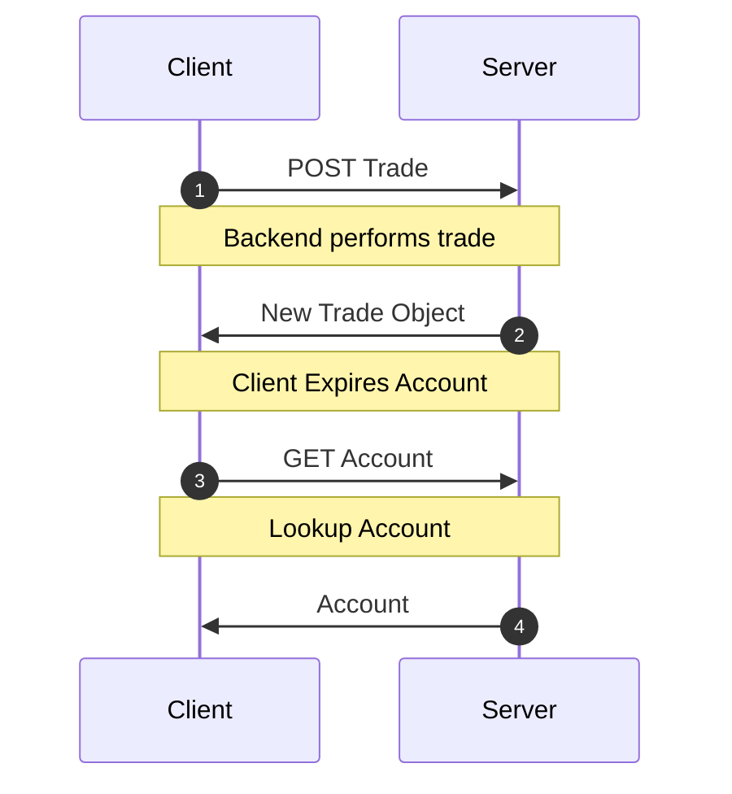
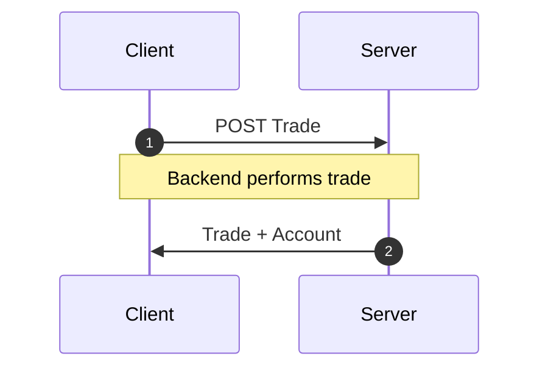

Cuando una mutación cambia más de un recurso, no [caduques](/docs/api/Controller#expireAll) los demás
recursos. Caducarlos provoca una lenta cascada de nuevos fetches. En su lugar, incluye _todos_ los recursos modificados en la respuesta de la
mutación. La mutación sigue siendo atómica y necesita una sola petición.

<div style={{display: 'grid', gridTemplateColumns: '1fr 1fr', columnGap: '15px'}}>

<div>
<h4 style={{textAlign: 'center'}}>Cascada de red</h4>



</div>
<div>
<h4 style={{textAlign: 'center'}}> Agrupación de respuestas</h4>



</div>

</div>

## Ejemplo {#example}

Una plataforma de trading de criptomonedas actualiza el saldo de la cuenta del usuario con cada operación. Por eso `POST /trade/` devuelve la nueva
operación y la cuenta actualizada.

```json title="POST /trade/"
{
  "trade": {
    "id": 2893232,
    "user": 1,
    "amount": "50.2335324",
    "coin": "doge",
    "created_at": ""
  },
  "account": {
    "id": 899,
    "user": 1,
    "balance": "1337.00",
    "coin_value": "3.50"
  }
}
```

Añade la cuenta al `schema` del endpoint.

```typescript title="resources/Trade.ts"
import { resource, Entity } from '@data-client/rest';
import { Account } from './Account';

export class Trade extends Entity {
  id = 0;
  user = 0;
  amount = '0';
  coin = '';
  created_at = '';
}

export const TradeResource = resource({
  path: '/trade/:id',
  schema: Trade,
}).extend(Base => ({
  createTrade: Base.getList.push.extend({
    schema: {
      trade: Base.getList.push.schema,
      account: Account,
    },
  }),
}));
```

`createTrade` extiende [getList.push](../api/resource.md#push). Cuando se completa el `POST`, el store actualiza tanto la nueva
operación como la cuenta.

:::react

```typescript title="CreateTrade.tsx"
export default function CreateTrade() {
  const ctrl = useController();
  const handleSubmit = payload =>
    ctrl.fetch(TradeResource.createTrade, {}, payload);
  //...
}
```

:::

:::vue

```html title="CreateTrade.vue"
<script setup lang="ts">
  import { useController } from '@data-client/vue';
  import { TradeResource } from './resources/Trade';

  const ctrl = useController();
  const handleSubmit = payload =>
    ctrl.fetch(TradeResource.createTrade, {}, payload);
  //...
</script>
```

:::

:::note

Define un nuevo [RestEndpoint](../api/RestEndpoint.md) para cualquier endpoint personalizado. Su `schema` le indica a Data Client cómo
almacenar la respuesta.

:::
