import Link from '@docusaurus/Link';

Além dos benefícios de desempenho e integridade de dados de [normalizar o estado](https://react.dev/learn/choosing-the-state-structure),
ganhamos a vantagem adicional de poder acessar e consultar a store diretamente com segurança.

Nesta versão, ajustamos e simplificamos essa funcionalidade unificando tudo em torno do conceito de [Schemas Queryable](/docs/api/useQuery#queryable). Eles incluem
[Entity](/rest/api/Entity), [All](/rest/api/All), [Collection](/rest/api/Collection), [Query](/rest/api/Query)
e [Union](/rest/api/Union)

O maior impacto dessa mudança é a introdução de um novo hook, [useQuery()](/blog/2024/04/08/v0.11-queries-querable-usequery#usequery), que permite consultas diretas à store
usando os [Schemas Queryable](/docs/api/useQuery#queryable).

```ts
class User extends Entity {
  username = '';
  id = '';
  groupId = '';
  pk() {
    return this.id;
  }
  static index = ['username' as const];
}

const bob = useQuery(User, { username: 'bob' });
const bob = useQuery(User, { id: '5' });
```

De forma semelhante, podemos consultar Queryables com o controller e o snapshot usando [controller.get](/blog/2024/04/08/v0.11-queries-querable-usequery#controllerget)

```ts
const bob = snapshot.get(User, { username: 'bob' });
```

Além disso, investimos em mais [melhorias de desempenho](/blog/2024/04/08/v0.11-queries-querable-usequery#performance), resultando em um ganho de cerca de 2x
na maioria das operações e em [Queries](/rest/api/Query) 16x mais rápidas.

<center>

<Link className="button button--secondary" to="/blog/2024/04/08/v0.11-queries-querable-usequery#migration-guide">Guia de migração</Link>

</center>

**Mudanças incompatíveis:**

- [useCache(new Index(MyEntity)) -> useQuery(MyEntity)](/blog/2024/04/08/v0.11-queries-querable-usequery#removed-index)
- [new Query -> new schema.Query](/blog/2024/04/08/v0.11-queries-querable-usequery#query-migration)
  - useCache(myQuery) -> useQuery(myQuery)
- [new AbortOptimistic() -> snapshot.abort](/blog/2024/04/08/v0.11-queries-querable-usequery#snap.abort)
- [Entity.useIncoming → Entity.shouldUpdate](/blog/2024/04/08/v0.11-queries-querable-usequery#shouldupdate)

[**Outros destaques:**](/blog/2024/04/08/v0.11-queries-querable-usequery#other-improvements)

- useCache() aceita Endpoints com sideEffects (como [Resource.update](/rest/api/resource#update))
- Permite que Entity.pk() retorne números.
- [Melhorias de desempenho](/blog/2024/04/08/v0.11-queries-querable-usequery#performance) de 2 a 16x

<!--truncate-->

import TypeScriptEditor from '@site/src/components/TypeScriptEditor';
import DiffEditor from '@site/src/components/DiffEditor';

### Querable {#querable}

Schemas [Queryable](/rest/api/schema#queryable) exigem um método `queryKey()` que retorne algo. Eles incluem
[Entity](/rest/api/Entity), [All](/rest/api/All), [Collection](/rest/api/Collection), [Query](/rest/api/Query)
e [Union](/rest/api/Union).

```ts
interface Queryable {
  queryKey(
    args: readonly any[],
    queryKey: (...args: any) => any,
    getEntity: GetEntity,
    getIndex: GetIndex,
    // `{}` means non-void
  ): {};
}
```

### schema.Query {#schemaquery}

`Query` antes era implementado como um Endpoint. Como agora temos formas de recuperar schemas Queryable
diretamente, podemos simplesmente tornar Query mais um schema Queryable. Ele deve funcionar basicamente da mesma forma,
permitindo computações arbitrárias sobre o valor vindo de uma store. [#2921](https://github.com/reactive/data-client/pull/2921)

```ts
const getUserCount = new schema.Query(
  new schema.All(User),
  (entries, { isAdmin } = {}) => {
    if (isAdmin !== undefined)
      return entries.filter(user => user.isAdmin === isAdmin).length;
    return entries.length;
  },
);

const userCount = useQuery(getUserCount);
const adminCount = useQuery(getUserCount, { isAdmin: true });
```

schema.Query agora não permite schemas que não sejam Queryable.

<TypeScriptEditor>

```ts
const getBob = new schema.Query(
  // Array is not Queryable
  new schema.Array({ bob: '' }),
  thing => {
    return thing;
  },
);
```

</TypeScriptEditor>

### controller.get / snapshot.get {#controllerget}

Agora podemos [acessar a store](/docs/api/Controller#get) apenas com um Schema Queryable - não precisamos mais de um Endpoint inteiro.
[#2921](https://github.com/reactive/data-client/pull/2921)

<DiffEditor>

```ts title="Before"
getOptimisticResponse(snapshot, { id }) {
  // highlight-next-line
  const { data: post } = snapshot.getResponse(Base.get, { id });
  if (!post) throw snapshot.abort;
  return {
    id,
    votes: post.votes + 1,
  };
}
```

```ts title="After"
getOptimisticResponse(snapshot, { id }) {
  // highlight-next-line
  const post = snapshot.get(Post, { id });
  if (!post) throw snapshot.abort;
  return {
    id,
    votes: post.votes + 1,
  };
}
```
</DiffEditor>

Como não precisamos mais acessar outros [membros do Resource](/rest/api/resource#members) para obter `Post`,
podemos usar a sobrecarga muito mais simples de [Resource.extend()](/rest/api/resource#extend-new).

<DiffEditor>

```ts title="Before"
export const PostResource = createResource({
  path: '/posts/:id',
  schema: Post,
// highlight-next-line
}).extend(Base => ({
  vote: new RestEndpoint({
    path: '/posts/:id/vote',
    method: 'POST',
    body: undefined,
    schema: Post,
    getOptimisticResponse(snapshot, { id }) {
      const { data: post } = snapshot.getResponse(Base.get, { id });
      if (!post) throw snapshot.abort;
      return {
        id,
        votes: post.votes + 1,
      };
    },
  }),
}));
```

```ts title="After"
export const PostResource = createResource({
  path: '/posts/:id',
  schema: Post,
// highlight-next-line
}).extend('vote', {
  path: '/posts/:id/vote',
  method: 'POST',
  body: undefined,
  schema: Post,
  getOptimisticResponse(snapshot, { id }) {
    const post = snapshot.get(Post, { id });
    if (!post) throw snapshot.abort;
    return {
      id,
      votes: post.votes + 1,
    };
  },
});
```

</DiffEditor>

### useQuery {#usequery}

Renderiza qualquer [Schema Queryable](/rest/api/schema#queryable) a partir da store.
[Queries](/rest/api/Query) são uma ótima companhia para renderizar com eficiência computações agregadas, como as que usam [groupBy](https://developer.mozilla.org/en-US/docs/Web/JavaScript/Reference/Global_Objects/Object/groupBy#browser_compatibility),
[map](https://developer.mozilla.org/en-US/docs/Web/JavaScript/Reference/Global_Objects/Array/map), [reduce](https://developer.mozilla.org/en-US/docs/Web/JavaScript/Reference/Global_Objects/Array/reduce) e [filter](https://developer.mozilla.org/en-US/docs/Web/JavaScript/Reference/Global_Objects/Array/filter). [#2921](https://github.com/reactive/data-client/pull/2921)

```ts
class User extends Entity {
  username = '';
  id = '';
  groupId = '';
  pk() {
    return this.id;
  }
  static index = ['username' as const];
}

const bob = useQuery(User, { username: 'bob' });
```

```ts
const getUserCount = new schema.Query(
  new schema.All(User),
  (entries, { isAdmin } = {}) => {
    if (isAdmin !== undefined)
      return entries.filter(user => user.isAdmin === isAdmin).length;
    return entries.length;
  },
);

const userCount = useQuery(getUserCount);
const adminCount = useQuery(getUserCount, { isAdmin: true });
```

```ts
const UserCollection = new schema.Collection([User], {
  argsKey: (urlParams: { groupId?: string }) => ({
    ...urlParams,
  }),
});

const usersInGroup = useQuery(UserCollection, { groupId: '5' });
```

## Desempenho {#performance}

Novas otimizações tanto no sistema de cache quanto em todos os caminhos críticos do código deram um
belo ganho de 2x às operações mais comuns. Com a adição da [capacidade de cache de queries](https://github.com/reactive/data-client/pull/2978), vemos uma melhoria ainda mais impressionante de 16x em nosso benchmark de ordenação com Query.

Isso se soma à [vantagem já existente (de até 23x) sobre a biblioteca normalizr legada](/docs/concepts/normalization#benchmarks).

```mermaid
xychart-beta
    title "Performance vs v0.10"
    x-axis ["get large", "get small", "get Query", "get (null args)", "set large"]
    y-axis "Percentage gain" 0 --> 1600
    bar [163, 177, 1571, 295, 182]
    bar [100, 100, 100, 100, 100]
```

<center>
<div style={{maxWidth:'600px'}}>



</div>

[Benchmarks ao longo do tempo](https://reactive.github.io/data-client/dev/bench/) | [Ver benchmark](https://github.com/reactive/data-client/tree/master/examples/benchmark)

</center>

## Outras melhorias {#other-improvements}

- useCache() aceita Endpoints com sideEffects (como [Resource.update](/rest/api/resource#update)) [#2963](https://github.com/reactive/data-client/pull/2963)
  ```ts
  const lastCreated = useCache(MyResource.getList.push);
  ```
- Permite que pk retorne números [#2961](https://github.com/reactive/data-client/pull/2961)
  <DiffEditor>
  ```ts title="Before"
  class MyEntity extends Entity {
    id = 0;
    pk() {
      // highlight-next-line
      return `${this.id}`;
    }
  }
  ```
  ```ts title="After"
  class MyEntity extends Entity {
    id = 0;
    pk() {
      // highlight-next-line
      return this.id;
    }
  }
  ```
  </DiffEditor>
- Tipagem
  - Melhora a tipagem de .extend() ao usar [verificações de null não estritas](https://www.typescriptlang.org/tsconfig#strictNullChecks) e nenhum parâmetro body [#2962](https://github.com/reactive/data-client/pull/2962)
    ```ts
    Parameters<typeof new RestEndpoint({ path: '/test' }).extend({ path: '/test2' })> === []
    ```
  - O tipo padrão de Args de Collection agora é: [8377e](https://github.com/reactive/data-client/commit/8377e0a157419f0f4c237c392a895fec1772854d)
    ```ts
    | []
    | [urlParams: Record<string, any>]
    | [urlParams: Record<string, any>, body: any]
    ```
- Correções
  - O caso INVALID na desnormalização de schema.All também deve funcionar quando os nomes de classe são minificados em builds de produção [#2954](https://github.com/reactive/data-client/pull/2954)
    - `unvisit()` sempre retorna `undefined` quando recebe `undefined` como entrada.
    - `All` retorna INVALID de `queryKey()` para invalidar o que antes era um caso especial em `unvisit()` (quando não há entrada na tabela para a entidade em questão)
  - Entidades aninhadas ausentes devem aparecer assim que estiverem presentes [#2956](https://github.com/reactive/data-client/pull/2956), [#2961](https://github.com/reactive/data-client/pull/2961)

## Guia de migração {#migration-guide}

import PkgTabs from '@site/src/components/PkgTabs';

Esta atualização exige atualizar todas as versões dos pacotes ao mesmo tempo.

<PkgTabs pkgs="@data-client/react@^0.11.0 @data-client/rest@^0.11.0 @data-client/test@^0.11.0 @data-client/img@^0.11.0 @data-client/hooks@^0.11.0" upgrade />

### Index removido {#removed-index}

Basta usar Entities diretamente em [useQuery](/docs/api/useQuery)

<DiffEditor>

```tsx title="Before"
const UserIndex = new Index(User);

const bob = useCache(UserIndex, { username: 'bob' });
```

```tsx title="After"
const bob = useQuery(User, { username: 'bob' });
```
</DiffEditor>

### new Query -> new schema.Query {#query-migration}

[Query](/rest/api/Query) agora é um schema; usado com [useQuery](/docs/api/useQuery)

<DiffEditor>

```tsx title="Before"
// highlight-next-line
const getUserCount = new Query(
  new schema.All(User),
  (entries, { isAdmin } = {}) => {
    if (isAdmin !== undefined)
      return entries.filter(user => user.isAdmin === isAdmin).length;
    return entries.length;
  },
);

const userCount = useCache(getUserCount);
const adminCount = useCache(getUserCount, { isAdmin: true });
```

```tsx title="After"
// highlight-next-line
const getUserCount = new schema.Query(
  new schema.All(User),
  (entries, { isAdmin } = {}) => {
    if (isAdmin !== undefined)
      return entries.filter(user => user.isAdmin === isAdmin).length;
    return entries.length;
  },
);

const userCount = useQuery(getUserCount);
const adminCount = useQuery(getUserCount, { isAdmin: true });
```
</DiffEditor>

### new AbortOptimistic() -> snapshot.abort {#snap.abort}

[snapshot.abort](https://dataclient.io/docs/api/Snapshot#abort) elimina a necessidade de importar AbortOptimistic [#2957](https://github.com/reactive/data-client/pull/2957)

<DiffEditor>

```ts title="Before"
getOptimisticResponse(snapshot, { id }) {
  const { data } = snapshot.getResponse(Base.get, { id });
  // highlight-next-line
  if (!data) throw new AbortOptimistic();
  return {
    id,
    votes: data.votes + 1,
  };
}
```

```ts title="After"
getOptimisticResponse(snapshot, { id }) {
  const { data } = snapshot.getResponse(Base.get, { id });
  // highlight-next-line
  if (!data) throw snapshot.abort;
  return {
    id,
    votes: data.votes + 1,
  };
}
```
</DiffEditor>

### Entity.useIncoming → Entity.shouldUpdate {#shouldupdate}

Torna o nome de [Entity.shouldUpdate](/rest/api/Entity#shouldupdate) consistente com [Entity.shouldReorder](/rest/api/Entity#shouldreorder) [#2972](https://github.com/reactive/data-client/pull/2972)

<DiffEditor>

```ts title="Before"
class MyEntity extends Entity {
  // highlight-next-line
  static useIncoming(
    existingMeta: { date: number },
    incomingMeta: { date: number },
    existing: any,
    incoming: any,
  ) {
    return !deepEquals(existing, incoming);
  }
}
```

```ts title="After"
class MyEntity extends Entity {
  // highlight-next-line
  static shouldUpdate(
    existingMeta: { date: number },
    incomingMeta: { date: number },
    existing: any,
    incoming: any,
  ) {
    return !deepEquals(existing, incoming);
  }
}
```
</DiffEditor>

### Tratamento de foco do useDLE() no React Native {#usedle-reactive-native-focus-handling}

Assim como [useSuspense()](/docs/api/useSuspense) e [useFetch()](/docs/api/useFetch), [useDLE()](/docs/api/useDLE) agora
pode revalidar os dados em eventos de foco.

Ao usar React Navigation, useDLE() disparará buscas no foco se os dados forem considerados
desatualizados.

Isso pode resultar em mais buscas do que ocorriam anteriormente.

### Mudanças potencialmente, mas improvavelmente, incompatíveis {#potential-but-unlikely-breaking-changes}

#### Schema.infer() -> Schema.queryKey() [#2977](https://github.com/reactive/data-client/pull/2977) {#schemainfer---schemaquerykey-2977}

A maioria das pessoas não sobrescreveu o método `infer()`. Se esse for o seu caso, você precisa renomeá-lo para `queryKey()`
e também atualizar a lista de parâmetros.

<DiffEditor>

```ts title="Before"
class MyEntity extends Entity {
  // highlight-start
  static infer(
    args: readonly any[],
    indexes: NormalizedIndex,
    recurse: any,
    entities: any,
  ): any {
    // highlight-end
    if (SILLYCONDITION) return undefined;
    if (entities[this.key]?.[someId]) return someId;
    return super.infer(args, indexes, recurse, entities);
  }
}
```

```ts title="After"
class MyEntity extends Entity {
  // highlight-start
  static queryKey(
    args: readonly any[],
    queryKey: (...args: any) => any,
    getEntity: GetEntity,
    getIndex: GetIndex,
  ): any {
    // highlight-end
    if (SILLYCONDITION) return undefined;
    if (getEntity(this.key, someId)) return someId;
    return super.queryKey(args, queryKey, getEntity, getIndex);
  }
}
```
</DiffEditor>

##### getEntity(key, pk?) {#getentitykey-pk}

Obtém todas as entidades de um tipo com um argumento, ou uma única entidade com dois

```ts title="One argument"
const entitiesEntry = getEntity(this.schema.key);
if (entitiesEntry === undefined) return INVALID;
return Object.values(entitiesEntry).map(
  entity => entity && this.schema.pk(entity),
);
```

```ts title="Two arguments"
if (getEntity(this.key, id)) return id;
```

##### getIndex(key, indexName, value) {#getindexkey-indexname-value}

Retorna a entrada do índice (mapa de valor->pk)

```ts
const value = args[0][indexName];
return getIndex(schema.key, indexName, value)[value];
```

#### Sempre normalizar pk para o tipo string [#2961](https://github.com/reactive/data-client/pull/2961) {#always-normalize-pk-to-string-type-2961}

Mudança sutil no que ficará na store. Isso provavelmente só importa ao usar [@data-client/normalizr](https://www.npmjs.com/package/@data-client/normalizr)
diretamente.

<DiffEditor>

```json title="Before"
{
  "Article": {
    "123": {
      // highlight-next-line
      "author": 8472,
      "id": 123,
      "title": "A Great Article"
    }
  },
  "User": {
    "8472": {
      "id": 8472,
      "name": "Paul"
    }
  }
}
```

```json title="After"
{
  "Article": {
    "123": {
      // highlight-next-line
      "author": "8472",
      "id": 123,
      "title": "A Great Article"
    }
  },
  "User": {
    "8472": {
      "id": 8472,
      "name": "Paul"
    }
  }
}
```
</DiffEditor>

#### state.results -> state.endpoints [#2971](https://github.com/reactive/data-client/pull/2971) {#stateresults---stateendpoints-2971}

Isso provavelmente só importa ao consumir [@data-client/core](https://www.npmjs.com/package/@data-client/core) diretamente, já que a estrutura do estado interno
é opaca para [@data-client/react](https://www.npmjs.com/package/@data-client/react).

<DiffEditor>

```json "Before"
{
  "entities": {
    "Article": {
      "5": {
        "content": "more things here",
        "id": 5,
        "title": "hi"
      }
    }
  },
  // highlight-next-line
  "results": {
    "GET http://test.com/articles/5": "5"
  }
}
```

```json "After"
{
  "entities": {
    "Article": {
      "5": {
        "content": "more things here",
        "id": 5,
        "title": "hi"
      }
    }
  },
  // highlight-next-line
  "endpoints": {
    "GET http://test.com/articles/5": "5"
  }
}
```
</DiffEditor>

#### inferResults() -> memo.buildQueryKey() [#2977](https://github.com/reactive/data-client/pull/2977), [#2978](https://github.com/reactive/data-client/pull/2978) {#inferresults---memobuildquerykey-2977-2978}

Esses métodos são exportados em [@data-client/core](https://www.npmjs.com/package/@data-client/core) e [@data-client/normalizr](https://www.npmjs.com/package/@data-client/normalizr).

#### denormalizeCached() -> memo.denormalize() [#2978](https://github.com/reactive/data-client/pull/2978) {#denormalizecached---memodenormalize-2978}

Exportado em [@data-client/normalizr](https://www.npmjs.com/package/@data-client/normalizr)

<DiffEditor>

```ts title="Before"
const endpointCache = new WeakEntityMap();
const entityCache = {};
denormalizeCached(
  input,
  schema,
  state.entities,
  entityCache,
  endpointCache,
  args,
);
```

```ts title="After"
const memo = new MemoCached();
memo.denormalize(
  input,
  schema,
  state.entities,
  args,
);
```
</DiffEditor>

#### WeakEntityMap -> WeakDependencyMap [#2978](https://github.com/reactive/data-client/pull/2978) {#weakentitymap---weakdependencymap-2978}

Exportado em [@data-client/normalizr](https://www.npmjs.com/package/@data-client/normalizr)

Generalizamos esse tipo de dado para que ele possa ser usado com outras dependências.

<DiffEditor>

```ts title="Before"
new WeakEntityMap();
```

```ts title="After"
new WeakDependencyMap<EntityPath>();
```
</DiffEditor>

### Suporte à atualização {#upgrade-support}

Como sempre, se você tiver qualquer problema ou dúvida, fique à vontade para entrar no nosso [](https://discord.gg/wXGV27xm6t) ou [registrar um bug](https://github.com/reactive/data-client/issues/new/choose)
