**Managers:**

As APIs de Manager foram simplificadas — formatos de action mais planos reduzem a complexidade do código e melhoram o desempenho ao minimizar entradas distintas de cache inline, enquanto APIs de configuração mais simples tornam a personalização mais agradável.

- [Formatos de action simplificados](/blog/2024/07/13/v0.14-release-announcement#action-shapes)
- Propriedade [Manager.middleware](/blog/2024/07/13/v0.14-release-announcement#manager-middleware)
- Configuração de [getDefaultManagers()](/blog/2024/07/13/v0.14-release-announcement#getdefaultmanagers)

**Desempenho:**
- [Chamadas de fetch imediatas](/blog/2024/07/13/v0.14-release-announcement#immediate-fetching) - sem mais esperar pelo idle
- [Bundles 30% menores](/blog/2024/07/13/v0.14-release-announcement#bundle-size) ao remover polyfills desnecessários
- [Normalização 10% mais rápida, desnormalização 32% mais rápida](/blog/2024/07/13/v0.14-release-announcement#normalization-performance)

**Schema/modelagem de dados:**
- [Joins com Query](/blog/2024/07/13/v0.14-release-announcement#query-joins) usando schemas de Object
- [EntityMixin](/blog/2024/07/13/v0.14-release-announcement#entitymixin) para compor o comportamento de Entity
- [Padrão de Entity.pk()](/blog/2024/07/13/v0.14-release-announcement#entity-pk-default) usa `id`
- [Invalidação dinâmica](/blog/2024/07/13/v0.14-release-announcement#dynamic-invalidation) via Entity.process()

**Testes:**
- [renderDataHook()](/blog/2024/07/13/v0.14-release-announcement#renderdatahook) para testes mais simples

**Coleta de lixo:**
- [GCPolicy](/blog/2024/07/13/v0.14-release-announcement#gcpolicy) - coleta de lixo automática de dados desatualizados

**[Mudanças incompatíveis:](/blog/2024/07/13/v0.14-release-announcement#migration-guide)**

- [NetworkManager busca imediatamente](/blog/2024/07/13/v0.14-release-announcement#networkmanager)
- [action.payload -> action.response](/blog/2024/07/13/v0.14-release-announcement#action-response)
- [action.meta.args -> action.args](/blog/2024/07/13/v0.14-release-announcement#action-args)

{/* truncate */}

import DiffEditor from '@site/src/components/DiffEditor';

## Managers {#managers}

As APIs de Manager foram simplificadas — formatos de action mais planos reduzem a complexidade do código e melhoram o desempenho ao minimizar entradas distintas de cache inline, enquanto APIs de configuração mais simples tornam a personalização mais agradável.

### Formatos de action {#action-shapes}

Os formatos de action estão mais simples e mais consistentes. [#3143](https://github.com/reactive/data-client/pull/3143), [#3139](https://github.com/reactive/data-client/pull/3139)

- `action.meta.args` -> `action.args`
- `action.meta.key` -> `action.key`
- `action.meta.nm` removido (não era usado)
- `action.payload` -> `action.response` (para SET_RESPONSE)


<DiffEditor>
```json title="Before"
{
  "type": "rdc/setresponse",
  "meta": {
    "key": "PATCH https://jsonplaceholder.typicode.com/todos/1",
    "payload": {
      "userId": 1,
      "id": 1,
      "title": "delectus aut autem",
      "completed": true
    },
    "args": [
      { "id": 1 },
      { "completed": true }
    ],
    "nm": true,
    "endpoint": {
      "name": "Todo.partialUpdate",
      "schema": {
        "key": "Todo",
        "schema": {}
      },
      "sideEffect": true,
    },
    "fetchedAt": "12:44:24.206 PM",
    "date": "12:44:24.334 PM",
    "expiresAt": "1:44:24.334 PM"
  },
  "error": false
}
```

```json title="After"
{
  "type": "rdc/setresponse",
  "key": "PATCH https://jsonplaceholder.typicode.com/todos/1",
  "response": {
    "userId": 1,
    "id": 1,
    "title": "delectus aut autem",
    "completed": true
  },
  "args": [
    { "id": 1 },
    { "completed": true }
  ],
  "endpoint": {
    "name": "Todo.partialUpdate",
    "schema": {
      "key": "Todo",
      "schema": {}
    },
    "sideEffect": true,
  },
  "meta": {
    "fetchedAt": "12:44:24.206 PM",
    "date": "12:44:24.334 PM",
    "expiresAt": "1:44:24.334 PM"
  },
  "error": false
}
```
</DiffEditor>


### Manager.middleware {#manager-middleware}

Managers agora podem usar uma propriedade `middleware` em vez do método `getMiddleware()`. [#3164](https://github.com/reactive/data-client/pull/3164)

<DiffEditor>

```ts title="Before"
class MyManager implements Manager {
  getMiddleware = (): Middleware => controller => next => async action => {
    // handle action
    return next(action);
  };

  cleanup() {}
}
```

```ts title="After"
class MyManager implements Manager {
  middleware: Middleware = controller => next => async action => {
    // handle action
    return next(action);
  };

  cleanup() {}
}
```

</DiffEditor>

:::tip
`getMiddleware()` continua funcionando por compatibilidade retroativa.
:::

### actionTypes sem o sufixo _TYPE {#actiontypes-without-_type-suffix}

Nomes de tipos de action mais limpos agora estão disponíveis (não é uma mudança incompatível - também mantemos os nomes antigos). [#3244](https://github.com/reactive/data-client/pull/3244)

<DiffEditor>

```ts title="Before"
import type { Manager, Middleware } from '@data-client/react';
import { actionTypes } from '@data-client/react';

export default class LoggingManager implements Manager {
  middleware: Middleware = controller => next => async action => {
    switch (action.type) {
      case actionTypes.SET_RESPONSE_TYPE:
        console.info(
          `${action.endpoint.name} ${JSON.stringify(action.response)}`,
        );
      default:
        return next(action);
    }
  };

  cleanup() {}
}
```

```ts title="After"
import type { Manager, Middleware } from '@data-client/react';
import { actionTypes } from '@data-client/react';

export default class LoggingManager implements Manager {
  middleware: Middleware = controller => next => async action => {
    switch (action.type) {
      case actionTypes.SET_RESPONSE:
        console.info(
          `${action.endpoint.name} ${JSON.stringify(action.response)}`,
        );
      default:
        return next(action);
    }
  };

  cleanup() {}
}
```

</DiffEditor>

### getDefaultManagers() {#getdefaultmanagers}

[getDefaultManagers()](/docs/api/getDefaultManagers) agora aceita opções de configuração. [#3161](https://github.com/reactive/data-client/pull/3161)

```ts
import { getDefaultManagers } from '@data-client/react';

// Remove DevToolsManager
const managers = getDefaultManagers({ devToolsManager: null });

// Configure DevToolsManager
const managers = getDefaultManagers({
  devToolsManager: {
    latency: 1000,
    predicate: (state, action) => action.type !== actionTypes.SET_RESPONSE,
  },
});

// Use custom NetworkManager
const managers = getDefaultManagers({
  networkManager: new IdlingNetworkManager(),
});
```

### Construtor do NetworkManager {#networkmanager-constructor}

O construtor do [NetworkManager](/docs/api/NetworkManager) agora usa argumentos nomeados para maior clareza.

<DiffEditor>

```ts title="Before"
new NetworkManager(42, 7);
```

```ts title="After"
new NetworkManager({ dataExpiryLength: 42, errorExpiryLength: 7 });
```

</DiffEditor>

## Desempenho {#performance}

O modo concorrente e o batching automático do React 18+ mudam como devemos otimizar. Esperar por callbacks de idle já não é o ideal — buscar imediatamente agora traz resultados melhores. Mudanças internas aproveitam closures e estruturas de dados `Map` para normalização e consultas mais rápidas, enquanto a remoção de dependências infladas de polyfill reduz significativamente os bundles.

### Busca imediata {#immediate-fetching}

O [NetworkManager](/docs/api/NetworkManager) agora busca imediatamente em vez de esperar por callbacks de idle. [#3146](https://github.com/reactive/data-client/pull/3146)

Isso resulta em carregamento de dados mais rápido, especialmente em aplicações com árvores de renderização complexas.

O `IdlingNetworkManager` continua disponível para quem preferir o comportamento anterior:

```ts
import { IdlingNetworkManager, getDefaultManagers } from '@data-client/react';

const managers = getDefaultManagers({
  networkManager: new IdlingNetworkManager(),
});
```

### Tamanho do bundle {#bundle-size}

Os pacotes agora são **30% menores** após a remoção de pacotes inflados de polyfill. [#3384](https://github.com/reactive/data-client/pull/3384)

Além disso, os polyfills não poluem mais o escopo global. [#3353](https://github.com/reactive/data-client/pull/3353)

### Desempenho da normalização {#normalization-performance}

Mudanças internas na interface de schema trazem um **ganho de 10% no desempenho da normalização**. [#3134](https://github.com/reactive/data-client/pull/3134)

Usar `Map` em vez de objetos simples para armazenar entidades oferece **consultas até 32% mais rápidas** em grandes conjuntos de dados. [#3390](https://github.com/reactive/data-client/pull/3390)

```mermaid
xychart-beta
    title "Performance vs v0.13"
    x-axis ["normalize", "denormalize (large)", "denormalize (small)"]
    y-axis "Percentage gain" 0 --> 140
    bar [110, 132, 115]
    bar [100, 100, 100]
```

<center>
<div style={{maxWidth:'500px'}}>



</div>

[Benchmarks ao longo do tempo](https://reactive.github.io/data-client/dev/bench/) | [Ver benchmark](https://github.com/reactive/data-client/tree/master/examples/benchmark)

</center>

## Schema/modelagem de dados {#schemadata-modeling}

As APIs de schema reduzem o código boilerplate em padrões comuns e, ao mesmo tempo, habilitam casos de uso mais avançados. Joins no lado do cliente agora funcionam entre entidades arbitrárias (não apenas relações aninhadas), a invalidação dinâmica lida com lógica de exclusão que só existe no servidor, e padrões sensatos como `Entity.pk()` usando `id` eliminam código repetitivo.

### Joins com Query {#query-joins}

[Query](/rest/api/Query) agora pode receber [schemas de Object](/rest/api/Object), permitindo joins entre vários tipos de entidade. [#3165](https://github.com/reactive/data-client/pull/3165)

```ts
class Ticker extends Entity {
  product_id = '';
  price = 0;
  pk() { return this.product_id; }
}

class Stats extends Entity {
  product_id = '';
  last = 0;
  pk() { return this.product_id; }
}

// Join Ticker and Stats by product_id
const queryPrice = new schema.Query(
  { ticker: Ticker, stats: Stats },
  ({ ticker, stats }) => ticker?.price ?? stats?.last,
);

// Use in components
const price = useQuery(queryPrice, { product_id: 'BTC-USD' });
```

### EntityMixin {#entitymixin}

Novo [EntityMixin](/rest/api/EntityMixin) para compor o comportamento de Entity com classes existentes. [#3243](https://github.com/reactive/data-client/pull/3243)

```ts
import { EntityMixin } from '@data-client/rest';

// Your existing class
export class Article {
  id = '';
  title = '';
  content = '';
  tags: string[] = [];
}

// Add Entity behavior
export class ArticleEntity extends EntityMixin(Article) {}
```

### Padrão de Entity.pk() {#entity-pk-default}

[Entity.pk()](/rest/api/Entity#pk) agora usa `this.id` por padrão. [#3188](https://github.com/reactive/data-client/pull/3188)

<DiffEditor>

```ts title="Before"
class Todo extends Entity {
  id = '';
  title = '';
  completed = false;

  pk() {
    return this.id;
  }
}
```

```ts title="After"
class Todo extends Entity {
  id = '';
  title = '';
  completed = false;
}
```

</DiffEditor>

### Invalidação dinâmica {#dynamic-invalidation}

Retorne `undefined` de [Entity.process()](/rest/api/Entity#process) para [invalidar](/docs/concepts/expiry-policy#invalidate-entity) entidades dinamicamente com base nos dados da resposta. [#3407](https://github.com/reactive/data-client/pull/3407)

```ts
class PriceLevel extends Entity {
  price = 0;
  amount = 0;

  pk() { return `${this.price}`; }

  static process(input: [number, number], parent: any, key: string | undefined) {
    const [price, amount] = input;
    // Invalidate when amount is 0
    // highlight-next-line
    if (amount === 0) return undefined;
    return { price, amount };
  }
}
```

### resource() {#resource}

`createResource()` foi renomeado para `resource()` por brevidade. [#3158](https://github.com/reactive/data-client/pull/3158)

<DiffEditor>

```ts
import { createResource } from '@data-client/rest';

const TodoResource = createResource({
  path: '/todos/:id',
  schema: Todo,
});
```

```ts
import { resource } from '@data-client/rest';

const TodoResource = resource({
  path: '/todos/:id',
  schema: Todo,
});
```

</DiffEditor>

:::note
`createResource` continua exportado por compatibilidade retroativa.
:::

## Testes {#testing}

Testar deve ser simples. Novos helpers usam padrões sensatos para eliminar o código boilerplate em cenários de teste comuns.

### renderDataHook() {#renderdatahook}

O novo [renderDataHook()](/docs/api/renderDataHook) usa o [DataProvider](/docs/api/DataProvider) padrão, eliminando código boilerplate. [#3238](https://github.com/reactive/data-client/pull/3238)

Além disso, `makeRenderDataClient()` foi renomeado para [makeRenderDataHook()](/docs/api/makeRenderDataHook) por consistência (o nome antigo continua funcionando).

```ts
import { renderDataHook } from '@data-client/test';

const { result } = renderDataHook(
  () => useSuspense(ArticleResource.get, { id: 5 }),
  {
    initialFixtures: [
      {
        endpoint: ArticleResource.get,
        args: [{ id: 5 }],
        response: { id: 5, title: 'Test' },
      },
    ],
  },
);
```

## Coleta de lixo {#garbage-collection}

Aplicações de longa duração acumulam dados desatualizados na memória. Novas políticas de coleta de lixo limpam automaticamente entradas expiradas, usando contagem de referências para rastrear quais dados estão ativamente vinculados a componentes.

### GCPolicy {#gcpolicy}

GCPolicy habilita a coleta de lixo automática de dados desatualizados. [#3343](https://github.com/reactive/data-client/pull/3343)

```tsx
import { GCPolicy, DataProvider } from '@data-client/react';

// Run GC sweep every 10 minutes
<DataProvider gcPolicy={new GCPolicy({ intervalMS: 60 * 1000 * 10 })}>
  {children}
</DataProvider>
```

Configure o comportamento de expiração:

```ts
new GCPolicy({
  intervalMS: 60 * 1000 * 5,  // How often to run GC
  expiryMultiplier: 2,        // How many stale lifetimes before GC
})
```

Use `ImmortalGCPolicy` para desabilitar a coleta de lixo (comportamento padrão anterior):

```tsx
import { ImmortalGCPolicy, DataProvider } from '@data-client/react';

<DataProvider gcPolicy={new ImmortalGCPolicy()}>
  {children}
</DataProvider>
```

## Outras melhorias {#other-improvements}

- Collections funcionam com schemas polimórficos como Union [#3151](https://github.com/reactive/data-client/pull/3151)
- Collections funcionam com args aninhados (compatibilidade com a biblioteca qs) [#3281](https://github.com/reactive/data-client/pull/3281)
- Interceptors funcionam em actions despachadas por managers [#3365](https://github.com/reactive/data-client/pull/3365)
- Mensagens de NetworkError incluem a URL para facilitar a depuração
- React Native: `InteractionManager.runAfterInteractions` para reduzir quedas de frames [#3127](https://github.com/reactive/data-client/pull/3127)
- React Native: entrada `react-native` nos exports do package.json [#3371](https://github.com/reactive/data-client/pull/3371)
- Compatibilidade aprimorada com React 19 [#3279](https://github.com/reactive/data-client/pull/3279)

## Guia de migração {#migration-guide}

import PkgTabs from '@site/src/components/PkgTabs';

Esta atualização exige atualizar todas as versões dos pacotes simultaneamente.

<PkgTabs pkgs="@data-client/react@^0.14.0 @data-client/rest@^0.14.0 @data-client/test@^0.14.0 @data-client/img@^0.14.0" upgrade />

### Para todos os usuários {#for-all-users}

#### NetworkManager busca imediatamente {#networkmanager}

O [NetworkManager](/docs/api/NetworkManager) agora busca imediatamente em vez de esperar pelo idle. Isso melhora o desempenho com React 18+. [#3146](https://github.com/reactive/data-client/pull/3146)

Para manter o comportamento anterior, use `IdlingNetworkManager`:

```ts
import { IdlingNetworkManager, getDefaultManagers } from '@data-client/react';

const managers = getDefaultManagers({
  networkManager: new IdlingNetworkManager(),
});
```

### Para autores de Managers personalizados {#custom-managers}

Pule esta seção se você não tem [Managers](/docs/concepts/managers) personalizados.

#### action.payload -> action.response {#action-response}

Para [Managers](/docs/concepts/managers) personalizados que tratam [SET_RESPONSE](/docs/api/Actions#set_response): [#3141](https://github.com/reactive/data-client/pull/3141)

  <DiffEditor>

  ```ts title="Before"
  import {
    SET_RESPONSE_TYPE,
    type Manager,
    type Middleware,
  } from '@data-client/react';

  export default class MyManager implements Manager {
    getMiddleware = (): Middleware => controller => next => async action => {
      switch (action.type) {
        case SET_RESPONSE_TYPE:
          console.log('Resolved with value', action.payload);
          return next(action);
        default:
          return next(action);
      }
    };

    cleanup() {}
  }
  ```

  ```ts title="After"
  import {
    SET_RESPONSE_TYPE,
    type Manager,
    type Middleware,
  } from '@data-client/react';

  export default class MyManager implements Manager {
    getMiddleware = (): Middleware => controller => next => async action => {
      switch (action.type) {
        case SET_RESPONSE_TYPE:
          console.log('Resolved with value', action.response);
          return next(action);
        default:
          return next(action);
      }
    };

    cleanup() {}
  }
  ```

  </DiffEditor>

#### fetchAction.payload removido {#fetch-payload}

Para [Managers](/docs/concepts/managers) personalizados que tratam [FETCH](/docs/api/Actions#fetch): [#3141](https://github.com/reactive/data-client/pull/3141)

  <DiffEditor>

  ```ts title="Before"
  import {
    FETCH_TYPE,
    type Manager,
    type Middleware,
  } from '@data-client/react';

  export default class MyManager implements Manager {
    getMiddleware = (): Middleware => controller => next => async action => {
      switch (action.type) {
        case FETCH_TYPE:
          // consume fetch, and print the resolution
          action.payload().then(response => console.log(response));
        default:
          return next(action);
      }
    };

    cleanup() {}
  }
  ```

  ```ts title="After"
  import {
    FETCH_TYPE,
    type Manager,
    type Middleware,
  } from '@data-client/react';

  export default class MyManager implements Manager {
    getMiddleware = (): Middleware => controller => next => async action => {
      switch (action.type) {
        case FETCH_TYPE:
          // consume fetch, and print the resolution
          action
          .endpoint(...action.args)
            .then(response => console.log(response));
        default:
          return next(action);
      }
    };

    cleanup() {}
  }
  ```

  </DiffEditor>

#### action.meta.args -> action.args {#action-args}

Os argumentos da action saíram de `meta` e foram para o nível superior. [#3143](https://github.com/reactive/data-client/pull/3143)

<DiffEditor>

```ts title="Before"
const { args, key } = action.meta;
```

```ts title="After"
const { args, key } = action;
```

</DiffEditor>

### Para autores de Schemas personalizados {#custom-schemas}

Pule esta seção se você não tem schemas personalizados que implementam `normalize()` ou `denormalize()`.

#### Mudanças na interface de Schema {#schema-interface}

As interfaces de `normalize()` e `denormalize()` mudaram. [#3134](https://github.com/reactive/data-client/pull/3134)

Isso traz um ganho de 10% no desempenho para todos os usuários.

#### Schema.normalize visit() {#schemanormalize-visit}

A interface de `visit()` agora remove os argumentos não contextuais:

```ts
/** Visits next data + schema while recurisvely normalizing */
export interface Visit {
  (schema: any, value: any, parent: any, key: any, args: readonly any[]): any;
  creating?: boolean;
}
```

<DiffEditor>

```ts title="Before"
processedEntity[key] = visit(
  processedEntity[key],
  processedEntity,
  key,
  this.schema[key],
  addEntity,
  visitedEntities,
  storeEntities,
  args,
);
```

```ts title="After"
processedEntity[key] = visit(
  this.schema[key],
  processedEntity[key],
  processedEntity,
  key,
  args,
);
```

</DiffEditor>

As informações necessárias desses argumentos são fornecidas ao [fechar](<https://en.wikipedia.org/wiki/Closure_(computer_programming)>) `visit()` em torno deles.

#### Interface de Schema.normalize {#schemanormalize-interface}

Mudou do acesso direto aos dados para o uso de funções como `getEntity`:

```ts
interface SchemaSimple {
  normalize(
    input: any,
    parent: any,
    key: any,
    args: any[],
    visit: (
      schema: any,
      value: any,
      parent: any,
      key: any,
      args: readonly any[],
    ) => any,
    addEntity: (...args: any) => any,
    getEntity: (...args: any) => any,
    checkLoop: (...args: any) => any,
  ): any;
}
```

Também adicionamos `checkLoop()`, que move parte da lógica de [Entity](/rest/api/Entity)
para o algoritmo central de normalização.

```ts
/** Returns true if a circular reference is found */
export interface CheckLoop {
  (entityKey: string, pk: string, input: object): boolean;
}
```

#### Schema.denormalize unvisit() {#schemadenormalize-unvisit}

O argumento `unvisit` agora recebe o argumento [schema](/rest/api/schema) primeiro:

```ts
interface SchemaSimple {
  denormalize(
    input: {},
    args: readonly any[],
    unvisit: (schema: any, input: any) => any,
  ): T;
}
```

### Suporte à atualização {#upgrade-support}

Como sempre, se tiver qualquer problema ou dúvida, fique à vontade para entrar no nosso [](https://discord.gg/wXGV27xm6t) ou [registrar um bug](https://github.com/reactive/data-client/issues/new/choose)
