import Link from '@docusaurus/Link';

**Novas plataformas:**
- [Vue 3](/blog/2026/01/06/v0.15-vue-support-collection-remove#vue-3-support) com composables completos: useSuspense, useCache, useDLE, useController, useQuery

**Novos recursos:**
- [Collection.remove](/blog/2026/01/06/v0.15-vue-support-collection-remove#collectionremove) para remover itens de collections
- [RestEndpoint.remove](/blog/2026/01/06/v0.15-vue-support-collection-remove#restendpointremove) para combinar PATCH com remoção da collection
- [Unions podem fazer query() sem o discriminador de tipo](/blog/2026/01/06/v0.15-vue-support-collection-remove#union-queries)
- [Invalidate dá suporte a Unions](/blog/2026/01/06/v0.15-vue-support-collection-remove#invalidate-unions) para operações de exclusão polimórficas
- [mockInitialState()](/blog/2026/01/06/v0.15-vue-support-collection-remove#mockinitialstate) para uma configuração de testes mais simples

**Desempenho:**
- [Melhoria de 10 a 20%](/blog/2026/01/06/v0.15-vue-support-collection-remove#performance) nas operações de get/denormalize

**[Mudanças incompatíveis:](/blog/2026/01/06/v0.15-vue-support-collection-remove#migration-guide)**

- [useDebounce() retorna [val, isPending]](/blog/2026/01/06/v0.15-vue-support-collection-remove#usedebounce)
- [Suporte a ImmutableJS movido para os exports /imm](/blog/2026/01/06/v0.15-vue-support-collection-remove#immutablejs)
- [Consolidação da interface de delegate dos Schemas](/blog/2026/01/06/v0.15-vue-support-collection-remove#schema-delegate)

Atualize com um [codemod](/codemods/v0.15.js) automatizado para as mudanças incompatíveis mais comuns:

```bash
npx jscodeshift -t https://dataclient.io/codemods/v0.15.js --extensions=ts,tsx,js,jsx src/
```

{/* truncate */}

import DiffEditor from '@site/src/components/DiffEditor';

## Suporte a Vue 3 {#vue-3-support}

O novo pacote [`@data-client/vue`](https://www.npmjs.com/package/@data-client/vue) traz todo o poder do Reactive Data Client para o Vue 3 com composables nativos. [#3549](https://github.com/reactive/data-client/pull/3549), [#3585](https://github.com/reactive/data-client/pull/3585)

### Instalação {#installation}

```bash
npm install @data-client/vue @data-client/rest
```

### Configuração {#setup}

Instale o [DataClientPlugin](/vue/api/DataClientPlugin) no seu app:

```ts title="main.ts"
import { createApp } from 'vue';
import { DataClientPlugin } from '@data-client/vue';

const app = createApp(App);
app.use(DataClientPlugin);
app.mount('#app');
```

### Composables {#composables}

Todos os hooks já conhecidos estão disponíveis como composables do Vue:

```html title="ArticleDetail.vue"
<script setup lang="ts">
import { useSuspense } from '@data-client/vue';
import { ArticleResource } from './resources';

const props = defineProps<{ id: string }>();

const article = await useSuspense(
  ArticleResource.get,
  computed(() => ({ id: props.id })),
);
</script>

<template>
  <article>
    <h1>{{ article.title }}</h1>
    <p>{{ article.content }}</p>
  </article>
</template>
```

Composables disponíveis:
- [`useSuspense()`](/vue/api/useSuspense) - Busca de dados integrada ao Suspense
- [`useCache()`](/vue/api/useCache) - Leitura do cache sem buscar
- [`useDLE()`](/vue/api/useDLE) - Padrão Data/Loading/Error sem Suspense [#3592](https://github.com/reactive/data-client/pull/3592)
- [`useController()`](/vue/api/useController) - Acesso ao controller para mutações
- [`useQuery()`](/vue/api/useQuery) - Consultas diretas a schemas

### Testes com MockPlugin {#testing-with-mockplugin}

```ts title="test setup"
import { createApp } from 'vue';
import { DataClientPlugin } from '@data-client/vue';
import { MockPlugin } from '@data-client/vue/test';

const app = createApp(App);
app.use(DataClientPlugin);
app.use(MockPlugin, {
  fixtures: [
    {
      endpoint: MyResource.get,
      args: [{ id: 1 }],
      response: { id: 1, name: 'Test' },
    },
  ],
});
```

<div style={{ textAlign: 'center' }}>
  <Link className="button button--primary" to="/vue/getting-started/agent-skills">Guia de primeiros passos</Link>
</div>

## Collection.remove {#collectionremove}

Novo schema para remover itens de [Collections](/rest/api/Collection) sem excluir a entidade em si. [#3560](https://github.com/reactive/data-client/pull/3560)

```ts
import { schema } from '@data-client/rest';

const TodoCollection = new schema.Collection([Todo]);
const TodoResource = resource({
  path: '/todos/:id',
  schema: Todo,
}).extend({
  getList: { schema: TodoCollection },
});

// Remove from collection without deleting
ctrl.set(TodoResource.getList.schema.remove, { id: '123' });
```

Isso é útil quando um item deve ser removido de uma visualização de lista, mas continuar existindo em outros lugares:

```ts
// Remove user from a specific group list
ctrl.set(UserResource.getList.schema.remove, { id: userId, group: 'admins' });
```

## RestEndpoint.remove {#restendpointremove}

[RestEndpoint.remove](/rest/api/RestEndpoint#remove) combina uma atualização PATCH com a remoção da collection - perfeito para operações de "arquivar" ou "mover". [#3623](https://github.com/reactive/data-client/pull/3623)

```ts
const getTodos = new RestEndpoint({
  path: '/todos',
  schema: new schema.Collection([Todo]),
});

// Removes Todo from collection AND updates it with new data
await ctrl.fetch(
  getTodos.remove,
  {},
  { id: '123', title: 'Done', completed: true, archived: true }
);
```

```ts
// Move user between groups
await ctrl.fetch(
  UserResource.getList.remove,
  { group: 'team-a' },
  { id: 2, username: 'bob', group: 'team-b' }
);
// User removed from 'team-a' list AND entity updated with group: 'team-b'
```

## Consultas a Union {#union-queries}

[Unions](/rest/api/Union) agora podem ser consultadas sem especificar o discriminador de tipo. [#3558](https://github.com/reactive/data-client/pull/3558)

<DiffEditor>

```tsx title="Before"
// Type discriminator required
// @ts-expect-error - missing 'type'
const event = useQuery(EventUnion, { id });
// event is undefined

const newsEvent = useQuery(EventUnion, { id, type: 'news' });
// newsEvent is found
```

```tsx title="After"
// Works without type discriminator
const event = useQuery(EventUnion, { id });
// event is found!

const newsEvent = useQuery(EventUnion, { id, type: 'news' });
// newsEvent is also found
```

</DiffEditor>

## Invalidate dá suporte a Unions {#invalidate-unions}

[schema.Invalidate](/rest/api/Invalidate) agora aceita schemas [Union](/rest/api/Union) para operações de exclusão polimórficas. Além disso, [resource().delete](/rest/api/resource#delete) envolve automaticamente schemas Union com Invalidate. [#3559](https://github.com/reactive/data-client/pull/3559)

```ts
const FeedUnion = new schema.Union(
  { posts: Post, comments: Comment },
  'type',
);

// resource() automatically handles Union delete
const FeedResource = resource({
  path: '/feed/:id',
  schema: FeedUnion,
});
await ctrl.fetch(FeedResource.delete, { id: '123' });

// For standalone endpoints, use schema.Invalidate directly
const deleteFeedItem = new RestEndpoint({
  path: '/feed/:id',
  method: 'DELETE',
  schema: new schema.Invalidate(FeedUnion),
});
await ctrl.fetch(deleteFeedItem, { id: '123' });
```

## Utilitários de teste {#testing-utilities}

### mockInitialState() {#mockinitialstate}

Novo utilitário para criar um estado pré-populado em testes. [`a4092a1`](https://github.com/reactive/data-client/commit/a4092a1499)

```ts
import { mockInitialState } from '@data-client/react/mock';
import { ArticleResource } from './resources';

const state = mockInitialState([
  {
    endpoint: ArticleResource.get,
    args: [{ id: 5 }],
    response: { id: 5, title: 'Hello', content: 'World' },
  },
]);
```

### @data-client/core/mock {#data-clientcoremock}

Novo ponto de entrada de mock com utilitários para construir implementações de mock personalizadas:

```ts
import { 
  MockController,
  collapseFixture,
  createFixtureMap,
} from '@data-client/core/mock';
```

- `MockController` - Wrapper de Controller para mockar endpoints
- `collapseFixture` - Resolve respostas de fixtures (trata respostas em forma de função)
- `createFixtureMap` - Separa fixtures em um mapa estático e interceptors

## Desempenho {#performance}

Remover a sobrecarga da detecção automática de ImmutableJS e otimizar os caminhos de código da desnormalização proporciona uma **melhoria de 10 a 20%** nas operações de get/denormalize. [#3421](https://github.com/reactive/data-client/pull/3421), [#3468](https://github.com/reactive/data-client/pull/3468)

```mermaid
xychart-beta
    title "Performance vs v0.14"
    x-axis ["get large", "get small", "denormalize"]
    y-axis "Percentage gain" 0 --> 125
    bar [120, 115, 110]
    bar [100, 100, 100]
```

<center>
<div style={{maxWidth:'500px'}}>



</div>

[Benchmarks ao longo do tempo](https://reactive.github.io/data-client/dev/bench/) | [Ver benchmark](https://github.com/reactive/data-client/tree/master/examples/benchmark)

</center>

## Outras melhorias {#other-improvements}

- Corrige os tipos de `getPage` quando paginationField está no body  
- Corrige o tratamento polimórfico de entidades invalidadas em [schema.All()](/rest/api/All)
- Corrige os tipos do argumento 'state' de [controller.get](/docs/api/Controller#get) e controller.getQueryMeta

## Guia de migração {#migration-guide}

import PkgTabs from '@site/src/components/PkgTabs';

Esta atualização exige atualizar todas as versões dos pacotes ao mesmo tempo.

<PkgTabs pkgs="@data-client/react@^0.15.0 @data-client/rest@^0.15.0 @data-client/test@^0.15.0 @data-client/img@^0.15.0" upgrade />

Um [codemod](/codemods/v0.15.js) automatizado trata as mudanças incompatíveis abaixo:

```bash
npx jscodeshift -t https://dataclient.io/codemods/v0.15.js --extensions=ts,tsx,js,jsx src/
```

### useDebounce() retorna [val, isPending] {#usedebounce}

[useDebounce()](/docs/api/useDebounce) agora retorna uma tupla com o estado pendente, seguindo o padrão do `useTransition` do React 19. [#3459](https://github.com/reactive/data-client/pull/3459)

<DiffEditor>

```tsx title="Before"
import { useDebounce } from '@data-client/react';

const debouncedQuery = useDebounce(query, 100);
```

```tsx title="After"
import { useDebounce } from '@data-client/react';

const [debouncedQuery] = useDebounce(query, 100);
// Or use the pending state
const [debouncedQuery, isPending] = useDebounce(query, 100);
```

</DiffEditor>

:::tip

A assinatura anterior continua disponível via `@data-client/react/next` para uma migração gradual.

:::

### ImmutableJS movido para os exports /imm {#immutablejs}

O suporte a ImmutableJS não é mais detectado automaticamente. Use os exports explícitos `/imm` para lidar com estado em ImmutableJS. [#3421](https://github.com/reactive/data-client/pull/3421), [#3468](https://github.com/reactive/data-client/pull/3468)

<DiffEditor>

```ts title="Before"
import { MemoCache, denormalize } from '@data-client/normalizr';

const memo = new MemoCache();
// Auto-detected ImmutableJS
```

```ts title="After"
import { MemoCache } from '@data-client/normalizr';
import { MemoPolicy, denormalize, normalize } from '@data-client/normalizr/imm';

const memo = new MemoCache(MemoPolicy);
```

</DiffEditor>

O ponto de entrada `/imm` agora inclui tanto `normalize()` quanto `denormalize()` para o tratamento completo de estado em ImmutableJS:

```ts
import { normalize } from '@data-client/normalizr/imm';
import { fromJS } from 'immutable';

const result = normalize(Article, responseData, args, {
  entities: fromJS({}),
  indexes: fromJS({}),
  entitiesMeta: fromJS({}),
});
// result.entities is an ImmutableJS Map
```

Essa mudança proporciona uma melhoria de desempenho de 10 a 20% ao remover a sobrecarga da detecção de ImmutableJS para quem não o utiliza.

### Mudanças na interface de delegate dos Schemas {#schema-delegate}

Se você tem schemas personalizados que sobrescrevem `normalize()` ou `queryKey()`, os argumentos de callback foram consolidados em um objeto `delegate`. [#3449](https://github.com/reactive/data-client/pull/3449)

#### normalize() {#normalize}

<DiffEditor>

```ts title="Before"
normalize(
  input: any,
  parent: any,
  key: string | undefined,
  args: any[],
  visit: (...args: any) => any,
  addEntity: any,
  getEntity: any,
  checkLoop: any,
): string {
  addEntity(this, processedEntity, id);
}
```

```ts title="After"
normalize(
  input: any,
  parent: any,
  key: string | undefined,
  args: any[],
  visit: (...args: any) => any,
  delegate: INormalizeDelegate,
): string {
  delegate.mergeEntity(this, id, processedEntity);
}
```

</DiffEditor>

#### queryKey() {#querykey}

<DiffEditor>

```ts title="Before"
queryKey(args, queryKey, getEntity, getIndex) {
  getIndex(schema.key, indexName, value)[value];
  getEntity(this.key, id);
  return queryKey(this.schema, args, getEntity, getIndex);
}
```

```ts title="After"
queryKey(args, unvisit, delegate) {
  delegate.getIndex(schema.key, indexName, value);
  delegate.getEntity(this.key, id);
  return unvisit(this.schema, args);
}
```

</DiffEditor>

#### delegate.getEntity → delegate.getEntities [#3501](https://github.com/reactive/data-client/pull/3501) {#delegategetentity--delegategetentities-3501}

Ao iterar sobre todas as entidades de um tipo, use `delegate.getEntities()`, que retorna uma interface restrita com os métodos iteradores `keys()` e `entries()`:

<DiffEditor>

```ts title="Before"
const entities = delegate.getEntity(this.key);
if (entities)
  Object.keys(entities).forEach(collectionPk => {
    if (!filterCollections(JSON.parse(collectionPk))) return;
    delegate.mergeEntity(this, collectionPk, normalizedValue);
  });
```

```ts title="After"
const entities = delegate.getEntities(this.key);
if (entities)
  for (const collectionKey of entities.keys()) {
    if (!filterCollections(JSON.parse(collectionKey))) continue;
    delegate.mergeEntity(this, collectionKey, normalizedValue);
  }
```

</DiffEditor>

### Símbolo INVALID removido {#invalid-removed}

O símbolo `INVALID` não é mais exportado. Use os métodos do delegate em seu lugar. [#3461](https://github.com/reactive/data-client/pull/3461)

<DiffEditor>

```ts title="Before"
import { INVALID } from '@data-client/endpoint';

normalize(..., delegate) {
  delegate.setEntity(this, pk, INVALID);
}

queryKey(args, unvisit, delegate) {
  if (!found) return INVALID;
}
```

```ts title="After"
normalize(..., delegate) {
  delegate.invalidate({ key: this.key }, pk);
}

queryKey(args, unvisit, delegate) {
  if (!found) return delegate.INVALID;
}
```

</DiffEditor>

### state.entityMeta -> state.entitiesMeta {#entitiesmeta}

Propriedade do estado interno renomeada por consistência. Isso afeta apenas o acesso direto à store. [#3451](https://github.com/reactive/data-client/pull/3451)

### Mudanças na estrutura de dados do NetworkManager {#networkmanager}

Os campos `fetched`, `rejectors`, `resolvers` e `fetchedAt` do [NetworkManager](/docs/api/NetworkManager) 
foram consolidados em `fetching`. [#3394](https://github.com/reactive/data-client/pull/3394)

<DiffEditor>

```ts title="Before"
if (action.key in this.fetched)
```

```ts title="After"
if (this.fetching.has(action.key))
```

</DiffEditor>

### Mudanças na API do MemoCache (normalizr) {#memocache}

Para quem usa [@data-client/normalizr](https://www.npmjs.com/package/@data-client/normalizr) diretamente:

#### MemoCache.query() e buildQueryKey() recebem o state como um único argumento [#3372](https://github.com/reactive/data-client/pull/3372) {#memocachequery-and-buildquerykey-take-state-as-one-argument-3372}

<DiffEditor>

```ts title="Before"
this.memo.buildQueryKey(schema, args, state.entities, state.indexes, key);
this.memo.query(schema, args, state.entities, state.indexes);
```

```ts title="After"
this.memo.buildQueryKey(schema, args, state, key);
this.memo.query(schema, args, state);
```

</DiffEditor>

#### MemoCache.query() retorna \{ data, paths \} {#memocachequery-returns--data-paths-}

```ts
const { data } = this.memo.query(schema, args, state);
return typeof data === 'symbol' ? undefined : (data as any);
```

### Suporte à atualização {#upgrade-support}

Como sempre, se você tiver qualquer problema ou dúvida, fique à vontade para entrar no nosso [](https://discord.gg/wXGV27xm6t) ou [registrar um bug](https://github.com/reactive/data-client/issues/new/choose)

