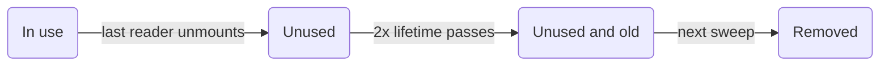

A v0.19 permite que um [Manager](/docs/concepts/managers) escreva um lote inteiro de linhas recebidas por stream em uma única atualização da store, verifica os tipos
do código de endpoints cerca de 2x mais rápido e corrige uma rodada de problemas de TypeScript e Vue.
Coding agents também ganham um plugin do Claude Code, skills de Vue e llms.txt; veja
[Data Client para Coding Agents](/blog/2026/10/06/coding-agents).

**Novas APIs:**

- [Controller.set() com schemas Array](/blog/2026/10/03/v0.19-batch-set#batch-set) - Escreva muitas entidades em uma única atualização da store com `ctrl.set([Entity], rows)`, [até 95x mais rápido](/blog/2026/10/03/v0.19-batch-set#batch-set-performance) do que um `set()` por linha

**Desempenho:**

- [TypeScript mais rápido](/blog/2026/10/03/v0.19-batch-set#faster-types) - Editores e o `tsc` verificam código com [RestEndpoint](/rest/api/RestEndpoint) e [resource()](/rest/api/resource) [cerca de 2x mais rápido com 40% menos memória](/blog/2026/10/03/v0.19-batch-set#faster-types-results), detectando todos os erros que detectavam antes

**Outras melhorias:**

- Corrige a resolução de módulos do TypeScript 7 para os `exports` do pacote; os imports agora resolvem para os arquivos de declaração ([#4019](https://github.com/reactive/data-client/pull/4019))
- [renderDataHook()](/docs/api/renderDataHook) executa os efeitos de montagem do provider quando a primeira renderização suspende ([#4099](https://github.com/reactive/data-client/pull/4099))
- [Os valores de Controller.set() são tipados pelo schema](/blog/2026/10/03/v0.19-batch-set#typed-set), então `ctrl.set(new schema.All(Todo), 42)` é um erro de TypeScript ([#4133](https://github.com/reactive/data-client/pull/4133))
- [Controller.set() exclui uma entidade com um schema Invalidate](/blog/2026/10/03/v0.19-batch-set#set-invalidate) sem a gambiarra do lote de uma linha ([#4230](https://github.com/reactive/data-client/pull/4230))
- [process() recebe params tipados](/blog/2026/10/03/v0.19-batch-set#extend-process-params) em `new RestEndpoint()`, `.extend()` e `resource().extend()`, então um parâmetro de path errado é um erro de TypeScript em vez de `undefined` em tempo de execução ([#4183](https://github.com/reactive/data-client/pull/4183), [#4184](https://github.com/reactive/data-client/pull/4184))
- [Os retornos de getOptimisticResponse() são tipados pelo schema](/blog/2026/10/03/v0.19-batch-set#typed-optimistic-response), então um tipo de campo errado é um erro de TypeScript em vez de um flash de dados incorretos ([#4198](https://github.com/reactive/data-client/pull/4198))
- [useSuspense()](/vue/api/useSuspense) e [useLive()](/vue/api/useLive) do Vue mantêm os dados anteriores enquanto novos argumentos carregam, em vez de retornar `undefined` ([#4131](https://github.com/reactive/data-client/pull/4131))
- [useSuspense()](/vue/api/useSuspense) e [useLive()](/vue/api/useLive) do Vue enviam erros de fetch após a mudança de argumentos para `onErrorCaptured()` em vez de uma rejeição de promise não tratada ([#4135](https://github.com/reactive/data-client/pull/4135))
- [useSuspense()](/vue/api/useSuspense), [useDLE()](/vue/api/useDLE) e [useFetch()](/vue/api/useFetch) do Vue não buscam mais novamente dados desatualizados a cada atualização da store, então um `controller.set()` não é sobrescrito ([#4134](https://github.com/reactive/data-client/pull/4134))
- [useSuspense()](/vue/api/useSuspense) do Vue [mostra dados desatualizados na montagem](/blog/2026/10/03/v0.19-batch-set#vue-stale-while-revalidate) e busca novamente em segundo plano, como no React, em vez de mostrar o fallback do `<Suspense>` até a nova busca terminar ([#4169](https://github.com/reactive/data-client/pull/4169))
- [useDLE()](/vue/api/useDLE) e [useCache()](/vue/api/useCache) do Vue mantêm dados `invalidIfStale` expirados durante atualizações não relacionadas da store, em vez de ficarem travados carregando ([#4142](https://github.com/reactive/data-client/pull/4142))
- O `DataClientPlugin` do Vue é instalado em versões do Vue anteriores à 3.5 em vez de lançar `app.onUnmount is not a function` ([#4146](https://github.com/reactive/data-client/pull/4146))
- O [DataClientPlugin](/vue/api/DataClientPlugin#gcPolicy) do Vue faz coleta de lixo por padrão, igual ao [DataProvider](/docs/api/DataProvider) do React, então você não precisa mais passar `gcPolicy`; [como ele decide o que remover](/blog/2026/10/03/v0.19-batch-set#vue-gc) ([#4148](https://github.com/reactive/data-client/pull/4148))
- Os composables do Vue aceitam [argumentos getter](/blog/2026/10/03/v0.19-batch-set#vue-getter-args) como `() => ({ id: props.id })`; eles eram tipados para permiti-los, mas passavam a própria função ao endpoint ([#4115](https://github.com/reactive/data-client/pull/4115))
- Corrige os erros `Cannot find name 'NoInfer'` e `export type` no TypeScript 4.x com `skipLibCheck` desativado ([#4138](https://github.com/reactive/data-client/pull/4138))
- Corrige erros de tipo de `Entity`, `Endpoint`, `Union` e `RestEndpoint` no TypeScript 4.0–4.5 com `skipLibCheck` desativado ([#4140](https://github.com/reactive/data-client/pull/4140))
- Corrige erros `',' expected` ao importar `@data-client/react/redux`, `@data-client/react/nextjs` ou `@data-client/test` no TypeScript 4.0–4.4 ([#4232](https://github.com/reactive/data-client/pull/4232))
- Corrige `act` e `renderHook` de `@data-client/test` tipados como `any` no TypeScript 4.0–4.4 ([#4251](https://github.com/reactive/data-client/pull/4251))
- Classes [Entity](/rest/api/Entity) podem ser usadas onde um `EntityInterface` é esperado ([#4149](https://github.com/reactive/data-client/pull/4149)); [prepare as sobrescritas de `pk()`](/blog/2026/10/03/v0.19-batch-set#entity-pk-args) para um lançamento futuro
- [useCache()](/docs/api/useCache) e [useDLE()](/docs/api/useDLE) retornam `undefined` para uma entidade excluída cuja nova busca falhou, em vez de um `Symbol` truthy que passava por verificações `if (!data)`; [remova quaisquer gambiarras](/blog/2026/10/03/v0.19-batch-set#deleted-entity-undefined) ([#4150](https://github.com/reactive/data-client/pull/4150))
- [useFetch()](/vue/api/useFetch) do Vue impede que seus dados sejam coletados pelo garbage collector enquanto está montado, como o [useSuspense()](/vue/api/useSuspense), então um `gcPolicy` configurado não remove mais dados pré-carregados que componentes leem depois ([#4152](https://github.com/reactive/data-client/pull/4152))
- Apps com o [Redux DevTools](/docs/getting-started/debugging) aberto não travam mais em desenvolvimento com stores grandes ou atualizações frequentes; cada atualização [serializa 40-60x mais rápido](/blog/2026/10/03/v0.19-batch-set#devtools-perf) ([#4163](https://github.com/reactive/data-client/pull/4163))
- [resource().extend()](/rest/api/resource#extend) com um objeto de sobrescritas de endpoints mantém em seu tipo os endpoints adicionados antes com `.extend('name', options)`, então usá-los não é mais um erro de TypeScript ([#4184](https://github.com/reactive/data-client/pull/4184))
- [RestEndpoint.push](/blog/2026/10/03/v0.19-batch-set#query-collection-push), `unshift` e `remove` aceitam os campos da Entity como body quando um [Query](/rest/api/Query) ou [Lazy](/rest/api/Lazy) envolve a [Collection](/rest/api/Collection), em vez de apenas `FormData` ([#4226](https://github.com/reactive/data-client/pull/4226))
- [useFetch()](/vue/api/useFetch) do Vue é tipado como o `Ref` somente leitura que retorna, então `promise.resolved` (sempre `undefined`) agora é um erro de TypeScript; leia `promise.value.resolved` em vez disso ([#4114](https://github.com/reactive/data-client/pull/4114))
- Uma subclasse de `Controller` passada ao [DataProvider](/docs/api/DataProvider#Controller) ou ao [DataClientPlugin](/vue/api/DataClientPlugin#Controller) não precisa mais de um cast para passar na verificação de tipos ([#4228](https://github.com/reactive/data-client/pull/4228))
- A `store` de [prepareStore()](/docs/guides/redux) pode ser passada ao `<Provider>` do react-redux sem cast, e tem `dispatch()` em seu tipo ([#4238](https://github.com/reactive/data-client/pull/4238))
- [resource().create aceita FormData](/blog/2026/10/03/v0.19-batch-set#create-formdata) sem cast, como `update`, `partialUpdate` e `getList.push` ([#4235](https://github.com/reactive/data-client/pull/4235))
- [RestEndpoint.push](/rest/api/RestEndpoint#push), `unshift` e `remove` enviam um body em array como JSON, então criar ou remover vários itens de uma vez não envia mais `"[object Object]"` ao seu servidor; `resource().create` também aceita um array ([#4262](https://github.com/reactive/data-client/pull/4262))
- O `createDataClient()` do Vue está descontinuado, já que é interno ao [DataClientPlugin](/vue/api/DataClientPlugin); instale o plugin com `app.use(DataClientPlugin, options)` em vez de chamá-lo diretamente ([#4193](https://github.com/reactive/data-client/pull/4193))
- O `waitForNextUpdate()` do `renderDataCompose()` do Vue está descontinuado, já que desiste silenciosamente após 1 segundo e deixa um teste passar enquanto ainda está suspenso; use `await result` em vez disso, ou `await allSettled()` após uma mudança, que agora também espera as buscas iniciadas por uma mudança de prop ([testes unitários de composables](/vue/guides/unit-testing-composables#renderdatacompose-api), [#4221](https://github.com/reactive/data-client/pull/4221))

**[Mudanças incompatíveis:](/blog/2026/10/03/v0.19-batch-set#migration-guide)**

- [TypeScript 4.0 ou posterior é obrigatório](/blog/2026/10/03/v0.19-batch-set#typescript-4) - as declarações para TypeScript 3.x foram removidas ([#4151](https://github.com/reactive/data-client/pull/4151))

**[Prepare-se para lançamentos futuros:](/blog/2026/10/03/v0.19-batch-set#future-releases)**

- [Tipe `args` como `readonly` nas sobrescritas de `Entity.pk()`](/blog/2026/10/03/v0.19-batch-set#future-pk-args)
- [Use `DataClientPlugin` em vez do `createDataClient()` do Vue](/blog/2026/10/03/v0.19-batch-set#future-create-data-client)
- [Substitua `waitForNextUpdate()` nos testes de Vue](/blog/2026/10/03/v0.19-batch-set#future-wait-for-next-update)

{/* truncate */}

import useBaseUrl from '@docusaurus/useBaseUrl';
import AutoPlayVideo from '@site/src/components/AutoPlayVideo';
import DiffEditor from '@site/src/components/DiffEditor';
import BatchSetDemo from '../../docs/core/shared/\_BatchSetDemo.mdx';
import PerfChart from '@site/src/components/PerfChart';
import PerfTable from '@site/src/components/PerfTable';
import StackBlitz from '@site/src/components/StackBlitz';
import TypeScriptEditor from '@site/src/components/TypeScriptEditor';

## Controller.set() em lote {#batch-set}

Um [Manager](/docs/concepts/managers) que recebe um stream de linhas (como cotações de preços por um websocket) agora pode escrever
todas elas com um único [Controller.set()](/docs/api/Controller#set-array) passando um schema [Array](/rest/api/Array).
Antes da v0.19, `[Ticker]` era um erro de TypeScript, então a gambiarra comum era um `set()` por linha:

<DiffEditor>

```ts title="Before"
ws.onmessage = event => {
  const rows = JSON.parse(event.data);
  for (const row of rows) {
    ctrl.set(Ticker, { product_id: row.product_id }, row);
  }
};
```

```ts title="After"
ws.onmessage = event => {
  const rows = JSON.parse(event.data);
  ctrl.set([Ticker], rows);
};
```

</DiffEditor>

Cada linha é mesclada com sua entidade armazenada, e as entidades que não estão na lista ficam intactas. Schemas Array não recebem `args` nem
função de atualização. Para agrupar em lote tipos de Entity diferentes, exclusões ou linhas indexadas por id, passe um schema [Union](/rest/api/Union),
[Invalidate](/rest/api/Invalidate#batch-invalidation) ou [Values](/rest/api/Values); veja
[Controller.set()](/docs/api/Controller#set-array) para exemplos.
[#4103](https://github.com/reactive/data-client/pull/4103)

<BatchSetDemo />

### Desempenho {#batch-set-performance}

Cada `set()` é uma atualização separada da store, e toda atualização da store copia a tabela daquele tipo de entidade. Escrever as linhas uma
de cada vez repete essa cópia para cada linha, então o custo cresce tanto com o tamanho do lote quanto com o tamanho da store. Um lote
paga essa cópia uma única vez.

O gráfico é o benchmark `setMany` em node de
[examples/benchmark/core.js](https://github.com/reactive/data-client/blob/master/examples/benchmark/core.js):
uma store que já contém 500 entidades, depois um `set()` síncrono por linha comparado a um único `set([Ticker], rows)`.
Ele mede a atualização da store: **20x** mais rápido para 50 linhas e **95x** mais rápido para 500 linhas.
[#4103](https://github.com/reactive/data-client/pull/4103)

<PerfChart
  title="setMany em Node em uma store com 500 entidades"
  baselineLabel="One set() per row"
  valueLabel="set([Ticker], rows)"
  rows={[
    { label: '50 rows', baseline: 10.8, value: 0.54 },
    { label: '500 rows', baseline: 103, value: 1.08 },
  ]}
/>

<center>

[Benchmarks ao longo do tempo](https://reactive.github.io/data-client/dev/bench/) | [Ver o benchmark setMany](https://github.com/reactive/data-client/blob/master/examples/benchmark/core.js)

</center>

Em um [Manager](/docs/concepts/managers), acumule as mensagens recebidas em um buffer e descarregue cada lote com um único `set()`, como descrito em
[Agrupando atualizações de alta frequência em lote](/docs/concepts/managers#batching). O `StreamManager` do app de moedas agora
descarrega as mensagens de ticker da Coinbase dessa forma.

<AutoPlayVideo
  src={useBaseUrl('/videos/blog/batch-set-devtools.webm')}
  type="video/webm"
  style={{ width: '100%' }}
  alt="Redux DevTools para duas cópias do StreamManager do app de moedas recebendo três rajadas de 500 mensagens de ticker. Chamar set() para cada mensagem registra 1.500 ações set, enquanto acumular as mensagens em um buffer e descarregá-las com set([Ticker], rows) registra 3."
/>

```ts title="StreamManager.ts"
handleMessage(msg: any) {
  if (msg.type in this.entities) {
    (this.buffer[msg.type] ??= {})[msg.product_id] = msg;
    this.flushTimeout ??= setTimeout(this.flush, 50);
  }
}

flush = () => {
  const buffer = this.buffer;
  this.buffer = {};
  this.flushTimeout = undefined;
  for (const type in buffer) {
    this.controller.set([this.entities[type]], Object.values(buffer[type]));
  }
};
```

<StackBlitz app="coin-app" file="src/resources/StreamManager.ts,src/getManagers.ts,src/resources/Ticker.ts" height="600" view="editor" />

:::tip

Se você filtra as ações do [DevToolsManager](/docs/api/DevToolsManager) por schema, o `action.schema` de uma escrita em lote
é o schema Array, então compare `action.schema[0]` para `[Ticker]` em vez da própria Entity.

:::

## TypeScript mais rápido {#faster-types}

O TypeScript verifica novamente seu código a cada tecla digitada no editor e a cada build de CI. Em apps com muitos endpoints,
tipos pesados de biblioteca aparecem como autocomplete lento, sublinhados vermelhos que levam segundos para aparecer e builds mais demorados.
A v0.19 torna [RestEndpoint](/rest/api/RestEndpoint), [resource()](/rest/api/resource) e `.extend()` muito mais baratos
de verificar, sem mudanças de código do seu lado. O TypeScript continua reportando todos os erros que reportava antes
([#4173](https://github.com/reactive/data-client/pull/4173)).

### Resultados {#faster-types-results}

Nosso teste de estresse mais pesado, um arquivo com 150 RestEndpoints com paths longos, `.extend()` e `.paginated()`, agora é verificado
**2x mais rápido no TypeScript 6** e **2,2x mais rápido no TypeScript 7**, usando cerca de **40% menos memória**. Todos os números comparam
os pacotes publicados da v0.18.1 com a v0.19; os tempos de verificação são o melhor de 10 execuções.

<PerfChart
  title="Verificando 150 RestEndpoints com paths longos"
  scaleMax={2.4}
  baselineLabel="v0.18"
  valueLabel="v0.19"
  unit="s"
  rows={[
    { label: 'TypeScript 6', baseline: 3.83, value: 1.98 },
    { label: 'TypeScript 7', baseline: 1.5, value: 0.69 },
  ]}
/>

<PerfChart
  title="Memória para o mesmo arquivo"
  scaleMax={2.4}
  baselineLabel="v0.18"
  valueLabel="v0.19"
  unit="MB"
  rows={[
    { label: 'TypeScript 6', baseline: 365, value: 211 },
    { label: 'TypeScript 7', baseline: 220, value: 128 },
  ]}
/>

Código com muitos endpoints faz muito menos trabalho de tipos. Instanciações de tipo são a unidade de trabalho do TypeScript: elas são
determinísticas, então podem ser comparadas com precisão entre máquinas. Union faz mais trabalho do que na v0.18, porque a v0.19 agora
[verifica os tipos dos valores de set()](#typed-set) (veja abaixo).

<PerfChart
  title="Instanciações de tipo por teste de estresse"
  scaleMax={2.4}
  baselineLabel="v0.18"
  valueLabel="v0.19"
  unit="K"
  rows={[
    { label: 'Long paths', baseline: 822, value: 341 },
    { label: 'Typical app', baseline: 20.2, value: 13.4 },
    { label: 'React hooks', baseline: 145, value: 122 },
    { label: 'Vue', baseline: 62.6, value: 47.3 },
    { label: '300 fields', baseline: 17.0, value: 12.8 },
    { label: 'Schemas', baseline: 118, value: 99.3 },
    { label: 'Union', baseline: 9.0, value: 16.1 },
  ]}
/>

Passe o mouse ou toque em uma célula para ver os números exatos.

<PerfTable
  columns={[
    { label: 'TS 6 check time', unit: 's' },
    { label: 'TS 7 check time', unit: 's' },
    { label: 'TS 6 memory', unit: 'MB' },
  ]}
  rows={[
    {
      label: 'Long paths',
      description: <>150 RestEndpoints with 6-param paths, <code>.extend()</code> and <code>.paginated()</code></>,
      values: [[3.83, 1.98], [1.5, 0.69], [365, 211]],
    },
    {
      label: 'Typical app',
      description: <>A few resources with <code>.extend()</code>, <code>.paginated()</code> and hooks</>,
      values: [[0.42, 0.42], [0.062, 0.053], [106, 109]],
    },
    {
      label: 'React hooks',
      description: <>40 resources through every hook, plus <code>ctrl.fetch()</code> and <code>ctrl.set()</code></>,
      values: [[1.24, 1.12], [0.41, 0.38], [167, 157]],
    },
    {
      label: 'Vue',
      description: 'The same 40 resources through every composable',
      values: [[0.68, 0.68], [0.17, 0.15], [145, 139]],
    },
    {
      label: '300 fields',
      description: 'One Entity with 300 fields, read and updated 100 times',
      values: [[0.44, 0.38], [0.086, 0.052], [111, 101]],
    },
    {
      label: 'Schemas',
      description: 'All, Query, Invalidate, Array, Object and Collection',
      values: [[1.1, 1.07], [0.36, 0.31], [156, 150]],
    },
    {
      label: 'Union',
      description: 'A 30-member Union in a Collection and Values',
      values: [[0.42, 0.41], [0.071, 0.068], [107, 101]],
    },
    {
      label: 'set() values',
      description: <>1000 <code>ctrl.set()</code> calls on a 30-member Union, a Collection of it and a 300-field Entity</>,
      values: [[1.49, 1.07], [0.54, 0.25], [176, 131]],
    },
    {
      label: 'set() updaters',
      description: <>1000 <code>ctrl.set(Union, args, prev =&gt; ...)</code> updaters on a 30-member Union</>,
      values: [[3.58, 3.43], [1.67, 1.85], [381, 384]],
    },
  ]}
/>

As linhas de set() medem os [valores tipados de set()](#typed-set), que a v0.18 não verificava de forma alguma. Valores simples ainda são verificados
mais rápido do que antes, e funções de atualização em Unions grandes são verificadas em aproximadamente o mesmo tempo, mesmo que o TypeScript agora
verifique o valor de retorno de cada função de atualização ([#4179](https://github.com/reactive/data-client/pull/4179)).

Arquivos pequenos são dominados pelo custo fixo de inicialização do TypeScript (carregar `lib.dom.d.ts` sozinho leva cerca de 100MB), então
seu tempo e memória quase não mudam. A economia se acumula conforme a base de código cresce.

### O que mudou {#faster-types-how}

- `.extend()` e `.paginated()` são compartilhados entre todos os endpoints em vez de recriados para cada tipo de endpoint.
- As opções de endpoint são inferidas como tipos de objeto simples, então o TypeScript para de reconstruí-las a cada uso.
- Parâmetros de path como `/users/:id` são lidos em uma única passagem.

Antes de publicar, desativamos todos os `@ts-expect-error` da suíte de testes no TypeScript 4.0 até o 7 e confirmamos
que todos os erros continuam aparecendo no mesmo lugar.

No TypeScript 5.x e anteriores, um método `process(value, params)` passado ao `.extend()` também não falha mais com
"implicitly has an 'any' type" em modo `strict`.

## Outras melhorias {#other-improvements}

### Valores tipados de set() {#typed-set}

[Controller.set()](/docs/api/Controller#set) antes aceitava qualquer valor para um schema, então um erro de digitação ou um tipo de campo
errado só aparecia como dados incorretos em tempo de execução. Os valores agora são tipados pelo schema: uma
[Entity](/rest/api/Entity) recebe seus campos, enquanto uma [Collection](/rest/api/Collection), [All](/rest/api/All) ou
Array recebe uma lista de linhas. Todo campo é opcional, já que `set()` mescla com o que já está armazenado, e
números e strings são intercambiáveis assim como nas respostas de API.
[#4133](https://github.com/reactive/data-client/pull/4133)

Passe o mouse sobre os sublinhados vermelhos para ver cada erro.

<TypeScriptEditor>

```ts title="Todo" collapsed
import { Entity, resource } from '@data-client/rest';

export class Todo extends Entity {
  id = 0;
  userId = 0;
  title = '';
  completed = false;

  static key = 'Todo';
}

export const TodoResource = resource({
  urlPrefix: 'https://jsonplaceholder.typicode.com',
  path: '/todos/:id',
  schema: Todo,
});
```

```ts title="updateTodos"
import type { Controller } from '@data-client/react';
import { schema } from '@data-client/rest';
import { Todo, TodoResource } from './Todo';

export function updateTodos(ctrl: Controller) {
  // ✅ rows are partial Todos; ids may be strings or numbers
  ctrl.set(TodoResource.getList.schema, [{ id: '5', completed: true }]);
  ctrl.set(Todo, { id: 5 }, todo => ({ completed: !todo.completed }));
  ctrl.set([Todo], [{ id: 1, title: 'first' }, { id: 2 }]);

  // ❌ All takes a list of rows
  ctrl.set(new schema.All(Todo), 42);
  // ❌ completed is a boolean
  ctrl.set(Todo, { id: 5 }, { id: 5, completed: 'yes' });
  // ❌ Todo has no done field
  ctrl.set(TodoResource.getList.schema, [{ id: 5, done: true }]);
  // ❌ updaters must return Todo fields
  ctrl.set(Todo, { id: 5 }, todo => ({ title: todo.completed }));
}
```

</TypeScriptEditor>

Um [Query](/rest/api/Query) recebe a entrada do schema que envolve, já que `set()` normaliza esse schema em vez de
reverter o `process()`. Quando cada membro declara seu discriminador como um literal (como `readonly type = 'post'`), uma
linha de [Union](/rest/api/Union) é verificada contra o membro que ela seleciona, então não pode misturar campos de membros diferentes; veja [Unions](/docs/api/Controller#set).

Se um código que antes compilava agora falha aqui, ele estava escrevendo dados que seu schema não descreve. Corrija o valor,
ou amplie os tipos dos campos da Entity se os dados realmente puderem ter essa forma.

### Exclua uma entidade com set() {#set-invalidate}

Passar um schema [Invalidate](/rest/api/Invalidate) ao [Controller.set()](/docs/api/Controller#set-array) exclui a
entidade que sua linha identifica, mas a forma singular era um erro de TypeScript, então o código a envolvia em um lote de uma linha. Agora
ela passa na verificação de tipos, com a linha tipada pelos campos da Entity
([#4230](https://github.com/reactive/data-client/pull/4230)):

<DiffEditor>

```ts title="Before"
ctrl.set([new Invalidate(Todo)], [{ id: '5' }]);
```

```ts title="After"
ctrl.set(new Invalidate(Todo), { id: '5' });
```

</DiffEditor>

Como o `set()` em lote, ela não recebe `args` nem função de atualização.

### Params tipados em process() {#extend-process-params}

Um método [process()](/rest/api/RestEndpoint#process) passado a `new RestEndpoint()`,
[.extend()](/rest/api/RestEndpoint#extend) ou [resource().extend()](/rest/api/resource#extend) recebia `params` tipado como
`any`, então ler um parâmetro que o endpoint não tem compilava e retornava `undefined` em tempo de execução. `params` e
`body` agora são tipados a partir do endpoint, incluindo um `path` definido na mesma chamada de `.extend()`
([#4183](https://github.com/reactive/data-client/pull/4183), [#4184](https://github.com/reactive/data-client/pull/4184)):

<TypeScriptEditor>

```ts
import { RestEndpoint } from '@data-client/rest';

const getUser = new RestEndpoint({ path: '/users/:id' });

export const getUserById = getUser.extend({
  path: '/users/by-id/:userId',
  process(value, params) {
    const userId: string | number = params.userId;
    // @ts-expect-error 'id' is not a param of '/users/by-id/:userId'
    params.id;
    return { ...value, userId };
  },
});
```

</TypeScriptEditor>

Quando todos os params são opcionais, `params` pode ser `undefined`, então leia-o com `params?.page`.

Isso pode revelar novos erros de TypeScript em métodos `process()` existentes. Cada um marca uma leitura que poderia ser `undefined`
ou lançar uma exceção em tempo de execução, então corrija o nome do param ou adicione a verificação que falta.

### Respostas otimistas tipadas {#typed-optimistic-response}

[getOptimisticResponse()](/rest/api/RestEndpoint#getoptimisticresponse) podia retornar qualquer coisa, a menos que o endpoint tivesse
um `process()` tipado, então um tipo de campo errado só aparecia como dados incorretos na interface até o servidor responder. O valor de retorno
agora é verificado contra o schema do endpoint, como um [valor tipado de set()](#typed-set): uma Entity recebe qualquer um de seus
campos, e uma [Collection](/rest/api/Collection) recebe uma lista deles
([#4198](https://github.com/reactive/data-client/pull/4198)):

<TypeScriptEditor>

```ts
import { Entity, RestEndpoint } from '@data-client/rest';

class Todo extends Entity {
  id = 0;
  title = '';
  completed = false;
}

export const toggleTodo = new RestEndpoint({
  path: '/todos/:id',
  method: 'PATCH',
  schema: Todo,
  // @ts-expect-error completed is a boolean; 'false' is truthy, so the checkbox would stay checked
  getOptimisticResponse(snap, { id }) {
    const todo = snap.get(Todo, { id });
    if (!todo) throw snap.abort;
    return { id, completed: todo.completed ? 'false' : 'true' };
  },
});
```

</TypeScriptEditor>

Isso pode revelar novos erros de TypeScript em métodos `getOptimisticResponse()` existentes. Cada um marca um valor que seria
armazenado com o tipo errado até o servidor responder, então retorne o tipo real do campo (aqui, `!todo.completed`).

### push() tipado em Collections ordenadas {#query-collection-push}

Envolver uma [Collection](/rest/api/Collection) em um [Query](/rest/api/Query) para ordená-la ou filtrá-la fazia
[push](/rest/api/RestEndpoint#push), `unshift` e `remove` rejeitarem qualquer body exceto `FormData`, embora adicionem à
lista em tempo de execução. O body agora é tipado a partir da Entity da Collection, então o cast pode ser removido e um campo errado é um
erro de TypeScript. O mesmo vale para uma Collection envolvida em [Lazy](/rest/api/Lazy)
([#4226](https://github.com/reactive/data-client/pull/4226)).

<DiffEditor>

```ts title="Before"
import { useController } from '@data-client/react';
import { getPosts } from './getPosts';

export function useAddPost() {
  const ctrl = useController();
  return (title: string, author: string) =>
    ctrl.fetch(getPosts.push, { group: 'react' }, { title, author } as any);
}
```

```ts title="After"
import { useController } from '@data-client/react';
import { getPosts } from './getPosts';

export function useAddPost() {
  const ctrl = useController();
  return (title: string, author: string) =>
    ctrl.fetch(getPosts.push, { group: 'react' }, { title, author });
}
```

</DiffEditor>

onde `getPosts` ordena sua Collection com um Query:

```ts title="getPosts.ts"
import { Collection, Entity, Query, RestEndpoint } from '@data-client/rest';

export class Post extends Entity {
  id = '';
  title = '';
  group = '';
  author = '';
}

export const getPosts = new RestEndpoint({
  path: '/:group/posts',
  searchParams: {} as { orderBy?: 'title' | 'author' },
  schema: new Query(
    new Collection([Post], { nonFilterArgumentKeys: /orderBy/ }),
    (posts, { orderBy }: { orderBy?: 'title' | 'author' } = {}) =>
      orderBy ?
        [...posts].sort((a, b) => a[orderBy].localeCompare(b[orderBy]))
      : posts,
  ),
});
```

### FormData em resource().create {#create-formdata}

O `create` de [resource()](/rest/api/resource) envia um body `FormData` como está, assim como `update`, `partialUpdate` e
[getList.push](/rest/api/resource#push), mas seu tipo só permitia um objeto, então enviar um formulário exigia um cast
([#4235](https://github.com/reactive/data-client/pull/4235)). Remova o cast:

<DiffEditor>

```tsx title="Before"
<form
  onSubmit={e => {
    e.preventDefault();
    ctrl.fetch(PostResource.create, new FormData(e.currentTarget) as any);
  }}
>
```

```tsx title="After"
<form
  onSubmit={e => {
    e.preventDefault();
    ctrl.fetch(PostResource.create, new FormData(e.currentTarget));
  }}
>
```

</DiffEditor>

`create` está descontinuado; [getList.push](/rest/api/resource#push) é seu substituto e também aceita `FormData`.

### Argumentos getter no Vue {#vue-getter-args}

Composables do Vue como [useSuspense()](/vue/api/useSuspense) e [useLive()](/vue/api/useLive) eram tipados para aceitar uma
função getter como argumento, mas passavam a própria função ao endpoint em vez de chamá-la. Getters agora
funcionam da mesma forma que refs e `computed`, e o composable busca novamente quando qualquer coisa que o getter lê muda
([#4115](https://github.com/reactive/data-client/pull/4115)). Remova o `computed()` ao redor se você só o usava para tornar
os argumentos reativos:

<DiffEditor>

```ts title="Before"
import { computed } from 'vue';

const props = defineProps<{ id: number }>();
const article = await useSuspense(
  ArticleResource.get,
  computed(() => ({ id: props.id })),
);
```

```ts title="After"
const props = defineProps<{ id: number }>();
const article = await useSuspense(ArticleResource.get, () => ({
  id: props.id,
}));
```

</DiffEditor>

Isso vale para todo composable que recebe argumentos de endpoint: [useSuspense()](/vue/api/useSuspense),
[useLive()](/vue/api/useLive), [useCache()](/vue/api/useCache), [useDLE()](/vue/api/useDLE),
[useFetch()](/vue/api/useFetch), [useQuery()](/vue/api/useQuery) e [useSubscription()](/vue/api/useSubscription).

### Vue faz coleta de lixo por padrão {#vue-gc}

O [DataClientPlugin](/vue/api/DataClientPlugin#gcPolicy) do Vue só removia dados não utilizados se você mesmo passasse um
`gcPolicy`. Agora o padrão é `new GCPolicy()`, o mesmo do [DataProvider](/docs/api/DataProvider) do React, então você pode
remover a opção, a menos que a personalize ([#4148](https://github.com/reactive/data-client/pull/4148)).

<DiffEditor>

```ts title="Before"
import { DataClientPlugin, GCPolicy } from '@data-client/vue';

app.use(DataClientPlugin, { gcPolicy: new GCPolicy() });
```

```ts title="After"
import { DataClientPlugin } from '@data-client/vue';

app.use(DataClientPlugin);
```

</DiffEditor>

Os dados só são removidos quando nenhum componente montado os lê _e_ o dobro do seu tempo de vida de frescor passou desde que foram
buscados (no mínimo dois minutos). Uma varredura verifica a cada cinco minutos. Qualquer coisa que um componente leia novamente antes disso
volta a estar em uso.

<center>

<div style={{maxWidth:'640px'}}>



</div>

</center>

Um componente que monta após a remoção trata os dados como nunca buscados: o [useSuspense()](/vue/api/useSuspense) os busca
de novo, enquanto o [useCache()](/vue/api/useCache) retorna `undefined`. Para manter dados não utilizados por mais tempo ou varrer com menos frequência,
passe seu próprio [gcPolicy](/vue/api/DataClientPlugin#gcPolicy).

### Stale-while-revalidate no Vue {#vue-stale-while-revalidate}

Quando um componente monta com dados que estão [desatualizados](/docs/concepts/expiry-policy#stale) mas ainda válidos, o
[useSuspense()](/vue/api/useSuspense) do Vue agora os renderiza imediatamente e busca novamente em segundo plano, como no React. Antes,
ele mostrava o fallback do `<Suspense>` até a nova busca terminar ([#4169](https://github.com/reactive/data-client/pull/4169)).

<AutoPlayVideo
  src={useBaseUrl('/videos/blog/vue-suspense-stale.mp4')}
  type="video/mp4"
  width="720"
  alt="Dois componentes Vue lado a lado, antes e depois da v0.19. Ambos mostram Loading na primeira montagem. Após desmontar e esperar até o preço ficar desatualizado, remontar mostra Loading de novo na versão anterior, enquanto a versão nova mostra o preço desatualizado imediatamente e busca novamente em segundo plano."
/>

### Classes Entity passam na verificação de tipos como EntityInterface {#entity-pk-args}

Funções auxiliares tipadas para aceitar qualquer Entity com `EntityInterface` rejeitavam classes Entity, porque
[Entity.pk()](/rest/api/Entity#pk) tipava seus `args` como um array mutável. Agora é `readonly any[]`, então isto
passa na verificação de tipos ([#4149](https://github.com/reactive/data-client/pull/4149)):

<TypeScriptEditor>

```ts
import { Entity } from '@data-client/rest';
import type { EntityInterface } from '@data-client/react';

class User extends Entity {
  id = '';
  name = '';
}

function entityName(schema: EntityInterface) {
  return schema.key;
}

entityName(User);
```

</TypeScriptEditor>

Se você sobrescreve `static pk()` e tipa `args` como um array mutável, ainda compila, mas um futuro lançamento com mudanças incompatíveis
exigirá `readonly`; [atualize agora](#future-pk-args).

### Entidades excluídas são lidas como undefined {#deleted-entity-undefined}

Quando uma entidade era excluída e sua nova busca falhava, [useCache()](/docs/api/useCache) e [useDLE()](/docs/api/useDLE)
(React e Vue) retornavam um `Symbol` interno como dados. Um `Symbol` é truthy, então a verificação comum de "ainda não carregou" o deixava
passar e o componente renderizava como se tivesse uma entidade
([#4150](https://github.com/reactive/data-client/pull/4150)):

```tsx
function TodoDetail({ id }: { id: number }) {
  const todo = useCache(TodoResource.get, { id });
  // a deleted todo used to get past this guard, so todo.title.trim() threw
  if (!todo) return <TodoPlaceholder />;
  return <h3>{todo.title.trim()}</h3>;
}
```

Agora `data` é `undefined`, de acordo com seu tipo e com [Controller.get()](/docs/api/Controller#get). O mesmo vale para
[Controller.getResponse()](/docs/api/Controller#getResponse) e
[Controller.fetchIfStale()](/docs/api/Controller#fetchIfStale), por exemplo em [Managers](/docs/api/Manager) personalizados.

Se você contornou isso, a gambiarra pode ser removida. Uma simples verificação de truthiness basta:

<DiffEditor>

```tsx title="Before"
function TodoDetail({ id }: { id: number }) {
  const todo = useCache(TodoResource.get, { id });
  if (!todo || typeof todo === 'symbol') return <TodoPlaceholder />;
  return <h3>{todo.title.trim()}</h3>;
}
```

```tsx title="After"
function TodoDetail({ id }: { id: number }) {
  const todo = useCache(TodoResource.get, { id });
  if (!todo) return <TodoPlaceholder />;
  return <h3>{todo.title.trim()}</h3>;
}
```

</DiffEditor>

Para mostrar algo específico quando a nova busca falhou (por exemplo, um 404 após a exclusão), leia `error` de
[useDLE()](/docs/api/useDLE) em vez de inspecionar `data`.

### Redux DevTools mais rápido {#devtools-perf}

Com a extensão [Redux DevTools](/docs/getting-started/debugging) aberta, toda atualização da store em desenvolvimento
serializa a store inteira para a extensão, e cada timestamp nela era formatado do jeito lento. Stores grandes ou
atualizações frequentes, como polling, dados em tempo real ou muitas chamadas de `controller.set()`, faziam a página travar. Cada atualização agora
serializa **40-60x mais rápido**, e os timestamps continuam aparecendo como `10:42:07.123 AM`
([#4163](https://github.com/reactive/data-client/pull/4163)). Builds de produção não incluem o DevTools, então não são
afetados.

<PerfChart
  title="Serialização do DevTools por atualização da store"
  baselineLabel="v0.18"
  valueLabel="v0.19"
  rows={[
    { label: '50 entities', baseline: 18.6, value: 0.31 },
    { label: '500 entities', baseline: 201, value: 5.0 },
  ]}
/>

## Guia de migração {#migration-guide}

import PkgTabs from '@site/src/components/PkgTabs';

Esta atualização exige atualizar todas as versões dos pacotes ao mesmo tempo.

<PkgTabs pkgs="@data-client/react@^0.19.0 @data-client/rest@^0.19.0 @data-client/endpoint@^0.19.0 @data-client/core@^0.19.0 @data-client/vue@^0.19.0 @data-client/test@^0.19.0 @data-client/img@^0.19.0" upgrade />

### TypeScript 4.0 ou posterior {#typescript-4}

Pule esta seção se você já usa TypeScript 4.0 ou posterior.

As declarações para TypeScript 3.x foram removidas, já que não passavam mais na verificação de tipos em nenhuma versão do TypeScript 3.x. Atualize
`typescript` para `^4.0.0` ou posterior nas suas `devDependencies`. [#4151](https://github.com/reactive/data-client/pull/4151)

### Prepare-se para lançamentos futuros {#future-releases}

Nada aqui é necessário para atualizar para a 0.19; seu código continua funcionando como está. Cada item vai quebrar em um lançamento futuro,
então atualizar agora torna aquela atualização trivial.

#### Os args de Entity.pk() são readonly {#future-pk-args}

Pule isto se você não sobrescreve `static pk()` com um parâmetro `args` tipado.

[Entity.pk()](/rest/api/Entity#pk) agora tipa `args` como `readonly any[]`. Sobrescritas que o anotam como um array
mutável ainda compilam por enquanto, mas um lançamento futuro exigirá `readonly`.

<DiffEditor>

```ts title="Before"
class User extends Entity {
  static pk(value: any, parent?: any, key?: string, args?: any[]) {
    return `${value.id}-${args?.[0]?.org}`;
  }
}
```

```ts title="After"
class User extends Entity {
  static pk(value: any, parent?: any, key?: string, args?: readonly any[]) {
    return `${value.id}-${args?.[0]?.org}`;
  }
}
```

</DiffEditor>

#### createDataClient() do Vue {#future-create-data-client}

Pule isto se você instala a store com `app.use(DataClientPlugin)`.

`createDataClient()` e `ProvidedDataClient` são internos ao [DataClientPlugin](/vue/api/DataClientPlugin) e
deixarão de ser exportados. Em vez disso, instale o plugin e leia o controller com
[useController()](/vue/api/useController). [#4193](https://github.com/reactive/data-client/pull/4193)

<DiffEditor>

```ts title="Before"
import { createDataClient } from '@data-client/vue';

const { controller } = createDataClient({ managers, initialState });
```

```ts title="After"
import { DataClientPlugin, useController } from '@data-client/vue';

app.use(DataClientPlugin, { managers, initialState });
// in a component's setup()
const controller = useController();
```

</DiffEditor>

#### waitForNextUpdate() do renderDataCompose() do Vue {#future-wait-for-next-update}

Pule isto se seus testes de Vue não chamam `waitForNextUpdate()`.

O `waitForNextUpdate()` de [renderDataCompose()](/vue/guides/unit-testing-composables#renderdatacompose-api) desiste
silenciosamente após 1 segundo, então um teste pode passar enquanto o composable ainda está suspenso. Ele será removido. Em vez disso, use `await` no
resultado e chame `allSettled()` após mudar props ou chamar o controller; agora ele também espera a
busca iniciada por uma mudança de prop. [#4221](https://github.com/reactive/data-client/pull/4221)

<DiffEditor>

```ts title="Before"
const { result, waitForNextUpdate } = await renderDataCompose(
  (props: { id: number }) =>
    useSuspense(ArticleResource.get, () => ({ id: props.id })),
  { props, resolverFixtures },
);
await waitForNextUpdate();
const article = await result;

props.id = 6;
await waitForNextUpdate();
```

```ts title="After"
const { result, allSettled } = await renderDataCompose(
  (props: { id: number }) =>
    useSuspense(ArticleResource.get, () => ({ id: props.id })),
  { props, resolverFixtures },
);
const article = await result;

props.id = 6;
await allSettled();
```

</DiffEditor>

### Suporte à atualização {#upgrade-support}

Como sempre, se você tiver qualquer problema ou dúvida, fique à vontade para entrar no nosso [](https://discord.gg/wXGV27xm6t) ou [abrir um bug](https://github.com/reactive/data-client/issues/new/choose)
