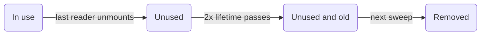

import useBaseUrl from '@docusaurus/useBaseUrl';
import AutoPlayVideo from '@site/src/components/AutoPlayVideo';
import CartBefore from '@site/src/components/CartBefore';
import DiffEditor from '@site/src/components/DiffEditor';
import HooksPlayground from '@site/src/components/HooksPlayground';
import BatchSetDemo from '../../docs/core/shared/\_BatchSetDemo.mdx';
import PerfChart from '@site/src/components/PerfChart';
import PerfTable from '@site/src/components/PerfTable';
import StackBlitz from '@site/src/components/StackBlitz';
import TypeScriptEditor from '@site/src/components/TypeScriptEditor';
import {
  cartFixtures,
  getInitialInterceptorData,
} from '@site/src/fixtures/cart';

export const readdDemo = [
  { delay: 1200, click: 'button[aria-label="Remove Ceramic mug"]' },
  { wait: 1500 },
  { click: '.toast button' },
];

A v0.19 permite que um [Manager](/docs/concepts/managers) grave um lote inteiro de linhas recebidas por streaming em uma única atualização do store, verifica
o código dos endpoints cerca de 2x mais rápido e corrige uma série de problemas de TypeScript e Vue.

**[Batch Controller.set()](/blog/2026/11/18/v0.19-batch-set#batch-set)** grava um stream inteiro de linhas, como cotações de preços vindas de um websocket, em uma única
atualização do store com `ctrl.set([Ticker], rows)`. Isso é [até 95x mais rápido](/blog/2026/11/18/v0.19-batch-set#batch-set-performance) do que um `set()` por linha.

<BatchSetDemo />

<PerfChart
  title="setMany no Node em um store com 500 entities"
  baselineLabel="One set() per row"
  valueLabel="set([Ticker], rows)"
  rows={[
    { label: '50 rows', baseline: 10.8, value: 0.54 },
    { label: '500 rows', baseline: 103, value: 1.08 },
  ]}
/>

**[TypeScript mais rápido](/blog/2026/11/18/v0.19-batch-set#faster-types)**: editores e `tsc` verificam o código de [RestEndpoint](/rest/api/RestEndpoint) e
[resource()](/rest/api/resource) cerca de 2x mais rápido, com 40% menos memória, e continuam reportando todos os erros que reportavam
antes.

<PerfChart
  title="Verificando 150 RestEndpoints com paths longos"
  scaleMax={2.4}
  baselineLabel="v0.18"
  valueLabel="v0.19"
  unit="s"
  rows={[
    { label: 'TypeScript 6', baseline: 3.83, value: 1.98 },
    { label: 'TypeScript 7', baseline: 1.5, value: 0.69 },
  ]}
/>

**Mais na v0.19:**

- [Desempenho](/blog/2026/11/18/v0.19-batch-set#performance): [Redux DevTools mais rápido](/blog/2026/11/18/v0.19-batch-set#devtools-perf), [pausas de GC mais curtas no React Native](/blog/2026/11/18/v0.19-batch-set#native-gc) e [bundles divididos menores](/blog/2026/11/18/v0.19-batch-set#smaller-chunks)
- [Client](/blog/2026/11/18/v0.19-batch-set#client): [apagar uma entity com set()](/blog/2026/11/18/v0.19-batch-set#set-invalidate), [leituras sem await não precisam de `.catch()`](/blog/2026/11/18/v0.19-batch-set#fetch-read-prehandled), [`<Activity>` acima do DataProvider](/blog/2026/11/18/v0.19-batch-set#loading-error-fixes) e [correções de carregamento e erro](/blog/2026/11/18/v0.19-batch-set#loading-error-states)
- [Plataformas](/blog/2026/11/18/v0.19-batch-set#platforms): [React Native 0.87 e Babel 8](/blog/2026/11/18/v0.19-batch-set#platforms)
- [Vue](/blog/2026/11/18/v0.19-batch-set#vue): [garbage collection por padrão](/blog/2026/11/18/v0.19-batch-set#vue-gc), [stale-while-revalidate](/blog/2026/11/18/v0.19-batch-set#vue-stale-while-revalidate) e [argumentos getter](/blog/2026/11/18/v0.19-batch-set#vue-getter-args)
- [Collections](/blog/2026/11/18/v0.19-batch-set#collection-updates): [listas de itens](/blog/2026/11/18/v0.19-batch-set#push-list) em todas as atualizações e [cada item exibido uma única vez](/blog/2026/11/18/v0.19-batch-set#collection-order)
- [Validação](/blog/2026/11/18/v0.19-batch-set#validation): [valores tipados em `set()`](/blog/2026/11/18/v0.19-batch-set#typed-set), [params de `process()`](/blog/2026/11/18/v0.19-batch-set#extend-process-params) e [respostas otimistas](/blog/2026/11/18/v0.19-batch-set#typed-optimistic-response); correções de [testes](/blog/2026/11/18/v0.19-batch-set#testing) e de [avisos](/blog/2026/11/18/v0.19-batch-set#warnings)

**[Mudanças incompatíveis:](/blog/2026/11/18/v0.19-batch-set#migration-guide)**

- [Para todos os usuários](/blog/2026/11/18/v0.19-batch-set#migrate-all)
  - [O Pages Router do Next.js não é compatível](/blog/2026/11/18/v0.19-batch-set#nextjs-pages-router); use o App Router ([#4648](https://github.com/reactive/data-client/pull/4648))
  - [TypeScript 4.0 ou superior é obrigatório](/blog/2026/11/18/v0.19-batch-set#typescript-4) - as declarações do TypeScript 3.x foram removidas ([#4151](https://github.com/reactive/data-client/pull/4151))
  - [`managers` é uma função que cria os Managers de cada store](/blog/2026/11/18/v0.19-batch-set#managers-function); `npx @data-client/codemods v0.19 src/` converte arrays ([#4601](https://github.com/reactive/data-client/pull/4601))
  - [Controller.fetchIfStale() sempre retorna uma Promise](/blog/2026/11/18/v0.19-batch-set#fetch-if-stale-promise), então prefetches não precisam de `.catch()` ([#4657](https://github.com/reactive/data-client/pull/4657))
  - [`__DC_CONTROLLERS__` agora é `__DC__`](/blog/2026/11/18/v0.19-batch-set#dc-global) para scripts de depuração ([#4435](https://github.com/reactive/data-client/pull/4435))
- [Para quem escreve Managers personalizados](/blog/2026/11/18/v0.19-batch-set#custom-managers)
  - [Managers devem definir `middleware`](/blog/2026/11/18/v0.19-batch-set#manager-middleware) - `getMiddleware()` foi removido ([#4378](https://github.com/reactive/data-client/pull/4378), [#4382](https://github.com/reactive/data-client/pull/4382))
  - [O `cleanup()` do Manager não significa mais que o store acabou](/blog/2026/11/18/v0.19-batch-set#manager-cleanup) - inicie timers e conexões em `init()`; `NetworkManager.cleanupDate` foi removido ([#4593](https://github.com/reactive/data-client/pull/4593))
- [Para quem escreve testes](/blog/2026/11/18/v0.19-batch-set#migrate-tests)
  - [@data-client/test exige @data-client/react 0.19](/blog/2026/11/18/v0.19-batch-set#test-react-0.19) ([#4414](https://github.com/reactive/data-client/pull/4414), [#4601](https://github.com/reactive/data-client/pull/4601))
  - [Testes de React Native precisam de @testing-library/react-native](/blog/2026/11/18/v0.19-batch-set#test-react-native) ([#4595](https://github.com/reactive/data-client/pull/4595))

**[Prepare-se para os próximos lançamentos:](/blog/2026/11/18/v0.19-batch-set#future-releases)**

- [Tipe `args` como `readonly` nas sobrescritas de `Entity.pk()`](/blog/2026/11/18/v0.19-batch-set#future-pk-args)
- [Use `DataClientPlugin` em vez do `createDataClient()` do Vue](/blog/2026/11/18/v0.19-batch-set#future-create-data-client)
- [Substitua `waitForNextUpdate()` nos testes de Vue](/blog/2026/11/18/v0.19-batch-set#future-wait-for-next-update)

**[Adote os novos recursos:](/blog/2026/11/18/v0.19-batch-set#adopt-features)** `npx @data-client/codemods v0.19 src/ --improvements=only` agrupa em lote os loops de `set()` e remove os workarounds que a 0.19 torna desnecessários

{/* truncate */}

## Desempenho {#performance}

O TypeScript roda a cada tecla digitada, o store é atualizado a cada mensagem recebida por streaming e o seu bundle é carregado a cada visualização de página.

### Batch Controller.set() {#batch-set}

`react` `vue`

Um [Manager](/docs/concepts/managers) que recebe um stream de linhas (como cotações de preços por um websocket) agora pode gravá-las
todas com um único [Controller.set()](/docs/api/Controller#set-array), passando um schema [Array](/rest/api/Array).
Antes da v0.19, `[Ticker]` era um erro de TypeScript, então o workaround usual era um `set()` por linha:

<DiffEditor>

```ts title="Before"
ws.onmessage = event => {
  const rows = JSON.parse(event.data);
  for (const row of rows) {
    ctrl.set(Ticker, { product_id: row.product_id }, row);
  }
};
```

```ts title="After"
ws.onmessage = event => {
  const rows = JSON.parse(event.data);
  ctrl.set([Ticker], rows);
};
```

</DiffEditor>

Cada linha é mesclada com a entity armazenada, e as entities que não estão na lista não são alteradas. Schemas Array não aceitam `args` nem
função de atualização. Para agrupar em lote tipos de Entity mistos, exclusões ou linhas indexadas por id, passe um schema [Union](/rest/api/Union),
[Invalidate](/rest/api/Invalidate#batch-invalidation) ou [Values](/rest/api/Values); veja
[Controller.set()](/docs/api/Controller#set-array) para exemplos.
[#4103](https://github.com/reactive/data-client/pull/4103)

#### Desempenho {#batch-set-performance}

Cada `set()` é uma atualização separada do store, e cada atualização do store copia a tabela daquele tipo de entity. Gravar as linhas uma
por vez repete essa cópia para cada linha, então o custo cresce tanto com o tamanho do lote quanto com o tamanho do store. Um lote
paga essa cópia uma única vez.

O gráfico no início deste post é o benchmark `setMany` do Node em
[examples/benchmark/core.js](https://github.com/reactive/data-client/blob/master/examples/benchmark/core.js):
um store que já contém 500 entities e, em seguida, um `set()` síncrono por linha comparado a um único `set([Ticker], rows)`.
Ele mede a atualização do store: **20x** mais rápido para 50 linhas e **95x** mais rápido para 500 linhas.
[#4103](https://github.com/reactive/data-client/pull/4103)

<center>

[Benchmarks ao longo do tempo](https://reactive.github.io/data-client/dev/bench/) | [Ver benchmark setMany](https://github.com/reactive/data-client/blob/master/examples/benchmark/core.js)

</center>

Em um [Manager](/docs/concepts/managers), armazene as mensagens recebidas em um buffer e descarregue cada lote com um único `set()`, como descrito em
[Agrupando atualizações de alta frequência em lote](/docs/concepts/managers#batching). O `StreamManager` do app coin agora
descarrega as mensagens de ticker da Coinbase dessa forma.

<AutoPlayVideo
  src={useBaseUrl('/videos/blog/batch-set-devtools.webm')}
  type="video/webm"
  style={{ width: '100%' }}
  alt="Redux DevTools de duas cópias do StreamManager do app coin recebendo três rajadas de 500 mensagens de ticker. Chamar set() para cada mensagem registra 1.500 ações set, enquanto armazenar as mensagens em um buffer e descarregá-las com set([Ticker], rows) registra 3."
/>

```ts title="StreamManager.ts"
handleMessage(msg: any) {
  if (msg.type in this.entities) {
    (this.buffer[msg.type] ??= {})[msg.product_id] = msg;
    this.flushTimeout ??= setTimeout(this.flush, 50);
  }
}

flush = () => {
  const buffer = this.buffer;
  this.buffer = {};
  this.flushTimeout = undefined;
  for (const type in buffer) {
    this.controller.set([this.entities[type]], Object.values(buffer[type]));
  }
};
```

<StackBlitz app="coin-app" file="src/resources/StreamManager.ts,src/getManagers.ts,src/resources/Ticker.ts" height="600" view="editor" />

:::tip

Se você filtra as ações do [DevToolsManager](/docs/api/DevToolsManager) por schema, o `action.schema` de uma gravação em lote
é o schema Array, então compare `action.schema[0]` com `[Ticker]` em vez de com a própria Entity.

:::

### Redux DevTools mais rápido {#devtools-perf}

`react` `vue`

Com a extensão [Redux DevTools](/docs/getting-started/debugging) aberta, cada atualização do store em desenvolvimento
serializa o store inteiro para a extensão, e cada timestamp nele era formatado da forma lenta. Stores grandes ou
atualizações frequentes, como polling, dados ao vivo ou muitas chamadas de `controller.set()`, faziam a página travar. Cada atualização agora
serializa **40-60x mais rápido**, e os timestamps continuam aparecendo como `10:42:07.123 AM`
([#4163](https://github.com/reactive/data-client/pull/4163)). Os builds de produção não incluem o DevTools, então não são
afetados.

<PerfChart
  title="Serialização do DevTools por atualização do store"
  baselineLabel="v0.18"
  valueLabel="v0.19"
  rows={[
    { label: '50 entities', baseline: 18.6, value: 0.31 },
    { label: '500 entities', baseline: 201, value: 5.0 },
  ]}
/>

### Pausas de GC mais curtas no React Native {#native-gc}

`react`

Os apps React Native não congelam mais por 0,5–3 s de cada vez ao ler um resultado grande que continua sendo atualizado, como
alguns milhares de entities unidas a preços ao vivo ([#4594](https://github.com/reactive/data-client/pull/4594)). A
leitura mais longa, pausas incluídas, agora é de 10x a 90x mais rápida.

<PerfChart
  title="Ganho de velocidade da leitura mais longa no Hermes, pausas de GC incluídas"
  rows={[
    { label: 'Long nested list, first read', baseline: 405, value: 39 },
    { label: 'Long and short reads, entity cache only', baseline: 407, value: 4.5 },
    { label: '50-deep bidirectional chain', baseline: 549, value: 11.7 },
    { label: '500 one-entity reads', baseline: 243, value: 13.8 },
    { label: 'All() query key', baseline: 200, value: 3.5 },
  ]}
/>

Cada congelamento era uma pausa de garbage collection (GC) no Hermes, o motor JavaScript do React Native. O cache de memoização do Data Client
aninhava um `WeakMap` por dependência, e o Hermes pausava a cada nível. No React Native, o cache agora tem um único nível.

O cache também ocupa até 10% menos memória. Medimos o heap que ele mantém no Node, então os tamanhos no Hermes diferem.

<PerfTable
  columns={[{ label: 'Memory the cache holds', unit: 'MB' }]}
  rows={[
    { label: 'Streaming join', description: '3,736 symbols joined to live tickers', values: [[9.68, 8.72]] },
    { label: 'Large refetch', description: '10,000 rows refetched 20 times', values: [[14.71, 13.6]] },
    { label: 'Trade tape', description: '100 rows of streaming trades', values: [[2.39, 2.3]] },
  ]}
/>

As leituras entre as pausas também ficam até 2,7x mais rápidas. As leituras pequenas em cache (as linhas vermelhas de 0,8x) são a exceção: ficam
cerca de 20% mais lentas.

<PerfChart
  title="Ganho de velocidade por leitura no Hermes, entre as pausas"
  unit="µs"
  rows={[
    { label: '500-row screen, after a store change', baseline: 4428, value: 1646 },
    { label: '500-row screen, same store again', baseline: 668, value: 302 },
    { label: 'Long nested list, cached', baseline: 337, value: 274 },
    { label: 'All() query, cached', baseline: 364, value: 266 },
    { label: '500 one-entity reads, cached', baseline: 669, value: 805 },
    { label: '500 one-entity queries, cached', baseline: 1121, value: 1328 },
  ]}
/>

Medimos um build de release em um emulador Android, com a mediana de 5 inicializações. Os builds para web não mudam.

<center>

[Detalhes do benchmark](https://github.com/reactive/data-client/pull/4594#benchmarks) | [Ver benchmarks de leitura](https://github.com/reactive/data-client/blob/master/examples/benchmark/normalizr.js)

</center>

### TypeScript mais rápido {#faster-types}

`rest` `endpoint` `graphql`

O TypeScript reverifica o seu código a cada tecla digitada no editor e a cada build de CI. Em apps com muitos endpoints,
tipos pesados de bibliotecas aparecem como autocompletar lento, sublinhados vermelhos que levam segundos para surgir e builds mais lentos.
A v0.19 torna a verificação de [RestEndpoint](/rest/api/RestEndpoint), [resource()](/rest/api/resource) e `.extend()` muito mais barata,
sem nenhuma alteração de código do seu lado. O TypeScript continua reportando todos os erros que reportava antes
([#4173](https://github.com/reactive/data-client/pull/4173)).

#### Resultados {#faster-types-results}

Nosso teste de estresse mais pesado, um arquivo com 150 RestEndpoints com paths longos, `.extend()` e `.paginated()`, agora é verificado
**2x mais rápido no TypeScript 6** e **2,2x mais rápido no TypeScript 7** (gráfico no início deste post), usando cerca de **40% menos memória**. Todos os números comparam
os pacotes publicados da v0.18.1 com a v0.19; os tempos de verificação são o melhor de 10 execuções.

<PerfChart
  title="Memória para o mesmo arquivo"
  scaleMax={2.4}
  baselineLabel="v0.18"
  valueLabel="v0.19"
  unit="MB"
  rows={[
    { label: 'TypeScript 6', baseline: 365, value: 211 },
    { label: 'TypeScript 7', baseline: 220, value: 128 },
  ]}
/>

O código com muitos endpoints faz muito menos trabalho de tipos. As instanciações de tipos são a unidade de trabalho do TypeScript: elas são
determinísticas, então podem ser comparadas entre máquinas. O Union faz mais trabalho do que na v0.18, porque a v0.19 agora
[verifica os tipos dos valores de set()](#typed-set) (veja abaixo).

<PerfChart
  title="Instanciações de tipos por teste de estresse"
  scaleMax={2.4}
  baselineLabel="v0.18"
  valueLabel="v0.19"
  unit="K"
  rows={[
    { label: 'Long paths', baseline: 822, value: 341 },
    { label: 'Typical app', baseline: 20.2, value: 13.4 },
    { label: 'React hooks', baseline: 145, value: 122 },
    { label: 'Vue', baseline: 62.6, value: 47.3 },
    { label: '300 fields', baseline: 17.0, value: 12.8 },
    { label: 'Schemas', baseline: 118, value: 99.3 },
    { label: 'Union', baseline: 9.0, value: 16.1 },
  ]}
/>

Passe o mouse ou toque em uma célula para ver os números exatos.

<PerfTable
  columns={[
    { label: 'TS 6 check time', unit: 's' },
    { label: 'TS 7 check time', unit: 's' },
    { label: 'TS 6 memory', unit: 'MB' },
  ]}
  rows={[
    {
      label: 'Long paths',
      description: <>150 RestEndpoints with 6-param paths, <code>.extend()</code> and <code>.paginated()</code></>,
      values: [[3.83, 1.98], [1.5, 0.69], [365, 211]],
    },
    {
      label: 'Typical app',
      description: <>A few resources with <code>.extend()</code>, <code>.paginated()</code> and hooks</>,
      values: [[0.42, 0.42], [0.062, 0.053], [106, 109]],
    },
    {
      label: 'React hooks',
      description: <>40 resources through every hook, plus <code>ctrl.fetch()</code> and <code>ctrl.set()</code></>,
      values: [[1.24, 1.12], [0.41, 0.38], [167, 157]],
    },
    {
      label: 'Vue',
      description: 'The same 40 resources through every composable',
      values: [[0.68, 0.68], [0.17, 0.15], [145, 139]],
    },
    {
      label: '300 fields',
      description: 'One Entity with 300 fields, read and updated 100 times',
      values: [[0.44, 0.38], [0.086, 0.052], [111, 101]],
    },
    {
      label: 'Schemas',
      description: 'All, Query, Invalidate, Array, Object and Collection',
      values: [[1.1, 1.07], [0.36, 0.31], [156, 150]],
    },
    {
      label: 'Union',
      description: 'A 30-member Union in a Collection and Values',
      values: [[0.42, 0.41], [0.071, 0.068], [107, 101]],
    },
    {
      label: 'set() values',
      description: <>1000 <code>ctrl.set()</code> calls on a 30-member Union, a Collection of it and a 300-field Entity</>,
      values: [[1.49, 1.07], [0.54, 0.25], [176, 131]],
    },
    {
      label: 'set() updaters',
      description: <>1000 <code>ctrl.set(Union, args, prev =&gt; ...)</code> updaters on a 30-member Union</>,
      values: [[3.58, 3.43], [1.67, 1.85], [381, 384]],
    },
  ]}
/>

As linhas de set() medem os [valores tipados em set()](#typed-set), que a v0.18 não verificava de forma alguma. Os valores simples ainda são verificados
mais rápido do que antes, e as funções de atualização em Unions grandes são verificadas em praticamente o mesmo tempo, mesmo que o TypeScript agora
verifique o valor de retorno de cada função de atualização ([#4179](https://github.com/reactive/data-client/pull/4179)).

Os arquivos pequenos são dominados pelo custo fixo de inicialização do TypeScript (só carregar `lib.dom.d.ts` já consome cerca de 100MB), então
o tempo e a memória mal mudam. A economia aumenta conforme a base de código cresce.

#### O que mudou {#faster-types-how}

- `.extend()` e `.paginated()` são compartilhados entre todos os endpoints em vez de recriados para cada tipo de endpoint.
- As opções do endpoint são inferidas como tipos de objeto simples, então o TypeScript deixa de reconstruí-las a cada uso.
- Parâmetros de path como `/users/:id` são lidos em uma única passada.

Antes de publicar, desativamos todos os `@ts-expect-error` da suíte de testes no TypeScript 4.0 até o 7 e confirmamos que
todos os erros continuam aparecendo no mesmo lugar.

No TypeScript 5.x e anteriores, um método `process(value, params)` passado para `.extend()` também deixa de falhar com
"implicitly has an 'any' type" sob `strict`.

### Bundles divididos menores {#smaller-chunks}

Os apps que dividem o bundle por página ou por vendor com webpack, rspack ou Turbopack agora enviam menos código do Data Client
([#4487](https://github.com/reactive/data-client/pull/4487)). JavaScript comprimido com Brotli de um app de duas páginas com rotas
lazy, compilado a partir da 0.19 sem e com essa mudança:

<PerfTable
  columns={[{ label: 'Total JS', unit: 'B', delta: 'absolute' }]}
  rows={[
    { label: 'rspack 2', description: 'tracks webpack', values: [[77401, 76609]] },
    { label: 'Next.js 16 (Turbopack)', values: [[175072, 174706]] },
  ]}
/>

O Vite e os apps de bundle único ficam com praticamente o mesmo tamanho.

Essa economia nos permitiu entregar mais funcionalidades na 0.19 com praticamente o mesmo tamanho. Em comparação com a 0.18.2, o mesmo app muda
−171 B com rspack, +257 B com Turbopack e +480 B com Vite.

Todo arquivo do Data Client estava marcado com `sideEffects: false`. Assim, os bundlers ignoravam o arquivo index de cada pacote e ligavam
cada import, como `Entity` ou `resource`, ao arquivo que o define. Com o Data Client dividido em chunks,
o webpack então dividia cada pacote em vários grupos e envolvia o código que eles compartilham. Agora os arquivos de entrada de
`@data-client/rest`, `endpoint`, `graphql`, `core`, `normalizr` e `react` estão marcados como tendo efeitos colaterais.
Os bundlers entram em cada pacote pelo seu index e unem o pacote em um único módulo. O código que você não usa, como
[Lazy](/rest/api/Lazy), continua sendo removido.

## Client {#client}

Todo app que usa `@data-client/react` ou `@data-client/vue` grava no store com o Controller e lê dele com hooks ou composables. Estas mudanças simplificam as gravações e mantêm a tela em sincronia com o store.

### Apagar uma entity com set() {#set-invalidate}

`react` `vue`

Passar um schema [Invalidate](/rest/api/Invalidate) para [Controller.set()](/docs/api/Controller#set-array) apaga a
entity que a sua linha identifica, mas a forma individual era um erro de TypeScript, então o código a envolvia em um lote de uma linha. Agora ela
passa na verificação de tipos, com a linha tipada pelos campos da Entity
([#4230](https://github.com/reactive/data-client/pull/4230)):

<DiffEditor>

```ts title="Before"
ctrl.set([new Invalidate(Todo)], [{ id: '5' }]);
```

```ts title="After"
ctrl.set(new Invalidate(Todo), { id: '5' });
```

</DiffEditor>

Assim como o `set()` em lote, ele não aceita `args` nem função de atualização.

### Correção: listas com polling são atualizadas por mutações {#poll-schema}

`react` `vue`

Um endpoint com [pollFrequency](/rest/api/RestEndpoint#pollfrequency) definido via `.extend()` agora mantém o seu schema quando faz
polling. Assim, uma lista de [useLive()](/docs/api/useLive) com polling é atualizada imediatamente por mutações e atualizações otimistas,
em vez de esperar o próximo polling ([#4437](https://github.com/reactive/data-client/pull/4437)).

### Ações recentes em `__DC__` {#dc-actions}

`react` `vue`

Em desenvolvimento, `__DC__.actions` lista as ações recentes do store, incluindo os fetches feitos enquanto a página carregava.
Coding agents e o console do navegador podem ver o que o store fez sem a extensão Redux DevTools, e
`__DC__.controller` lê o store com os métodos do [Controller](/docs/api/Controller) que eles já conhecem. Stores com
o mesmo nome de devtools agora recebem chaves próprias, como `'Data Client: My App (2)'`, em vez de o segundo esconder o primeiro.
Isso substitui `__DC_CONTROLLERS__`; veja as [notas de atualização](#dc-global) ([#4393](https://github.com/reactive/data-client/pull/4393)).

```js title="Browser DevTools console"
__DC__.actions.slice(-10);
```

### Estados de carregamento e erro {#loading-error-states}

A tela deve corresponder aos dados: sem spinner infinito, sem erro antigo depois que uma nova tentativa tem sucesso, sem item apagado renderizado como presente.

#### Correção: entities apagadas são lidas como undefined {#deleted-entity-undefined}

`react` `vue`

Quando uma entity era apagada e o seu refetch falhava, [useCache()](/docs/api/useCache) e [useDLE()](/docs/api/useDLE)
(React e Vue) retornavam um `Symbol` interno como dados. Um `Symbol` é truthy, então a verificação usual de "ainda não carregado" o deixava
passar e o componente renderizava como se tivesse uma entity
([#4150](https://github.com/reactive/data-client/pull/4150)):

```tsx
function TodoDetail({ id }: { id: number }) {
  const todo = useCache(TodoResource.get, { id });
  // a deleted todo used to get past this guard, so todo.title.trim() threw
  if (!todo) return <TodoPlaceholder />;
  return <h3>{todo.title.trim()}</h3>;
}
```

Agora `data` é `undefined`, de acordo com o seu tipo e com [Controller.get()](/docs/api/Controller#get). O mesmo vale para
[Controller.getResponse()](/docs/api/Controller#getResponse), por exemplo em [Managers](/docs/api/Manager) personalizados.

Se você usava um workaround para isso, ele pode ser removido. Uma simples verificação de truthiness basta:

<DiffEditor>

```tsx title="Before"
function TodoDetail({ id }: { id: number }) {
  const todo = useCache(TodoResource.get, { id });
  if (!todo || typeof todo === 'symbol') return <TodoPlaceholder />;
  return <h3>{todo.title.trim()}</h3>;
}
```

```tsx title="After"
function TodoDetail({ id }: { id: number }) {
  const todo = useCache(TodoResource.get, { id });
  if (!todo) return <TodoPlaceholder />;
  return <h3>{todo.title.trim()}</h3>;
}
```

</DiffEditor>

Para mostrar algo específico quando o refetch falhou (por exemplo, um 404 após a exclusão), leia `error` de
[useDLE()](/docs/api/useDLE) em vez de inspecionar `data`.

#### Outras mudanças {#loading-error-fixes}

- `react` O [Controller.fetch()](/docs/api/Controller#fetch) de um endpoint sem `sideEffect` nunca rejeita sem tratamento, então uma leitura sem await não precisa de `.catch()`: os componentes que leem esse endpoint mostram o erro armazenado. As mutações continuam rejeitando. Isso também elimina o aviso de rejeição não tratada do React Native quando um refetch no foco da tela falha. [Notas de atualização](#fetch-read-prehandled) ([#4670](https://github.com/reactive/data-client/pull/4670))
- `react` Suporte ao React [`<Activity>`](https://react.dev/reference/react/Activity) acima do [DataProvider](/docs/api/DataProvider). Antes, ocultar o `DataProvider` descartava respostas, fetches e subscriptions, o que deixava o [useSuspense()](/docs/api/useSuspense) carregando para sempre. A maioria dos apps ainda deve colocar o `DataProvider` na raiz, acima de `<Activity>`, o que funciona como antes. Uma resposta a um fetch iniciado antes de [resetEntireStore()](/docs/api/Controller#resetEntireStore) é sempre descartada, então os managers personalizados devem passar o próprio `fetchedAt` do fetch para [controller.resolve()](/docs/api/Controller#resolve); o codemod da v0.19 faz isso onde um Manager resolve `action.endpoint` sob uma verificação de `actionTypes.FETCH` ([#4593](https://github.com/reactive/data-client/pull/4593))
- `react` `vue` **Correção:** [useLoading()](/docs/api/useLoading) limpa `error` quando a função envolvida é chamada de novo, então um formulário não mostra mais um erro antigo depois que um envio posterior tem sucesso. Quando as chamadas se sobrepõem, `loading` e `error` no React e no Vue seguem a última chamada, e uma chamada que termina dentro de um `<Activity>` oculto mostra o seu resultado quando fica visível ([#4614](https://github.com/reactive/data-client/pull/4614))
- `react` `vue` **Correção:** Um resultado em cache não continua mais mostrando uma entity aninhada como ausente depois que essa entity foi `INVALID` ou `null` e volta a ser válida ([#4460](https://github.com/reactive/data-client/pull/4460))
- `react` **Correção:** [useCancelling()](/docs/api/useCancelling) não aborta mais a requisição que o seu próprio componente está aguardando quando ele renderiza de novo enquanto suspenso, o que podia deixar requisições lentas carregando para sempre ([#4516](https://github.com/reactive/data-client/pull/4516))
- `react` **Correção:** [ExternalDataProvider](/docs/api/ExternalDataProvider) e o [`DataProvider` do Redux](/docs/guides/redux) renderizam as atualizações despachadas pelos Effects de montagem dos filhos, como um `controller.fetch()` otimista, em vez de esperar a próxima mudança do store ([#4663](https://github.com/reactive/data-client/pull/4663))

## Plataformas {#platforms}

Uma atualização do Data Client não deve atrapalhar a sua configuração de React Native, Babel ou imagens.

- `react` Suporte ao React Native 0.87. Ele removeu `InteractionManager`, então os apps nessa versão quebravam assim que um componente chamava `useSuspense()`, `useFetch()` ou `useDLE()`. Na 0.87 e posteriores, o Data Client espera por tempo ocioso com `requestIdleCallback()`, como o React Native recomenda ([#4355](https://github.com/reactive/data-client/pull/4355))
- `all` Suporte ao `@babel/runtime` 8: os apps com Babel 8 compartilham o seu runtime com o Data Client em vez de instalar uma segunda cópia. Os apps com Babel 7 continuam funcionando ([#4209](https://github.com/reactive/data-client/pull/4209))
- `img` Suporte ao `@data-client/react` 0.19 ([#4636](https://github.com/reactive/data-client/pull/4636))
- `react` **Correção:** Os apps React Native não congelam mais por 0,5–3 s de cada vez ao ler um resultado grande cujas entities continuam sendo atualizadas. Veja [Pausas de GC mais curtas no React Native](#native-gc) ([#4594](https://github.com/reactive/data-client/pull/4594))
- `react` **Correção:** [useSuspense()](/docs/api/useSuspense), [useFetch()](/docs/api/useFetch) e [useDLE()](/docs/api/useDLE) no React Native fazem refetch no foco da tela apenas quando os dados atuais estão desatualizados ou inválidos, em vez de refazer o fetch de dados atualizados a cada novo foco ([#4378](https://github.com/reactive/data-client/pull/4378))
- `img` **Correção:** O `import` do Node, e as ferramentas que rodam nele, como o Vitest, carregam o build ESM de `@data-client/img` em vez do CommonJS ([#4617](https://github.com/reactive/data-client/pull/4617))

## Vue {#vue}

Os composables do Vue agora tratam cache, garbage collection e erros como os hooks do React, então um padrão que você conhece do React funciona da mesma forma no Vue.

### Garbage collection por padrão {#vue-gc}

`vue`

O [DataClientPlugin](/vue/api/DataClientPlugin#gcPolicy) do Vue só removia dados não utilizados se você passasse um `gcPolicy`
por conta própria. Agora o padrão é `new GCPolicy()`, igual ao [DataProvider](/docs/api/DataProvider) do React, então você pode
remover a opção, a menos que a personalize ([#4148](https://github.com/reactive/data-client/pull/4148)).

<DiffEditor>

```ts title="Before"
import { DataClientPlugin, GCPolicy } from '@data-client/vue';

app.use(DataClientPlugin, { gcPolicy: new GCPolicy() });
```

```ts title="After"
import { DataClientPlugin } from '@data-client/vue';

app.use(DataClientPlugin);
```

</DiffEditor>

Os dados só são removidos quando nenhum componente montado os lê _e_ quando já se passou o dobro do seu tempo de validade desde que foram
buscados (no mínimo dois minutos). Uma varredura verifica a cada cinco minutos. Tudo o que um componente lê de novo antes disso
volta a estar em uso.

<center>

<div style={{maxWidth:'640px'}}>



</div>

</center>

Um componente que monta depois da remoção trata os dados como nunca buscados: [useSuspense()](/vue/api/useSuspense) busca
de novo, enquanto [useCache()](/vue/api/useCache) retorna `undefined`. Para manter os dados não utilizados por mais tempo ou varrer com menos frequência,
passe o seu próprio [gcPolicy](/vue/api/DataClientPlugin#gcPolicy).

### Stale-while-revalidate {#vue-stale-while-revalidate}

`vue`

Quando um componente monta com dados [desatualizados](/docs/concepts/expiry-policy#stale), mas ainda válidos, o
[useSuspense()](/vue/api/useSuspense) do Vue agora os renderiza imediatamente e refaz o fetch em segundo plano, como o React. Antes,
ele mostrava o fallback de `<Suspense>` até o refetch terminar ([#4169](https://github.com/reactive/data-client/pull/4169)).

<AutoPlayVideo
  src={useBaseUrl('/videos/blog/vue-suspense-stale.mp4')}
  type="video/mp4"
  width="720"
  alt="Dois componentes Vue lado a lado, antes e depois da v0.19. Ambos mostram Loading na primeira montagem. Depois de desmontar e esperar até o preço ficar desatualizado, remontar mostra Loading de novo na versão anterior, enquanto a versão nova mostra o preço desatualizado imediatamente e refaz o fetch em segundo plano."
/>

### Correção: argumentos getter {#vue-getter-args}

`vue`

Composables do Vue como [useSuspense()](/vue/api/useSuspense) e [useLive()](/vue/api/useLive) eram tipados para aceitar uma
função getter como argumento, mas passavam a própria função ao endpoint em vez de chamá-la. Agora os getters
funcionam como refs e `computed`, e o composable refaz o fetch quando qualquer coisa que o getter lê muda
([#4115](https://github.com/reactive/data-client/pull/4115)). Remova o wrapper `computed()` se você só o usava para tornar os
argumentos reativos:

<DiffEditor>

```ts title="Before"
import { computed } from 'vue';

const props = defineProps<{ id: number }>();
const article = await useSuspense(
  ArticleResource.get,
  computed(() => ({ id: props.id })),
);
```

```ts title="After"
const props = defineProps<{ id: number }>();
const article = await useSuspense(ArticleResource.get, () => ({
  id: props.id,
}));
```

</DiffEditor>

Isso vale para todo composable que recebe argumentos de endpoint: [useSuspense()](/vue/api/useSuspense),
[useLive()](/vue/api/useLive), [useCache()](/vue/api/useCache), [useDLE()](/vue/api/useDLE),
[useFetch()](/vue/api/useFetch), [useQuery()](/vue/api/useQuery) e [useSubscription()](/vue/api/useSubscription).

### Outras mudanças no Vue {#vue-fixes}

- `vue` Exporta `GCPolicy` de `@data-client/vue`, então um `gcPolicy` personalizado não precisa mais de `@data-client/core` ([#4143](https://github.com/reactive/data-client/pull/4143))
- `vue` Exporta `__INTERNAL__`, como o `@data-client/react`, para que ferramentas possam usar `createReducer` e `initialState` sem depender de `@data-client/core` ([#4270](https://github.com/reactive/data-client/pull/4270))
- `vue` **Correção:** [useSuspense()](/vue/api/useSuspense) e [useLive()](/vue/api/useLive) mantêm os dados anteriores enquanto novos argumentos carregam, em vez de retornar `undefined` ([#4131](https://github.com/reactive/data-client/pull/4131))
- `vue` **Correção:** [useSuspense()](/vue/api/useSuspense) e [useLive()](/vue/api/useLive) enviam os erros de fetch após a mudança dos argumentos para `onErrorCaptured()` em vez de uma promise rejection não tratada ([#4135](https://github.com/reactive/data-client/pull/4135))
- `vue` **Correção:** [useSuspense()](/vue/api/useSuspense), [useDLE()](/vue/api/useDLE) e [useFetch()](/vue/api/useFetch) não refazem mais o fetch de dados desatualizados a cada atualização do store, então um `controller.set()` não é sobrescrito ([#4134](https://github.com/reactive/data-client/pull/4134))
- `vue` **Correção:** [useDLE()](/vue/api/useDLE) e [useCache()](/vue/api/useCache) mantêm dados `invalidIfStale` expirados durante atualizações não relacionadas do store em vez de ficarem presos carregando ([#4142](https://github.com/reactive/data-client/pull/4142))
- `vue` **Correção:** [useFetch()](/vue/api/useFetch) impede que os seus dados sofram garbage collection enquanto montado, como o [useSuspense()](/vue/api/useSuspense), então um `gcPolicy` configurado não remove mais dados pré-carregados que os componentes leem depois ([#4152](https://github.com/reactive/data-client/pull/4152))
- `vue` **Correção:** [useFetch()](/vue/api/useFetch) é tipado como o `Ref` somente leitura que ele retorna, então `promise.resolved` (sempre `undefined`) agora é um erro de TypeScript; leia `promise.value.resolved` em vez disso ([#4114](https://github.com/reactive/data-client/pull/4114))
- `vue` **Correção:** `DataClientPlugin` é instalado em versões do Vue anteriores à 3.5 em vez de lançar `app.onUnmount is not a function` ([#4146](https://github.com/reactive/data-client/pull/4146))

## Atualizações de Collection {#collection-updates}

As listas dão problema nas bordas: um item aparece duas vezes, cai no lugar errado ou uma resposta tardia descarta uma atualização.

[push](/rest/api/RestEndpoint#push), [unshift](/rest/api/RestEndpoint#unshift), [remove](/rest/api/RestEndpoint#remove),
[move](/rest/api/RestEndpoint#move) e [getPage](/rest/api/RestEndpoint#getpage) agora tratam todos os casos: um item ou uma
lista, uma [Collection](/rest/api/Collection) simples ou ordenada, e respostas em qualquer ordem.

### Listas de itens {#push-list}

`rest` `endpoint` `graphql` `react` `vue`

Envie um array para `push` ou `unshift` para criar todos os itens, ou para `remove` para removê-los. Agora o array vai para o
servidor como JSON em vez de `"[object Object]"`, e o `resource().create` obsoleto também aceita um array
([#4262](https://github.com/reactive/data-client/pull/4262)).

O [Controller.fetch()](/docs/api/Controller#fetch) tipava o resultado como um único item, embora seja um array. Ler o array
era um erro de TypeScript, enquanto `created.id` compilava e era `undefined` em tempo de execução. Agora o resultado é um array, então o
cast pode ser removido ([#4421](https://github.com/reactive/data-client/pull/4421)):

<DiffEditor>

```ts title="Before"
import { useController } from '@data-client/react';
import { TodoResource, type Todo } from './TodoResource';

export function useImportTodos() {
  const ctrl = useController();
  return async (titles: string[]) => {
    const todos = (await ctrl.fetch(
      TodoResource.getList.push,
      titles.map(title => ({ title })),
    )) as unknown as Todo[];
    return todos.map(todo => todo.id);
  };
}
```

```ts title="After"
import { useController } from '@data-client/react';
import { TodoResource } from './TodoResource';

export function useImportTodos() {
  const ctrl = useController();
  return async (titles: string[]) => {
    const todos = await ctrl.fetch(
      TodoResource.getList.push,
      titles.map(title => ({ title })),
    );
    return todos.map(todo => todo.id);
  };
}
```

</DiffEditor>

Uma lista é tipada como array em qualquer endpoint cujo schema seja o `push` ou o `unshift` de uma Collection, como o `resource().create`
obsoleto ou o seu próprio `new RestEndpoint()` com um schema [Collection.push](/rest/api/Collection#push). Um único
item, `FormData` ou um body tipado como `any` continua sendo tipado como um único item.

[Controller.set()](/docs/api/Controller#set) com [Collection.push](/rest/api/Collection#push) ou `unshift` agora recebe
os args da Collection, que escolhem as listas às quais adicionar, e uma linha ou uma lista de linhas. Antes, ele recebia os campos
da Entity, então os args precisavam de um cast e cada linha de uma chamada própria:

<DiffEditor>

```ts title="Before"
function addTodos(ctrl: Controller, userId: string, todos: Todo[]) {
  for (const todo of todos) {
    ctrl.set(TodoResource.getList.schema.push, { userId } as any, todo);
  }
}
```

```ts title="After"
function addTodos(ctrl: Controller, userId: string, todos: Todo[]) {
  ctrl.set(TodoResource.getList.schema.push, { userId }, todos);
}
```

</DiffEditor>

Uma função de atualização (`previous => value`) agora é um erro de TypeScript ali, já que uma linha adicionada não tem valor anterior e
a função nunca era executada. Chamado sem args, `push` adiciona apenas às listas sem chaves de filtro, em vez de lançar um erro e
descartar a gravação quando há uma lista filtrada no store.

### Correção: Collections ordenadas e lazy {#query-collection-push}

`rest`

Envolver uma [Collection](/rest/api/Collection) em uma [Query](/rest/api/Query) para ordená-la ou filtrá-la fazia
[push](/rest/api/RestEndpoint#push), `unshift` e `remove` rejeitarem todos os bodies, exceto `FormData`, embora adicionem à
lista em tempo de execução. Agora o body é tipado a partir da Entity da Collection, então o cast pode ser removido e um campo errado é um
erro de TypeScript. O mesmo vale para uma Collection envolvida em [Lazy](/rest/api/Lazy)
([#4226](https://github.com/reactive/data-client/pull/4226)).

<DiffEditor>

```ts title="Before"
import { useController } from '@data-client/react';
import { getPosts } from './getPosts';

export function useAddPost() {
  const ctrl = useController();
  return (title: string, author: string) =>
    ctrl.fetch(getPosts.push, { group: 'react' }, { title, author } as any);
}
```

```ts title="After"
import { useController } from '@data-client/react';
import { getPosts } from './getPosts';

export function useAddPost() {
  const ctrl = useController();
  return (title: string, author: string) =>
    ctrl.fetch(getPosts.push, { group: 'react' }, { title, author });
}
```

</DiffEditor>

em que `getPosts` ordena a sua Collection com uma Query:

```ts title="getPosts.ts"
import { Collection, Entity, Query, RestEndpoint } from '@data-client/rest';

export class Post extends Entity {
  id = '';
  title = '';
  group = '';
  author = '';
}

export const getPosts = new RestEndpoint({
  path: '/:group/posts',
  searchParams: {} as { orderBy?: 'title' | 'author' },
  schema: new Query(
    new Collection([Post], { nonFilterArgumentKeys: /orderBy/ }),
    (posts, { orderBy }: { orderBy?: 'title' | 'author' } = {}) =>
      orderBy ?
        [...posts].sort((a, b) => a[orderBy].localeCompare(b[orderBy]))
      : posts,
  ),
});
```

### Correção: itens adicionados de novo e respostas tardias {#collection-order}

`rest` `endpoint` `graphql`

As atualizações de Collection agora mostram cada item uma única vez, no seu lugar. Você não precisa alterar o código.

- Um item que você remove e depois adiciona de volta com `push` ou `unshift` aparece uma vez, não duas
  ([#4487](https://github.com/reactive/data-client/pull/4487)).
- Uma atualização que é resolvida depois de um refetch mais recente da sua lista ainda se aplica a essa lista
  ([#4566](https://github.com/reactive/data-client/pull/4566)). `push` adiciona ao final, `remove` e `move` alteram apenas
  o seu item, e `getPage` adiciona abaixo da primeira página.
- Uma criação mostra o seu item uma única vez quando um fetch da lista começa logo depois dela, no mesmo milissegundo, e já tem o
  item ([#4677](https://github.com/reactive/data-client/pull/4677)).

Remova a caneca e depois desfaça. O replay da v0.18 a lista duas vezes. O carrinho ao vivo da v0.19 a lista uma vez:

<HooksPlayground
row
before={<CartBefore />}
beforeLabel="v0.18"
fixtures={cartFixtures}
getInitialInterceptorData={getInitialInterceptorData}
defaultTab="CartPage"
autoRun={readdDemo}
>

```ts title="resources/Cart" collapsed
import { Entity, resource } from '@data-client/rest';

export class Product extends Entity {
  id = '';
  name = '';
  price = 0;
}

/** A line in the cart, keyed by its product's id */
export class CartItem extends Entity {
  id = '';
  product = Product.fromJS();
  quantity = 1;

  get total() {
    return this.quantity * this.product.price;
  }

  static schema = { product: Product };
}
export const CartResource = resource({
  path: '/cart/items/:id',
  schema: CartItem,
  optimistic: true,
});

export const usd = (value: number) =>
  value.toLocaleString('en-US', { style: 'currency', currency: 'USD' });
```

```tsx title="CartPage" {8,11}
import { useController, useSuspense } from '@data-client/react';
import { type CartItem, CartResource, usd } from './resources/Cart';

function CartPage() {
  const ctrl = useController();
  const items = useSuspense(CartResource.getList);
  const remove = (item: CartItem) => {
    ctrl.fetch(CartResource.delete, { id: item.id });
    toast.info(`${item.product.name} removed`, {
      label: 'Undo',
      onClick: () => ctrl.fetch(CartResource.getList.push, item),
    });
  };

  return (
    <>
      <header className="appHeader">
        <h1 className="appTitle">Daily Grind</h1>
        <span className="meta">{items.length} in cart</span>
      </header>
      <div className="list">
        <Reorder layoutDependency={items}>
          {items.map(item => (
            <CartRow key={item.id} item={item} onRemove={remove} />
          ))}
        </Reorder>
      </div>
      <Toaster />
    </>
  );
}

function CartRow({ item, onRemove }: Props) {
  return (
    <div className="listItem" ref={useReorderItem(item.id)}>
      <div>
        {item.product.name}
        <div className="meta">
          {item.quantity} × {usd(item.product.price)}
        </div>
      </div>
      <span className="value">{usd(item.total)}</span>
      <CancelButton
        label={`Remove ${item.product.name}`}
        onClick={() => onRemove(item)}
      />
    </div>
  );
}
interface Props {
  item: CartItem;
  onRemove: (item: CartItem) => void;
}
render(<CartPage />);
```

</HooksPlayground>

### Outras mudanças no REST {#rest-changes}

- `rest` **Correção:** Um endpoint `DELETE` que declara `body` o envia. Antes, a requisição saía sem body e o último argumento virava parâmetros da URL (`DELETE /posts?0=5&1=13`). Se você chama um endpoint assim sem body, remova `body` ou defina `body: undefined` ([#4528](https://github.com/reactive/data-client/pull/4528))
- `rest` **Correção:** O `delete` de [resource()](/rest/api/resource) executa o [process()](/rest/api/RestEndpoint#process) da sua classe `Endpoint`, ou a opção `process` do resource. Antes, `delete` definia o seu próprio `process()`, que substituía o da classe base, então uma classe base que desembrulhava `{ "data": ... }` ou convertia a caixa das chaves retornava o body bruto apenas para `delete`. Um body vazio, ou que o seu `process()` esvazia, ainda vira os params ([#4698](https://github.com/reactive/data-client/pull/4698))

## Validação {#validation}

Os erros são mais baratos de corrigir quando o TypeScript, um teste ou um aviso de desenvolvimento os pega, antes que um usuário os veja.

### Segurança de tipos {#types}

Um valor errado que compila aparece depois como dados incorretos ou `undefined`. Um cast em código correto esconde o próximo erro real.

#### Valores tipados em set() {#typed-set}

`react` `vue`

Antes, [Controller.set()](/docs/api/Controller#set) aceitava qualquer valor para um schema, então um erro de digitação ou um tipo de
campo errado só aparecia como dados incorretos em tempo de execução. Agora os valores são tipados pelo schema: uma
[Entity](/rest/api/Entity) recebe os seus campos, enquanto uma [Collection](/rest/api/Collection), [All](/rest/api/All) ou
Array recebe uma lista de linhas. Todos os campos são opcionais, já que `set()` mescla com o que já está armazenado, e
números e strings são intercambiáveis, assim como nas respostas de API.
[#4133](https://github.com/reactive/data-client/pull/4133)

Passe o mouse sobre os sublinhados vermelhos para ver cada erro.

<TypeScriptEditor>

```ts title="Todo" collapsed
import { Entity, resource } from '@data-client/rest';

export class Todo extends Entity {
  id = 0;
  userId = 0;
  title = '';
  completed = false;

  static key = 'Todo';
}

export const TodoResource = resource({
  urlPrefix: 'https://jsonplaceholder.typicode.com',
  path: '/todos/:id',
  schema: Todo,
});
```

```ts title="updateTodos"
import type { Controller } from '@data-client/react';
import { schema } from '@data-client/rest';
import { Todo, TodoResource } from './Todo';

export function updateTodos(ctrl: Controller) {
  // ✅ rows are partial Todos; ids may be strings or numbers
  ctrl.set(TodoResource.getList.schema, [{ id: '5', completed: true }]);
  ctrl.set(Todo, { id: 5 }, todo => ({ completed: !todo.completed }));
  ctrl.set([Todo], [{ id: 1, title: 'first' }, { id: 2 }]);

  // ❌ All takes a list of rows
  ctrl.set(new schema.All(Todo), 42);
  // ❌ completed is a boolean
  ctrl.set(Todo, { id: 5 }, { id: 5, completed: 'yes' });
  // ❌ Todo has no done field
  ctrl.set(TodoResource.getList.schema, [{ id: 5, done: true }]);
  // ❌ updaters must return Todo fields
  ctrl.set(Todo, { id: 5 }, todo => ({ title: todo.completed }));
}
```

</TypeScriptEditor>

Uma [Query](/rest/api/Query) recebe a entrada do schema que ela envolve, já que `set()` normaliza esse schema em vez de
reverter `process()`. Quando cada membro declara o seu discriminador como literal (como `readonly type = 'post'`), uma linha de
[Union](/rest/api/Union) é verificada contra o membro que ela seleciona, então não pode misturar campos de membros diferentes; veja [Unions](/docs/api/Controller#set).

Se um código que antes compilava agora falha aqui, ele estava gravando dados que o seu schema não descreve. Corrija o valor
ou amplie os tipos dos campos da Entity se os dados realmente puderem ter esse formato.

#### Params tipados em process() {#extend-process-params}

`rest`

Um método [process()](/rest/api/RestEndpoint#process) passado para `new RestEndpoint()`,
[.extend()](/rest/api/RestEndpoint#extend) ou [resource().extend()](/rest/api/resource#extend) recebia `params` tipado como
`any`, então ler um parâmetro que o endpoint não tem compilava e retornava `undefined` em tempo de execução. Agora `params` e
`body` são tipados a partir do endpoint, incluindo um `path` definido na mesma chamada de `.extend()`
([#4183](https://github.com/reactive/data-client/pull/4183), [#4184](https://github.com/reactive/data-client/pull/4184)):

<TypeScriptEditor>

```ts
import { RestEndpoint } from '@data-client/rest';

const getUser = new RestEndpoint({ path: '/users/:id' });

export const getUserById = getUser.extend({
  path: '/users/by-id/:userId',
  process(value, params) {
    const userId: string | number = params.userId;
    // @ts-expect-error 'id' is not a param of '/users/by-id/:userId'
    params.id;
    return { ...value, userId };
  },
});
```

</TypeScriptEditor>

Quando todos os params são opcionais, `params` pode ser `undefined`, então leia-o com `params?.page`.

Isso pode revelar novos erros de TypeScript em métodos `process()` existentes. Cada um marca uma leitura que poderia ser `undefined`
ou lançar um erro em tempo de execução, então corrija o nome do param ou adicione a verificação que falta.

#### Respostas otimistas tipadas {#typed-optimistic-response}

`rest` `endpoint` `graphql`

[getOptimisticResponse()](/rest/api/RestEndpoint#getoptimisticresponse) podia retornar qualquer coisa, a menos que o endpoint tivesse
um `process()` tipado, então um tipo de campo errado só aparecia como dados incorretos na UI até o servidor responder. O valor
de retorno agora é verificado contra o schema do endpoint, como um [valor tipado em set()](#typed-set): uma Entity aceita qualquer um dos seus
campos, e uma [Collection](/rest/api/Collection) aceita uma lista deles
([#4198](https://github.com/reactive/data-client/pull/4198)):

<TypeScriptEditor>

```ts
import { Entity, RestEndpoint } from '@data-client/rest';

class Todo extends Entity {
  id = 0;
  title = '';
  completed = false;
}

export const toggleTodo = new RestEndpoint({
  path: '/todos/:id',
  method: 'PATCH',
  schema: Todo,
  // @ts-expect-error completed is a boolean; 'false' is truthy, so the checkbox would stay checked
  getOptimisticResponse(snap, { id }) {
    const todo = snap.get(Todo, { id });
    if (!todo) throw snap.abort;
    return { id, completed: todo.completed ? 'false' : 'true' };
  },
});
```

</TypeScriptEditor>

Isso pode revelar novos erros de TypeScript em métodos `getOptimisticResponse()` existentes. Cada um marca um valor que seria
armazenado com o tipo errado até o servidor responder, então retorne o tipo real do campo (aqui `!todo.completed`).

#### Signal tipado do Endpoint {#endpoint-signal}

`endpoint` `rest` `graphql`

Todo [Endpoint](/rest/api/Endpoint#signal) agora tipa `this.signal`, então uma chamada de SDK envolvida pode ser cancelada
sem declará-lo. Repasse-o a partir da função de fetch e mantenha-o fora dos argumentos, que são a
chave de cache ([#4658](https://github.com/reactive/data-client/pull/4658)):

<TypeScriptEditor>

```ts
import { Endpoint, Entity } from '@data-client/rest';

class Post extends Entity {
  id = 0;
  title = '';
}
declare const client: {
  getPosts(options: { page: number; signal?: AbortSignal }): Promise<Post[]>;
};

export const getPosts = new Endpoint(
  function ({ page }: { page: number }) {
    return client.getPosts({ page, signal: this.signal });
  },
  { name: 'getPosts', schema: [Post] },
);
```

</TypeScriptEditor>

O [useCancelling()](/docs/api/useCancelling) e `extend({ signal })` o definem.

#### Correção: FormData em resource().create {#create-formdata}

`rest`

O `create` de [resource()](/rest/api/resource) envia um body `FormData` como está, como `update`, `partialUpdate` e
[getList.push](/rest/api/resource#push), mas o seu tipo só permitia um objeto, então enviar um formulário exigia um cast
([#4235](https://github.com/reactive/data-client/pull/4235)). Remova o cast:

<DiffEditor>

```tsx title="Before"
<form
  onSubmit={e => {
    e.preventDefault();
    ctrl.fetch(PostResource.create, new FormData(e.currentTarget) as any);
  }}
>
```

```tsx title="After"
<form
  onSubmit={e => {
    e.preventDefault();
    ctrl.fetch(PostResource.create, new FormData(e.currentTarget));
  }}
>
```

</DiffEditor>

`create` está obsoleto; [getList.push](/rest/api/resource#push) é o seu substituto e também aceita `FormData`.

#### Correção: bodies Union {#union-body}

`rest`

Um [RestEndpoint](/rest/api/RestEndpoint) cujo `body` era tipado como uma union, como uma discriminated union do zod ou
`A & (B | C)`, rejeitava todos os valores dessa union, então chamá-lo exigia um cast
([#4591](https://github.com/reactive/data-client/pull/4591)). Remova o cast:

<DiffEditor>

```ts title="Before"
type Register = { email: string } & (
  { teamId: string } | { teamName: string }
);

const register = new RestEndpoint({
  path: '/auth/register',
  method: 'POST',
  body: {} as Register,
});

function signUp(ctrl: Controller, input: Register) {
  return ctrl.fetch(register, input as any);
}
```

```ts title="After"
type Register = { email: string } & (
  { teamId: string } | { teamName: string }
);

const register = new RestEndpoint({
  path: '/auth/register',
  method: 'POST',
  body: {} as Register,
});

function signUp(ctrl: Controller, input: Register) {
  return ctrl.fetch(register, input);
}
```

</DiffEditor>

Antes da v0.19, o TypeScript só aceitava um body que correspondesse a todos os membros da union ao mesmo tempo. Um `body` de union adicionado
com `.extend({ body })` era tipado como `never`, então nada além de um cast compilava.

#### Correção: classes Entity passam na verificação de tipos como EntityInterface {#entity-pk-args}

`endpoint` `rest` `graphql`

Helpers tipados para aceitar qualquer Entity com `EntityInterface` rejeitavam classes Entity, porque
[Entity.pk()](/rest/api/Entity#pk) tipava os seus `args` como um array mutável. Agora é `readonly any[]`, então isto
passa na verificação de tipos ([#4149](https://github.com/reactive/data-client/pull/4149)):

<TypeScriptEditor>

```ts
import { Entity } from '@data-client/rest';
import type { EntityInterface } from '@data-client/react';

class User extends Entity {
  id = '';
  name = '';
}

function entityName(schema: EntityInterface) {
  return schema.key;
}

entityName(User);
```

</TypeScriptEditor>

Se você sobrescreve `static pk()` e tipa `args` como um array mutável, ainda compila, mas uma futura versão com mudanças incompatíveis
exigirá `readonly`; [atualize agora](#future-pk-args).

#### Outras mudanças de tipos {#type-fixes}

- `react` `vue` [useQuery()](/docs/api/useQuery) aceita `null` para ignorar, como os outros hooks, então `useQuery(Todo, id ? { id } : null)` passa na verificação de tipos e retorna `undefined` até que `id` seja definido ([#4661](https://github.com/reactive/data-client/pull/4661))
- `react` `vue` **Correção:** Uma subclasse de `Controller` passada para [DataProvider](/docs/api/DataProvider#Controller) ou [DataClientPlugin](/vue/api/DataClientPlugin#Controller) não precisa mais de um cast para passar na verificação de tipos ([#4228](https://github.com/reactive/data-client/pull/4228))
- `react` **Correção:** O `store` de [prepareStore()](/docs/guides/redux) pode ser passado ao `<Provider>` do react-redux sem um cast, e tem `dispatch()` no seu tipo ([#4238](https://github.com/reactive/data-client/pull/4238))
- `rest` **Correção:** [resource().extend()](/rest/api/resource#extend) com um objeto de sobrescritas de endpoints mantém no seu tipo os endpoints adicionados antes com `.extend('name', options)`, então usá-los não é mais um erro de TypeScript ([#4184](https://github.com/reactive/data-client/pull/4184))
- `rest` **Correção:** O [fetch condicional](/docs/api/useSuspense#conditional) funciona para um [RestEndpoint](/rest/api/RestEndpoint) sem path nem parâmetros de busca: ele aceita `{}`, então `useSuspense(getTeams, showTeams ? {} : null)` não é mais um erro de TypeScript ([#4612](https://github.com/reactive/data-client/pull/4612))
- `react` `vue` **Correção:** O `meta.promise` de uma ação FETCH é tipado como `Promise`, então um [Manager](/docs/api/Manager) pode chamar `.finally()` e `.catch()` nele. Antes era tipado como `PromiseLike`, que só tem `.then()` ([#4227](https://github.com/reactive/data-client/pull/4227))
- `react` `vue` **Correção:** `ExpiryStatus` compila com `isolatedModules` do TypeScript (o padrão em apps Vite e Next.js), em vez de falhar com `TS2748: Cannot access ambient const enums` ([#4671](https://github.com/reactive/data-client/pull/4671))
- `endpoint` `rest` `graphql` **Correção:** A documentação ao passar o mouse no editor para `Entity.maxEntityDepth` mostra o seu padrão real, 64, e não 128 ([#4224](https://github.com/reactive/data-client/pull/4224))

#### Correção: TypeScript 4.0–4.5 e 7 {#typescript-versions}

`all`

- Corrige a resolução de módulos do TypeScript 7 para `exports` de pacotes; os imports agora são resolvidos para arquivos de declaração ([#4019](https://github.com/reactive/data-client/pull/4019))
- Corrige os erros `Cannot find name 'NoInfer'` e de `export type` no TypeScript 4.x com `skipLibCheck` desativado ([#4138](https://github.com/reactive/data-client/pull/4138))
- Corrige erros de tipo de `Entity`, `Endpoint`, `Union` e `RestEndpoint` no TypeScript 4.0–4.5 com `skipLibCheck` desativado ([#4140](https://github.com/reactive/data-client/pull/4140))
- Corrige os erros `',' expected` ao importar `@data-client/react/redux`, `@data-client/react/nextjs` ou `@data-client/test` no TypeScript 4.0–4.4 ([#4232](https://github.com/reactive/data-client/pull/4232))
- Corrige `act` e `renderHook` de `@data-client/test` tipados como `any` no TypeScript 4.0–4.4 ([#4251](https://github.com/reactive/data-client/pull/4251))

### Testes {#testing}

Um teste que trava, ou que passa ainda suspenso, esconde bugs reais.

- `test` [renderDataHook()](/docs/api/renderDataHook) funciona com o React Native Testing Library 14 e continua síncrono, então as chamadas de `renderDataHook()` não precisam de `await` ([#4374](https://github.com/reactive/data-client/pull/4374))
- `test` `react` `vue` As [Fixtures](/docs/api/Fixtures) respeitam o AbortSignal do fetch, rejeitando com um `AbortError` como `fetch()`, e os interceptors de [fetchResponse()](/docs/api/Fixtures#fetchResponse) podem ser assíncronos ([#4516](https://github.com/reactive/data-client/pull/4516))
- `test` **Correção:** [renderDataHook()](/docs/api/renderDataHook#optionsmanagers) aceita uma opção `managers`, então um teste pode executar o seu próprio [Manager](/docs/api/Manager); antes, a opção era ignorada ([#4602](https://github.com/reactive/data-client/pull/4602))
- `test` **Correção:** [renderDataHook()](/docs/api/renderDataHook) executa os effects de montagem do provider quando a primeira renderização suspende ([#4099](https://github.com/reactive/data-client/pull/4099))
- `test` **Correção:** As fixtures de um [Endpoint](/rest/api/Endpoint) simples em [renderDataHook()](/docs/api/renderDataHook) ou [MockResolver](/docs/api/MockResolver) resolvem `controller.fetch()` em vez de travar ([#4625](https://github.com/reactive/data-client/pull/4625))
- `react` **Correção:** O [DataProvider](/docs/api/DataProvider) renderiza em testes do Vitest 2 com o ambiente `jsdom` e a configuração padrão do Vitest, então você pode remover um workaround de `server.deps.inline`; antes, ele lançava `useEnhancedReducer is not a function` ([#4613](https://github.com/reactive/data-client/pull/4613))
- `react` `rest` **Correção:** No Vitest e em outras configurações de ESM do Node sem bundler, os hooks agora enxergam os providers de `@data-client/react/redux`, `/ssr` e `/nextjs`. Antes, eles agiam como se nenhum provider tivesse sido renderizado: registravam "It appears you are trying to use Reactive Data Client without a provider" e não buscavam nada. Os subpaths agora compartilham o código da entrada principal, então um teste que importa um deles, no Vitest ou no Jest, carrega até 72% menos código do data-client. Os bundles de navegador não mudam ([#4626](https://github.com/reactive/data-client/pull/4626))
- `test` `react` `vue` **Correção:** Fixtures escritas com `args: [...] as const` passam na verificação de tipos em [MockResolver](/docs/api/MockResolver), `renderDataHook()`, `renderDataCompose()` do Vue e `mockInitialState()` ([#4250](https://github.com/reactive/data-client/pull/4250))
- `test` `react` **Correção:** Os tipos de fixtures não precisam mais de `@data-client/endpoint` instalado, então projetos com apenas `@data-client/react` e `@data-client/test` (por exemplo, com o layout estrito do pnpm) passam na verificação de tipos ([#4420](https://github.com/reactive/data-client/pull/4420))
- `vue` **Correção:** `@data-client/vue/test` carrega no Jest e no Node. Antes, `require()` lançava `Cannot find module`, e o `import` do Node deixava `mountDataClient`, `renderDataCompose` e `MockPlugin` indefinidos ([#4617](https://github.com/reactive/data-client/pull/4617))

### Avisos de desenvolvimento {#warnings}

Um aviso deve disparar apenas para um problema real e dizer como corrigi-lo.

- `react` `vue` Quando [getOptimisticResponse()](/rest/api/RestEndpoint#getoptimisticresponse) retorna uma Entity sem a sua chave primária, os builds de desenvolvimento registram uma vez um erro curto `Optimistic update skipped` com a provável correção, em vez de um longo erro de processamento a cada atualização do store ([#4616](https://github.com/reactive/data-client/pull/4616))
- `react` O aviso "Uncaught suspense" diz para colocar os boundaries de Suspense dentro do [DataProvider](/docs/api/DataProvider), já que um acima dele nunca captura nada ([#4609](https://github.com/reactive/data-client/pull/4609))
- `rest` Quando o [getRequestInit()](/rest/api/RestEndpoint#getRequestInit) de uma mutação não retorna `method`, os builds de desenvolvimento registram um erro, já que `fetch()` enviaria um GET. Isso pega uma sobrescrita que espalha `super.getRequestInit()` sem `await` ([#4647](https://github.com/reactive/data-client/pull/4647))
- `react` **Correção:** O [DataProvider](/docs/api/DataProvider) só avisa que não atualiza durante o SSR quando algo faz fetch enquanto o servidor renderiza, em vez de a cada renderização no servidor, então páginas que carregam dados depois da montagem (como a saída web estática do Expo Router) ficam em silêncio ([#4449](https://github.com/reactive/data-client/pull/4449))
- `react` **Correção:** A renderização no servidor com React 19 não registra mais "Uncaught suspense" quando nada suspendeu; o React renderiza e descarta os fallbacks de boundaries grandes, e o aviso agora espera por um fallback que realmente aparece ([#4450](https://github.com/reactive/data-client/pull/4450))

## Guia de migração {#migration-guide}

import PkgTabs from '@site/src/components/PkgTabs';
import SkillTabs from '@site/src/components/SkillTabs';

Esta atualização exige atualizar todas as versões dos pacotes simultaneamente.

<PkgTabs pkgs="@data-client/react@^0.19.0 @data-client/rest@^0.19.0 @data-client/endpoint@^0.19.0 @data-client/core@^0.19.0 @data-client/vue@^0.19.0 @data-client/test@^0.19.0 @data-client/img@^0.19.0" upgrade />

Os codemods agora são distribuídos como o pacote [@data-client/codemods](https://www.npmjs.com/package/@data-client/codemods), então `npx @data-client/codemods v0.19 src/` executa o codemod desta versão ([#4409](https://github.com/reactive/data-client/pull/4409)).

**Usa um agente de IA?** Instale a skill de migração. Ela executa o [codemod](https://www.npmjs.com/package/@data-client/codemods)
e corrige o que ele sinaliza:

<SkillTabs repo="reactive/data-client" skill="data-client-v0.19-migration" />

### Para todos os usuários {#migrate-all}

#### O Pages Router do Next.js não é compatível {#nextjs-pages-router}

`react`

Pule esta seção se você usa o App Router do Next.js ou não usa Next.js.

`@data-client/ssr` só é compatível com `@data-client/react` até a 0.14, então o Pages Router (`pages/_document` e
`pages/_app` com `DataClientDocument` e `AppDataProvider`) não funciona com a 0.19. Migre para o
[App Router](/docs/guides/ssr#app-router) e renderize o `DataProvider` de `@data-client/react/nextjs` no seu layout raiz:

```tsx title="app/layout.tsx"
import { DataProvider } from '@data-client/react/nextjs';

export default function RootLayout({ children }) {
  return (
    <html>
      <body>
        <DataProvider>{children}</DataProvider>
      </body>
    </html>
  );
}
```

Depois desinstale `@data-client/ssr` e `@data-client/redux`, se nada mais o usar.

#### TypeScript 4.0 ou superior {#typescript-4}

`all`

Pule esta seção se você já usa o TypeScript 4.0 ou superior.

As declarações do TypeScript 3.x foram removidas, já que não passavam mais na verificação de tipos em nenhuma versão do TypeScript 3.x. Atualize
`typescript` para `^4.0.0` ou superior nas suas `devDependencies`. [#4151](https://github.com/reactive/data-client/pull/4151)

#### `managers` é uma função {#managers-function}

`react` `vue`

Pule esta seção se você não passa `managers` para [DataProvider](/docs/api/DataProvider#managers),
[DataClientPlugin](/vue/api/DataClientPlugin#managers) ou `prepareStore()`.

`managers` recebe uma função em vez de um array. O `DataProvider` a chama uma vez para cada store, então um
`DataProvider` remontado recebe novos Managers. Antes, todo store que usava um array compartilhava as suas instâncias, e o estado do store
antigo vazava para o novo. Defina a função no nível do módulo e crie cada Manager dentro dela. O
construtor de um Manager guarda apenas as suas opções; veja [Ciclo de vida do Manager](/docs/api/Manager#lifetimes) para saber o que vai onde.

<DiffEditor>

```tsx title="Before"
const managers = [new MyManager(), ...getDefaultManagers()];

<DataProvider managers={managers}>
```

```tsx title="After"
const managers = () => [new MyManager(), ...getDefaultManagers()];

<DataProvider managers={managers}>
```

</DiffEditor>

O codemod da v0.19 converte arrays, `getDefaultManagers()`, as opções de plugin do Vue e o `managers` de
`renderDataHook()` e `renderDataCompose()`. Onde ele só consegue envolver um array definido em outro lugar como `() => managers`, ele
adiciona um comentário `TODO(data-client)`: mova as chamadas `new` para dentro da função para que os stores não compartilhem instâncias.

```bash
npx @data-client/codemods v0.19 src/
```

Providers personalizados deixam de usar o terceiro argumento de `initManager()`, já que `init()` recebe o estado atual do store. O codemod
também faz isso. [#4601](https://github.com/reactive/data-client/pull/4601)

#### Controller.fetchIfStale() sempre retorna uma Promise {#fetch-if-stale-promise}

`react` `vue`

[Controller.fetchIfStale()](/docs/api/Controller#fetchIfStale) agora sempre retorna uma Promise do resultado do último fetch
e só faz fetch quando o cache está desatualizado. Uma chamada sem await não pode rejeitar sem tratamento, porque o erro já
está armazenado como qualquer erro de fetch, então os componentes que leem esse endpoint o tratam como de costume.

| Pergunta | Antes | Depois |
| --- | --- | --- |
| O que a chamada retorna? | Os dados quando atualizados, uma Promise quando desatualizados | Sempre uma Promise |
| O fetch de uma chamada sem await falha. O que acontece? | Rejeição não tratada | Nenhuma rejeição não tratada; o erro é armazenado, como antes |
| O que o `await` retorna quando o último fetch falhou dentro de [errorExpiryLength](/rest/api/Endpoint#errorexpirylength)? | `undefined` | Rejeita com esse erro |
| Como verifico se está atualizado sem fazer fetch? | Verifique o resultado com `instanceof Promise` | [getResponse()](/docs/api/Controller#getResponse) |

```ts
async function issueLoader(ctrl: Controller, id: number) {
  // start the comments request without waiting for it; no .catch() needed
  ctrl.fetchIfStale(CommentResource.getList, { issueId: id });
  // wait for the issue; rejects if its fetch fails
  await ctrl.fetchIfStale(IssueResource.get, { id });
}
```

Antes, um loader que iniciava um prefetch com `.catch()` lançava um `TypeError` em uma segunda visita, porque os dados atualizados voltavam
de forma síncrona e não tinham `.catch()`. Sem `.catch()`, um prefetch com falha era uma rejeição não tratada, o que
derruba o Node em loaders do lado do servidor. Nenhuma forma natural de escrever um prefetch era segura.

Por que cada decisão:

- **Sempre uma Promise.** O `fetchIfStale()` retornou primeiro `undefined` para dados atualizados
  ([#2743](https://github.com/reactive/data-client/pull/2743)). O [#2745](https://github.com/reactive/data-client/pull/2745)
  passou a retornar os dados em cache, para que `await fetchIfStale()` resolva os dados nos dois casos. O valor síncrono
  foi um efeito colateral dessa correção, e o `await` continua funcionando. Uma chamada não pode retornar dados simples e também oferecer `.catch()`.
  O tipo de retorno antigo era uma union, então o código tipado já verificava `instanceof Promise` ou usava await antes de usá-lo,
  e os loaders de roteador (React Router, TanStack Router) usam await em qualquer coisa que recebem. O `await` leva um microtask
  tanto em dados simples quanto em uma Promise resolvida, então quem usa await não percebe nenhum atraso extra.
- **Chamadas sem await nunca rejeitam sem tratamento.** O erro já está armazenado para os componentes que leem o endpoint,
  então uma cópia sem tratamento só adiciona um crash. As chamadas com `await` continuam rejeitando. Um método `prefetch()` separado que não rejeita
  deixaria `fetchIfStale().catch()` quebrado, e esse é o código que pessoas e agentes escrevem.
- **`await` rejeita quando o último fetch falhou dentro de errorExpiryLength.** A Promise informa o resultado do último fetch,
  e esse fetch falhou, então ela rejeita, assim como [useSuspense()](/docs/api/useSuspense) lança o mesmo erro.
  Antes, ela resolvia `undefined`, então o código que usava await e depois lia um campo quebrava.

Para verificar se os dados estão em cache e atualizados sem fazer fetch, leia [getResponse()](/docs/api/Controller#getResponse)
de forma síncrona. Ele executa a mesma verificação que `fetchIfStale()`:

```ts
const { data, expiryStatus, expiresAt } = ctrl.getResponse(
  IssueResource.get,
  { id },
  ctrl.getState(),
);
const fresh = expiryStatus !== ExpiryStatus.Invalid && Date.now() <= expiresAt;
```

O que verificar ao atualizar. O codemod da v0.19 trata os três primeiros:

```bash
npx @data-client/codemods v0.19 src/
```

- **Código que lê o resultado como dados**, como `instanceof Promise`, `.title`, desestruturação ou um `if` sobre ele:
  use `await` nele (abaixo). Onde uma verificação `instanceof Promise` ou `isPromise()` tem um branch que usa await no resultado e
  lê os dados (ou o outro branch está vazio), o codemod mantém esse branch e apaga o outro. Ele adiciona um comentário `TODO(data-client)` acima de cada outra leitura que
  encontra. O type checker sinaliza as leituras de propriedades que ele deixa passar, como resultados passados por outras funções.
- **Testes que fazem mock do retorno antigo**: `spyOn(ctrl, 'fetchIfStale').mockReturnValue(data)` vira
  `.mockResolvedValue(data)`, e `fetchIfStale: jest.fn(() => data)` resolve o seu valor.
- Os wrappers **`Promise.resolve(ctrl.fetchIfStale(...))`** não são mais necessários, e o codemod os remove, junto com
  um `.catch(() => {})` sem efeito em uma chamada sem await.
- **Monitoramento de erros**: as falhas de chamadas sem await não chegam mais aos handlers globais de unhandled-rejection: o
  erro "Uncaught (in promise)" do console do navegador, os rastreadores de erros que capturam rejeições não tratadas (como o Sentry) e
  o evento `unhandledRejection` do Node. O mesmo agora vale para leituras sem await com `fetch()`
  ([abaixo](#fetch-read-prehandled)). Para reportar todo fetch com falha, com await ou não, adicione um
  [Manager de relatório de erros](/docs/concepts/managers#error-reporting).
- **Loaders que usam await** agora rejeitam quando o último fetch falhou dentro de errorExpiryLength, como já faziam quando
  um fetch desatualizado falhava, então a UI de erro do roteador mostra o erro em vez do error boundary do componente. Para continuar
  esperando mas deixar o erro para o componente, adicione `.catch(() => {})` a essa chamada. O código que tratava um resultado ausente
  após o `await`, como `?? fallback`, recebe um comentário `TODO(data-client)` do codemod: mova esse tratamento para
  `.catch()`.
- **Cadeias de `.then()`**: um `.then()` no resultado cria uma nova Promise, então termine a cadeia com `.catch()` como de costume.
- **Subclasses de Controller** que sobrescrevem `fetchIfStale()` devem retornar uma Promise.

<DiffEditor>

```ts title="Before"
const issue = ctrl.fetchIfStale(IssueResource.get, { id });
if (!(issue instanceof Promise)) render(issue);
```

```ts title="After"
const issue = await ctrl.fetchIfStale(IssueResource.get, { id });
render(issue);
```

</DiffEditor>

[#4657](https://github.com/reactive/data-client/pull/4657)

#### Leituras sem await com Controller.fetch() nunca rejeitam sem tratamento {#fetch-read-prehandled}

`react`

O [Controller.fetch()](/docs/api/Controller#fetch) de um endpoint sem `sideEffect` (uma leitura) agora funciona como
`fetchIfStale()`: uma chamada sem await não pode rejeitar sem tratamento, porque o seu erro é armazenado para os componentes que
leem esse endpoint. `await` e `.catch()` ainda recebem o erro. As mutações (`sideEffect: true`) continuam rejeitando sem tratamento.
Nada quebra, então isto não é uma mudança incompatível, mas permite apagar código e muda o que os rastreadores de erros veem.

Por que cada decisão:

- **Apenas leituras.** O erro de uma leitura já tem um leitor: os componentes que renderizam esse endpoint. Uma cópia sem tratamento
  só adiciona um crash em loaders de servidor do Node ou um aviso no React Native. O erro de uma mutação não tem outro leitor, então
  a sua rejeição continua sendo o sinal de que uma gravação falhou.
- **No fetch(), não em cada chamador.** Todo chamador tinha que lembrar de `.catch(() => {})`. A própria biblioteca esqueceu disso no
  refetch no foco da tela do React Native de `useSuspense()`, `useDLE()` e `useFetch()`, que emitia um aviso a cada
  refetch com falha.

O que verificar ao atualizar:

- **`.catch(() => {})` em leituras sem await** não é mais necessário; apague-o. Mantenha um catch que faz alguma coisa,
  catches em mutações e catches que terminam uma cadeia de `.then()`, já que `.then()` retorna uma nova Promise. O codemod da v0.19
  apaga-o em `fetch()` de `get`, `getList` ou `getList.getPage` de um resource quando nada usa o resultado.
- **Relatório de erros (opcional)**: uma leitura com falha sem await não chega mais aos handlers globais de unhandled-rejection,
  como a configuração padrão do Sentry. Os fetches iniciados por hooks nunca chegaram. Para enviar todo fetch com falha ao Sentry ou a outro
  rastreador, adicione um [Manager de relatório de erros](/docs/concepts/managers#error-reporting).
- **Uma leitura que nenhum componente renderiza**, como o `getPage` de um botão "carregar mais": nada mostra o seu erro, então envolva a chamada em
  [useLoading()](/docs/api/useLoading) ou use `await` nela.
- **Um [Endpoint](/rest/api/Endpoint) escrito à mão que altera dados** precisa de `sideEffect: true`, como antes; sem ele,
  as suas falhas agora também ficam em silêncio.

<DiffEditor>

```ts title="Before"
// .catch() kept a failed refresh from rejecting unhandled
const refresh = () => ctrl.fetch(TodoResource.getList).catch(() => {});
```

```ts title="After"
// the error is stored for the components rendering the list
const refresh = () => ctrl.fetch(TodoResource.getList);
```

</DiffEditor>

[#4670](https://github.com/reactive/data-client/pull/4670)

#### `__DC_CONTROLLERS__` agora é `__DC__` {#dc-global}

`react` `vue`

Pule esta seção se nenhum script ou ferramenta de depuração seu lê `globalThis.__DC_CONTROLLERS__`.

Em desenvolvimento, o [DevToolsManager](/docs/api/DevToolsManager#controllers) agora coloca o store em `globalThis.__DC__`,
cujos `controller` e `actions` leem o store da página, em vez do Map `__DC_CONTROLLERS__`. Com vários stores,
`__DC__.stores` lista as suas chaves e definir `__DC__.store` escolhe um.

<DiffEditor>

```js title="Before"
__DC_CONTROLLERS__.get('Data Client: My App').getState();
```

```js title="After"
__DC__.store = 'Data Client: My App'; // only needed with several stores
__DC__.controller.getState();
```

</DiffEditor>

O codemod da v0.19 faz essa mudança nos arquivos JavaScript e TypeScript que você passar a ele, incluindo scripts que não
importam o Data Client, e adiciona um comentário `TODO(data-client)` nos outros usos de `__DC_CONTROLLERS__`. Entre eles está o código que
trata um store ausente, já que `__DC__.controller` lança um erro onde `.get(name)` retornava `undefined`.
[#4393](https://github.com/reactive/data-client/pull/4393), [#4435](https://github.com/reactive/data-client/pull/4435)

### Para quem escreve Managers personalizados {#custom-managers}

#### Manager.middleware é obrigatório {#manager-middleware}

`react` `vue`

Pule esta seção se os seus [Managers](/docs/api/Manager) já definem `middleware`.

`getMiddleware()` foi substituído pela propriedade [middleware](/docs/api/Manager#middleware) na
[v0.14](/blog/2024/07/13/v0.14-release-announcement); agora foi removido. Um Manager que ainda o define, ou que não tem
nenhum middleware, é um erro de TypeScript e lança um erro quando `DataProvider` ou `DataClientPlugin` monta em desenvolvimento.
Renomeie `getMiddleware()` para uma propriedade `middleware`. O codemod da v0.19 faz isso quando `getMiddleware()` só retorna uma
função e dá um pass-through a um Manager sem middleware. Onde ele não consegue converter com segurança, como
`super.getMiddleware()`, ele deixa o código como está e adiciona um comentário `TODO(data-client)`:

<DiffEditor>

```ts title="Before"
class LoggingManager implements Manager {
  getMiddleware = (): Middleware => controller => next => async action => {
    console.log('before', action, controller.getState());
    await next(action);
    console.log('after', action, controller.getState());
  };

  cleanup() {}
}
```

```ts title="After"
class LoggingManager implements Manager {
  middleware: Middleware = controller => next => async action => {
    console.log('before', action, controller.getState());
    await next(action);
    console.log('after', action, controller.getState());
  };

  cleanup() {}
}
```

</DiffEditor>

[#4382](https://github.com/reactive/data-client/pull/4382)

#### O cleanup() do Manager não significa mais que o store acabou {#manager-cleanup}

`react`

Pule esta seção se os seus [Managers](/docs/api/Manager) personalizados não iniciam timers, conexões nem listeners.

[cleanup()](/docs/api/Manager#cleanup) agora pausa um Manager. Ele não encerra o store. O `DataProvider` executa
[init()](/docs/api/Manager#init) e `cleanup()` como o
[setup e o cleanup](https://react.dev/learn/synchronizing-with-effects#how-to-handle-the-effect-firing-twice-in-development) de um Effect.
Assim, o React StrictMode e o [`<Activity>`](https://react.dev/reference/react/Activity) ocultando um `DataProvider` chamam
`cleanup()` e depois `init()` no mesmo store. O store continua aplicando ações nesse intervalo. Inicie timers e
conexões em `init()` e pare-os em `cleanup()`. Não redefina o estado sobre o store em `cleanup()`. Ações ainda podem
chegar depois de `cleanup()`, então proteja os efeitos colaterais com um campo que `cleanup()` limpa, como `this.channel?.postMessage()`.
`init()` recebe o estado atual do store, inclusive ao retomar.

<DiffEditor>

```ts title="Before"
class TimeManager implements Manager {
  declare protected intervalID?: ReturnType<typeof setInterval>;

  middleware: Middleware = controller => {
    this.intervalID = setInterval(() => {
      controller.set(CurrentTime, { id: 1 }, { id: 1, time: Date.now() });
    }, 1000);
    return next => async action => next(action);
  };

  cleanup() {
    clearInterval(this.intervalID);
  }
}
```

```ts title="After"
class TimeManager implements Manager {
  declare protected controller: Controller;
  declare protected intervalID?: ReturnType<typeof setInterval>;

  middleware: Middleware = controller => {
    this.controller = controller;
    return next => async action => next(action);
  };

  init() {
    this.intervalID = setInterval(() => {
      this.controller.set(
        CurrentTime,
        { id: 1 },
        { id: 1, time: Date.now() },
      );
    }, 1000);
  }

  cleanup() {
    clearInterval(this.intervalID);
  }
}
```

</DiffEditor>

No React 18 e posteriores, um `DataProvider` desmontado agora repassa ações aos seus Managers, então o seu `fetch()` é enviado. O React ignora a atualização do store, então as promises que esperam por ela nunca são resolvidas: `set()`, `setResponse()`, `resetEntireStore()` e `fetch()` de um endpoint sem `sideEffect`. Não use `await` nelas depois da desmontagem. O React 16 e o 17 ainda descartam essas ações. `NetworkManager.cleanupDate` foi removido, já que nada o lê. Apague o código que o lê ou o define; o codemod da v0.19 adiciona um comentário `TODO(data-client)` acima de cada uso. [#4593](https://github.com/reactive/data-client/pull/4593)

### Para quem escreve testes {#migrate-tests}

#### @data-client/test exige @data-client/react 0.19 {#test-react-0.19}

`test`

Pule esta seção se você não usa [@data-client/test](https://www.npmjs.com/package/@data-client/test).

O suporte a `@data-client/react` 0.12 até 0.18 foi removido. Atualize `@data-client/react` para a mesma versão de
`@data-client/test`, como faz o comando de instalação acima. Os tipos de fixtures importados de `@data-client/test` e de
`@data-client/react/mock` agora são os mesmos tipos. [#4414](https://github.com/reactive/data-client/pull/4414)

[makeRenderDataHook()](/docs/api/makeRenderDataHook) agora passa `managers` ao seu Provider como uma função, a forma que a
0.19 recomenda. Um Provider personalizado deve aceitar `managers: () => Manager[]`, como
[DataProvider](/docs/api/DataProvider#managers) aceita. [#4601](https://github.com/reactive/data-client/pull/4601)

[renderDataHook()](/docs/api/renderDataHook#optionsmanagers) costumava ignorar a sua opção `managers` e sempre executar um
`NetworkManager` e um `SubscriptionManager`. Agora a lista que você passa os substitui, e `renderDataHook()` lança um erro se ela
não tiver um `NetworkManager`. Para manter os testes funcionando como antes, o codemod da v0.19 adiciona ambos a uma lista `managers` de
Managers `new` que não os tenha. [#4602](https://github.com/reactive/data-client/pull/4602)

#### Testes de React Native precisam de @testing-library/react-native {#test-react-native}

`test`

Os projetos React Native que testam com `@data-client/test` precisam ter o
[@testing-library/react-native](https://www.npmjs.com/package/@testing-library/react-native) instalado.
[#4595](https://github.com/reactive/data-client/pull/4595)

### Prepare-se para os próximos lançamentos {#future-releases}

Nada aqui é necessário para atualizar para a 0.19; o seu código continua funcionando como está. Cada item vai quebrar em uma versão futura,
então atualizar agora torna essa atualização um no-op. O codemod da v0.19 também abandona APIs obsoletas mais antigas: ele renomeia as opções
`actionsBlacklist` / `actionsWhitelist` do DevTools para `actionsDenylist` / `actionsAllowlist`, renomeia
`resource().create` para [getList.push](/rest/api/resource#push) onde o endpoint é executado (para um resource declarado no
arquivo ou importado de um path relativo ou de um alias do tsconfig), faz as duas mudanças abaixo e adiciona um
comentário `TODO(data-client)` no restante. Passe `--deprecations=only` para fazer isso em um commit separado, depois de `--deprecations=false` na
atualização. [#4669](https://github.com/reactive/data-client/pull/4669)

#### Os args de Entity.pk() são readonly {#future-pk-args}

`endpoint` `rest` `graphql`

Pule isto se você não sobrescreve `static pk()` com um parâmetro `args` tipado.

[Entity.pk()](/rest/api/Entity#pk) agora tipa `args` como `readonly any[]`. As sobrescritas que o anotam como um array
mutável ainda compilam por enquanto, mas uma versão futura exigirá `readonly`. O codemod da v0.19 faz essa mudança e
adiciona um comentário `TODO(data-client)` onde a sobrescrita altera `args` ou o tipa com um tipo nomeado.

<DiffEditor>

```ts title="Before"
class User extends Entity {
  static pk(value: any, parent?: any, key?: string, args?: any[]) {
    return `${value.id}-${args?.[0]?.org}`;
  }
}
```

```ts title="After"
class User extends Entity {
  static pk(value: any, parent?: any, key?: string, args?: readonly any[]) {
    return `${value.id}-${args?.[0]?.org}`;
  }
}
```

</DiffEditor>

#### createDataClient() do Vue {#future-create-data-client}

`vue`

Pule isto se você instala o store com `app.use(DataClientPlugin)`.

`createDataClient()` e `ProvidedDataClient` são internos ao [DataClientPlugin](/vue/api/DataClientPlugin) e deixarão
de ser exportados. Instale o plugin em vez disso e leia o controller com
[useController()](/vue/api/useController). [#4193](https://github.com/reactive/data-client/pull/4193)

<DiffEditor>

```ts title="Before"
import { createDataClient } from '@data-client/vue';

const { controller } = createDataClient({ managers, initialState });
```

```ts title="After"
import { DataClientPlugin, useController } from '@data-client/vue';

app.use(DataClientPlugin, { managers, initialState });
// in a component's setup()
const controller = useController();
```

</DiffEditor>

#### waitForNextUpdate() do renderDataCompose() do Vue {#future-wait-for-next-update}

`vue`

Pule isto se os seus testes de Vue não chamam `waitForNextUpdate()`.

`waitForNextUpdate()` de [renderDataCompose()](/vue/guides/unit-testing-composables#renderdatacompose-api) desiste
silenciosamente após 1 segundo, então um teste pode passar enquanto o composable ainda está suspenso. Ele será removido. Use `await` no
resultado em vez disso e chame `allSettled()` depois de alterar props ou chamar o controller; ele agora também espera pelo
fetch que uma mudança de prop inicia. O codemod da v0.19 faz essa mudança. Logo após a renderização, ele apaga a espera quando a
linha seguinte usa await em `result` e, caso contrário, adiciona um comentário `TODO(data-client)`, já que a chamada antiga também esperava por uma
Promise em `result`.
[#4221](https://github.com/reactive/data-client/pull/4221)

<DiffEditor>

```ts title="Before"
const { result, waitForNextUpdate } = await renderDataCompose(
  (props: { id: number }) =>
    useSuspense(ArticleResource.get, () => ({ id: props.id })),
  { props, resolverFixtures },
);
await waitForNextUpdate();
const article = await result;

props.id = 6;
await waitForNextUpdate();
```

```ts title="After"
const { result, allSettled } = await renderDataCompose(
  (props: { id: number }) =>
    useSuspense(ArticleResource.get, () => ({ id: props.id })),
  { props, resolverFixtures },
);
const article = await result;

props.id = 6;
await allSettled();
```

</DiffEditor>

### Adote os novos recursos {#adopt-features}

Opcional depois que você estiver na 0.19. Execute o codemod em um commit separado:

```bash
npx @data-client/codemods v0.19 src/ --improvements=only
```

Ele agrupa em lote os loops de `ctrl.set()` em um único [batch set()](#batch-set) e remove o código que a 0.19 torna desnecessário: [exclusões](#set-invalidate)
de uma linha, o [`gcPolicy`](#vue-gc) padrão do Vue e os [args com `computed()`](#vue-getter-args) e as
[verificações](#deleted-entity-undefined) de `typeof data === 'symbol'`. Depois do agrupamento em lote, um Manager que corresponde a ações SET por
`action.schema` vê `[Ticker]` em vez de `Ticker` ([#4697](https://github.com/reactive/data-client/pull/4697)).

### Suporte à atualização {#upgrade-support}

Como sempre, se você tiver qualquer problema ou dúvida, fique à vontade para entrar no nosso [](https://discord.gg/wXGV27xm6t) ou [registrar um bug](https://github.com/reactive/data-client/issues/new/choose)
