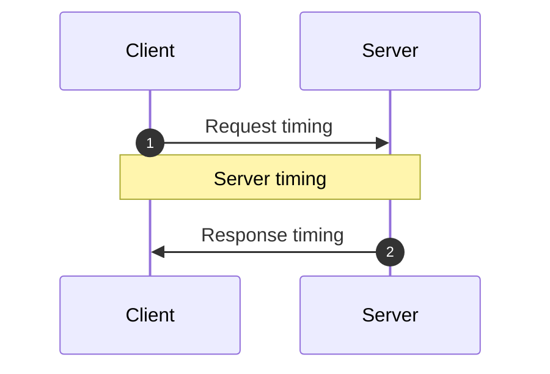

<head>
  <meta name="docsearch:pagerank" content="40"/>
</head>

import FrameworkPlayground from '@site/src/components/FrameworkPlayground';
import {RestEndpoint} from '@data-client/rest';
import { todoFixtures } from '@site/src/fixtures/todos';
import OptimisticTransform from '../shared/\_optimisticTransform.mdx';
import OptimisticRace from '@site/src/components/OptimisticRace';

export const timingDemo = [
  { delay: 800, store: 'open' },
  { delay: 1000, click: 'button.upvote' },
  { delay: 250, click: 'button.upvote' },
  { delay: 250, click: 'button.upvote' },
  { delay: 250, click: 'button.upvote' },
  // past the slowest increment response (the fixture's 4.7s), so the
  // timeline holds every response
  { wait: 5000 },
  { click: { in: 'store', selector: 'button[aria-label="Diff"]' } },
  // the first action (the count's load), then on through each change, time
  // to read each diff: 5 = the changes the 4 clicks make, as Diff's "Next
  // change" counts them (more would idle at the end before the close)
  {
    click: {
      in: 'store',
      selector: '[role="group"][aria-label^="Scrubber"] button[data-id]',
    },
  },
  ...Array.from({ length: 5 }, () => ({
    delay: 1500,
    click: { in: 'store', selector: 'button[aria-label="Next change"]' },
  })),
  // Store → Code: back to the code that did it
  { delay: 2000, store: 'close' },
];

# Atualizações otimistas

Uma atualização otimista mostra o resultado de uma mutação antes de o servidor responder. Ela presume que a requisição terá sucesso, então
a interface não espera pela rede.

As atualizações otimistas acrescentam novas race conditions. O Reactive Data Client cuida delas para você.

## Resources {#resources}

Para tornar um [resource()](../api/resource.md) otimista, defina [optimistic: true](../api/resource.md#optimistic).

<FrameworkPlayground defaultOpen="n" row fixtures={todoFixtures}>

```ts title="TodoResource" {16}
import { Entity, resource } from '@data-client/rest';

export class Todo extends Entity {
  id = 0;
  userId = 0;
  title = '';
  completed = false;

  static key = 'Todo';
}
export const TodoResource = resource({
  urlPrefix: 'https://jsonplaceholder.typicode.com',
  path: '/todos/:id',
  searchParams: {} as { userId?: string | number } | undefined,
  schema: Todo,
  optimistic: true,
});
```

:::react

```tsx title="TodoItem" collapsed
import { useController } from '@data-client/react';
import { TodoResource, type Todo } from './TodoResource';

export default function TodoItem({ todo }: { todo: Todo }) {
  const ctrl = useController();
  const handleChange = e =>
    ctrl.fetch(
      TodoResource.partialUpdate,
      { id: todo.id },
      { completed: e.currentTarget.checked },
    );
  const handleDelete = () =>
    ctrl.fetch(TodoResource.delete, {
      id: todo.id,
    });
  return (
    <div className="listItem nogap">
      <label>
        <input
          type="checkbox"
          checked={todo.completed}
          onChange={handleChange}
        />
        {todo.title}
      </label>
      <CancelButton onClick={handleDelete} />
    </div>
  );
}
```

```tsx title="CreateTodo" collapsed
import { useController } from '@data-client/react';
import { TodoResource } from './TodoResource';

export default function CreateTodo({ userId }: { userId: number }) {
  const ctrl = useController();
  const handleKeyDown = async e => {
    if (e.key === 'Enter') {
      ctrl.fetch(TodoResource.getList.push, {
        userId,
        title: e.currentTarget.value,
      });
      e.currentTarget.value = '';
    }
  };
  return (
    <div className="listItem nogap">
      <label>
        <input type="checkbox" name="new" checked={false} disabled />
        <input
          type="text"
          aria-label="New todo"
          placeholder="New todo"
          onKeyDown={handleKeyDown}
        />
      </label>
      <CancelButton />
    </div>
  );
}
```

```tsx title="TodoList" collapsed
import { useSuspense } from '@data-client/react';
import { TodoResource } from './TodoResource';
import TodoItem from './TodoItem';
import CreateTodo from './CreateTodo';

function TodoList() {
  const userId = 1;
  const todos = useSuspense(TodoResource.getList, { userId });
  return (
    <div className="list">
      {todos.map(todo => (
        <TodoItem key={todo.pk()} todo={todo} />
      ))}
      <CreateTodo userId={userId} />
    </div>
  );
}
render(<TodoList />);
```

:::

:::vue

```html title="TodoItem.vue" collapsed
<script setup lang="ts">
  import { useController } from '@data-client/vue';
  import { TodoResource, type Todo } from './TodoResource';

  const props = defineProps<{ todo: Todo }>();
  const ctrl = useController();
  const handleChange = e =>
    ctrl.fetch(
      TodoResource.partialUpdate,
      { id: props.todo.id },
      { completed: e.currentTarget.checked },
    );
  const handleDelete = () =>
    ctrl.fetch(TodoResource.delete, {
      id: props.todo.id,
    });
</script>

<template>
  <div class="listItem nogap">
    <label>
      <input type="checkbox" :checked="todo.completed" @change="handleChange" />
      {{ todo.title }}
    </label>
    <CancelButton @click="handleDelete" />
  </div>
</template>
```

```html title="CreateTodo.vue" collapsed
<script setup lang="ts">
  import { useController } from '@data-client/vue';
  import { TodoResource } from './TodoResource';

  const props = defineProps<{ userId: number }>();
  const ctrl = useController();
  const handleKeyDown = async e => {
    if (e.key === 'Enter') {
      ctrl.fetch(TodoResource.getList.push, {
        userId: props.userId,
        title: e.currentTarget.value,
      });
      e.currentTarget.value = '';
    }
  };
</script>

<template>
  <div class="listItem nogap">
    <label>
      <input type="checkbox" name="new" :checked="false" disabled />
      <input
        type="text"
        aria-label="New todo"
        placeholder="New todo"
        @keydown="handleKeyDown"
      />
    </label>
    <CancelButton />
  </div>
</template>
```

```html title="TodoList.vue" collapsed
<script setup lang="ts">
  import { useSuspense } from '@data-client/vue';
  import { TodoResource } from './TodoResource';
  import TodoItem from './TodoItem.vue';
  import CreateTodo from './CreateTodo.vue';

  const userId = 1;
  const todos = await useSuspense(TodoResource.getList, { userId });
</script>

<template>
  <div class="list">
    <TodoItem v-for="todo in todos" :key="todo.pk()" :todo="todo" />
    <CreateTodo :userId="userId" />
  </div>
</template>
```

:::

</FrameworkPlayground>

Todas as suas mutações passam então a usar estas respostas otimistas padrão:

### update/getList.push/getList.unshift {#updategetlistpushgetlistunshift}

```ts
function optimisticUpdate(
  snap: SnapshotInterface,
  params: any,
  body: any,
) {
  return {
    ...params,
    ...ensureBodyPojo(body),
  };
}

function ensureBodyPojo(body: any) {
  return body instanceof FormData
    ? Object.fromEntries((body as any).entries())
    : body;
}
```

O corpo de uma criação (push/unshift) normalmente não tem um `id` para calcular uma pk. Por isso, o
<abbr title="Reactive Data Client">Data Client</abbr> cria uma `pk` aleatória.

Mutações no novo objeto normalmente falham até que o servidor o crie. Por isso, desabilite outras mutações nele até que o
`POST` seja concluído. Por exemplo, verifique se a entity tem um `id` real.

### partialUpdate {#partialupdate}

```ts
function optimisticPartial(schema: Queryable) {
  return function (snap: SnapshotInterface, params: any, body: any) {
    const data = snap.get(schema, params);
    if (!data) throw snap.abort;
    return {
      ...params,
      ...data,
      // even tho we don't always have two arguments, the extra one will simply be undefined which spreads fine
      ...ensurePojo(body),
    };
  };
}
```

Atualizações parciais não enviam o corpo inteiro. Os campos que a resposta esperada deixa de fora mantêm seus
valores em cache, então uma Entity só precisa da sua [chave primária](../api/Entity.md#pk) e dos campos alterados.
Se a entity ainda não está no store, a atualização é [abortada](/docs/api/Snapshot#abort) em vez de mostrar uma Entity
feita apenas dos campos alterados. Os [Snapshots](/docs/api/Snapshot) leem o valor atual do store com segurança, sem race
conditions.

### delete {#delete}

```ts
function optimisticDelete(snap: SnapshotInterface, params: any) {
  return params;
}
```

Para tornar otimistas apenas alguns endpoints, ou para se adequar a uma API incomum, defina
[getOptimisticResponse()](../api/RestEndpoint.md#getoptimisticresponse) com
[Resource.extend()](../api/resource.md#extend).

## Transformações otimistas {#optimistic-transforms}

Algumas atualizações dependem do valor anterior, como alternar um booleano ou incrementar um contador. Este exemplo usa um
contador.

<OptimisticTransform />

O Reactive Data Client trata as race conditions causadas pelo tempo da rede. Ele acompanha quando cada fetch começa, associa cada
resposta à sua atualização otimista e faz rollback da atualização quando a requisição é resolvida ou falha.

Outras bibliotecas têm essas race conditions mesmo sem atualizações otimistas. As atualizações otimistas pioram a situação.

### Exemplo de race condition {#example-race-condition}

Este exemplo solicita dois incrementos. A primeira resposta chega depois da segunda.

<OptimisticRace />

Outras bibliotecas mostram 0, 2 e depois 1 sem atualizações otimistas, e 0, 1, 2, 2 e depois 1 com elas. As duas terminam no valor errado, com atualizações travadas pelo caminho. O Data Client mostra 0, 1 e depois 2, e mantém o 2 quando a resposta mais antiga chega por último.

### Compensando variações de tempo do servidor {#server-timings}



Três tempos podem variar em uma mutação assíncrona:

1. Tempo da requisição
1. Tempo do servidor
1. Tempo da resposta

O Reactive Data Client cuida dos tempos da requisição e da resposta para você. Normalmente isso é suficiente, porque os servidores
geralmente processam as requisições na ordem em que chegam. Se o servidor salvar as requisições em outra ordem, uma race condition
permanece.

Para resolver isso, mantenha uma [ordem total](https://en.wikipedia.org/wiki/Total_order) com um único relógio. Os relógios do servidor e do cliente
podem diferir, e as atualizações otimistas acontecem no cliente, então use o relógio do cliente:

1. Envie o horário da requisição em um header `updatedAt` com [getRequestInit()](../api/RestEndpoint.md#getRequestInit).
1. O servidor processa as requisições na ordem de `updatedAt`, armazena `updatedAt` na entity e o retorna em toda
   resposta.
1. Sobrescreva [shouldReorder](../api/Entity.md#shouldreorder) para reordenar respostas fora de ordem por `updatedAt`.

[getOptimisticResponse](../api/RestEndpoint.md#getoptimisticresponse) usa [snap.fetchedAt](/docs/api/Snapshot#fetchedat).
Esse é o momento em que o fetch começa, o mesmo momento em que o header `updatedAt` é calculado.

<FrameworkPlayground fixtures={[
{
endpoint: new RestEndpoint({path: '/api/count'}),
args: [],
response: { count: 0, updatedAt: Date.now() }
},
{
endpoint: new RestEndpoint({
path: '/api/count/increment',
method: 'POST',
body: undefined,
}),
fetchResponse(input, init) {
return ({
"count": (this.count = this.count + 1),
"updatedAt": JSON.parse(init.body).updatedAt,
});
},
delay: () => 200 + Math.random() * 4500,
delayCollapse:true,
}
]}
getInitialInterceptorData={() => ({ count: 0 })}
row
autoRun={timingDemo}
>

```ts title="count" {11-13} collapsed
import { Entity, RestEndpoint } from '@data-client/rest';

export class CountEntity extends Entity {
  count = 0;
  updatedAt = 0;

  pk() {
    return `SINGLETON`;
  }

  static shouldReorder(existingMeta, incomingMeta, existing, incoming) {
    return incoming.updatedAt < existing.updatedAt;
  }
}
export const getCount = new RestEndpoint({
  path: '/api/count',
  schema: CountEntity,
  name: 'get',
});
```

```ts title="increment" {10-16,22}
import { RestEndpoint } from '@data-client/rest';
import { CountEntity } from './count';

export const increment = new RestEndpoint({
  path: '/api/count/increment',
  method: 'POST',
  body: undefined,
  name: 'increment',
  schema: CountEntity,
  getRequestInit() {
    // this is a substitute for super.getRequestInit()
    // since we aren't in a class context
    return RestEndpoint.prototype.getRequestInit.call(this, {
      updatedAt: Date.now(),
    });
  },
  getOptimisticResponse(snap) {
    const data = snap.get(CountEntity, {});
    if (!data) throw snap.abort;
    return {
      count: data.count + 1,
      updatedAt: snap.fetchedAt,
    };
  },
});
```

:::react

```tsx title="CounterPage" collapsed
import React from 'react';
import { useController, useSuspense } from '@data-client/react';
import NumberFlow from '@number-flow/react';
import { getCount } from './count';
import { increment } from './increment';

function CounterPage() {
  const ctrl = useController();
  const { count } = useSuspense(getCount);
  const [clicks, setClicks] = React.useState(count);
  const clickHandler = () => {
    setClicks(c => c + 1);
    return ctrl.fetch(increment);
  };
  return (
    <>
      <header className="appHeader">
        <h1 className="appTitle">Votes</h1>
      </header>
      <div className="listItem">
        <button className="upvote" onClick={clickHandler} aria-label="Upvote" />
        <dl className="stats">
          <div>
            <dt>Data Client</dt>
            <dd><NumberFlow value={count} /></dd>
          </div>
          <div>
            <dt>Clicks</dt>
            <dd><NumberFlow value={clicks} /></dd>
          </div>
        </dl>
      </div>
    </>
  );
}
render(<CounterPage />);
```

:::

:::vue

```html title="CounterPage.vue" collapsed
<script setup lang="ts">
  import { ref } from 'vue';
  import { useController, useSuspense } from '@data-client/vue';
  import NumberFlow from '@number-flow/vue';
  import { getCount } from './count';
  import { increment } from './increment';

  const ctrl = useController();
  const data = await useSuspense(getCount);
  const clicks = ref(data.value.count);
  const clickHandler = () => {
    clicks.value += 1;
    return ctrl.fetch(increment);
  };
</script>

<template>
  <header class="appHeader">
    <h1 class="appTitle">Votes</h1>
  </header>
  <div class="listItem">
    <button class="upvote" @click="clickHandler" aria-label="Upvote" />
    <dl class="stats">
      <div>
        <dt>Data Client</dt>
        <dd><NumberFlow :value="data.count" /></dd>
      </div>
      <div>
        <dt>Clicks</dt>
        <dd><NumberFlow :value="clicks" /></dd>
      </div>
    </dl>
  </div>
</template>
```

:::

</FrameworkPlayground>
