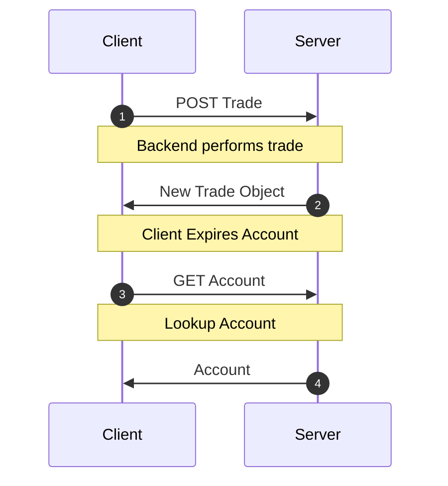
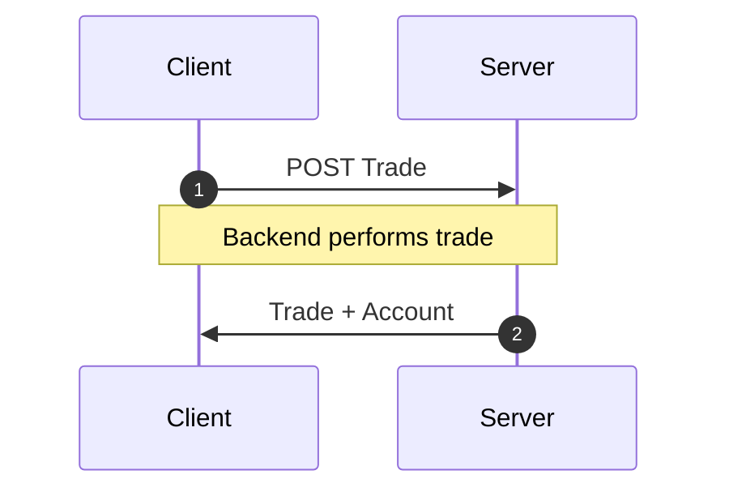

Quando uma mutação altera mais de um resource, não [expire](/docs/api/Controller#expireAll) os outros
resources. Expirá-los causa uma lenta cascata de novos fetches. Em vez disso, inclua _todos_ os resources alterados na resposta
da mutação. A mutação continua atômica e precisa de uma única requisição.

<div style={{display: 'grid', gridTemplateColumns: '1fr 1fr', columnGap: '15px'}}>

<div>
<h4 style={{textAlign: 'center'}}>Cascata de rede</h4>



</div>
<div>
<h4 style={{textAlign: 'center'}}> Agrupamento de resposta</h4>



</div>

</div>

## Exemplo {#example}

Uma plataforma de negociação de criptomoedas atualiza o saldo da conta do usuário a cada negociação. Assim, `POST /trade/` retorna a nova
negociação e a conta atualizada.

```json title="POST /trade/"
{
  "trade": {
    "id": 2893232,
    "user": 1,
    "amount": "50.2335324",
    "coin": "doge",
    "created_at": ""
  },
  "account": {
    "id": 899,
    "user": 1,
    "balance": "1337.00",
    "coin_value": "3.50"
  }
}
```

Adicione a conta ao `schema` do endpoint.

```typescript title="resources/Trade.ts"
import { resource, Entity } from '@data-client/rest';
import { Account } from './Account';

export class Trade extends Entity {
  id = 0;
  user = 0;
  amount = '0';
  coin = '';
  created_at = '';
}

export const TradeResource = resource({
  path: '/trade/:id',
  schema: Trade,
}).extend(Base => ({
  createTrade: Base.getList.push.extend({
    schema: {
      trade: Base.getList.push.schema,
      account: Account,
    },
  }),
}));
```

`createTrade` estende [getList.push](../api/resource.md#push). Quando o `POST` é concluído, o store atualiza tanto a nova
negociação quanto a conta.

:::react

```typescript title="CreateTrade.tsx"
export default function CreateTrade() {
  const ctrl = useController();
  const handleSubmit = payload =>
    ctrl.fetch(TradeResource.createTrade, {}, payload);
  //...
}
```

:::

:::vue

```html title="CreateTrade.vue"
<script setup lang="ts">
  import { useController } from '@data-client/vue';
  import { TradeResource } from './resources/Trade';

  const ctrl = useController();
  const handleSubmit = payload =>
    ctrl.fetch(TradeResource.createTrade, {}, payload);
  //...
</script>
```

:::

:::note

Defina um novo [RestEndpoint](../api/RestEndpoint.md) para qualquer endpoint personalizado. O `schema` dele diz ao Data Client como
armazenar a resposta.

:::
