import Link from '@docusaurus/Link';

除了[规范化状态](https://react.dev/learn/choosing-the-state-structure)带来的性能和数据完整性收益之外，
我们还获得了一项额外的好处：能够安全地直接访问并查询 store。

在本次发布中，我们围绕 [Queryable Schema](/docs/api/useQuery#queryable) 的概念统一并简化了这一功能。它们包括
[Entity](/rest/api/Entity)、[All](/rest/api/All)、[Collection](/rest/api/Collection)、[Query](/rest/api/Query)
和 [Union](/rest/api/Union)

这一变化最大的影响是引入了新的 hook [useQuery()](/blog/2024/04/08/v0.11-queries-querable-usequery#usequery)，它允许使用
[Queryable Schema](/docs/api/useQuery#queryable) 直接查找 store。

```ts
class User extends Entity {
  username = '';
  id = '';
  groupId = '';
  pk() {
    return this.id;
  }
  static index = ['username' as const];
}

const bob = useQuery(User, { username: 'bob' });
const bob = useQuery(User, { id: '5' });
```

同样地，我们可以通过 [controller.get](/blog/2024/04/08/v0.11-queries-querable-usequery#controllerget) 在 controller 和 snapshot 中查找 Queryable

```ts
const bob = snapshot.get(User, { username: 'bob' });
```

此外，我们还投入了更多的[性能改进](/blog/2024/04/08/v0.11-queries-querable-usequery#performance)，使大多数操作的性能提升了约 2 倍，
而 [Query](/rest/api/Query) 则快了 16 倍。

<center>

<Link className="button button--secondary" to="/blog/2024/04/08/v0.11-queries-querable-usequery#migration-guide">迁移指南</Link>

</center>

**破坏性变更：**

- [useCache(new Index(MyEntity)) -> useQuery(MyEntity)](/blog/2024/04/08/v0.11-queries-querable-usequery#removed-index)
- [new Query -> new schema.Query](/blog/2024/04/08/v0.11-queries-querable-usequery#query-migration)
  - useCache(myQuery) -> useQuery(myQuery)
- [new AbortOptimistic() -> snapshot.abort](/blog/2024/04/08/v0.11-queries-querable-usequery#snap.abort)
- [Entity.useIncoming → Entity.shouldUpdate](/blog/2024/04/08/v0.11-queries-querable-usequery#shouldupdate)

[**其他亮点：**](/blog/2024/04/08/v0.11-queries-querable-usequery#other-improvements)

- useCache() 接受带有 sideEffects 的 Endpoint（例如 [Resource.update](/rest/api/resource#update)）
- 允许 Entity.pk() 返回数字。
- 2 到 16 倍的[性能改进](/blog/2024/04/08/v0.11-queries-querable-usequery#performance)

<!--truncate-->

import TypeScriptEditor from '@site/src/components/TypeScriptEditor';
import DiffEditor from '@site/src/components/DiffEditor';

### Queryable {#querable}

[Queryable](/rest/api/schema#queryable) schema 需要一个返回非空值的 `queryKey()` 方法。它们包括
[Entity](/rest/api/Entity)、[All](/rest/api/All)、[Collection](/rest/api/Collection)、[Query](/rest/api/Query)
和 [Union](/rest/api/Union)。

```ts
interface Queryable {
  queryKey(
    args: readonly any[],
    queryKey: (...args: any) => any,
    getEntity: GetEntity,
    getIndex: GetIndex,
    // `{}` means non-void
  ): {};
}
```

### schema.Query {#schemaquery}

`Query` 之前是作为 Endpoint 实现的。既然我们现在有了直接获取 Queryable
schema 的方法，就可以干脆让 Query 本身也成为一个 Queryable schema。它的用法基本保持不变，
允许对 store 中的值进行任意计算。[#2921](https://github.com/reactive/data-client/pull/2921)

```ts
const getUserCount = new schema.Query(
  new schema.All(User),
  (entries, { isAdmin } = {}) => {
    if (isAdmin !== undefined)
      return entries.filter(user => user.isAdmin === isAdmin).length;
    return entries.length;
  },
);

const userCount = useQuery(getUserCount);
const adminCount = useQuery(getUserCount, { isAdmin: true });
```

schema.Query 现在不再允许使用非 Queryable 的 schema。

<TypeScriptEditor>

```ts
const getBob = new schema.Query(
  // Array is not Queryable
  new schema.Array({ bob: '' }),
  thing => {
    return thing;
  },
);
```

</TypeScriptEditor>

### controller.get / snapshot.get {#controllerget}

现在只需一个 Queryable Schema 即可[访问 store](/docs/api/Controller#get)——不再需要一整个 Endpoint。
[#2921](https://github.com/reactive/data-client/pull/2921)

<DiffEditor>

```ts title="Before"
getOptimisticResponse(snapshot, { id }) {
  // highlight-next-line
  const { data: post } = snapshot.getResponse(Base.get, { id });
  if (!post) throw snapshot.abort;
  return {
    id,
    votes: post.votes + 1,
  };
}
```

```ts title="After"
getOptimisticResponse(snapshot, { id }) {
  // highlight-next-line
  const post = snapshot.get(Post, { id });
  if (!post) throw snapshot.abort;
  return {
    id,
    votes: post.votes + 1,
  };
}
```
</DiffEditor>

由于我们不再需要访问其他 [Resource 成员](/rest/api/resource#members)来获取 `Post`，
就可以使用简单得多的 [Resource.extend()](/rest/api/resource#extend-new) 重载。

<DiffEditor>

```ts title="Before"
export const PostResource = createResource({
  path: '/posts/:id',
  schema: Post,
// highlight-next-line
}).extend(Base => ({
  vote: new RestEndpoint({
    path: '/posts/:id/vote',
    method: 'POST',
    body: undefined,
    schema: Post,
    getOptimisticResponse(snapshot, { id }) {
      const { data: post } = snapshot.getResponse(Base.get, { id });
      if (!post) throw snapshot.abort;
      return {
        id,
        votes: post.votes + 1,
      };
    },
  }),
}));
```

```ts title="After"
export const PostResource = createResource({
  path: '/posts/:id',
  schema: Post,
// highlight-next-line
}).extend('vote', {
  path: '/posts/:id/vote',
  method: 'POST',
  body: undefined,
  schema: Post,
  getOptimisticResponse(snapshot, { id }) {
    const post = snapshot.get(Post, { id });
    if (!post) throw snapshot.abort;
    return {
      id,
      votes: post.votes + 1,
    };
  },
});
```

</DiffEditor>

### useQuery {#usequery}

从 store 中渲染任意 [Queryable Schema](/rest/api/schema#queryable)。
[Query](/rest/api/Query) 是高效渲染聚合计算的绝佳搭档，例如那些使用 [groupBy](https://developer.mozilla.org/en-US/docs/Web/JavaScript/Reference/Global_Objects/Object/groupBy#browser_compatibility)、
[map](https://developer.mozilla.org/en-US/docs/Web/JavaScript/Reference/Global_Objects/Array/map)、[reduce](https://developer.mozilla.org/en-US/docs/Web/JavaScript/Reference/Global_Objects/Array/reduce) 和 [filter](https://developer.mozilla.org/en-US/docs/Web/JavaScript/Reference/Global_Objects/Array/filter) 的计算。[#2921](https://github.com/reactive/data-client/pull/2921)

```ts
class User extends Entity {
  username = '';
  id = '';
  groupId = '';
  pk() {
    return this.id;
  }
  static index = ['username' as const];
}

const bob = useQuery(User, { username: 'bob' });
```

```ts
const getUserCount = new schema.Query(
  new schema.All(User),
  (entries, { isAdmin } = {}) => {
    if (isAdmin !== undefined)
      return entries.filter(user => user.isAdmin === isAdmin).length;
    return entries.length;
  },
);

const userCount = useQuery(getUserCount);
const adminCount = useQuery(getUserCount, { isAdmin: true });
```

```ts
const UserCollection = new schema.Collection([User], {
  argsKey: (urlParams: { groupId?: string }) => ({
    ...urlParams,
  }),
});

const usersInGroup = useQuery(UserCollection, { groupId: '5' });
```

## 性能 {#performance}

对缓存系统以及所有关键代码路径的进一步优化，为最常见的操作带来了
2 倍的可观提升。再加上新增的[查询缓存能力](https://github.com/reactive/data-client/pull/2978)，我们的 Query 排序基准测试更是取得了令人印象深刻的 16 倍提升。

这些都叠加在原有的（最高 23 倍）[相对旧版 normalizr](/docs/concepts/normalization#benchmarks) 库的领先优势之上。

```mermaid
xychart-beta
    title "Performance vs v0.10"
    x-axis ["get large", "get small", "get Query", "get (null args)", "set large"]
    y-axis "Percentage gain" 0 --> 1600
    bar [163, 177, 1571, 295, 182]
    bar [100, 100, 100, 100, 100]
```

<center>
<div style={{maxWidth:'600px'}}>



</div>

[历史基准测试](https://reactive.github.io/data-client/dev/bench/) | [查看基准测试](https://github.com/reactive/data-client/tree/master/examples/benchmark)

</center>

## 其他改进 {#other-improvements}

- useCache() 接受带有 sideEffects 的 Endpoint（例如 [Resource.update](/rest/api/resource#update)）[#2963](https://github.com/reactive/data-client/pull/2963)
  ```ts
  const lastCreated = useCache(MyResource.getList.push);
  ```
- 允许 pk 返回数字 [#2961](https://github.com/reactive/data-client/pull/2961)
  <DiffEditor>
  ```ts title="Before"
  class MyEntity extends Entity {
    id = 0;
    pk() {
      // highlight-next-line
      return `${this.id}`;
    }
  }
  ```
  ```ts title="After"
  class MyEntity extends Entity {
    id = 0;
    pk() {
      // highlight-next-line
      return this.id;
    }
  }
  ```
  </DiffEditor>
- 类型
  - 在使用[宽松空值检查](https://www.typescriptlang.org/tsconfig#strictNullChecks)且没有 body 参数时，改进 .extend() 的类型推断 [#2962](https://github.com/reactive/data-client/pull/2962)
    ```ts
    Parameters<typeof new RestEndpoint({ path: '/test' }).extend({ path: '/test2' })> === []
    ```
  - Collection 默认的 Args 类型为：[8377e](https://github.com/reactive/data-client/commit/8377e0a157419f0f4c237c392a895fec1772854d)
    ```ts
    | []
    | [urlParams: Record<string, any>]
    | [urlParams: Record<string, any>, body: any]
    ```
- 修复
  - schema.All 反规范化的 INVALID 情况在生产构建中进行类名混淆时也应正常工作 [#2954](https://github.com/reactive/data-client/pull/2954)
    - 输入为 `undefined` 时，`unvisit()` 始终返回 `undefined`。
    - `All` 在 `queryKey()` 中返回 INVALID，以使此前 `unvisit()` 中的特殊情况（给定实体没有表项时）失效
  - 缺失的嵌套实体在出现后应该能够显示出来 [#2956](https://github.com/reactive/data-client/pull/2956)、[#2961](https://github.com/reactive/data-client/pull/2961)

## 迁移指南 {#migration-guide}

import PkgTabs from '@site/src/components/PkgTabs';

本次升级需要同时更新所有包的版本。

<PkgTabs pkgs="@data-client/react@^0.11.0 @data-client/rest@^0.11.0 @data-client/test@^0.11.0 @data-client/img@^0.11.0 @data-client/hooks@^0.11.0" upgrade />

### 移除 Index {#removed-index}

直接在 [useQuery](/docs/api/useQuery) 中使用 Entity 即可

<DiffEditor>

```tsx title="Before"
const UserIndex = new Index(User);

const bob = useCache(UserIndex, { username: 'bob' });
```

```tsx title="After"
const bob = useQuery(User, { username: 'bob' });
```
</DiffEditor>

### new Query -> new schema.Query {#query-migration}

[Query](/rest/api/Query) 现在是一个 schema；与 [useQuery](/docs/api/useQuery) 搭配使用

<DiffEditor>

```tsx title="Before"
// highlight-next-line
const getUserCount = new Query(
  new schema.All(User),
  (entries, { isAdmin } = {}) => {
    if (isAdmin !== undefined)
      return entries.filter(user => user.isAdmin === isAdmin).length;
    return entries.length;
  },
);

const userCount = useCache(getUserCount);
const adminCount = useCache(getUserCount, { isAdmin: true });
```

```tsx title="After"
// highlight-next-line
const getUserCount = new schema.Query(
  new schema.All(User),
  (entries, { isAdmin } = {}) => {
    if (isAdmin !== undefined)
      return entries.filter(user => user.isAdmin === isAdmin).length;
    return entries.length;
  },
);

const userCount = useQuery(getUserCount);
const adminCount = useQuery(getUserCount, { isAdmin: true });
```
</DiffEditor>

### new AbortOptimistic() -> snapshot.abort {#snap.abort}

[snapshot.abort](https://dataclient.io/docs/api/Snapshot#abort) 让你不再需要导入 AbortOptimistic [#2957](https://github.com/reactive/data-client/pull/2957)

<DiffEditor>

```ts title="Before"
getOptimisticResponse(snapshot, { id }) {
  const { data } = snapshot.getResponse(Base.get, { id });
  // highlight-next-line
  if (!data) throw new AbortOptimistic();
  return {
    id,
    votes: data.votes + 1,
  };
}
```

```ts title="After"
getOptimisticResponse(snapshot, { id }) {
  const { data } = snapshot.getResponse(Base.get, { id });
  // highlight-next-line
  if (!data) throw snapshot.abort;
  return {
    id,
    votes: data.votes + 1,
  };
}
```
</DiffEditor>

### Entity.useIncoming → Entity.shouldUpdate {#shouldupdate}

让 [Entity.shouldUpdate](/rest/api/Entity#shouldupdate) 的命名与 [Entity.shouldReorder](/rest/api/Entity#shouldreorder) 保持一致 [#2972](https://github.com/reactive/data-client/pull/2972)

<DiffEditor>

```ts title="Before"
class MyEntity extends Entity {
  // highlight-next-line
  static useIncoming(
    existingMeta: { date: number },
    incomingMeta: { date: number },
    existing: any,
    incoming: any,
  ) {
    return !deepEquals(existing, incoming);
  }
}
```

```ts title="After"
class MyEntity extends Entity {
  // highlight-next-line
  static shouldUpdate(
    existingMeta: { date: number },
    incomingMeta: { date: number },
    existing: any,
    incoming: any,
  ) {
    return !deepEquals(existing, incoming);
  }
}
```
</DiffEditor>

### useDLE() 在 React Native 中的焦点处理 {#usedle-reactive-native-focus-handling}

与 [useSuspense()](/docs/api/useSuspense) 和 [useFetch()](/docs/api/useFetch) 一样，[useDLE()](/docs/api/useDLE) 现在
可能会在焦点事件发生时重新验证数据。

使用 React Navigation 时，如果数据被视为过时，useDLE() 会在获得焦点时触发
获取。

这可能导致比以前更多的获取请求。

### 可能但不太会遇到的破坏性变更 {#potential-but-unlikely-breaking-changes}

#### Schema.infer() -> Schema.queryKey() [#2977](https://github.com/reactive/data-client/pull/2977) {#schemainfer---schemaquerykey-2977}

大多数人都没有重写过 `infer()` 方法。如果你重写了，需要将其重命名为 `queryKey()`，
并同时更新参数列表。

<DiffEditor>

```ts title="Before"
class MyEntity extends Entity {
  // highlight-start
  static infer(
    args: readonly any[],
    indexes: NormalizedIndex,
    recurse: any,
    entities: any,
  ): any {
    // highlight-end
    if (SILLYCONDITION) return undefined;
    if (entities[this.key]?.[someId]) return someId;
    return super.infer(args, indexes, recurse, entities);
  }
}
```

```ts title="After"
class MyEntity extends Entity {
  // highlight-start
  static queryKey(
    args: readonly any[],
    queryKey: (...args: any) => any,
    getEntity: GetEntity,
    getIndex: GetIndex,
  ): any {
    // highlight-end
    if (SILLYCONDITION) return undefined;
    if (getEntity(this.key, someId)) return someId;
    return super.queryKey(args, queryKey, getEntity, getIndex);
  }
}
```
</DiffEditor>

##### getEntity(key, pk?) {#getentitykey-pk}

传入一个参数时获取某一类型的全部实体，传入两个参数时获取单个实体

```ts title="One argument"
const entitiesEntry = getEntity(this.schema.key);
if (entitiesEntry === undefined) return INVALID;
return Object.values(entitiesEntry).map(
  entity => entity && this.schema.pk(entity),
);
```

```ts title="Two arguments"
if (getEntity(this.key, id)) return id;
```

##### getIndex(key, indexName, value) {#getindexkey-indexname-value}

返回索引条目（value->pk 的映射）

```ts
const value = args[0][indexName];
return getIndex(schema.key, indexName, value)[value];
```

#### pk 始终规范化为字符串类型 [#2961](https://github.com/reactive/data-client/pull/2961) {#always-normalize-pk-to-string-type-2961}

这是对 store 中内容的一个细微变化。这很可能只在直接使用 [@data-client/normalizr](https://www.npmjs.com/package/@data-client/normalizr)
时才有影响。

<DiffEditor>

```json title="Before"
{
  "Article": {
    "123": {
      // highlight-next-line
      "author": 8472,
      "id": 123,
      "title": "A Great Article"
    }
  },
  "User": {
    "8472": {
      "id": 8472,
      "name": "Paul"
    }
  }
}
```

```json title="After"
{
  "Article": {
    "123": {
      // highlight-next-line
      "author": "8472",
      "id": 123,
      "title": "A Great Article"
    }
  },
  "User": {
    "8472": {
      "id": 8472,
      "name": "Paul"
    }
  }
}
```
</DiffEditor>

#### state.results -> state.endpoints [#2971](https://github.com/reactive/data-client/pull/2971) {#stateresults---stateendpoints-2971}

这很可能只在直接使用 [@data-client/core](https://www.npmjs.com/package/@data-client/core) 时才有影响，因为内部状态的结构
对 [@data-client/react](https://www.npmjs.com/package/@data-client/react) 来说是不透明的。

<DiffEditor>

```json "Before"
{
  "entities": {
    "Article": {
      "5": {
        "content": "more things here",
        "id": 5,
        "title": "hi"
      }
    }
  },
  // highlight-next-line
  "results": {
    "GET http://test.com/articles/5": "5"
  }
}
```

```json "After"
{
  "entities": {
    "Article": {
      "5": {
        "content": "more things here",
        "id": 5,
        "title": "hi"
      }
    }
  },
  // highlight-next-line
  "endpoints": {
    "GET http://test.com/articles/5": "5"
  }
}
```
</DiffEditor>

#### inferResults() -> memo.buildQueryKey() [#2977](https://github.com/reactive/data-client/pull/2977)、[#2978](https://github.com/reactive/data-client/pull/2978) {#inferresults---memobuildquerykey-2977-2978}

这些方法由 [@data-client/core](https://www.npmjs.com/package/@data-client/core) 和 [@data-client/normalizr](https://www.npmjs.com/package/@data-client/normalizr) 导出。

#### denormalizeCached() -> memo.denormalize() [#2978](https://github.com/reactive/data-client/pull/2978) {#denormalizecached---memodenormalize-2978}

由 [@data-client/normalizr](https://www.npmjs.com/package/@data-client/normalizr) 导出

<DiffEditor>

```ts title="Before"
const endpointCache = new WeakEntityMap();
const entityCache = {};
denormalizeCached(
  input,
  schema,
  state.entities,
  entityCache,
  endpointCache,
  args,
);
```

```ts title="After"
const memo = new MemoCached();
memo.denormalize(
  input,
  schema,
  state.entities,
  args,
);
```
</DiffEditor>

#### WeakEntityMap -> WeakDependencyMap [#2978](https://github.com/reactive/data-client/pull/2978) {#weakentitymap---weakdependencymap-2978}

由 [@data-client/normalizr](https://www.npmjs.com/package/@data-client/normalizr) 导出

我们将这一数据类型泛化，使其可以用于其他依赖。

<DiffEditor>

```ts title="Before"
new WeakEntityMap();
```

```ts title="After"
new WeakDependencyMap<EntityPath>();
```
</DiffEditor>

### 升级支持 {#upgrade-support}

一如既往，如果你遇到任何问题或有任何疑问，欢迎加入我们的 [](https://discord.gg/wXGV27xm6t) 或[提交 bug](https://github.com/reactive/data-client/issues/new/choose)
