**Manager：**

Manager API 得到了精简——更扁平的 action 结构降低了代码复杂度，并通过减少不同的内联缓存条目来提升性能；同时更简单的配置 API 让自定义更加愉快。

- [简化的 action 结构](/blog/2024/07/13/v0.14-release-announcement#action-shapes)
- [Manager.middleware](/blog/2024/07/13/v0.14-release-announcement#manager-middleware) 属性
- [getDefaultManagers()](/blog/2024/07/13/v0.14-release-announcement#getdefaultmanagers) 配置

**性能：**
- [立即发起 fetch 调用](/blog/2024/07/13/v0.14-release-announcement#immediate-fetching)——不再等待空闲
- 通过移除不必要的 polyfill，[包体积缩小 30%](/blog/2024/07/13/v0.14-release-announcement#bundle-size)
- [规范化快 10%，反规范化快 32%](/blog/2024/07/13/v0.14-release-announcement#normalization-performance)

**Schema/数据建模：**
- 使用 Object Schema 进行 [Query 连接](/blog/2024/07/13/v0.14-release-announcement#query-joins)
- 用于组合 Entity 行为的 [EntityMixin](/blog/2024/07/13/v0.14-release-announcement#entitymixin)
- [Entity.pk() 默认值](/blog/2024/07/13/v0.14-release-announcement#entity-pk-default)使用 `id`
- 通过 Entity.process() 实现[动态失效](/blog/2024/07/13/v0.14-release-announcement#dynamic-invalidation)

**测试：**
- [renderDataHook()](/blog/2024/07/13/v0.14-release-announcement#renderdatahook) 让测试更简单

**垃圾回收：**
- [GCPolicy](/blog/2024/07/13/v0.14-release-announcement#gcpolicy)——自动回收过时数据

**[破坏性变更：](/blog/2024/07/13/v0.14-release-announcement#migration-guide)**

- [NetworkManager 立即发起获取](/blog/2024/07/13/v0.14-release-announcement#networkmanager)
- [action.payload -> action.response](/blog/2024/07/13/v0.14-release-announcement#action-response)
- [action.meta.args -> action.args](/blog/2024/07/13/v0.14-release-announcement#action-args)

{/* truncate */}

import DiffEditor from '@site/src/components/DiffEditor';

## Manager {#managers}

Manager API 得到了精简——更扁平的 action 结构降低了代码复杂度，并通过减少不同的内联缓存条目来提升性能；同时更简单的配置 API 让自定义更加愉快。

### Action 结构 {#action-shapes}

Action 结构更简单、更一致。[#3143](https://github.com/reactive/data-client/pull/3143)、[#3139](https://github.com/reactive/data-client/pull/3139)

- `action.meta.args` -> `action.args`
- `action.meta.key` -> `action.key`
- `action.meta.nm` 已移除（未使用）
- `action.payload` -> `action.response`（针对 SET_RESPONSE）


<DiffEditor>
```json title="Before"
{
  "type": "rdc/setresponse",
  "meta": {
    "key": "PATCH https://jsonplaceholder.typicode.com/todos/1",
    "payload": {
      "userId": 1,
      "id": 1,
      "title": "delectus aut autem",
      "completed": true
    },
    "args": [
      { "id": 1 },
      { "completed": true }
    ],
    "nm": true,
    "endpoint": {
      "name": "Todo.partialUpdate",
      "schema": {
        "key": "Todo",
        "schema": {}
      },
      "sideEffect": true,
    },
    "fetchedAt": "12:44:24.206 PM",
    "date": "12:44:24.334 PM",
    "expiresAt": "1:44:24.334 PM"
  },
  "error": false
}
```

```json title="After"
{
  "type": "rdc/setresponse",
  "key": "PATCH https://jsonplaceholder.typicode.com/todos/1",
  "response": {
    "userId": 1,
    "id": 1,
    "title": "delectus aut autem",
    "completed": true
  },
  "args": [
    { "id": 1 },
    { "completed": true }
  ],
  "endpoint": {
    "name": "Todo.partialUpdate",
    "schema": {
      "key": "Todo",
      "schema": {}
    },
    "sideEffect": true,
  },
  "meta": {
    "fetchedAt": "12:44:24.206 PM",
    "date": "12:44:24.334 PM",
    "expiresAt": "1:44:24.334 PM"
  },
  "error": false
}
```
</DiffEditor>


### Manager.middleware {#manager-middleware}

Manager 现在可以使用 `middleware` 属性来代替 `getMiddleware()` 方法。[#3164](https://github.com/reactive/data-client/pull/3164)

<DiffEditor>

```ts title="Before"
class MyManager implements Manager {
  getMiddleware = (): Middleware => controller => next => async action => {
    // handle action
    return next(action);
  };

  cleanup() {}
}
```

```ts title="After"
class MyManager implements Manager {
  middleware: Middleware = controller => next => async action => {
    // handle action
    return next(action);
  };

  cleanup() {}
}
```

</DiffEditor>

:::tip
为了向后兼容，`getMiddleware()` 仍然可用。
:::

### 不带 _TYPE 后缀的 actionTypes {#actiontypes-without-_type-suffix}

现在提供了更简洁的 action 类型名称（非破坏性变更——旧名称同样保留）。[#3244](https://github.com/reactive/data-client/pull/3244)

<DiffEditor>

```ts title="Before"
import type { Manager, Middleware } from '@data-client/react';
import { actionTypes } from '@data-client/react';

export default class LoggingManager implements Manager {
  middleware: Middleware = controller => next => async action => {
    switch (action.type) {
      case actionTypes.SET_RESPONSE_TYPE:
        console.info(
          `${action.endpoint.name} ${JSON.stringify(action.response)}`,
        );
      default:
        return next(action);
    }
  };

  cleanup() {}
}
```

```ts title="After"
import type { Manager, Middleware } from '@data-client/react';
import { actionTypes } from '@data-client/react';

export default class LoggingManager implements Manager {
  middleware: Middleware = controller => next => async action => {
    switch (action.type) {
      case actionTypes.SET_RESPONSE:
        console.info(
          `${action.endpoint.name} ${JSON.stringify(action.response)}`,
        );
      default:
        return next(action);
    }
  };

  cleanup() {}
}
```

</DiffEditor>

### getDefaultManagers() {#getdefaultmanagers}

[getDefaultManagers()](/docs/api/getDefaultManagers) 现在接受配置选项。[#3161](https://github.com/reactive/data-client/pull/3161)

```ts
import { getDefaultManagers } from '@data-client/react';

// Remove DevToolsManager
const managers = getDefaultManagers({ devToolsManager: null });

// Configure DevToolsManager
const managers = getDefaultManagers({
  devToolsManager: {
    latency: 1000,
    predicate: (state, action) => action.type !== actionTypes.SET_RESPONSE,
  },
});

// Use custom NetworkManager
const managers = getDefaultManagers({
  networkManager: new IdlingNetworkManager(),
});
```

### NetworkManager 构造函数 {#networkmanager-constructor}

为了更清晰，[NetworkManager](/docs/api/NetworkManager) 的构造函数现在使用关键字参数。

<DiffEditor>

```ts title="Before"
new NetworkManager(42, 7);
```

```ts title="After"
new NetworkManager({ dataExpiryLength: 42, errorExpiryLength: 7 });
```

</DiffEditor>

## 性能 {#performance}

React 18+ 的并发模式和自动批处理改变了我们应该采用的优化方式。等待空闲回调不再是最优选择——现在立即发起获取能带来更好的结果。内部改动利用闭包和 `Map` 数据结构来加快规范化和查找速度，同时移除臃肿的 polyfill 依赖显著缩小了包体积。

### 立即获取 {#immediate-fetching}

[NetworkManager](/docs/api/NetworkManager) 现在会立即发起获取，而不是等待空闲回调。[#3146](https://github.com/reactive/data-client/pull/3146)

这让数据加载更快，对于渲染树复杂的应用尤其明显。

对于更喜欢之前行为的用户，`IdlingNetworkManager` 仍然可用：

```ts
import { IdlingNetworkManager, getDefaultManagers } from '@data-client/react';

const managers = getDefaultManagers({
  networkManager: new IdlingNetworkManager(),
});
```

### 包体积 {#bundle-size}

移除臃肿的 polyfill 包后，各个包现在**缩小了 30%**。[#3384](https://github.com/reactive/data-client/pull/3384)

此外，polyfill 不再污染全局作用域。[#3353](https://github.com/reactive/data-client/pull/3353)

### 规范化性能 {#normalization-performance}

内部 schema 接口的改动带来了 **10% 的规范化性能提升**。[#3134](https://github.com/reactive/data-client/pull/3134)

使用 `Map` 代替普通对象来存储实体，在大型数据集上查找速度**最多可快 32%**。[#3390](https://github.com/reactive/data-client/pull/3390)

```mermaid
xychart-beta
    title "Performance vs v0.13"
    x-axis ["normalize", "denormalize (large)", "denormalize (small)"]
    y-axis "Percentage gain" 0 --> 140
    bar [110, 132, 115]
    bar [100, 100, 100]
```

<center>
<div style={{maxWidth:'500px'}}>



</div>

[历史基准测试](https://reactive.github.io/data-client/dev/bench/) | [查看基准测试](https://github.com/reactive/data-client/tree/master/examples/benchmark)

</center>

## Schema/数据建模 {#schemadata-modeling}

Schema API 减少了常见模式的样板代码，同时支持更高级的用例。客户端连接现在可以跨任意实体工作（不再局限于嵌套关系），动态失效可以处理仅在服务端存在的删除逻辑，而像 `Entity.pk()` 默认使用 `id` 这样合理的默认值则消除了重复代码。

### Query 连接 {#query-joins}

[Query](/rest/api/Query) 现在可以接受 [Object Schema](/rest/api/Object)，从而实现跨多种实体类型的连接。[#3165](https://github.com/reactive/data-client/pull/3165)

```ts
class Ticker extends Entity {
  product_id = '';
  price = 0;
  pk() { return this.product_id; }
}

class Stats extends Entity {
  product_id = '';
  last = 0;
  pk() { return this.product_id; }
}

// Join Ticker and Stats by product_id
const queryPrice = new schema.Query(
  { ticker: Ticker, stats: Stats },
  ({ ticker, stats }) => ticker?.price ?? stats?.last,
);

// Use in components
const price = useQuery(queryPrice, { product_id: 'BTC-USD' });
```

### EntityMixin {#entitymixin}

新增 [EntityMixin](/rest/api/EntityMixin)，用于将 Entity 行为与现有的类组合。[#3243](https://github.com/reactive/data-client/pull/3243)

```ts
import { EntityMixin } from '@data-client/rest';

// Your existing class
export class Article {
  id = '';
  title = '';
  content = '';
  tags: string[] = [];
}

// Add Entity behavior
export class ArticleEntity extends EntityMixin(Article) {}
```

### Entity.pk() 默认值 {#entity-pk-default}

[Entity.pk()](/rest/api/Entity#pk) 现在默认返回 `this.id`。[#3188](https://github.com/reactive/data-client/pull/3188)

<DiffEditor>

```ts title="Before"
class Todo extends Entity {
  id = '';
  title = '';
  completed = false;

  pk() {
    return this.id;
  }
}
```

```ts title="After"
class Todo extends Entity {
  id = '';
  title = '';
  completed = false;
}
```

</DiffEditor>

### 动态失效 {#dynamic-invalidation}

在 [Entity.process()](/rest/api/Entity#process) 中返回 `undefined`，即可根据响应数据动态地让实体[失效](/docs/concepts/expiry-policy#invalidate-entity)。[#3407](https://github.com/reactive/data-client/pull/3407)

```ts
class PriceLevel extends Entity {
  price = 0;
  amount = 0;

  pk() { return `${this.price}`; }

  static process(input: [number, number], parent: any, key: string | undefined) {
    const [price, amount] = input;
    // Invalidate when amount is 0
    // highlight-next-line
    if (amount === 0) return undefined;
    return { price, amount };
  }
}
```

### resource() {#resource}

为求简洁，`createResource()` 已重命名为 `resource()`。[#3158](https://github.com/reactive/data-client/pull/3158)

<DiffEditor>

```ts
import { createResource } from '@data-client/rest';

const TodoResource = createResource({
  path: '/todos/:id',
  schema: Todo,
});
```

```ts
import { resource } from '@data-client/rest';

const TodoResource = resource({
  path: '/todos/:id',
  schema: Todo,
});
```

</DiffEditor>

:::note
为了向后兼容，`createResource` 仍然会导出。
:::

## 测试 {#testing}

测试应当简单。新的辅助函数使用合理的默认值，消除常见测试场景中的样板代码。

### renderDataHook() {#renderdatahook}

新增的 [renderDataHook()](/docs/api/renderDataHook) 使用默认的 [DataProvider](/docs/api/DataProvider)，消除了样板代码。[#3238](https://github.com/reactive/data-client/pull/3238)

此外，为保持一致，`makeRenderDataClient()` 已重命名为 [makeRenderDataHook()](/docs/api/makeRenderDataHook)（旧名称仍然可用）。

```ts
import { renderDataHook } from '@data-client/test';

const { result } = renderDataHook(
  () => useSuspense(ArticleResource.get, { id: 5 }),
  {
    initialFixtures: [
      {
        endpoint: ArticleResource.get,
        args: [{ id: 5 }],
        response: { id: 5, title: 'Test' },
      },
    ],
  },
);
```

## 垃圾回收 {#garbage-collection}

长时间运行的应用会在内存中积累过时数据。新的垃圾回收策略使用引用计数来跟踪哪些数据正被组件绑定，从而自动清理已过期的条目。

### GCPolicy {#gcpolicy}

GCPolicy 可以自动对过时数据进行垃圾回收。[#3343](https://github.com/reactive/data-client/pull/3343)

```tsx
import { GCPolicy, DataProvider } from '@data-client/react';

// Run GC sweep every 10 minutes
<DataProvider gcPolicy={new GCPolicy({ intervalMS: 60 * 1000 * 10 })}>
  {children}
</DataProvider>
```

配置过期行为：

```ts
new GCPolicy({
  intervalMS: 60 * 1000 * 5,  // How often to run GC
  expiryMultiplier: 2,        // How many stale lifetimes before GC
})
```

使用 `ImmortalGCPolicy` 可以禁用垃圾回收（即之前的默认行为）：

```tsx
import { ImmortalGCPolicy, DataProvider } from '@data-client/react';

<DataProvider gcPolicy={new ImmortalGCPolicy()}>
  {children}
</DataProvider>
```

## 其他改进 {#other-improvements}

- Collection 可与 Union 等多态 schema 配合使用 [#3151](https://github.com/reactive/data-client/pull/3151)
- Collection 支持嵌套参数（兼容 qs 库）[#3281](https://github.com/reactive/data-client/pull/3281)
- Interceptor 对 Manager 派发的 action 同样生效 [#3365](https://github.com/reactive/data-client/pull/3365)
- NetworkError 的消息中包含 URL，便于调试
- React Native：使用 `InteractionManager.runAfterInteractions` 减少掉帧 [#3127](https://github.com/reactive/data-client/pull/3127)
- React Native：package.json exports 中新增 `react-native` 入口 [#3371](https://github.com/reactive/data-client/pull/3371)
- 改进了 React 19 兼容性 [#3279](https://github.com/reactive/data-client/pull/3279)

## 迁移指南 {#migration-guide}

import PkgTabs from '@site/src/components/PkgTabs';

本次升级需要同时更新所有包的版本。

<PkgTabs pkgs="@data-client/react@^0.14.0 @data-client/rest@^0.14.0 @data-client/test@^0.14.0 @data-client/img@^0.14.0" upgrade />

### 针对所有用户 {#for-all-users}

#### NetworkManager 立即发起获取 {#networkmanager}

[NetworkManager](/docs/api/NetworkManager) 现在会立即发起获取，而不是等待空闲。这提升了在 React 18+ 下的性能。[#3146](https://github.com/reactive/data-client/pull/3146)

若要保留之前的行为，请使用 `IdlingNetworkManager`：

```ts
import { IdlingNetworkManager, getDefaultManagers } from '@data-client/react';

const managers = getDefaultManagers({
  networkManager: new IdlingNetworkManager(),
});
```

### 针对自定义 Manager 作者 {#custom-managers}

如果你没有自定义 [Manager](/docs/concepts/managers)，可以跳过本节。

#### action.payload -> action.response {#action-response}

对于处理 [SET_RESPONSE](/docs/api/Actions#set_response) 的自定义 [Manager](/docs/concepts/managers)：[#3141](https://github.com/reactive/data-client/pull/3141)

  <DiffEditor>

  ```ts title="Before"
  import {
    SET_RESPONSE_TYPE,
    type Manager,
    type Middleware,
  } from '@data-client/react';

  export default class MyManager implements Manager {
    getMiddleware = (): Middleware => controller => next => async action => {
      switch (action.type) {
        case SET_RESPONSE_TYPE:
          console.log('Resolved with value', action.payload);
          return next(action);
        default:
          return next(action);
      }
    };

    cleanup() {}
  }
  ```

  ```ts title="After"
  import {
    SET_RESPONSE_TYPE,
    type Manager,
    type Middleware,
  } from '@data-client/react';

  export default class MyManager implements Manager {
    getMiddleware = (): Middleware => controller => next => async action => {
      switch (action.type) {
        case SET_RESPONSE_TYPE:
          console.log('Resolved with value', action.response);
          return next(action);
        default:
          return next(action);
      }
    };

    cleanup() {}
  }
  ```

  </DiffEditor>

#### fetchAction.payload 已移除 {#fetch-payload}

对于处理 [FETCH](/docs/api/Actions#fetch) 的自定义 [Manager](/docs/concepts/managers)：[#3141](https://github.com/reactive/data-client/pull/3141)

  <DiffEditor>

  ```ts title="Before"
  import {
    FETCH_TYPE,
    type Manager,
    type Middleware,
  } from '@data-client/react';

  export default class MyManager implements Manager {
    getMiddleware = (): Middleware => controller => next => async action => {
      switch (action.type) {
        case FETCH_TYPE:
          // consume fetch, and print the resolution
          action.payload().then(response => console.log(response));
        default:
          return next(action);
      }
    };

    cleanup() {}
  }
  ```

  ```ts title="After"
  import {
    FETCH_TYPE,
    type Manager,
    type Middleware,
  } from '@data-client/react';

  export default class MyManager implements Manager {
    getMiddleware = (): Middleware => controller => next => async action => {
      switch (action.type) {
        case FETCH_TYPE:
          // consume fetch, and print the resolution
          action
          .endpoint(...action.args)
            .then(response => console.log(response));
        default:
          return next(action);
      }
    };

    cleanup() {}
  }
  ```

  </DiffEditor>

#### action.meta.args -> action.args {#action-args}

Action 参数从 `meta` 移到了顶层。[#3143](https://github.com/reactive/data-client/pull/3143)

<DiffEditor>

```ts title="Before"
const { args, key } = action.meta;
```

```ts title="After"
const { args, key } = action;
```

</DiffEditor>

### 针对自定义 Schema 作者 {#custom-schemas}

如果你没有实现 `normalize()` 或 `denormalize()` 的自定义 schema，可以跳过本节。

#### Schema 接口变更 {#schema-interface}

`normalize()` 和 `denormalize()` 的接口已经改变。[#3134](https://github.com/reactive/data-client/pull/3134)

这为所有用户带来了 10% 的性能提升。

#### Schema.normalize visit() {#schemanormalize-visit}

`visit()` 接口现在移除了与上下文无关的参数：

```ts
/** Visits next data + schema while recurisvely normalizing */
export interface Visit {
  (schema: any, value: any, parent: any, key: any, args: readonly any[]): any;
  creating?: boolean;
}
```

<DiffEditor>

```ts title="Before"
processedEntity[key] = visit(
  processedEntity[key],
  processedEntity,
  key,
  this.schema[key],
  addEntity,
  visitedEntities,
  storeEntities,
  args,
);
```

```ts title="After"
processedEntity[key] = visit(
  this.schema[key],
  processedEntity[key],
  processedEntity,
  key,
  args,
);
```

</DiffEditor>

这些参数所需的信息，现在通过让 `visit()` 对它们形成[闭包](<https://en.wikipedia.org/wiki/Closure_(computer_programming)>)来提供。

#### Schema.normalize 接口 {#schemanormalize-interface}

从直接访问数据改为使用 `getEntity` 等函数：

```ts
interface SchemaSimple {
  normalize(
    input: any,
    parent: any,
    key: any,
    args: any[],
    visit: (
      schema: any,
      value: any,
      parent: any,
      key: any,
      args: readonly any[],
    ) => any,
    addEntity: (...args: any) => any,
    getEntity: (...args: any) => any,
    checkLoop: (...args: any) => any,
  ): any;
}
```

我们还新增了 `checkLoop()`，它把 [Entity](/rest/api/Entity) 中的部分逻辑
移到了核心的规范化算法中。

```ts
/** Returns true if a circular reference is found */
export interface CheckLoop {
  (entityKey: string, pk: string, input: object): boolean;
}
```

#### Schema.denormalize unvisit() {#schemadenormalize-unvisit}

`unvisit` 参数现在把 [schema](/rest/api/schema) 作为第一个参数：

```ts
interface SchemaSimple {
  denormalize(
    input: {},
    args: readonly any[],
    unvisit: (schema: any, input: any) => any,
  ): T;
}
```

### 升级支持 {#upgrade-support}

一如往常，如果你遇到任何问题或有疑问，欢迎加入我们的 [](https://discord.gg/wXGV27xm6t) 或[提交 bug](https://github.com/reactive/data-client/issues/new/choose)
