import Link from '@docusaurus/Link';

**新平台：**
- [Vue 3](/blog/2026/01/06/v0.15-vue-support-collection-remove#vue-3-support)，提供完整的组合式函数：useSuspense、useCache、useDLE、useController、useQuery

**新特性：**
- [Collection.remove](/blog/2026/01/06/v0.15-vue-support-collection-remove#collectionremove)，用于从集合中移除条目
- [RestEndpoint.remove](/blog/2026/01/06/v0.15-vue-support-collection-remove#restendpointremove)，将 PATCH 与集合移除合二为一
- [Union 无需类型判别字段即可 query()](/blog/2026/01/06/v0.15-vue-support-collection-remove#union-queries)
- [Invalidate 支持 Union](/blog/2026/01/06/v0.15-vue-support-collection-remove#invalidate-unions)，用于多态删除操作
- [mockInitialState()](/blog/2026/01/06/v0.15-vue-support-collection-remove#mockinitialstate)，让测试搭建更简单

**性能：**
- get/denormalize 操作[提升 10-20%](/blog/2026/01/06/v0.15-vue-support-collection-remove#performance)

**[破坏性变更：](/blog/2026/01/06/v0.15-vue-support-collection-remove#migration-guide)**

- [useDebounce() 返回 [val, isPending]](/blog/2026/01/06/v0.15-vue-support-collection-remove#usedebounce)
- [ImmutableJS 支持移至 /imm 导出](/blog/2026/01/06/v0.15-vue-support-collection-remove#immutablejs)
- [Schema delegate 接口整合](/blog/2026/01/06/v0.15-vue-support-collection-remove#schema-delegate)

使用自动化 [codemod](/codemods/v0.15.js) 完成常见破坏性变更的升级：

```bash
npx jscodeshift -t https://dataclient.io/codemods/v0.15.js --extensions=ts,tsx,js,jsx src/
```

{/* truncate */}

import DiffEditor from '@site/src/components/DiffEditor';

## Vue 3 支持 {#vue-3-support}

全新的 [`@data-client/vue`](https://www.npmjs.com/package/@data-client/vue) 包以原生组合式函数的形式，将 Reactive Data Client 的全部能力带到了 Vue 3。[#3549](https://github.com/reactive/data-client/pull/3549)、[#3585](https://github.com/reactive/data-client/pull/3585)

### 安装 {#installation}

```bash
npm install @data-client/vue @data-client/rest
```

### 设置 {#setup}

在你的应用上安装 [DataClientPlugin](/vue/api/DataClientPlugin)：

```ts title="main.ts"
import { createApp } from 'vue';
import { DataClientPlugin } from '@data-client/vue';

const app = createApp(App);
app.use(DataClientPlugin);
app.mount('#app');
```

### 组合式函数 {#composables}

所有你熟悉的 hook 都以 Vue 组合式函数的形式提供：

```html title="ArticleDetail.vue"
<script setup lang="ts">
import { useSuspense } from '@data-client/vue';
import { ArticleResource } from './resources';

const props = defineProps<{ id: string }>();

const article = await useSuspense(
  ArticleResource.get,
  computed(() => ({ id: props.id })),
);
</script>

<template>
  <article>
    <h1>{{ article.title }}</h1>
    <p>{{ article.content }}</p>
  </article>
</template>
```

可用的组合式函数：
- [`useSuspense()`](/vue/api/useSuspense) - 支持 Suspense 的数据获取
- [`useCache()`](/vue/api/useCache) - 从缓存读取而不发起获取
- [`useDLE()`](/vue/api/useDLE) - 不使用 Suspense 的数据/加载/错误模式 [#3592](https://github.com/reactive/data-client/pull/3592)
- [`useController()`](/vue/api/useController) - 访问 controller 以执行变更
- [`useQuery()`](/vue/api/useQuery) - 直接查询 schema

### 使用 MockPlugin 进行测试 {#testing-with-mockplugin}

```ts title="test setup"
import { createApp } from 'vue';
import { DataClientPlugin } from '@data-client/vue';
import { MockPlugin } from '@data-client/vue/test';

const app = createApp(App);
app.use(DataClientPlugin);
app.use(MockPlugin, {
  fixtures: [
    {
      endpoint: MyResource.get,
      args: [{ id: 1 }],
      response: { id: 1, name: 'Test' },
    },
  ],
});
```

<div style={{ textAlign: 'center' }}>
  <Link className="button button--primary" to="/vue/getting-started/agent-skills">快速上手指南</Link>
</div>

## Collection.remove {#collectionremove}

新的 schema，用于在不删除实体本身的情况下从 [Collection](/rest/api/Collection) 中移除条目。[#3560](https://github.com/reactive/data-client/pull/3560)

```ts
import { schema } from '@data-client/rest';

const TodoCollection = new schema.Collection([Todo]);
const TodoResource = resource({
  path: '/todos/:id',
  schema: Todo,
}).extend({
  getList: { schema: TodoCollection },
});

// Remove from collection without deleting
ctrl.set(TodoResource.getList.schema.remove, { id: '123' });
```

当某个条目应从列表视图中移除、但仍需存在于其他地方时，这非常有用：

```ts
// Remove user from a specific group list
ctrl.set(UserResource.getList.schema.remove, { id: userId, group: 'admins' });
```

## RestEndpoint.remove {#restendpointremove}

[RestEndpoint.remove](/rest/api/RestEndpoint#remove) 将 PATCH 更新与集合移除结合在一起——非常适合“归档”或“移动”操作。[#3623](https://github.com/reactive/data-client/pull/3623)

```ts
const getTodos = new RestEndpoint({
  path: '/todos',
  schema: new schema.Collection([Todo]),
});

// Removes Todo from collection AND updates it with new data
await ctrl.fetch(
  getTodos.remove,
  {},
  { id: '123', title: 'Done', completed: true, archived: true }
);
```

```ts
// Move user between groups
await ctrl.fetch(
  UserResource.getList.remove,
  { group: 'team-a' },
  { id: 2, username: 'bob', group: 'team-b' }
);
// User removed from 'team-a' list AND entity updated with group: 'team-b'
```

## Union 查询 {#union-queries}

[Union](/rest/api/Union) 现在无需指定类型判别字段即可查询。[#3558](https://github.com/reactive/data-client/pull/3558)

<DiffEditor>

```tsx title="Before"
// Type discriminator required
// @ts-expect-error - missing 'type'
const event = useQuery(EventUnion, { id });
// event is undefined

const newsEvent = useQuery(EventUnion, { id, type: 'news' });
// newsEvent is found
```

```tsx title="After"
// Works without type discriminator
const event = useQuery(EventUnion, { id });
// event is found!

const newsEvent = useQuery(EventUnion, { id, type: 'news' });
// newsEvent is also found
```

</DiffEditor>

## Invalidate 支持 Union {#invalidate-unions}

[schema.Invalidate](/rest/api/Invalidate) 现在接受 [Union](/rest/api/Union) schema，用于多态删除操作。此外，[resource().delete](/rest/api/resource#delete) 会自动用 Invalidate 包装 Union schema。[#3559](https://github.com/reactive/data-client/pull/3559)

```ts
const FeedUnion = new schema.Union(
  { posts: Post, comments: Comment },
  'type',
);

// resource() automatically handles Union delete
const FeedResource = resource({
  path: '/feed/:id',
  schema: FeedUnion,
});
await ctrl.fetch(FeedResource.delete, { id: '123' });

// For standalone endpoints, use schema.Invalidate directly
const deleteFeedItem = new RestEndpoint({
  path: '/feed/:id',
  method: 'DELETE',
  schema: new schema.Invalidate(FeedUnion),
});
await ctrl.fetch(deleteFeedItem, { id: '123' });
```

## 测试工具 {#testing-utilities}

### mockInitialState() {#mockinitialstate}

用于在测试中创建预填充状态的新工具。[`a4092a1`](https://github.com/reactive/data-client/commit/a4092a1499)

```ts
import { mockInitialState } from '@data-client/react/mock';
import { ArticleResource } from './resources';

const state = mockInitialState([
  {
    endpoint: ArticleResource.get,
    args: [{ id: 5 }],
    response: { id: 5, title: 'Hello', content: 'World' },
  },
]);
```

### @data-client/core/mock {#data-clientcoremock}

新的 mock 入口，提供用于构建自定义 mock 实现的工具：

```ts
import { 
  MockController,
  collapseFixture,
  createFixtureMap,
} from '@data-client/core/mock';
```

- `MockController` - 用于 mock endpoint 的 Controller 包装器
- `collapseFixture` - 解析 fixture 响应（处理函数形式的响应）
- `createFixtureMap` - 将 fixture 拆分为静态映射和 interceptor

## 性能 {#performance}

移除 ImmutableJS 自动检测开销并优化反规范化代码路径，为 get/denormalize 操作带来了 **10-20% 的提升**。[#3421](https://github.com/reactive/data-client/pull/3421)、[#3468](https://github.com/reactive/data-client/pull/3468)

```mermaid
xychart-beta
    title "Performance vs v0.14"
    x-axis ["get large", "get small", "denormalize"]
    y-axis "Percentage gain" 0 --> 125
    bar [120, 115, 110]
    bar [100, 100, 100]
```

<center>
<div style={{maxWidth:'500px'}}>



</div>

[历史基准测试](https://reactive.github.io/data-client/dev/bench/) | [查看基准测试](https://github.com/reactive/data-client/tree/master/examples/benchmark)

</center>

## 其他改进 {#other-improvements}

- 修复 paginationField 位于 body 中时 `getPage` 的类型  
- 修复 [schema.All()](/rest/api/All) 对已失效实体的多态处理
- 修复 [controller.get](/docs/api/Controller#get) 和 controller.getQueryMeta 的 'state' 参数类型

## 迁移指南 {#migration-guide}

import PkgTabs from '@site/src/components/PkgTabs';

本次升级需要同时更新所有包的版本。

<PkgTabs pkgs="@data-client/react@^0.15.0 @data-client/rest@^0.15.0 @data-client/test@^0.15.0 @data-client/img@^0.15.0" upgrade />

自动化 [codemod](/codemods/v0.15.js) 可以处理下面这些破坏性变更：

```bash
npx jscodeshift -t https://dataclient.io/codemods/v0.15.js --extensions=ts,tsx,js,jsx src/
```

### useDebounce() 返回 [val, isPending] {#usedebounce}

[useDebounce()](/docs/api/useDebounce) 现在返回一个包含 pending 状态的元组，与 React 19 的 `useTransition` 模式保持一致。[#3459](https://github.com/reactive/data-client/pull/3459)

<DiffEditor>

```tsx title="Before"
import { useDebounce } from '@data-client/react';

const debouncedQuery = useDebounce(query, 100);
```

```tsx title="After"
import { useDebounce } from '@data-client/react';

const [debouncedQuery] = useDebounce(query, 100);
// Or use the pending state
const [debouncedQuery, isPending] = useDebounce(query, 100);
```

</DiffEditor>

:::tip

旧的签名仍可通过 `@data-client/react/next` 使用，以便逐步迁移。

:::

### ImmutableJS 移至 /imm 导出 {#immutablejs}

ImmutableJS 支持不再自动检测。请使用显式的 `/imm` 导出来处理 ImmutableJS 状态。[#3421](https://github.com/reactive/data-client/pull/3421)、[#3468](https://github.com/reactive/data-client/pull/3468)

<DiffEditor>

```ts title="Before"
import { MemoCache, denormalize } from '@data-client/normalizr';

const memo = new MemoCache();
// Auto-detected ImmutableJS
```

```ts title="After"
import { MemoCache } from '@data-client/normalizr';
import { MemoPolicy, denormalize, normalize } from '@data-client/normalizr/imm';

const memo = new MemoCache(MemoPolicy);
```

</DiffEditor>

`/imm` 入口现在同时包含 `normalize()` 和 `denormalize()`，以完整支持 ImmutableJS 状态处理：

```ts
import { normalize } from '@data-client/normalizr/imm';
import { fromJS } from 'immutable';

const result = normalize(Article, responseData, args, {
  entities: fromJS({}),
  indexes: fromJS({}),
  entitiesMeta: fromJS({}),
});
// result.entities is an ImmutableJS Map
```

这一变化为不使用 ImmutableJS 的用户移除了 ImmutableJS 检测开销，带来 10-20% 的性能提升。

### Schema delegate 接口变更 {#schema-delegate}

如果你有重写了 `normalize()` 或 `queryKey()` 的自定义 schema，这些回调参数已被整合为一个 `delegate` 对象。[#3449](https://github.com/reactive/data-client/pull/3449)

#### normalize() {#normalize}

<DiffEditor>

```ts title="Before"
normalize(
  input: any,
  parent: any,
  key: string | undefined,
  args: any[],
  visit: (...args: any) => any,
  addEntity: any,
  getEntity: any,
  checkLoop: any,
): string {
  addEntity(this, processedEntity, id);
}
```

```ts title="After"
normalize(
  input: any,
  parent: any,
  key: string | undefined,
  args: any[],
  visit: (...args: any) => any,
  delegate: INormalizeDelegate,
): string {
  delegate.mergeEntity(this, id, processedEntity);
}
```

</DiffEditor>

#### queryKey() {#querykey}

<DiffEditor>

```ts title="Before"
queryKey(args, queryKey, getEntity, getIndex) {
  getIndex(schema.key, indexName, value)[value];
  getEntity(this.key, id);
  return queryKey(this.schema, args, getEntity, getIndex);
}
```

```ts title="After"
queryKey(args, unvisit, delegate) {
  delegate.getIndex(schema.key, indexName, value);
  delegate.getEntity(this.key, id);
  return unvisit(this.schema, args);
}
```

</DiffEditor>

#### delegate.getEntity → delegate.getEntities [#3501](https://github.com/reactive/data-client/pull/3501) {#delegategetentity--delegategetentities-3501}

遍历某一类型的全部实体时，请使用 `delegate.getEntities()`，它返回一个受限接口，提供 `keys()` 和 `entries()` 迭代器方法：

<DiffEditor>

```ts title="Before"
const entities = delegate.getEntity(this.key);
if (entities)
  Object.keys(entities).forEach(collectionPk => {
    if (!filterCollections(JSON.parse(collectionPk))) return;
    delegate.mergeEntity(this, collectionPk, normalizedValue);
  });
```

```ts title="After"
const entities = delegate.getEntities(this.key);
if (entities)
  for (const collectionKey of entities.keys()) {
    if (!filterCollections(JSON.parse(collectionKey))) continue;
    delegate.mergeEntity(this, collectionKey, normalizedValue);
  }
```

</DiffEditor>

### 移除 INVALID 符号 {#invalid-removed}

`INVALID` 符号不再导出。请改用 delegate 的方法。[#3461](https://github.com/reactive/data-client/pull/3461)

<DiffEditor>

```ts title="Before"
import { INVALID } from '@data-client/endpoint';

normalize(..., delegate) {
  delegate.setEntity(this, pk, INVALID);
}

queryKey(args, unvisit, delegate) {
  if (!found) return INVALID;
}
```

```ts title="After"
normalize(..., delegate) {
  delegate.invalidate({ key: this.key }, pk);
}

queryKey(args, unvisit, delegate) {
  if (!found) return delegate.INVALID;
}
```

</DiffEditor>

### state.entityMeta -> state.entitiesMeta {#entitiesmeta}

为保持一致性而重命名的内部状态属性。这只影响直接访问 store 的代码。[#3451](https://github.com/reactive/data-client/pull/3451)

### NetworkManager 数据结构变更 {#networkmanager}

[NetworkManager](/docs/api/NetworkManager) 的 `fetched`、`rejectors`、`resolvers`、`fetchedAt` 
已被整合为 `fetching`。[#3394](https://github.com/reactive/data-client/pull/3394)

<DiffEditor>

```ts title="Before"
if (action.key in this.fetched)
```

```ts title="After"
if (this.fetching.has(action.key))
```

</DiffEditor>

### MemoCache API 变更（normalizr） {#memocache}

面向直接使用 [@data-client/normalizr](https://www.npmjs.com/package/@data-client/normalizr) 的用户：

#### MemoCache.query() 和 buildQueryKey() 以单个参数接收 state [#3372](https://github.com/reactive/data-client/pull/3372) {#memocachequery-and-buildquerykey-take-state-as-one-argument-3372}

<DiffEditor>

```ts title="Before"
this.memo.buildQueryKey(schema, args, state.entities, state.indexes, key);
this.memo.query(schema, args, state.entities, state.indexes);
```

```ts title="After"
this.memo.buildQueryKey(schema, args, state, key);
this.memo.query(schema, args, state);
```

</DiffEditor>

#### MemoCache.query() 返回 \{ data, paths \} {#memocachequery-returns--data-paths-}

```ts
const { data } = this.memo.query(schema, args, state);
return typeof data === 'symbol' ? undefined : (data as any);
```

### 升级支持 {#upgrade-support}

一如既往，如果你遇到任何问题或有任何疑问，欢迎加入我们的 [](https://discord.gg/wXGV27xm6t) 或[提交 bug](https://github.com/reactive/data-client/issues/new/choose)
