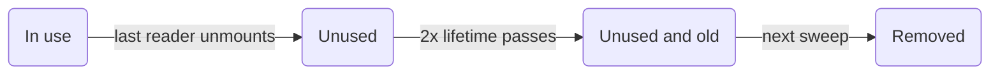

v0.19 让 [Manager](/docs/concepts/managers) 可以在一次 store 更新中写入一整批流式到达的行，
把 endpoint 代码的类型检查速度提高约 2 倍，并修复了一批 TypeScript 和 Vue 问题。
编码智能体还获得了 Claude Code 插件、Vue skill 和 llms.txt；请参阅
[面向编码智能体的 Data Client](/blog/2026/10/06/coding-agents)。

**新 API：**

- [支持 Array schema 的 Controller.set()](/blog/2026/10/03/v0.19-batch-set#batch-set) - 用 `ctrl.set([Entity], rows)` 在一次 store 更新中写入多个 entity，比每行调用一次 `set()` [最多快 95 倍](/blog/2026/10/03/v0.19-batch-set#batch-set-performance)

**性能：**

- [更快的 TypeScript](/blog/2026/10/03/v0.19-batch-set#faster-types) - 编辑器和 `tsc` 检查 [RestEndpoint](/rest/api/RestEndpoint) 与 [resource()](/rest/api/resource) 代码的速度[提高约 2 倍，内存减少 40%](/blog/2026/10/03/v0.19-batch-set#faster-types-results)，并且之前能捕获的错误一个都不少

**其他改进：**

- 修复 TypeScript 7 对包 `exports` 的模块解析；导入现在会解析到声明文件（[#4019](https://github.com/reactive/data-client/pull/4019)）
- [renderDataHook()](/docs/api/renderDataHook) 在首次渲染挂起时也会运行 provider 的挂载副作用（[#4099](https://github.com/reactive/data-client/pull/4099)）
- [Controller.set() 的值按 schema 推导类型](/blog/2026/10/03/v0.19-batch-set#typed-set)，因此 `ctrl.set(new schema.All(Todo), 42)` 会是 TypeScript 错误（[#4133](https://github.com/reactive/data-client/pull/4133)）
- [Controller.set() 可用 Invalidate schema 删除单个 entity](/blog/2026/10/03/v0.19-batch-set#set-invalidate)，不再需要包成单行批量的变通写法（[#4230](https://github.com/reactive/data-client/pull/4230)）
- 在 `new RestEndpoint()`、`.extend()` 和 `resource().extend()` 中，[process() 获得带类型的 params](/blog/2026/10/03/v0.19-batch-set#extend-process-params)，因此写错路径参数会是 TypeScript 错误，而不是运行时的 `undefined`（[#4183](https://github.com/reactive/data-client/pull/4183)、[#4184](https://github.com/reactive/data-client/pull/4184)）
- [getOptimisticResponse() 的返回值按 schema 推导类型](/blog/2026/10/03/v0.19-batch-set#typed-optimistic-response)，因此字段类型写错会是 TypeScript 错误，而不是闪现一下错误数据（[#4198](https://github.com/reactive/data-client/pull/4198)）
- Vue 的 [useSuspense()](/vue/api/useSuspense) 和 [useLive()](/vue/api/useLive) 在新参数加载期间保留之前的数据，而不是返回 `undefined`（[#4131](https://github.com/reactive/data-client/pull/4131)）
- Vue 的 [useSuspense()](/vue/api/useSuspense) 和 [useLive()](/vue/api/useLive) 把参数变化后的获取错误发送给 `onErrorCaptured()`，而不是产生未处理的 promise rejection（[#4135](https://github.com/reactive/data-client/pull/4135)）
- Vue 的 [useSuspense()](/vue/api/useSuspense)、[useDLE()](/vue/api/useDLE) 和 [useFetch()](/vue/api/useFetch) 不再在每次 store 更新时重新获取过时数据，因此 `controller.set()` 不会被覆盖（[#4134](https://github.com/reactive/data-client/pull/4134)）
- Vue 的 [useSuspense()](/vue/api/useSuspense) [在挂载时显示过时数据](/blog/2026/10/03/v0.19-batch-set#vue-stale-while-revalidate)并在后台重新获取，与 React 一致，而不是在重新获取完成前一直显示 `<Suspense>` 的 fallback（[#4169](https://github.com/reactive/data-client/pull/4169)）
- Vue 的 [useDLE()](/vue/api/useDLE) 和 [useCache()](/vue/api/useCache) 在无关的 store 更新中保留已过期的 `invalidIfStale` 数据，而不是卡在加载状态（[#4142](https://github.com/reactive/data-client/pull/4142)）
- Vue 的 `DataClientPlugin` 可以安装在 3.5 之前的 Vue 版本上，而不是抛出 `app.onUnmount is not a function`（[#4146](https://github.com/reactive/data-client/pull/4146)）
- Vue 的 [DataClientPlugin](/vue/api/DataClientPlugin#gcPolicy) 默认进行垃圾回收，与 React 的 [DataProvider](/docs/api/DataProvider) 一致，因此你不再需要传入 `gcPolicy`；[它如何决定移除什么](/blog/2026/10/03/v0.19-batch-set#vue-gc)（[#4148](https://github.com/reactive/data-client/pull/4148)）
- Vue 组合式函数接受像 `() => ({ id: props.id })` 这样的 [getter 参数](/blog/2026/10/03/v0.19-batch-set#vue-getter-args)；之前类型上允许，但却把函数本身传给了 endpoint（[#4115](https://github.com/reactive/data-client/pull/4115)）
- 修复在关闭 `skipLibCheck` 的 TypeScript 4.x 上出现的 `Cannot find name 'NoInfer'` 和 `export type` 错误（[#4138](https://github.com/reactive/data-client/pull/4138)）
- 修复在关闭 `skipLibCheck` 的 TypeScript 4.0–4.5 上 `Entity`、`Endpoint`、`Union` 和 `RestEndpoint` 的类型错误（[#4140](https://github.com/reactive/data-client/pull/4140)）
- 修复在 TypeScript 4.0–4.4 上导入 `@data-client/react/redux`、`@data-client/react/nextjs` 或 `@data-client/test` 时的 `',' expected` 错误（[#4232](https://github.com/reactive/data-client/pull/4232)）
- 修复在 TypeScript 4.0–4.4 上 `@data-client/test` 的 `act` 和 `renderHook` 被推导为 `any` 的问题（[#4251](https://github.com/reactive/data-client/pull/4251)）
- [Entity](/rest/api/Entity) 类可以用在期望 `EntityInterface` 的地方（[#4149](https://github.com/reactive/data-client/pull/4149)）；为未来版本[准备好 `pk()` 重写](/blog/2026/10/03/v0.19-batch-set#entity-pk-args)
- [useCache()](/docs/api/useCache) 和 [useDLE()](/docs/api/useDLE) 对已删除且重新获取失败的 entity 返回 `undefined`，而不是一个能绕过 `if (!data)` 检查的真值 `Symbol`；[移除所有变通代码](/blog/2026/10/03/v0.19-batch-set#deleted-entity-undefined)（[#4150](https://github.com/reactive/data-client/pull/4150)）
- Vue 的 [useFetch()](/vue/api/useFetch) 在挂载期间保护其数据不被垃圾回收，与 [useSuspense()](/vue/api/useSuspense) 一致，因此配置的 `gcPolicy` 不再会清除组件稍后要读取的预取数据（[#4152](https://github.com/reactive/data-client/pull/4152)）
- 打开 [Redux DevTools](/docs/getting-started/debugging) 的应用在开发模式下遇到大型 store 或频繁更新时不再卡顿；每次更新的[序列化快 40-60 倍](/blog/2026/10/03/v0.19-batch-set#devtools-perf)（[#4163](https://github.com/reactive/data-client/pull/4163)）
- 传入 endpoint 覆盖对象的 [resource().extend()](/rest/api/resource#extend) 会在类型中保留之前用 `.extend('name', options)` 添加的 endpoint，因此使用它们不再是 TypeScript 错误（[#4184](https://github.com/reactive/data-client/pull/4184)）
- 当 [Query](/rest/api/Query) 或 [Lazy](/rest/api/Lazy) 包装 [Collection](/rest/api/Collection) 时，[RestEndpoint.push](/blog/2026/10/03/v0.19-batch-set#query-collection-push)、`unshift` 和 `remove` 接受 Entity 的字段作为 body，而不是只接受 `FormData`（[#4226](https://github.com/reactive/data-client/pull/4226)）
- Vue 的 [useFetch()](/vue/api/useFetch) 的类型现在是它返回的只读 `Ref`，因此 `promise.resolved`（始终为 `undefined`）现在是 TypeScript 错误；请改为读取 `promise.value.resolved`（[#4114](https://github.com/reactive/data-client/pull/4114)）
- 传给 [DataProvider](/docs/api/DataProvider#Controller) 或 [DataClientPlugin](/vue/api/DataClientPlugin#Controller) 的 `Controller` 子类不再需要类型断言就能通过类型检查（[#4228](https://github.com/reactive/data-client/pull/4228)）
- [prepareStore()](/docs/guides/redux) 的 `store` 可以不加类型断言直接传给 react-redux 的 `<Provider>`，并且其类型中包含 `dispatch()`（[#4238](https://github.com/reactive/data-client/pull/4238)）
- [resource().create 接受 FormData](/blog/2026/10/03/v0.19-batch-set#create-formdata)，无需类型断言，与 `update`、`partialUpdate` 和 `getList.push` 一致（[#4235](https://github.com/reactive/data-client/pull/4235)）
- [RestEndpoint.push](/rest/api/RestEndpoint#push)、`unshift` 和 `remove` 以 JSON 形式发送数组 body，因此一次创建或移除多个条目不再向服务器发送 `"[object Object]"`；`resource().create` 也接受数组（[#4262](https://github.com/reactive/data-client/pull/4262)）
- Vue 的 `createDataClient()` 已弃用，因为它是 [DataClientPlugin](/vue/api/DataClientPlugin) 的内部实现；请用 `app.use(DataClientPlugin, options)` 安装插件，而不是直接调用它（[#4193](https://github.com/reactive/data-client/pull/4193)）
- Vue 的 `renderDataCompose()` 的 `waitForNextUpdate()` 已弃用，因为它会在 1 秒后静默放弃，让仍处于挂起状态的测试通过；请改为 `await result`，或在变化之后 `await allSettled()`，后者现在也会等待由 prop 变化触发的获取（[组合式函数的单元测试](/vue/guides/unit-testing-composables#renderdatacompose-api)、[#4221](https://github.com/reactive/data-client/pull/4221)）

**[破坏性变更：](/blog/2026/10/03/v0.19-batch-set#migration-guide)**

- [需要 TypeScript 4.0 或更高版本](/blog/2026/10/03/v0.19-batch-set#typescript-4) - 移除了 TypeScript 3.x 的声明文件（[#4151](https://github.com/reactive/data-client/pull/4151)）

**[为未来版本做好准备：](/blog/2026/10/03/v0.19-batch-set#future-releases)**

- [在 `Entity.pk()` 重写中把 `args` 标注为 `readonly`](/blog/2026/10/03/v0.19-batch-set#future-pk-args)
- [用 `DataClientPlugin` 代替 Vue 的 `createDataClient()`](/blog/2026/10/03/v0.19-batch-set#future-create-data-client)
- [替换 Vue 测试中的 `waitForNextUpdate()`](/blog/2026/10/03/v0.19-batch-set#future-wait-for-next-update)

{/* truncate */}

import useBaseUrl from '@docusaurus/useBaseUrl';
import AutoPlayVideo from '@site/src/components/AutoPlayVideo';
import DiffEditor from '@site/src/components/DiffEditor';
import BatchSetDemo from '../../docs/core/shared/\_BatchSetDemo.mdx';
import PerfChart from '@site/src/components/PerfChart';
import PerfTable from '@site/src/components/PerfTable';
import StackBlitz from '@site/src/components/StackBlitz';
import TypeScriptEditor from '@site/src/components/TypeScriptEditor';

## 批量 Controller.set() {#batch-set}

接收一连串行数据（比如通过 websocket 传来的价格行情）的 [Manager](/docs/concepts/managers)，现在可以通过传入
[Array](/rest/api/Array) schema，用一次 [Controller.set()](/docs/api/Controller#set-array) 把它们全部写入。
在 v0.19 之前，`[Ticker]` 会是 TypeScript 错误，所以常见的变通做法是每行调用一次 `set()`：

<DiffEditor>

```ts title="Before"
ws.onmessage = event => {
  const rows = JSON.parse(event.data);
  for (const row of rows) {
    ctrl.set(Ticker, { product_id: row.product_id }, row);
  }
};
```

```ts title="After"
ws.onmessage = event => {
  const rows = JSON.parse(event.data);
  ctrl.set([Ticker], rows);
};
```

</DiffEditor>

每一行都会与已存储的 entity 合并，列表中没有的 entity 则保持不变。Array schema 不接受 `args`，
也不接受更新函数。要批量处理混合的 Entity 类型、删除操作或按 id 作为键的行，请传入 [Union](/rest/api/Union)、
[Invalidate](/rest/api/Invalidate#batch-invalidation) 或 [Values](/rest/api/Values) schema；示例请参阅
[Controller.set()](/docs/api/Controller#set-array)。
[#4103](https://github.com/reactive/data-client/pull/4103)

<BatchSetDemo />

### 性能 {#batch-set-performance}

每次 `set()` 都是一次独立的 store 更新，而每次 store 更新都会复制该 entity 类型的整张表。逐行写入会为每一行
重复这次复制，因此开销随批量大小和 store 大小一起增长。批量写入只需付出一次复制的代价。

下图是
[examples/benchmark/core.js](https://github.com/reactive/data-client/blob/master/examples/benchmark/core.js)
中的 node `setMany` 基准测试：一个已持有 500 个 entity 的 store，对比每行同步调用一次 `set()` 与一次 `set([Ticker], rows)`。
它测量的是 store 更新：50 行时快 **20 倍**，500 行时快 **95 倍**。
[#4103](https://github.com/reactive/data-client/pull/4103)

<PerfChart
  title="Node 向 500 个 entity 的 store 执行 setMany"
  baselineLabel="One set() per row"
  valueLabel="set([Ticker], rows)"
  rows={[
    { label: '50 rows', baseline: 10.8, value: 0.54 },
    { label: '500 rows', baseline: 103, value: 1.08 },
  ]}
/>

<center>

[历史基准测试](https://reactive.github.io/data-client/dev/bench/) | [查看 setMany 基准测试](https://github.com/reactive/data-client/blob/master/examples/benchmark/core.js)

</center>

在 [Manager](/docs/concepts/managers) 中，缓冲到达的消息并用一次 `set()` 刷出每一批，具体做法见
[批量处理高频更新](/docs/concepts/managers#batching)。coin 应用的 `StreamManager` 现在就是这样
刷出 Coinbase 的行情消息。

<AutoPlayVideo
  src={useBaseUrl('/videos/blog/batch-set-devtools.webm')}
  type="video/webm"
  style={{ width: '100%' }}
  alt="Redux DevTools 中显示 coin 应用 StreamManager 的两个副本各接收三波 500 条行情消息。每条消息调用一次 set() 会记录 1,500 个 set action，而缓冲消息并用 set([Ticker], rows) 刷出只记录 3 个。"
/>

```ts title="StreamManager.ts"
handleMessage(msg: any) {
  if (msg.type in this.entities) {
    (this.buffer[msg.type] ??= {})[msg.product_id] = msg;
    this.flushTimeout ??= setTimeout(this.flush, 50);
  }
}

flush = () => {
  const buffer = this.buffer;
  this.buffer = {};
  this.flushTimeout = undefined;
  for (const type in buffer) {
    this.controller.set([this.entities[type]], Object.values(buffer[type]));
  }
};
```

<StackBlitz app="coin-app" file="src/resources/StreamManager.ts,src/getManagers.ts,src/resources/Ticker.ts" height="600" view="editor" />

:::tip

如果你按 schema 过滤 [DevToolsManager](/docs/api/DevToolsManager) 的 action，批量写入的 `action.schema`
是 Array schema，因此对于 `[Ticker]` 应匹配 `action.schema[0]`，而不是 Entity 本身。

:::

## 更快的 TypeScript {#faster-types}

TypeScript 会在编辑器里的每次按键和每次 CI 构建时重新检查你的代码。在拥有大量 endpoint 的应用中，
沉重的库类型表现为迟缓的自动补全、要等几秒才出现的红色波浪线，以及更慢的构建。
v0.19 让 [RestEndpoint](/rest/api/RestEndpoint)、[resource()](/rest/api/resource) 和 `.extend()` 的检查开销大幅降低，
你无需改动任何代码。TypeScript 仍然会报告之前报告过的每一个错误
（[#4173](https://github.com/reactive/data-client/pull/4173)）。

### 结果 {#faster-types-results}

我们最重的压力测试，一个包含 150 个带长路径、`.extend()` 和 `.paginated()` 的 RestEndpoint 的文件，现在
**在 TypeScript 6 上检查快 2 倍**，**在 TypeScript 7 上快 2.2 倍**，内存用量减少约 **40%**。所有数字都是
已发布的 v0.18.1 包与 v0.19 的对比；检查时间取 10 次运行中的最佳值。

<PerfChart
  title="检查 150 个带长路径的 RestEndpoint"
  scaleMax={2.4}
  baselineLabel="v0.18"
  valueLabel="v0.19"
  unit="s"
  rows={[
    { label: 'TypeScript 6', baseline: 3.83, value: 1.98 },
    { label: 'TypeScript 7', baseline: 1.5, value: 0.69 },
  ]}
/>

<PerfChart
  title="同一文件的内存用量"
  scaleMax={2.4}
  baselineLabel="v0.18"
  valueLabel="v0.19"
  unit="MB"
  rows={[
    { label: 'TypeScript 6', baseline: 365, value: 211 },
    { label: 'TypeScript 7', baseline: 220, value: 128 },
  ]}
/>

endpoint 密集的代码所做的类型工作少了很多。类型实例化是 TypeScript 的工作单位：它们是确定性的，
因此可以在不同机器间干净地比较。Union 比 v0.18 做了更多工作，因为 v0.19 现在会
[对 set() 的值做类型检查](#typed-set)（见下文）。

<PerfChart
  title="各压力测试的类型实例化次数"
  scaleMax={2.4}
  baselineLabel="v0.18"
  valueLabel="v0.19"
  unit="K"
  rows={[
    { label: 'Long paths', baseline: 822, value: 341 },
    { label: 'Typical app', baseline: 20.2, value: 13.4 },
    { label: 'React hooks', baseline: 145, value: 122 },
    { label: 'Vue', baseline: 62.6, value: 47.3 },
    { label: '300 fields', baseline: 17.0, value: 12.8 },
    { label: 'Schemas', baseline: 118, value: 99.3 },
    { label: 'Union', baseline: 9.0, value: 16.1 },
  ]}
/>

悬停或点击单元格可查看精确数字。

<PerfTable
  columns={[
    { label: 'TS 6 check time', unit: 's' },
    { label: 'TS 7 check time', unit: 's' },
    { label: 'TS 6 memory', unit: 'MB' },
  ]}
  rows={[
    {
      label: 'Long paths',
      description: <>150 RestEndpoints with 6-param paths, <code>.extend()</code> and <code>.paginated()</code></>,
      values: [[3.83, 1.98], [1.5, 0.69], [365, 211]],
    },
    {
      label: 'Typical app',
      description: <>A few resources with <code>.extend()</code>, <code>.paginated()</code> and hooks</>,
      values: [[0.42, 0.42], [0.062, 0.053], [106, 109]],
    },
    {
      label: 'React hooks',
      description: <>40 resources through every hook, plus <code>ctrl.fetch()</code> and <code>ctrl.set()</code></>,
      values: [[1.24, 1.12], [0.41, 0.38], [167, 157]],
    },
    {
      label: 'Vue',
      description: 'The same 40 resources through every composable',
      values: [[0.68, 0.68], [0.17, 0.15], [145, 139]],
    },
    {
      label: '300 fields',
      description: 'One Entity with 300 fields, read and updated 100 times',
      values: [[0.44, 0.38], [0.086, 0.052], [111, 101]],
    },
    {
      label: 'Schemas',
      description: 'All, Query, Invalidate, Array, Object and Collection',
      values: [[1.1, 1.07], [0.36, 0.31], [156, 150]],
    },
    {
      label: 'Union',
      description: 'A 30-member Union in a Collection and Values',
      values: [[0.42, 0.41], [0.071, 0.068], [107, 101]],
    },
    {
      label: 'set() values',
      description: <>1000 <code>ctrl.set()</code> calls on a 30-member Union, a Collection of it and a 300-field Entity</>,
      values: [[1.49, 1.07], [0.54, 0.25], [176, 131]],
    },
    {
      label: 'set() updaters',
      description: <>1000 <code>ctrl.set(Union, args, prev =&gt; ...)</code> updaters on a 30-member Union</>,
      values: [[3.58, 3.43], [1.67, 1.85], [381, 384]],
    },
  ]}
/>

set() 各行测量的是[带类型的 set() 值](#typed-set)，v0.18 完全不检查这些值。普通值的检查仍比之前更快，
而大型 Union 上的更新函数检查耗时大致相同，尽管 TypeScript 现在会检查每个更新函数的返回值
（[#4179](https://github.com/reactive/data-client/pull/4179)）。

小文件的开销主要来自 TypeScript 固定的启动成本（仅加载 `lib.dom.d.ts` 就要约 100MB），所以
它们的时间和内存几乎不变。随着代码库增长，节省的开销会逐渐累积。

### 改了什么 {#faster-types-how}

- `.extend()` 和 `.paginated()` 在所有 endpoint 之间共享，而不是为每种 endpoint 类型重新创建。
- endpoint 选项被推导为普通对象类型，因此 TypeScript 不再在每次使用时重新构建它们。
- 像 `/users/:id` 这样的路径参数只需一遍即可读取完毕。

发布之前，我们在 TypeScript 4.0 到 7 上关闭了测试套件中的每一个 `@ts-expect-error`，并确认
每个错误仍然出现在同一位置。

在 TypeScript 5.x 及更早版本上，传给 `.extend()` 的 `process(value, params)` 方法在 `strict` 下
也不再报 "implicitly has an 'any' type" 错误。

## 其他改进 {#other-improvements}

### 带类型的 set() 值 {#typed-set}

[Controller.set()](/docs/api/Controller#set) 之前对任何 schema 都接受任意值，所以拼写错误或字段类型写错
只会在运行时表现为错误数据。现在值按 schema 推导类型：
[Entity](/rest/api/Entity) 接受它的字段，而 [Collection](/rest/api/Collection)、[All](/rest/api/All) 或
Array 接受一个行列表。每个字段都是可选的，因为 `set()` 会合并到已存储的数据中；
并且数字和字符串可以互换，就像在 API 响应中一样。
[#4133](https://github.com/reactive/data-client/pull/4133)

悬停在红色下划线上可查看每个错误。

<TypeScriptEditor>

```ts title="Todo" collapsed
import { Entity, resource } from '@data-client/rest';

export class Todo extends Entity {
  id = 0;
  userId = 0;
  title = '';
  completed = false;

  static key = 'Todo';
}

export const TodoResource = resource({
  urlPrefix: 'https://jsonplaceholder.typicode.com',
  path: '/todos/:id',
  schema: Todo,
});
```

```ts title="updateTodos"
import type { Controller } from '@data-client/react';
import { schema } from '@data-client/rest';
import { Todo, TodoResource } from './Todo';

export function updateTodos(ctrl: Controller) {
  // ✅ rows are partial Todos; ids may be strings or numbers
  ctrl.set(TodoResource.getList.schema, [{ id: '5', completed: true }]);
  ctrl.set(Todo, { id: 5 }, todo => ({ completed: !todo.completed }));
  ctrl.set([Todo], [{ id: 1, title: 'first' }, { id: 2 }]);

  // ❌ All takes a list of rows
  ctrl.set(new schema.All(Todo), 42);
  // ❌ completed is a boolean
  ctrl.set(Todo, { id: 5 }, { id: 5, completed: 'yes' });
  // ❌ Todo has no done field
  ctrl.set(TodoResource.getList.schema, [{ id: 5, done: true }]);
  // ❌ updaters must return Todo fields
  ctrl.set(Todo, { id: 5 }, todo => ({ title: todo.completed }));
}
```

</TypeScriptEditor>

[Query](/rest/api/Query) 接受它所包装 schema 的输入，因为 `set()` 规范化的是那个 schema，而不是
反转 `process()`。当每个成员都把判别字段声明为字面量（如 `readonly type = 'post'`）时，
[Union](/rest/api/Union) 的行会按它所选中的成员进行检查，因此不能混用不同成员的字段；请参阅 [Unions](/docs/api/Controller#set)。

如果之前能编译的代码现在在这里报错，说明它写入的数据与其 schema 的描述不符。请修正该值，
或者在数据确实可能是那种形状时放宽 Entity 的字段类型。

### 用 set() 删除单个 entity {#set-invalidate}

向 [Controller.set()](/docs/api/Controller#set-array) 传入 [Invalidate](/rest/api/Invalidate) schema 会删除
其行所标识的 entity，但单个形式曾是 TypeScript 错误，所以代码只能把它包成单行批量。现在它
可以通过类型检查，且行按 Entity 的字段推导类型
（[#4230](https://github.com/reactive/data-client/pull/4230)）：

<DiffEditor>

```ts title="Before"
ctrl.set([new Invalidate(Todo)], [{ id: '5' }]);
```

```ts title="After"
ctrl.set(new Invalidate(Todo), { id: '5' });
```

</DiffEditor>

与批量 `set()` 一样，它不接受 `args`，也不接受更新函数。

### 带类型的 process() params {#extend-process-params}

传给 `new RestEndpoint()`、[.extend()](/rest/api/RestEndpoint#extend) 或 [resource().extend()](/rest/api/resource#extend) 的
[process()](/rest/api/RestEndpoint#process) 方法，其 `params` 之前被推导为
`any`，因此读取 endpoint 并不具备的参数也能编译通过，并在运行时返回 `undefined`。`params` 和
`body` 现在从 endpoint 推导类型，包括在同一个 `.extend()` 调用中设置的 `path`
（[#4183](https://github.com/reactive/data-client/pull/4183)、[#4184](https://github.com/reactive/data-client/pull/4184)）：

<TypeScriptEditor>

```ts
import { RestEndpoint } from '@data-client/rest';

const getUser = new RestEndpoint({ path: '/users/:id' });

export const getUserById = getUser.extend({
  path: '/users/by-id/:userId',
  process(value, params) {
    const userId: string | number = params.userId;
    // @ts-expect-error 'id' is not a param of '/users/by-id/:userId'
    params.id;
    return { ...value, userId };
  },
});
```

</TypeScriptEditor>

当每个参数都是可选的时，`params` 可能为 `undefined`，因此要用 `params?.page` 读取。

这可能会在现有的 `process()` 方法中暴露出新的 TypeScript 错误。每一个错误都标记了一处可能为 `undefined`
或在运行时抛出异常的读取，因此请修正参数名或补上缺失的检查。

### 带类型的乐观响应 {#typed-optimistic-response}

除非 endpoint 有带类型的 `process()`，否则 [getOptimisticResponse()](/rest/api/RestEndpoint#getoptimisticresponse) 可以返回任何东西，
因此字段类型写错只会在服务器响应之前表现为 UI 里的错误数据。返回值
现在会按 endpoint 的 schema 检查，就像[带类型的 set() 值](#typed-set)一样：Entity 接受它的任意
字段，而 [Collection](/rest/api/Collection) 接受它们的列表
（[#4198](https://github.com/reactive/data-client/pull/4198)）：

<TypeScriptEditor>

```ts
import { Entity, RestEndpoint } from '@data-client/rest';

class Todo extends Entity {
  id = 0;
  title = '';
  completed = false;
}

export const toggleTodo = new RestEndpoint({
  path: '/todos/:id',
  method: 'PATCH',
  schema: Todo,
  // @ts-expect-error completed is a boolean; 'false' is truthy, so the checkbox would stay checked
  getOptimisticResponse(snap, { id }) {
    const todo = snap.get(Todo, { id });
    if (!todo) throw snap.abort;
    return { id, completed: todo.completed ? 'false' : 'true' };
  },
});
```

</TypeScriptEditor>

这可能会在现有的 `getOptimisticResponse()` 方法中暴露出新的 TypeScript 错误。每一个错误都标记了一个
在服务器响应之前会以错误类型存储的值，因此请返回字段的真实类型（这里是 `!todo.completed`）。

### 排序后的 Collection 上带类型的 push() {#query-collection-push}

把 [Collection](/rest/api/Collection) 包在 [Query](/rest/api/Query) 中进行排序或过滤，会让
[push](/rest/api/RestEndpoint#push)、`unshift` 和 `remove` 拒绝除 `FormData` 以外的所有 body，尽管它们在运行时
会向列表添加数据。body 现在从 Collection 的 Entity 推导类型，因此可以去掉类型断言，而字段写错会是
TypeScript 错误。被 [Lazy](/rest/api/Lazy) 包装的 Collection 也同样适用
（[#4226](https://github.com/reactive/data-client/pull/4226)）。

<DiffEditor>

```ts title="Before"
import { useController } from '@data-client/react';
import { getPosts } from './getPosts';

export function useAddPost() {
  const ctrl = useController();
  return (title: string, author: string) =>
    ctrl.fetch(getPosts.push, { group: 'react' }, { title, author } as any);
}
```

```ts title="After"
import { useController } from '@data-client/react';
import { getPosts } from './getPosts';

export function useAddPost() {
  const ctrl = useController();
  return (title: string, author: string) =>
    ctrl.fetch(getPosts.push, { group: 'react' }, { title, author });
}
```

</DiffEditor>

其中 `getPosts` 用 Query 对其 Collection 排序：

```ts title="getPosts.ts"
import { Collection, Entity, Query, RestEndpoint } from '@data-client/rest';

export class Post extends Entity {
  id = '';
  title = '';
  group = '';
  author = '';
}

export const getPosts = new RestEndpoint({
  path: '/:group/posts',
  searchParams: {} as { orderBy?: 'title' | 'author' },
  schema: new Query(
    new Collection([Post], { nonFilterArgumentKeys: /orderBy/ }),
    (posts, { orderBy }: { orderBy?: 'title' | 'author' } = {}) =>
      orderBy ?
        [...posts].sort((a, b) => a[orderBy].localeCompare(b[orderBy]))
      : posts,
  ),
});
```

### resource().create 中的 FormData {#create-formdata}

[resource()](/rest/api/resource) 的 `create` 会原样发送 `FormData` body，与 `update`、`partialUpdate` 和
[getList.push](/rest/api/resource#push) 一致，但它的类型只允许对象，所以提交表单需要类型断言
（[#4235](https://github.com/reactive/data-client/pull/4235)）。去掉断言即可：

<DiffEditor>

```tsx title="Before"
<form
  onSubmit={e => {
    e.preventDefault();
    ctrl.fetch(PostResource.create, new FormData(e.currentTarget) as any);
  }}
>
```

```tsx title="After"
<form
  onSubmit={e => {
    e.preventDefault();
    ctrl.fetch(PostResource.create, new FormData(e.currentTarget));
  }}
>
```

</DiffEditor>

`create` 已弃用；[getList.push](/rest/api/resource#push) 是它的替代品，同样接受 `FormData`。

### Vue getter 参数 {#vue-getter-args}

像 [useSuspense()](/vue/api/useSuspense) 和 [useLive()](/vue/api/useLive) 这样的 Vue 组合式函数在类型上接受
getter 函数作为参数，但它们把函数本身传给了 endpoint，而没有调用它。getter 现在
与 ref 和 `computed` 的行为一致，并且当 getter 读取的任何内容发生变化时，组合式函数会重新获取
（[#4115](https://github.com/reactive/data-client/pull/4115)）。如果你只是为了让参数具有响应性才用 `computed()` 包装，
现在可以去掉它：

<DiffEditor>

```ts title="Before"
import { computed } from 'vue';

const props = defineProps<{ id: number }>();
const article = await useSuspense(
  ArticleResource.get,
  computed(() => ({ id: props.id })),
);
```

```ts title="After"
const props = defineProps<{ id: number }>();
const article = await useSuspense(ArticleResource.get, () => ({
  id: props.id,
}));
```

</DiffEditor>

这适用于每个接受 endpoint 参数的组合式函数：[useSuspense()](/vue/api/useSuspense)、
[useLive()](/vue/api/useLive)、[useCache()](/vue/api/useCache)、[useDLE()](/vue/api/useDLE)、
[useFetch()](/vue/api/useFetch)、[useQuery()](/vue/api/useQuery) 和 [useSubscription()](/vue/api/useSubscription)。

### Vue 默认进行垃圾回收 {#vue-gc}

Vue 的 [DataClientPlugin](/vue/api/DataClientPlugin#gcPolicy) 之前只有在你自己传入 `gcPolicy` 时才会移除
未使用的数据。它现在默认使用 `new GCPolicy()`，与 React 的 [DataProvider](/docs/api/DataProvider) 相同，因此
除非你要自定义它，否则可以去掉这个选项（[#4148](https://github.com/reactive/data-client/pull/4148)）。

<DiffEditor>

```ts title="Before"
import { DataClientPlugin, GCPolicy } from '@data-client/vue';

app.use(DataClientPlugin, { gcPolicy: new GCPolicy() });
```

```ts title="After"
import { DataClientPlugin } from '@data-client/vue';

app.use(DataClientPlugin);
```

</DiffEditor>

数据只有在没有任何已挂载组件读取它，_并且_自获取以来已经过了两倍新鲜期（至少两分钟）时
才会被移除。清扫每五分钟检查一次。在此之前被组件再次读取的任何数据都会
重新回到使用中。

<center>

<div style={{maxWidth:'640px'}}>



</div>

</center>

在移除之后挂载的组件会把该数据视为从未获取过：[useSuspense()](/vue/api/useSuspense) 会重新获取它，
而 [useCache()](/vue/api/useCache) 会返回 `undefined`。要让未使用的数据保留更久或减少清扫频率，
请传入你自己的 [gcPolicy](/vue/api/DataClientPlugin#gcPolicy)。

### Vue stale-while-revalidate {#vue-stale-while-revalidate}

当组件挂载时的数据[已过时](/docs/concepts/expiry-policy#stale)但仍然有效，Vue 的
[useSuspense()](/vue/api/useSuspense) 现在会立即渲染它并在后台重新获取，与 React 一致。之前，
它会在重新获取完成前一直显示 `<Suspense>` 的 fallback（[#4169](https://github.com/reactive/data-client/pull/4169)）。

<AutoPlayVideo
  src={useBaseUrl('/videos/blog/vue-suspense-stale.mp4')}
  type="video/mp4"
  width="720"
  alt="两个 Vue 组件并排显示，分别是 v0.19 之前和之后。两者首次挂载时都显示 Loading。卸载并等待价格变为过时后，重新挂载时之前的版本再次显示 Loading，而之后的版本立即显示过时的价格并在后台重新获取。"
/>

### Entity 类可作为 EntityInterface 通过类型检查 {#entity-pk-args}

用 `EntityInterface` 标注为接受任意 Entity 的辅助函数曾经拒绝 Entity 类，因为
[Entity.pk()](/rest/api/Entity#pk) 把它的 `args` 标注为可变数组。它现在是 `readonly any[]`，因此下面的代码
可以通过类型检查（[#4149](https://github.com/reactive/data-client/pull/4149)）：

<TypeScriptEditor>

```ts
import { Entity } from '@data-client/rest';
import type { EntityInterface } from '@data-client/react';

class User extends Entity {
  id = '';
  name = '';
}

function entityName(schema: EntityInterface) {
  return schema.key;
}

entityName(User);
```

</TypeScriptEditor>

如果你重写了 `static pk()` 并把 `args` 标注为可变数组，它目前仍能编译，但未来的破坏性版本
将要求 `readonly`；[现在就更新它](#future-pk-args)。

### 已删除的 entity 读取为 undefined {#deleted-entity-undefined}

当一个 entity 被删除且重新获取失败时，[useCache()](/docs/api/useCache) 和 [useDLE()](/docs/api/useDLE)
（React 和 Vue）会把一个内部 `Symbol` 作为数据返回。`Symbol` 是真值，所以常见的"尚未加载"守卫会放它
通过，组件就当作自己拿到了 entity 一样渲染
（[#4150](https://github.com/reactive/data-client/pull/4150)）：

```tsx
function TodoDetail({ id }: { id: number }) {
  const todo = useCache(TodoResource.get, { id });
  // a deleted todo used to get past this guard, so todo.title.trim() threw
  if (!todo) return <TodoPlaceholder />;
  return <h3>{todo.title.trim()}</h3>;
}
```

现在 `data` 是 `undefined`，与它的类型和 [Controller.get()](/docs/api/Controller#get) 一致。
[Controller.getResponse()](/docs/api/Controller#getResponse) 和
[Controller.fetchIfStale()](/docs/api/Controller#fetchIfStale) 也同样如此，例如在自定义 [Manager](/docs/api/Manager) 中。

如果你为此做过变通处理，现在可以去掉了。普通的真值检查就足够了：

<DiffEditor>

```tsx title="Before"
function TodoDetail({ id }: { id: number }) {
  const todo = useCache(TodoResource.get, { id });
  if (!todo || typeof todo === 'symbol') return <TodoPlaceholder />;
  return <h3>{todo.title.trim()}</h3>;
}
```

```tsx title="After"
function TodoDetail({ id }: { id: number }) {
  const todo = useCache(TodoResource.get, { id });
  if (!todo) return <TodoPlaceholder />;
  return <h3>{todo.title.trim()}</h3>;
}
```

</DiffEditor>

要在重新获取失败时显示特定内容（例如删除后的 404），请从
[useDLE()](/docs/api/useDLE) 读取 `error`，而不是检查 `data`。

### 更快的 Redux DevTools {#devtools-perf}

打开 [Redux DevTools](/docs/getting-started/debugging) 扩展后，开发模式下的每次 store 更新
都会为扩展序列化整个 store，而其中每个时间戳都是用慢速方式格式化的。大型 store 或
频繁更新，比如轮询、实时数据或大量 `controller.set()` 调用，会让页面卡顿。现在每次更新的
序列化快 **40-60 倍**，而时间戳仍然显示为 `10:42:07.123 AM` 这样的形式
（[#4163](https://github.com/reactive/data-client/pull/4163)）。生产构建不包含 DevTools，因此
不受影响。

<PerfChart
  title="每次 store 更新的 DevTools 序列化"
  baselineLabel="v0.18"
  valueLabel="v0.19"
  rows={[
    { label: '50 entities', baseline: 18.6, value: 0.31 },
    { label: '500 entities', baseline: 201, value: 5.0 },
  ]}
/>

## 迁移指南 {#migration-guide}

import PkgTabs from '@site/src/components/PkgTabs';

本次升级需要同时更新所有包的版本。

<PkgTabs pkgs="@data-client/react@^0.19.0 @data-client/rest@^0.19.0 @data-client/endpoint@^0.19.0 @data-client/core@^0.19.0 @data-client/vue@^0.19.0 @data-client/test@^0.19.0 @data-client/img@^0.19.0" upgrade />

### TypeScript 4.0 或更高版本 {#typescript-4}

如果你已经在使用 TypeScript 4.0 或更高版本，请跳过本节。

TypeScript 3.x 的声明文件已被移除，因为它们在任何 TypeScript 3.x 版本上都已无法通过类型检查。请把
`devDependencies` 中的 `typescript` 升级到 `^4.0.0` 或更高版本。[#4151](https://github.com/reactive/data-client/pull/4151)

### 为未来版本做好准备 {#future-releases}

升级到 0.19 并不需要做这里的任何事情；你的代码可以原样继续工作。每一项都会在未来版本中失效，
所以现在更新能让那次升级不费任何功夫。

#### Entity.pk() 的 args 是 readonly {#future-pk-args}

如果你没有用带类型的 `args` 参数重写 `static pk()`，请跳过这一项。

[Entity.pk()](/rest/api/Entity#pk) 现在把 `args` 标注为 `readonly any[]`。把它标注为可变
数组的重写目前仍能编译，但未来版本将要求 `readonly`。

<DiffEditor>

```ts title="Before"
class User extends Entity {
  static pk(value: any, parent?: any, key?: string, args?: any[]) {
    return `${value.id}-${args?.[0]?.org}`;
  }
}
```

```ts title="After"
class User extends Entity {
  static pk(value: any, parent?: any, key?: string, args?: readonly any[]) {
    return `${value.id}-${args?.[0]?.org}`;
  }
}
```

</DiffEditor>

#### Vue createDataClient() {#future-create-data-client}

如果你用 `app.use(DataClientPlugin)` 安装 store，请跳过这一项。

`createDataClient()` 和 `ProvidedDataClient` 是 [DataClientPlugin](/vue/api/DataClientPlugin) 的内部实现，
将不再导出。请改为安装插件，并通过
[useController()](/vue/api/useController) 读取 controller。[#4193](https://github.com/reactive/data-client/pull/4193)

<DiffEditor>

```ts title="Before"
import { createDataClient } from '@data-client/vue';

const { controller } = createDataClient({ managers, initialState });
```

```ts title="After"
import { DataClientPlugin, useController } from '@data-client/vue';

app.use(DataClientPlugin, { managers, initialState });
// in a component's setup()
const controller = useController();
```

</DiffEditor>

#### Vue renderDataCompose() 的 waitForNextUpdate() {#future-wait-for-next-update}

如果你的 Vue 测试没有调用 `waitForNextUpdate()`，请跳过这一项。

[renderDataCompose()](/vue/guides/unit-testing-composables#renderdatacompose-api) 的 `waitForNextUpdate()` 会在
1 秒后静默放弃，因此组合式函数仍处于挂起状态时测试也能通过。它将被移除。请改为 `await`
结果，并在修改 props 或调用 controller 之后调用 `allSettled()`；它现在也会等待由
prop 变化触发的获取。[#4221](https://github.com/reactive/data-client/pull/4221)

<DiffEditor>

```ts title="Before"
const { result, waitForNextUpdate } = await renderDataCompose(
  (props: { id: number }) =>
    useSuspense(ArticleResource.get, () => ({ id: props.id })),
  { props, resolverFixtures },
);
await waitForNextUpdate();
const article = await result;

props.id = 6;
await waitForNextUpdate();
```

```ts title="After"
const { result, allSettled } = await renderDataCompose(
  (props: { id: number }) =>
    useSuspense(ArticleResource.get, () => ({ id: props.id })),
  { props, resolverFixtures },
);
const article = await result;

props.id = 6;
await allSettled();
```

</DiffEditor>

### 升级支持 {#upgrade-support}

一如既往，如果你遇到任何问题或有任何疑问，欢迎加入我们的 [](https://discord.gg/wXGV27xm6t) 或[提交 bug](https://github.com/reactive/data-client/issues/new/choose)
