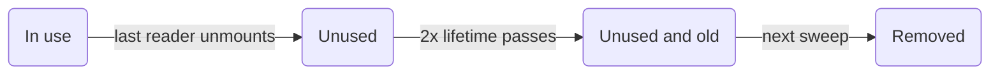

import useBaseUrl from '@docusaurus/useBaseUrl';
import AutoPlayVideo from '@site/src/components/AutoPlayVideo';
import CartBefore from '@site/src/components/CartBefore';
import DiffEditor from '@site/src/components/DiffEditor';
import HooksPlayground from '@site/src/components/HooksPlayground';
import BatchSetDemo from '../../docs/core/shared/\_BatchSetDemo.mdx';
import PerfChart from '@site/src/components/PerfChart';
import PerfTable from '@site/src/components/PerfTable';
import StackBlitz from '@site/src/components/StackBlitz';
import TypeScriptEditor from '@site/src/components/TypeScriptEditor';
import {
  cartFixtures,
  getInitialInterceptorData,
} from '@site/src/fixtures/cart';

export const readdDemo = [
  { delay: 1200, click: 'button[aria-label="Remove Ceramic mug"]' },
  { wait: 1500 },
  { click: '.toast button' },
];

v0.19 让 [Manager](/docs/concepts/managers) 能在一次 store 更新中写入一整批流式数据行，endpoint 代码的类型检查速度提升约 2 倍，
并修复了一批 TypeScript 和 Vue 问题。

**[批量 Controller.set()](/blog/2026/11/18/v0.19-batch-set#batch-set)** 用 `ctrl.set([Ticker], rows)` 在一次 store 更新中写入一整条数据流的行，比如来自 websocket 的价格行情。
这比每行调用一次 `set()` [快达 95 倍](/blog/2026/11/18/v0.19-batch-set#batch-set-performance)。

<BatchSetDemo />

<PerfChart
  title="向已有 500 个实体的 store 执行 Node setMany"
  baselineLabel="One set() per row"
  valueLabel="set([Ticker], rows)"
  rows={[
    { label: '50 rows', baseline: 10.8, value: 0.54 },
    { label: '500 rows', baseline: 103, value: 1.08 },
  ]}
/>

**[更快的 TypeScript](/blog/2026/11/18/v0.19-batch-set#faster-types)**：编辑器和 `tsc` 检查 [RestEndpoint](/rest/api/RestEndpoint) 和
[resource()](/rest/api/resource) 代码的速度提升约 2 倍，内存减少 40%，并且依然会报告之前报告的每一个
错误。

<PerfChart
  title="检查 150 个带长路径的 RestEndpoint"
  scaleMax={2.4}
  baselineLabel="v0.18"
  valueLabel="v0.19"
  unit="s"
  rows={[
    { label: 'TypeScript 6', baseline: 3.83, value: 1.98 },
    { label: 'TypeScript 7', baseline: 1.5, value: 0.69 },
  ]}
/>

**v0.19 的更多内容：**

- [性能](/blog/2026/11/18/v0.19-batch-set#performance)：[更快的 Redux DevTools](/blog/2026/11/18/v0.19-batch-set#devtools-perf)、[更短的 React Native GC 停顿](/blog/2026/11/18/v0.19-batch-set#native-gc)和[更小的拆分包](/blog/2026/11/18/v0.19-batch-set#smaller-chunks)
- [客户端](/blog/2026/11/18/v0.19-batch-set#client)：[用 set() 删除单个实体](/blog/2026/11/18/v0.19-batch-set#set-invalidate)、[不 await 的读取无需 `.catch()`](/blog/2026/11/18/v0.19-batch-set#fetch-read-prehandled)、[DataProvider 之上的 `<Activity>`](/blog/2026/11/18/v0.19-batch-set#loading-error-fixes)，以及[加载与错误修复](/blog/2026/11/18/v0.19-batch-set#loading-error-states)
- [平台](/blog/2026/11/18/v0.19-batch-set#platforms)：[React Native 0.87 和 Babel 8](/blog/2026/11/18/v0.19-batch-set#platforms)
- [Vue](/blog/2026/11/18/v0.19-batch-set#vue)：[默认启用垃圾回收](/blog/2026/11/18/v0.19-batch-set#vue-gc)、[stale-while-revalidate](/blog/2026/11/18/v0.19-batch-set#vue-stale-while-revalidate) 和 [getter 参数](/blog/2026/11/18/v0.19-batch-set#vue-getter-args)
- [Collection](/blog/2026/11/18/v0.19-batch-set#collection-updates)：每种更新都支持[多个条目的列表](/blog/2026/11/18/v0.19-batch-set#push-list)，并且[每个条目只显示一次](/blog/2026/11/18/v0.19-batch-set#collection-order)
- [校验](/blog/2026/11/18/v0.19-batch-set#validation)：[带类型的 `set()` 值](/blog/2026/11/18/v0.19-batch-set#typed-set)、[`process()` 参数](/blog/2026/11/18/v0.19-batch-set#extend-process-params)和[乐观响应](/blog/2026/11/18/v0.19-batch-set#typed-optimistic-response)；[测试](/blog/2026/11/18/v0.19-batch-set#testing)和[警告](/blog/2026/11/18/v0.19-batch-set#warnings)修复

**[破坏性变更：](/blog/2026/11/18/v0.19-batch-set#migration-guide)**

- [适用于所有用户](/blog/2026/11/18/v0.19-batch-set#migrate-all)
  - [不再支持 Next.js Pages Router](/blog/2026/11/18/v0.19-batch-set#nextjs-pages-router)；请使用 App Router（[#4648](https://github.com/reactive/data-client/pull/4648)）
  - [需要 TypeScript 4.0 或更高版本](/blog/2026/11/18/v0.19-batch-set#typescript-4)——移除了 TypeScript 3.x 的类型声明（[#4151](https://github.com/reactive/data-client/pull/4151)）
  - [`managers` 是一个为每个 store 创建 Manager 的函数](/blog/2026/11/18/v0.19-batch-set#managers-function)；`npx @data-client/codemods v0.19 src/` 会转换数组（[#4601](https://github.com/reactive/data-client/pull/4601)）
  - [Controller.fetchIfStale() 总是返回 Promise](/blog/2026/11/18/v0.19-batch-set#fetch-if-stale-promise)，因此预取无需 `.catch()`（[#4657](https://github.com/reactive/data-client/pull/4657)）
  - 调试脚本使用的 [`__DC_CONTROLLERS__` 现在改为 `__DC__`](/blog/2026/11/18/v0.19-batch-set#dc-global)（[#4435](https://github.com/reactive/data-client/pull/4435)）
- [适用于自定义 Manager 的作者](/blog/2026/11/18/v0.19-batch-set#custom-managers)
  - [Manager 必须定义 `middleware`](/blog/2026/11/18/v0.19-batch-set#manager-middleware)——移除了 `getMiddleware()`（[#4378](https://github.com/reactive/data-client/pull/4378)、[#4382](https://github.com/reactive/data-client/pull/4382)）
  - [Manager 的 `cleanup()` 不再意味着 store 已销毁](/blog/2026/11/18/v0.19-batch-set#manager-cleanup)——请在 `init()` 中启动定时器和连接，并且移除了 `NetworkManager.cleanupDate`（[#4593](https://github.com/reactive/data-client/pull/4593)）
- [适用于测试作者](/blog/2026/11/18/v0.19-batch-set#migrate-tests)
  - [@data-client/test 需要 @data-client/react 0.19](/blog/2026/11/18/v0.19-batch-set#test-react-0.19)（[#4414](https://github.com/reactive/data-client/pull/4414)、[#4601](https://github.com/reactive/data-client/pull/4601)）
  - [React Native 测试需要 @testing-library/react-native](/blog/2026/11/18/v0.19-batch-set#test-react-native)（[#4595](https://github.com/reactive/data-client/pull/4595)）

**[为未来版本做好准备：](/blog/2026/11/18/v0.19-batch-set#future-releases)**

- [在 `Entity.pk()` 重写中把 `args` 标注为 `readonly`](/blog/2026/11/18/v0.19-batch-set#future-pk-args)
- [使用 `DataClientPlugin` 代替 Vue 的 `createDataClient()`](/blog/2026/11/18/v0.19-batch-set#future-create-data-client)
- [替换 Vue 测试中的 `waitForNextUpdate()`](/blog/2026/11/18/v0.19-batch-set#future-wait-for-next-update)

**[采用新特性：](/blog/2026/11/18/v0.19-batch-set#adopt-features)** `npx @data-client/codemods v0.19 src/ --improvements=only` 会把 `set()` 循环合并为批量调用，并删除 0.19 已不再需要的变通写法

{/* truncate */}

## 性能 {#performance}

TypeScript 在每次按键时运行，store 在每条流式消息到达时更新，而你的包在每次页面浏览时加载。

### 批量 Controller.set() {#batch-set}

`react` `vue`

接收数据行流（比如通过 websocket 推送的价格行情）的 [Manager](/docs/concepts/managers) 现在可以通过传入 [Array](/rest/api/Array) schema，
用一次 [Controller.set()](/docs/api/Controller#set-array) 写入所有行。
在 v0.19 之前，`[Ticker]` 会导致 TypeScript 错误，所以常见的变通做法是每行调用一次 `set()`：

<DiffEditor>

```ts title="Before"
ws.onmessage = event => {
  const rows = JSON.parse(event.data);
  for (const row of rows) {
    ctrl.set(Ticker, { product_id: row.product_id }, row);
  }
};
```

```ts title="After"
ws.onmessage = event => {
  const rows = JSON.parse(event.data);
  ctrl.set([Ticker], rows);
};
```

</DiffEditor>

每一行都会与 store 中对应的实体合并，不在列表中的实体保持不变。Array schema 不接受 `args`，
也不接受 updater 函数。要批量处理混合的 Entity 类型、删除操作或以 id 为键的行，请传入 [Union](/rest/api/Union)、
[Invalidate](/rest/api/Invalidate#batch-invalidation) 或 [Values](/rest/api/Values) schema；示例参见
[Controller.set()](/docs/api/Controller#set-array)。
[#4103](https://github.com/reactive/data-client/pull/4103)

#### 性能 {#batch-set-performance}

每次 `set()` 都是一次独立的 store 更新，而每次 store 更新都会复制该实体类型的表。逐行写入
会为每一行重复这次复制，因此开销会随着批量大小和 store 大小同时增长。批量写入
只需付出一次复制的开销。

本文开头的图表是
[examples/benchmark/core.js](https://github.com/reactive/data-client/blob/master/examples/benchmark/core.js) 中的 node `setMany` 基准测试：
在一个已存有 500 个实体的 store 上，比较每行一次同步 `set()` 与一次 `set([Ticker], rows)`。
它测量的是 store 更新：50 行时快 **20 倍**，500 行时快 **95 倍**。
[#4103](https://github.com/reactive/data-client/pull/4103)

<center>

[历次基准测试](https://reactive.github.io/data-client/dev/bench/) | [查看 setMany 基准测试](https://github.com/reactive/data-client/blob/master/examples/benchmark/core.js)

</center>

在 [Manager](/docs/concepts/managers) 中，缓冲收到的消息，并用一次 `set()` 刷新每一批，如
[批处理高频更新](/docs/concepts/managers#batching)中所述。coin 应用的 `StreamManager` 现在
就是这样刷新 Coinbase 行情消息的。

<AutoPlayVideo
  src={useBaseUrl('/videos/blog/batch-set-devtools.webm')}
  type="video/webm"
  style={{ width: '100%' }}
  alt="两份 coin 应用的 StreamManager 在 Redux DevTools 中接收三波各 500 条行情消息。为每条消息调用 set() 会记录 1,500 个 set action，而缓冲消息并用 set([Ticker], rows) 刷新只记录 3 个。"
/>

```ts title="StreamManager.ts"
handleMessage(msg: any) {
  if (msg.type in this.entities) {
    (this.buffer[msg.type] ??= {})[msg.product_id] = msg;
    this.flushTimeout ??= setTimeout(this.flush, 50);
  }
}

flush = () => {
  const buffer = this.buffer;
  this.buffer = {};
  this.flushTimeout = undefined;
  for (const type in buffer) {
    this.controller.set([this.entities[type]], Object.values(buffer[type]));
  }
};
```

<StackBlitz app="coin-app" file="src/resources/StreamManager.ts,src/getManagers.ts,src/resources/Ticker.ts" height="600" view="editor" />

:::tip

如果你按 schema 过滤 [DevToolsManager](/docs/api/DevToolsManager) 的 action，批量写入的 `action.schema`
是 Array schema，因此对于 `[Ticker]` 要匹配 `action.schema[0]`，而不是 Entity 本身。

:::

### 更快的 Redux DevTools {#devtools-perf}

`react` `vue`

打开 [Redux DevTools](/docs/getting-started/debugging) 扩展时，开发环境中的每次 store 更新
都会为扩展序列化整个 store，而其中的每个时间戳都以很慢的方式格式化。大型 store 或
频繁的更新（比如轮询、实时数据或大量 `controller.set()` 调用）会让页面卡顿。现在每次更新的
序列化速度提升了 **40-60 倍**，时间戳依然显示为 `10:42:07.123 AM` 这样的格式
（[#4163](https://github.com/reactive/data-client/pull/4163)）。生产构建不包含 DevTools，因此
不受影响。

<PerfChart
  title="每次 store 更新的 DevTools 序列化耗时"
  baselineLabel="v0.18"
  valueLabel="v0.19"
  rows={[
    { label: '50 entities', baseline: 18.6, value: 0.31 },
    { label: '500 entities', baseline: 201, value: 5.0 },
  ]}
/>

### 更短的 React Native GC 停顿 {#native-gc}

`react`

React Native 应用在读取一个持续更新的大型结果时（比如几千个实体与实时价格关联），不再会每次卡住 0.5–3 秒
（[#4594](https://github.com/reactive/data-client/pull/4594)）。
最长的一次读取（含停顿）现在快了 10 到 90 倍。

<PerfChart
  title="Hermes 中最长一次读取的加速比（含 GC 停顿）"
  rows={[
    { label: 'Long nested list, first read', baseline: 405, value: 39 },
    { label: 'Long and short reads, entity cache only', baseline: 407, value: 4.5 },
    { label: '50-deep bidirectional chain', baseline: 549, value: 11.7 },
    { label: '500 one-entity reads', baseline: 243, value: 13.8 },
    { label: 'All() query key', baseline: 200, value: 3.5 },
  ]}
/>

每次卡顿都是 Hermes（React Native 的 JavaScript 引擎）中的一次垃圾回收（GC）停顿。Data Client 的 memo 缓存
为每个依赖嵌套一个 `WeakMap`，而 Hermes 会在每一层都停顿。在 React Native 上，缓存现在只有一层。

缓存占用的内存也最多减少 10%。我们测量的是它在 Node 中保留的堆，因此 Hermes 中的大小会有所不同。

<PerfTable
  columns={[{ label: 'Memory the cache holds', unit: 'MB' }]}
  rows={[
    { label: 'Streaming join', description: '3,736 symbols joined to live tickers', values: [[9.68, 8.72]] },
    { label: 'Large refetch', description: '10,000 rows refetched 20 times', values: [[14.71, 13.6]] },
    { label: 'Trade tape', description: '100 rows of streaming trades', values: [[2.39, 2.3]] },
  ]}
/>

停顿之间的读取也最多快了 2.7 倍。小型缓存读取（红色的 0.8x 行）是例外：它们
大约慢了 20%。

<PerfChart
  title="Hermes 中停顿之间每次读取的加速比"
  unit="µs"
  rows={[
    { label: '500-row screen, after a store change', baseline: 4428, value: 1646 },
    { label: '500-row screen, same store again', baseline: 668, value: 302 },
    { label: 'Long nested list, cached', baseline: 337, value: 274 },
    { label: 'All() query, cached', baseline: 364, value: 266 },
    { label: '500 one-entity reads, cached', baseline: 669, value: 805 },
    { label: '500 one-entity queries, cached', baseline: 1121, value: 1328 },
  ]}
/>

我们在 Android 模拟器上测量了 release 构建，取 5 次启动的中位数。Web 构建没有变化。

<center>

[基准测试详情](https://github.com/reactive/data-client/pull/4594#benchmarks) | [查看读取基准测试](https://github.com/reactive/data-client/blob/master/examples/benchmark/normalizr.js)

</center>

### 更快的 TypeScript {#faster-types}

`rest` `endpoint` `graphql`

TypeScript 会在编辑器中每次按键时以及每次 CI 构建时重新检查你的代码。在拥有大量 endpoint 的应用中，
沉重的库类型会表现为迟钝的自动补全、要好几秒才出现的红色波浪线，以及更慢的构建。
v0.19 让 [RestEndpoint](/rest/api/RestEndpoint)、[resource()](/rest/api/resource) 和 `.extend()` 的类型检查
开销大大降低，你无需修改任何代码。TypeScript 依然会报告之前报告的每一个错误
（[#4173](https://github.com/reactive/data-client/pull/4173)）。

#### 结果 {#faster-types-results}

我们最重的压力测试是一个包含 150 个 RestEndpoint 的文件，带有长路径、`.extend()` 和 `.paginated()`，它现在
**在 TypeScript 6 上检查快 2 倍**，**在 TypeScript 7 上快 2.2 倍**（见本文开头的图表），内存约**减少 40%**。所有数字比较的都是
已发布的 v0.18.1 包与 v0.19；检查时间取 10 次运行中的最佳值。

<PerfChart
  title="同一文件的内存占用"
  scaleMax={2.4}
  baselineLabel="v0.18"
  valueLabel="v0.19"
  unit="MB"
  rows={[
    { label: 'TypeScript 6', baseline: 365, value: 211 },
    { label: 'TypeScript 7', baseline: 220, value: 128 },
  ]}
/>

大量使用 endpoint 的代码所做的类型工作大大减少。类型实例化是 TypeScript 的工作单位：它们是
确定性的，因此可以在不同机器之间清晰地比较。Union 比 v0.18 做了更多工作，因为 v0.19 现在会
[对 set() 的值做类型检查](#typed-set)（见下文）。

<PerfChart
  title="各压力测试的类型实例化数量"
  scaleMax={2.4}
  baselineLabel="v0.18"
  valueLabel="v0.19"
  unit="K"
  rows={[
    { label: 'Long paths', baseline: 822, value: 341 },
    { label: 'Typical app', baseline: 20.2, value: 13.4 },
    { label: 'React hooks', baseline: 145, value: 122 },
    { label: 'Vue', baseline: 62.6, value: 47.3 },
    { label: '300 fields', baseline: 17.0, value: 12.8 },
    { label: 'Schemas', baseline: 118, value: 99.3 },
    { label: 'Union', baseline: 9.0, value: 16.1 },
  ]}
/>

悬停或点按单元格可查看精确数字。

<PerfTable
  columns={[
    { label: 'TS 6 check time', unit: 's' },
    { label: 'TS 7 check time', unit: 's' },
    { label: 'TS 6 memory', unit: 'MB' },
  ]}
  rows={[
    {
      label: 'Long paths',
      description: <>150 RestEndpoints with 6-param paths, <code>.extend()</code> and <code>.paginated()</code></>,
      values: [[3.83, 1.98], [1.5, 0.69], [365, 211]],
    },
    {
      label: 'Typical app',
      description: <>A few resources with <code>.extend()</code>, <code>.paginated()</code> and hooks</>,
      values: [[0.42, 0.42], [0.062, 0.053], [106, 109]],
    },
    {
      label: 'React hooks',
      description: <>40 resources through every hook, plus <code>ctrl.fetch()</code> and <code>ctrl.set()</code></>,
      values: [[1.24, 1.12], [0.41, 0.38], [167, 157]],
    },
    {
      label: 'Vue',
      description: 'The same 40 resources through every composable',
      values: [[0.68, 0.68], [0.17, 0.15], [145, 139]],
    },
    {
      label: '300 fields',
      description: 'One Entity with 300 fields, read and updated 100 times',
      values: [[0.44, 0.38], [0.086, 0.052], [111, 101]],
    },
    {
      label: 'Schemas',
      description: 'All, Query, Invalidate, Array, Object and Collection',
      values: [[1.1, 1.07], [0.36, 0.31], [156, 150]],
    },
    {
      label: 'Union',
      description: 'A 30-member Union in a Collection and Values',
      values: [[0.42, 0.41], [0.071, 0.068], [107, 101]],
    },
    {
      label: 'set() values',
      description: <>1000 <code>ctrl.set()</code> calls on a 30-member Union, a Collection of it and a 300-field Entity</>,
      values: [[1.49, 1.07], [0.54, 0.25], [176, 131]],
    },
    {
      label: 'set() updaters',
      description: <>1000 <code>ctrl.set(Union, args, prev =&gt; ...)</code> updaters on a 30-member Union</>,
      values: [[3.58, 3.43], [1.67, 1.85], [381, 384]],
    },
  ]}
/>

set() 相关的行测量的是 [带类型的 set() 值](#typed-set)，v0.18 完全不检查这些。普通值的检查依然
比以前快，而大型 Union 上的 updater 函数的检查时间基本持平，尽管 TypeScript 现在会
检查每个 updater 的返回值（[#4179](https://github.com/reactive/data-client/pull/4179)）。

小文件的耗时主要来自 TypeScript 的固定启动开销（仅加载 `lib.dom.d.ts` 就需要约 100MB），因此
它们的时间和内存几乎不变。随着代码库增长，节省会逐渐累积。

#### 改动了什么 {#faster-types-how}

- `.extend()` 和 `.paginated()` 在所有 endpoint 之间共享，而不是为每种 endpoint 类型重新创建。
- endpoint 选项被推断为普通对象类型，因此 TypeScript 不再在每次使用时重新构建它们。
- 像 `/users/:id` 这样的路径参数只需一次扫描即可读取。

发布前，我们在 TypeScript 4.0 到 7 上关闭了测试套件中的每个 `@ts-expect-error`，并确认
每个错误仍然出现在相同的位置。

在 TypeScript 5.x 及更早版本上，传给 `.extend()` 的 `process(value, params)` 方法在 `strict` 下
也不再报 "implicitly has an 'any' type" 错误。

### 更小的拆分包 {#smaller-chunks}

使用 webpack、rspack 或 Turbopack 按页面或第三方库拆分包的应用，现在打包的 Data Client 代码更少了
（[#4487](https://github.com/reactive/data-client/pull/4487)）。下面是一个带懒加载路由的双页面应用经 Brotli 压缩后的 JavaScript 体积，
均基于 0.19 构建，分别不含和包含此改动：

<PerfTable
  columns={[{ label: 'Total JS', unit: 'B', delta: 'absolute' }]}
  rows={[
    { label: 'rspack 2', description: 'tracks webpack', values: [[77401, 76609]] },
    { label: 'Next.js 16 (Turbopack)', values: [[175072, 174706]] },
  ]}
/>

Vite 和单包应用的体积基本不变。

这些节省让我们在 0.19 中以差不多的体积提供了更多功能。与 0.18.2 相比，同一个应用的体积变化为：
rspack −171 B，Turbopack +257 B，Vite +480 B。

此前每个 Data Client 文件都被标记为 `sideEffects: false`。因此打包工具会跳过每个包的入口文件，把
每个导入（比如 `Entity` 或 `resource`）直接链接到定义它的文件。当 Data Client 被拆分到多个 chunk 时，
webpack 会把每个包拆成若干组，并包装它们共享的代码。现在
`@data-client/rest`、`endpoint`、`graphql`、`core`、`normalizr` 和 `react` 的入口文件被标记为有副作用。
打包工具会通过入口文件进入每个包，并把包合并为一个模块。你没有使用的代码，比如
[Lazy](/rest/api/Lazy)，依然会被移除。

## 客户端 {#client}

每个基于 `@data-client/react` 或 `@data-client/vue` 的应用都通过 Controller 写入 store，并通过 hook 或组合式函数读取它。这些改动让写入更简单，并让屏幕与 store 保持同步。

### 用 set() 删除单个实体 {#set-invalidate}

`react` `vue`

向 [Controller.set()](/docs/api/Controller#set-array) 传入 [Invalidate](/rest/api/Invalidate) schema 会删除
该行所标识的实体，但单个形式会导致 TypeScript 错误，因此代码只能把它包在一个单行批量中。现在
它可以通过类型检查，行的类型由 Entity 的字段决定
（[#4230](https://github.com/reactive/data-client/pull/4230)）：

<DiffEditor>

```ts title="Before"
ctrl.set([new Invalidate(Todo)], [{ id: '5' }]);
```

```ts title="After"
ctrl.set(new Invalidate(Todo), { id: '5' });
```

</DiffEditor>

与批量 `set()` 一样，它不接受 `args`，也不接受 updater 函数。

### 修复：轮询的列表会随变更更新 {#poll-schema}

`react` `vue`

通过 `.extend()` 设置了 [pollFrequency](/rest/api/RestEndpoint#pollfrequency) 的 endpoint 现在在轮询时会保留其 schema。
因此轮询的 [useLive()](/docs/api/useLive) 列表会立即随变更和乐观更新而更新，
而不必等到下一次轮询（[#4437](https://github.com/reactive/data-client/pull/4437)）。

### `__DC__` 上的最近 action {#dc-actions}

`react` `vue`

在开发环境中，`__DC__.actions` 会列出 store 最近的 action，包括页面加载期间发起的获取。
编码智能体和浏览器控制台无需 Redux DevTools 扩展就能看到 store 做了什么，并且
`__DC__.controller` 可以用它们已经熟悉的 [Controller](/docs/api/Controller) 方法读取 store。devtools 名称相同的
store 现在会获得各自的键，比如 `'Data Client: My App (2)'`，而不是第二个遮住第一个。
这取代了 `__DC_CONTROLLERS__`；参见[升级说明](#dc-global)（[#4393](https://github.com/reactive/data-client/pull/4393)）。

```js title="Browser DevTools console"
__DC__.actions.slice(-10);
```

### 加载与错误状态 {#loading-error-states}

屏幕应当与数据一致：没有无尽的加载动画，重试成功后没有旧的错误，已删除的条目不会被当作存在而渲染。

#### 修复：已删除的实体读取为 undefined {#deleted-entity-undefined}

`react` `vue`

当一个实体被删除且其重新获取失败时，[useCache()](/docs/api/useCache) 和 [useDLE()](/docs/api/useDLE)
（React 和 Vue）会把一个内部 `Symbol` 作为 data 返回。`Symbol` 是真值，所以常见的“尚未加载”判断会放行它，
组件就会像拥有实体一样渲染
（[#4150](https://github.com/reactive/data-client/pull/4150)）：

```tsx
function TodoDetail({ id }: { id: number }) {
  const todo = useCache(TodoResource.get, { id });
  // a deleted todo used to get past this guard, so todo.title.trim() threw
  if (!todo) return <TodoPlaceholder />;
  return <h3>{todo.title.trim()}</h3>;
}
```

现在 `data` 是 `undefined`，与它的类型和 [Controller.get()](/docs/api/Controller#get) 一致。这同样适用于
[Controller.getResponse()](/docs/api/Controller#getResponse)，例如在自定义 [Manager](/docs/api/Manager) 中。

如果你曾为此写过变通代码，现在可以删掉了。普通的真值判断就足够了：

<DiffEditor>

```tsx title="Before"
function TodoDetail({ id }: { id: number }) {
  const todo = useCache(TodoResource.get, { id });
  if (!todo || typeof todo === 'symbol') return <TodoPlaceholder />;
  return <h3>{todo.title.trim()}</h3>;
}
```

```tsx title="After"
function TodoDetail({ id }: { id: number }) {
  const todo = useCache(TodoResource.get, { id });
  if (!todo) return <TodoPlaceholder />;
  return <h3>{todo.title.trim()}</h3>;
}
```

</DiffEditor>

要在重新获取失败时显示特定内容（例如删除后的 404），请从
[useDLE()](/docs/api/useDLE) 读取 `error`，而不是检查 `data`。

#### 其他改动 {#loading-error-fixes}

- `react` 对没有 `sideEffect` 的 endpoint 调用 [Controller.fetch()](/docs/api/Controller#fetch) 永远不会产生未处理的 rejection，因此你不 await 的读取无需 `.catch()`：读取该 endpoint 的组件会显示其存储的错误。变更依然会 reject。这也消除了屏幕获得焦点时重新获取失败所触发的 React Native 未处理 rejection 警告。[升级说明](#fetch-read-prehandled)（[#4670](https://github.com/reactive/data-client/pull/4670)）
- `react` 支持在 [DataProvider](/docs/api/DataProvider) 之上使用 React [`<Activity>`](https://react.dev/reference/react/Activity)。以前隐藏 `DataProvider` 会丢弃响应、获取和订阅，导致 [useSuspense()](/docs/api/useSuspense) 永远处于加载状态。大多数应用仍应把 `DataProvider` 放在根部、`<Activity>` 之上，这样与以前一样工作。在 [resetEntireStore()](/docs/api/Controller#resetEntireStore) 之前发起的获取所返回的响应总会被丢弃，因此自定义 manager 应把该获取自己的 `fetchedAt` 传给 [controller.resolve()](/docs/api/Controller#resolve)；当 Manager 在 `actionTypes.FETCH` 检查下 resolve `action.endpoint` 时，v0.19 codemod 会完成这项修改（[#4593](https://github.com/reactive/data-client/pull/4593)）
- `react` `vue` **修复：** 再次调用被包装的函数时，[useLoading()](/docs/api/useLoading) 会清除 `error`，因此表单在之后的提交成功后不再显示旧错误。当调用重叠时，React 和 Vue 的 `loading` 与 `error` 跟随最新的调用，而在隐藏的 `<Activity>` 中完成的调用会在可见后显示其结果（[#4614](https://github.com/reactive/data-client/pull/4614)）
- `react` `vue` **修复：** 当嵌套实体曾为 `INVALID` 或 `null` 并重新变为有效后，缓存的结果不再持续显示该实体缺失（[#4460](https://github.com/reactive/data-client/pull/4460)）
- `react` **修复：** [useCancelling()](/docs/api/useCancelling) 在挂起期间重新渲染时，不再中止其所在组件正在等待的请求，此前这可能让慢请求永远处于加载状态（[#4516](https://github.com/reactive/data-client/pull/4516)）
- `react` **修复：** [ExternalDataProvider](/docs/api/ExternalDataProvider) 和 [Redux `DataProvider`](/docs/guides/redux) 会渲染子组件挂载 Effect 中派发的更新（比如乐观的 `controller.fetch()`），而不是等待下一次 store 变化（[#4663](https://github.com/reactive/data-client/pull/4663)）

## 平台 {#platforms}

升级 Data Client 不应拖累你的 React Native、Babel 或图片配置。

- `react` 支持 React Native 0.87。它移除了 `InteractionManager`，因此运行在其上的应用一旦有组件调用 `useSuspense()`、`useFetch()` 或 `useDLE()` 就会崩溃。在 0.87 及更高版本上，Data Client 按 React Native 的建议使用 `requestIdleCallback()` 等待空闲时间（[#4355](https://github.com/reactive/data-client/pull/4355)）
- `all` 支持 `@babel/runtime` 8：使用 Babel 8 的应用会与 Data Client 共享运行时，而不是安装第二份副本。使用 Babel 7 的应用可以继续工作（[#4209](https://github.com/reactive/data-client/pull/4209)）
- `img` 支持 `@data-client/react` 0.19（[#4636](https://github.com/reactive/data-client/pull/4636)）
- `react` **修复：** React Native 应用在读取实体持续更新的大型结果时，不再会每次卡住 0.5–3 秒。参见[更短的 React Native GC 停顿](#native-gc)（[#4594](https://github.com/reactive/data-client/pull/4594)）
- `react` **修复：** React Native 的 [useSuspense()](/docs/api/useSuspense)、[useFetch()](/docs/api/useFetch) 和 [useDLE()](/docs/api/useDLE) 只在当前数据过时或无效时才会在屏幕获得焦点时重新获取，而不是每次重新聚焦都重新获取新鲜数据（[#4378](https://github.com/reactive/data-client/pull/4378)）
- `img` **修复：** Node 的 `import` 以及基于它运行的工具（比如 Vitest）会加载 `@data-client/img` 的 ESM 构建，而不是 CommonJS（[#4617](https://github.com/reactive/data-client/pull/4617)）

## Vue {#vue}

Vue 组合式函数现在以与 React hook 相同的方式处理缓存、垃圾回收和错误，因此你在 React 中熟悉的模式在 Vue 中同样适用。

### 默认启用垃圾回收 {#vue-gc}

`vue`

Vue 的 [DataClientPlugin](/vue/api/DataClientPlugin#gcPolicy) 以前只有在你自己传入 `gcPolicy` 时才会移除未使用的数据。
现在它默认为 `new GCPolicy()`，与 React 的 [DataProvider](/docs/api/DataProvider) 相同，因此除非你要自定义，
否则可以去掉这个选项（[#4148](https://github.com/reactive/data-client/pull/4148)）。

<DiffEditor>

```ts title="Before"
import { DataClientPlugin, GCPolicy } from '@data-client/vue';

app.use(DataClientPlugin, { gcPolicy: new GCPolicy() });
```

```ts title="After"
import { DataClientPlugin } from '@data-client/vue';

app.use(DataClientPlugin);
```

</DiffEditor>

只有当没有已挂载的组件读取数据，_并且_自获取以来已经过了其新鲜期的两倍时间（至少两分钟）时，数据才会被移除。
清理每五分钟检查一次。在此之前被组件再次读取的任何数据
都会重新进入使用状态。

<center>

<div style={{maxWidth:'640px'}}>



</div>

</center>

在数据被移除后挂载的组件会把它视为从未获取过：[useSuspense()](/vue/api/useSuspense) 会重新获取
它，而 [useCache()](/vue/api/useCache) 返回 `undefined`。要让未使用的数据保留更久或降低清理频率，
请传入你自己的 [gcPolicy](/vue/api/DataClientPlugin#gcPolicy)。

### Stale-while-revalidate {#vue-stale-while-revalidate}

`vue`

当组件挂载时的数据已[过时](/docs/concepts/expiry-policy#stale)但仍然有效，Vue 的
[useSuspense()](/vue/api/useSuspense) 现在会立即渲染它并在后台重新获取，与 React 一样。以前，
它会显示 `<Suspense>` 的 fallback，直到重新获取完成（[#4169](https://github.com/reactive/data-client/pull/4169)）。

<AutoPlayVideo
  src={useBaseUrl('/videos/blog/vue-suspense-stale.mp4')}
  type="video/mp4"
  width="720"
  alt="v0.19 之前与之后的两个 Vue 组件并排显示。首次挂载时两者都显示 Loading。卸载并等到价格过时后重新挂载，之前的版本再次显示 Loading，而之后的版本立即显示过时的价格并在后台重新获取。"
/>

### 修复：getter 参数 {#vue-getter-args}

`vue`

像 [useSuspense()](/vue/api/useSuspense) 和 [useLive()](/vue/api/useLive) 这样的 Vue 组合式函数，类型上接受
getter 函数作为参数，但它们把函数本身传给了 endpoint，而不是调用它。现在 getter
与 ref 和 `computed` 的行为一致，并且当 getter 读取的任何内容变化时，组合式函数都会重新获取
（[#4115](https://github.com/reactive/data-client/pull/4115)）。如果你使用 `computed()` 包装只是为了让
参数具有响应性，可以去掉它：

<DiffEditor>

```ts title="Before"
import { computed } from 'vue';

const props = defineProps<{ id: number }>();
const article = await useSuspense(
  ArticleResource.get,
  computed(() => ({ id: props.id })),
);
```

```ts title="After"
const props = defineProps<{ id: number }>();
const article = await useSuspense(ArticleResource.get, () => ({
  id: props.id,
}));
```

</DiffEditor>

这适用于所有接受 endpoint 参数的组合式函数：[useSuspense()](/vue/api/useSuspense)、
[useLive()](/vue/api/useLive)、[useCache()](/vue/api/useCache)、[useDLE()](/vue/api/useDLE)、
[useFetch()](/vue/api/useFetch)、[useQuery()](/vue/api/useQuery) 和 [useSubscription()](/vue/api/useSubscription)。

### 其他 Vue 改动 {#vue-fixes}

- `vue` 从 `@data-client/vue` 导出 `GCPolicy`，因此自定义 `gcPolicy` 不再需要 `@data-client/core`（[#4143](https://github.com/reactive/data-client/pull/4143)）
- `vue` 与 `@data-client/react` 一样导出 `__INTERNAL__`，因此工具可以使用 `createReducer` 和 `initialState` 而无需依赖 `@data-client/core`（[#4270](https://github.com/reactive/data-client/pull/4270)）
- `vue` **修复：** [useSuspense()](/vue/api/useSuspense) 和 [useLive()](/vue/api/useLive) 在新参数加载期间保留之前的数据，而不是返回 `undefined`（[#4131](https://github.com/reactive/data-client/pull/4131)）
- `vue` **修复：** [useSuspense()](/vue/api/useSuspense) 和 [useLive()](/vue/api/useLive) 会把参数变化后的获取错误发送给 `onErrorCaptured()`，而不是产生未处理的 promise rejection（[#4135](https://github.com/reactive/data-client/pull/4135)）
- `vue` **修复：** [useSuspense()](/vue/api/useSuspense)、[useDLE()](/vue/api/useDLE) 和 [useFetch()](/vue/api/useFetch) 不再在每次 store 更新时重新获取过时数据，因此 `controller.set()` 不会被覆盖（[#4134](https://github.com/reactive/data-client/pull/4134)）
- `vue` **修复：** [useDLE()](/vue/api/useDLE) 和 [useCache()](/vue/api/useCache) 在无关的 store 更新中保留已过期的 `invalidIfStale` 数据，而不是卡在加载状态（[#4142](https://github.com/reactive/data-client/pull/4142)）
- `vue` **修复：** [useFetch()](/vue/api/useFetch) 在挂载期间会像 [useSuspense()](/vue/api/useSuspense) 一样防止其数据被垃圾回收，因此配置的 `gcPolicy` 不再驱逐组件稍后读取的预取数据（[#4152](https://github.com/reactive/data-client/pull/4152)）
- `vue` **修复：** [useFetch()](/vue/api/useFetch) 的类型为它实际返回的只读 `Ref`，因此 `promise.resolved`（始终为 `undefined`）现在是 TypeScript 错误；请改为读取 `promise.value.resolved`（[#4114](https://github.com/reactive/data-client/pull/4114)）
- `vue` **修复：** `DataClientPlugin` 可以安装在 3.5 之前的 Vue 版本上，而不是抛出 `app.onUnmount is not a function`（[#4146](https://github.com/reactive/data-client/pull/4146)）

## Collection 更新 {#collection-updates}

列表总在边界情况出错：某个条目显示两次、出现在错误的位置，或者迟到的响应丢掉了一次更新。

[push](/rest/api/RestEndpoint#push)、[unshift](/rest/api/RestEndpoint#unshift)、[remove](/rest/api/RestEndpoint#remove)、
[move](/rest/api/RestEndpoint#move) 和 [getPage](/rest/api/RestEndpoint#getpage) 现在能处理所有情况：单个条目或
列表、普通或排序的 [Collection](/rest/api/Collection)，以及任意顺序到达的响应。

### 多个条目的列表 {#push-list}

`rest` `endpoint` `graphql` `react` `vue`

向 `push` 或 `unshift` 发送数组即可创建每个条目，向 `remove` 发送数组即可移除它们。数组现在会以 JSON 发送到
服务器，而不是 `"[object Object]"`，并且已弃用的 `resource().create` 也接受数组
（[#4262](https://github.com/reactive/data-client/pull/4262)）。

[Controller.fetch()](/docs/api/Controller#fetch) 以前把结果类型标为单个条目，尽管它实际是数组。读取数组
会导致 TypeScript 错误，而 `created.id` 能通过编译，运行时却是 `undefined`。现在结果是数组，因此
类型断言可以去掉了（[#4421](https://github.com/reactive/data-client/pull/4421)）：

<DiffEditor>

```ts title="Before"
import { useController } from '@data-client/react';
import { TodoResource, type Todo } from './TodoResource';

export function useImportTodos() {
  const ctrl = useController();
  return async (titles: string[]) => {
    const todos = (await ctrl.fetch(
      TodoResource.getList.push,
      titles.map(title => ({ title })),
    )) as unknown as Todo[];
    return todos.map(todo => todo.id);
  };
}
```

```ts title="After"
import { useController } from '@data-client/react';
import { TodoResource } from './TodoResource';

export function useImportTodos() {
  const ctrl = useController();
  return async (titles: string[]) => {
    const todos = await ctrl.fetch(
      TodoResource.getList.push,
      titles.map(title => ({ title })),
    );
    return todos.map(todo => todo.id);
  };
}
```

</DiffEditor>

在任何 schema 是 Collection 的 `push` 或 `unshift` 的 endpoint 上，列表都会被类型标为数组，比如已弃用的
`resource().create`，或你自己用 [Collection.push](/rest/api/Collection#push) schema 创建的 `new RestEndpoint()`。单个
条目、`FormData` 或类型为 `any` 的 body 依然被类型标为单个条目。

搭配 [Collection.push](/rest/api/Collection#push) 或 `unshift` 的 [Controller.set()](/docs/api/Controller#set) 现在接受
Collection 的 args（用于选择要添加到哪些列表），以及一行或多行数据。以前它接受的是 Entity 的
字段，因此 args 需要类型断言，并且每一行都要单独调用一次：

<DiffEditor>

```ts title="Before"
function addTodos(ctrl: Controller, userId: string, todos: Todo[]) {
  for (const todo of todos) {
    ctrl.set(TodoResource.getList.schema.push, { userId } as any, todo);
  }
}
```

```ts title="After"
function addTodos(ctrl: Controller, userId: string, todos: Todo[]) {
  ctrl.set(TodoResource.getList.schema.push, { userId }, todos);
}
```

</DiffEditor>

在这里 updater 函数（`previous => value`）现在会导致 TypeScript 错误，因为新增的行没有之前的值，
而且该函数从未执行过。不带 args 调用时，`push` 只会添加到没有过滤键的列表，而不是在 store 中存在过滤列表时
抛出错误并丢弃这次写入。

### 修复：排序和懒加载的 Collection {#query-collection-push}

`rest`

把 [Collection](/rest/api/Collection) 包装在 [Query](/rest/api/Query) 中进行排序或过滤，会使
[push](/rest/api/RestEndpoint#push)、`unshift` 和 `remove` 拒绝除 `FormData` 之外的所有 body，尽管它们在运行时确实会添加到
列表中。现在 body 的类型由 Collection 的 Entity 决定，因此类型断言可以去掉，错误的字段会导致
TypeScript 错误。包装在 [Lazy](/rest/api/Lazy) 中的 Collection 同样适用
（[#4226](https://github.com/reactive/data-client/pull/4226)）。

<DiffEditor>

```ts title="Before"
import { useController } from '@data-client/react';
import { getPosts } from './getPosts';

export function useAddPost() {
  const ctrl = useController();
  return (title: string, author: string) =>
    ctrl.fetch(getPosts.push, { group: 'react' }, { title, author } as any);
}
```

```ts title="After"
import { useController } from '@data-client/react';
import { getPosts } from './getPosts';

export function useAddPost() {
  const ctrl = useController();
  return (title: string, author: string) =>
    ctrl.fetch(getPosts.push, { group: 'react' }, { title, author });
}
```

</DiffEditor>

其中 `getPosts` 用 Query 对其 Collection 排序：

```ts title="getPosts.ts"
import { Collection, Entity, Query, RestEndpoint } from '@data-client/rest';

export class Post extends Entity {
  id = '';
  title = '';
  group = '';
  author = '';
}

export const getPosts = new RestEndpoint({
  path: '/:group/posts',
  searchParams: {} as { orderBy?: 'title' | 'author' },
  schema: new Query(
    new Collection([Post], { nonFilterArgumentKeys: /orderBy/ }),
    (posts, { orderBy }: { orderBy?: 'title' | 'author' } = {}) =>
      orderBy ?
        [...posts].sort((a, b) => a[orderBy].localeCompare(b[orderBy]))
      : posts,
  ),
});
```

### 修复：重新添加的条目和迟到的响应 {#collection-order}

`rest` `endpoint` `graphql`

Collection 更新现在会让每个条目只显示一次，并处在正确的位置。你无需修改代码。

- 先移除再用 `push` 或 `unshift` 加回的条目只显示一次，而不是两次
  （[#4487](https://github.com/reactive/data-client/pull/4487)）。
- 在列表的较新一次重新获取之后才 resolve 的更新，依然会应用到该列表
  （[#4566](https://github.com/reactive/data-client/pull/4566)）。`push` 添加到末尾，`remove` 和 `move` 只改变
  它们的条目，`getPage` 添加到第一页下方。
- 当一次列表获取恰好在创建之后的同一毫秒内开始，并且已经包含该条目时，创建的条目只显示一次
  （[#4677](https://github.com/reactive/data-client/pull/4677)）。

移除马克杯，然后撤销。v0.18 的回放中它会出现两次。实时运行的 v0.19 购物车中它只出现一次：

<HooksPlayground
row
before={<CartBefore />}
beforeLabel="v0.18"
fixtures={cartFixtures}
getInitialInterceptorData={getInitialInterceptorData}
defaultTab="CartPage"
autoRun={readdDemo}
>

```ts title="resources/Cart" collapsed
import { Entity, resource } from '@data-client/rest';

export class Product extends Entity {
  id = '';
  name = '';
  price = 0;
}

/** A line in the cart, keyed by its product's id */
export class CartItem extends Entity {
  id = '';
  product = Product.fromJS();
  quantity = 1;

  get total() {
    return this.quantity * this.product.price;
  }

  static schema = { product: Product };
}
export const CartResource = resource({
  path: '/cart/items/:id',
  schema: CartItem,
  optimistic: true,
});

export const usd = (value: number) =>
  value.toLocaleString('en-US', { style: 'currency', currency: 'USD' });
```

```tsx title="CartPage" {8,11}
import { useController, useSuspense } from '@data-client/react';
import { type CartItem, CartResource, usd } from './resources/Cart';

function CartPage() {
  const ctrl = useController();
  const items = useSuspense(CartResource.getList);
  const remove = (item: CartItem) => {
    ctrl.fetch(CartResource.delete, { id: item.id });
    toast.info(`${item.product.name} removed`, {
      label: 'Undo',
      onClick: () => ctrl.fetch(CartResource.getList.push, item),
    });
  };

  return (
    <>
      <header className="appHeader">
        <h1 className="appTitle">Daily Grind</h1>
        <span className="meta">{items.length} in cart</span>
      </header>
      <div className="list">
        <Reorder layoutDependency={items}>
          {items.map(item => (
            <CartRow key={item.id} item={item} onRemove={remove} />
          ))}
        </Reorder>
      </div>
      <Toaster />
    </>
  );
}

function CartRow({ item, onRemove }: Props) {
  return (
    <div className="listItem" ref={useReorderItem(item.id)}>
      <div>
        {item.product.name}
        <div className="meta">
          {item.quantity} × {usd(item.product.price)}
        </div>
      </div>
      <span className="value">{usd(item.total)}</span>
      <CancelButton
        label={`Remove ${item.product.name}`}
        onClick={() => onRemove(item)}
      />
    </div>
  );
}
interface Props {
  item: CartItem;
  onRemove: (item: CartItem) => void;
}
render(<CartPage />);
```

</HooksPlayground>

### 其他 REST 改动 {#rest-changes}

- `rest` **修复：** 声明了 `body` 的 `DELETE` endpoint 会发送它。以前请求发出时没有 body，最后一个参数变成了 URL 参数（`DELETE /posts?0=5&1=13`）。如果你调用这样的 endpoint 时不传 body，请移除 `body` 或设置 `body: undefined`（[#4528](https://github.com/reactive/data-client/pull/4528)）
- `rest` **修复：** [resource()](/rest/api/resource) 的 `delete` 会运行你的 `Endpoint` 类的 [process()](/rest/api/RestEndpoint#process) 或 resource 的 `process` 选项。以前 `delete` 设置了自己的 `process()`，替换掉了基类的，因此解包 `{ "data": ... }` 或转换键名大小写的基类只有在 `delete` 上会返回原始 body。空的 body，或被你的 `process()` 清空的 body，依然会变成 params（[#4698](https://github.com/reactive/data-client/pull/4698)）

## 校验 {#validation}

在用户看到错误之前，由 TypeScript、测试或开发警告捕获它们，修复成本最低。

### 类型安全 {#types}

能通过编译的错误值会在之后表现为错误数据或 `undefined`。而在正确代码上使用类型断言会掩盖下一个真正的错误。

#### 带类型的 set() 值 {#typed-set}

`react` `vue`

[Controller.set()](/docs/api/Controller#set) 以前对任何 schema 都接受任意值，因此拼写错误或错误的
字段类型只会在运行时以错误数据的形式暴露出来。现在值的类型由 schema 决定：
[Entity](/rest/api/Entity) 接受它的字段，而 [Collection](/rest/api/Collection)、[All](/rest/api/All) 或
Array 接受行的列表。每个字段都是可选的，因为 `set()` 会合并到已存储的内容中，并且
数字和字符串可以互换，就像在 API 响应中一样。
[#4133](https://github.com/reactive/data-client/pull/4133)

悬停在红色下划线上可查看每个错误。

<TypeScriptEditor>

```ts title="Todo" collapsed
import { Entity, resource } from '@data-client/rest';

export class Todo extends Entity {
  id = 0;
  userId = 0;
  title = '';
  completed = false;

  static key = 'Todo';
}

export const TodoResource = resource({
  urlPrefix: 'https://jsonplaceholder.typicode.com',
  path: '/todos/:id',
  schema: Todo,
});
```

```ts title="updateTodos"
import type { Controller } from '@data-client/react';
import { schema } from '@data-client/rest';
import { Todo, TodoResource } from './Todo';

export function updateTodos(ctrl: Controller) {
  // ✅ rows are partial Todos; ids may be strings or numbers
  ctrl.set(TodoResource.getList.schema, [{ id: '5', completed: true }]);
  ctrl.set(Todo, { id: 5 }, todo => ({ completed: !todo.completed }));
  ctrl.set([Todo], [{ id: 1, title: 'first' }, { id: 2 }]);

  // ❌ All takes a list of rows
  ctrl.set(new schema.All(Todo), 42);
  // ❌ completed is a boolean
  ctrl.set(Todo, { id: 5 }, { id: 5, completed: 'yes' });
  // ❌ Todo has no done field
  ctrl.set(TodoResource.getList.schema, [{ id: 5, done: true }]);
  // ❌ updaters must return Todo fields
  ctrl.set(Todo, { id: 5 }, todo => ({ title: todo.completed }));
}
```

</TypeScriptEditor>

[Query](/rest/api/Query) 接受它所包装的 schema 的输入，因为 `set()` 规范化的是那个 schema，而不是
反向执行 `process()`。当每个成员都把其区分字段声明为字面量（比如 `readonly type = 'post'`）时，
[Union](/rest/api/Union) 的行会根据它所选中的成员进行检查，因此不能混用不同成员的字段；参见 [Unions](/docs/api/Controller#set)。

如果之前能编译的代码现在在这里报错，说明它写入了其 schema 未描述的数据。请修正这个值，
或者如果数据确实可能是这种形状，就放宽 Entity 的字段类型。

#### 带类型的 process() 参数 {#extend-process-params}

`rest`

传给 `new RestEndpoint()`、
[.extend()](/rest/api/RestEndpoint#extend) 或 [resource().extend()](/rest/api/resource#extend) 的 [process()](/rest/api/RestEndpoint#process) 方法以前得到的 `params` 类型为
`any`，因此读取 endpoint 并不存在的参数能通过编译，运行时却返回 `undefined`。现在 `params` 和
`body` 的类型由 endpoint 决定，包括在同一个 `.extend()` 调用中设置的 `path`
（[#4183](https://github.com/reactive/data-client/pull/4183)、[#4184](https://github.com/reactive/data-client/pull/4184)）：

<TypeScriptEditor>

```ts
import { RestEndpoint } from '@data-client/rest';

const getUser = new RestEndpoint({ path: '/users/:id' });

export const getUserById = getUser.extend({
  path: '/users/by-id/:userId',
  process(value, params) {
    const userId: string | number = params.userId;
    // @ts-expect-error 'id' is not a param of '/users/by-id/:userId'
    params.id;
    return { ...value, userId };
  },
});
```

</TypeScriptEditor>

当所有参数都是可选的时候，`params` 可能是 `undefined`，因此请用 `params?.page` 读取。

这可能会在现有的 `process()` 方法中暴露出新的 TypeScript 错误。每个错误都标出了一处可能为 `undefined`
或在运行时抛出异常的读取，因此请修正参数名或补上缺失的检查。

#### 带类型的乐观响应 {#typed-optimistic-response}

`rest` `endpoint` `graphql`

除非 endpoint 有带类型的 `process()`，否则 [getOptimisticResponse()](/rest/api/RestEndpoint#getoptimisticresponse) 可以返回任意值，
因此错误的字段类型只会在服务器响应之前以 UI 中的错误数据形式出现。现在返回
值会对照 endpoint 的 schema 检查，就像[带类型的 set() 值](#typed-set)一样：Entity 接受它的任意
字段，而 [Collection](/rest/api/Collection) 接受它们的列表
（[#4198](https://github.com/reactive/data-client/pull/4198)）：

<TypeScriptEditor>

```ts
import { Entity, RestEndpoint } from '@data-client/rest';

class Todo extends Entity {
  id = 0;
  title = '';
  completed = false;
}

export const toggleTodo = new RestEndpoint({
  path: '/todos/:id',
  method: 'PATCH',
  schema: Todo,
  // @ts-expect-error completed is a boolean; 'false' is truthy, so the checkbox would stay checked
  getOptimisticResponse(snap, { id }) {
    const todo = snap.get(Todo, { id });
    if (!todo) throw snap.abort;
    return { id, completed: todo.completed ? 'false' : 'true' };
  },
});
```

</TypeScriptEditor>

这可能会在现有的 `getOptimisticResponse()` 方法中暴露出新的 TypeScript 错误。每个错误都标出了一个在服务器响应之前
会以错误类型存储的值，因此请返回字段的真实类型（这里是 `!todo.completed`）。

#### 带类型的 Endpoint signal {#endpoint-signal}

`endpoint` `rest` `graphql`

每个 [Endpoint](/rest/api/Endpoint#signal) 现在都为 `this.signal` 提供了类型，因此被包装的 SDK 调用无需声明它
就可以取消。请从 fetch 函数中把它传下去，并且不要放进参数里，因为参数是
缓存键（[#4658](https://github.com/reactive/data-client/pull/4658)）：

<TypeScriptEditor>

```ts
import { Endpoint, Entity } from '@data-client/rest';

class Post extends Entity {
  id = 0;
  title = '';
}
declare const client: {
  getPosts(options: { page: number; signal?: AbortSignal }): Promise<Post[]>;
};

export const getPosts = new Endpoint(
  function ({ page }: { page: number }) {
    return client.getPosts({ page, signal: this.signal });
  },
  { name: 'getPosts', schema: [Post] },
);
```

</TypeScriptEditor>

[useCancelling()](/docs/api/useCancelling) 和 `extend({ signal })` 会设置它。

#### 修复：resource().create 中的 FormData {#create-formdata}

`rest`

[resource()](/rest/api/resource) 的 `create` 会原样发送 `FormData` body，与 `update`、`partialUpdate` 和
[getList.push](/rest/api/resource#push) 一样，但它的类型只允许对象，因此提交表单需要类型断言
（[#4235](https://github.com/reactive/data-client/pull/4235)）。去掉类型断言：

<DiffEditor>

```tsx title="Before"
<form
  onSubmit={e => {
    e.preventDefault();
    ctrl.fetch(PostResource.create, new FormData(e.currentTarget) as any);
  }}
>
```

```tsx title="After"
<form
  onSubmit={e => {
    e.preventDefault();
    ctrl.fetch(PostResource.create, new FormData(e.currentTarget));
  }}
>
```

</DiffEditor>

`create` 已弃用；[getList.push](/rest/api/resource#push) 是它的替代品，同样接受 `FormData`。

#### 修复：联合类型的 body {#union-body}

`rest`

`body` 类型为联合类型（比如 zod 的可辨识联合或
`A & (B | C)`）的 [RestEndpoint](/rest/api/RestEndpoint) 会拒绝该联合的每一个值，因此调用它需要类型断言
（[#4591](https://github.com/reactive/data-client/pull/4591)）。去掉类型断言：

<DiffEditor>

```ts title="Before"
type Register = { email: string } & (
  { teamId: string } | { teamName: string }
);

const register = new RestEndpoint({
  path: '/auth/register',
  method: 'POST',
  body: {} as Register,
});

function signUp(ctrl: Controller, input: Register) {
  return ctrl.fetch(register, input as any);
}
```

```ts title="After"
type Register = { email: string } & (
  { teamId: string } | { teamName: string }
);

const register = new RestEndpoint({
  path: '/auth/register',
  method: 'POST',
  body: {} as Register,
});

function signUp(ctrl: Controller, input: Register) {
  return ctrl.fetch(register, input);
}
```

</DiffEditor>

在 v0.19 之前，TypeScript 只接受同时匹配联合中每个成员的 body。通过 `.extend({ body })` 添加的
联合类型 `body` 会被类型标为 `never`，因此只有类型断言才能通过编译。

#### 修复：Entity 类可以作为 EntityInterface 通过类型检查 {#entity-pk-args}

`endpoint` `rest` `graphql`

用 `EntityInterface` 来接受任意 Entity 的辅助函数会拒绝 Entity 类，因为
[Entity.pk()](/rest/api/Entity#pk) 把其 `args` 类型标为可变数组。现在它是 `readonly any[]`，因此下面的代码
可以通过类型检查（[#4149](https://github.com/reactive/data-client/pull/4149)）：

<TypeScriptEditor>

```ts
import { Entity } from '@data-client/rest';
import type { EntityInterface } from '@data-client/react';

class User extends Entity {
  id = '';
  name = '';
}

function entityName(schema: EntityInterface) {
  return schema.key;
}

entityName(User);
```

</TypeScriptEditor>

如果你重写了 `static pk()` 并把 `args` 标为可变数组，它依然能编译，但未来的破坏性版本
将要求 `readonly`；[现在就更新它](#future-pk-args)。

#### 其他类型改动 {#type-fixes}

- `react` `vue` [useQuery()](/docs/api/useQuery) 与其他 hook 一样接受 `null` 来跳过，因此 `useQuery(Todo, id ? { id } : null)` 可以通过类型检查，并在设置 `id` 之前返回 `undefined`（[#4661](https://github.com/reactive/data-client/pull/4661)）
- `react` `vue` **修复：** 传给 [DataProvider](/docs/api/DataProvider#Controller) 或 [DataClientPlugin](/vue/api/DataClientPlugin#Controller) 的 `Controller` 子类不再需要类型断言就能通过类型检查（[#4228](https://github.com/reactive/data-client/pull/4228)）
- `react` **修复：** [prepareStore()](/docs/guides/redux) 的 `store` 无需类型断言即可传给 react-redux 的 `<Provider>`，并且其类型中包含 `dispatch()`（[#4238](https://github.com/reactive/data-client/pull/4238)）
- `rest` **修复：** 使用 endpoint 重写对象调用 [resource().extend()](/rest/api/resource#extend) 时，类型中会保留之前通过 `.extend('name', options)` 添加的 endpoint，因此使用它们不再导致 TypeScript 错误（[#4184](https://github.com/reactive/data-client/pull/4184)）
- `rest` **修复：** [条件获取](/docs/api/useSuspense#conditional)适用于没有路径参数或查询参数的 [RestEndpoint](/rest/api/RestEndpoint)：它接受 `{}`，因此 `useSuspense(getTeams, showTeams ? {} : null)` 不再导致 TypeScript 错误（[#4612](https://github.com/reactive/data-client/pull/4612)）
- `react` `vue` **修复：** FETCH action 的 `meta.promise` 类型为 `Promise`，因此 [Manager](/docs/api/Manager) 可以对它调用 `.finally()` 和 `.catch()`。它以前的类型是只有 `.then()` 的 `PromiseLike`（[#4227](https://github.com/reactive/data-client/pull/4227)）
- `react` `vue` **修复：** `ExpiryStatus` 可以在 TypeScript 的 `isolatedModules`（Vite 和 Next.js 应用中的默认设置）下编译，而不是报错 `TS2748: Cannot access ambient const enums`（[#4671](https://github.com/reactive/data-client/pull/4671)）
- `endpoint` `rest` `graphql` **修复：** 编辑器中 `Entity.maxEntityDepth` 的悬停文档显示其真实默认值 64，而不是 128（[#4224](https://github.com/reactive/data-client/pull/4224)）

#### 修复：TypeScript 4.0–4.5 和 7 {#typescript-versions}

`all`

- 修复 TypeScript 7 对包 `exports` 的模块解析；导入现在会解析到声明文件（[#4019](https://github.com/reactive/data-client/pull/4019)）
- 修复 TypeScript 4.x 在关闭 `skipLibCheck` 时出现的 `Cannot find name 'NoInfer'` 和 `export type` 错误（[#4138](https://github.com/reactive/data-client/pull/4138)）
- 修复 TypeScript 4.0–4.5 在关闭 `skipLibCheck` 时出现的 `Entity`、`Endpoint`、`Union` 和 `RestEndpoint` 类型错误（[#4140](https://github.com/reactive/data-client/pull/4140)）
- 修复在 TypeScript 4.0–4.4 上导入 `@data-client/react/redux`、`@data-client/react/nextjs` 或 `@data-client/test` 时出现的 `',' expected` 错误（[#4232](https://github.com/reactive/data-client/pull/4232)）
- 修复 TypeScript 4.0–4.4 上 `@data-client/test` 的 `act` 和 `renderHook` 被类型标为 `any` 的问题（[#4251](https://github.com/reactive/data-client/pull/4251)）

### 测试 {#testing}

挂起的测试，或仍处于挂起状态却通过的测试，会掩盖真正的 bug。

- `test` [renderDataHook()](/docs/api/renderDataHook) 支持 React Native Testing Library 14 并保持同步，因此调用 `renderDataHook()` 无需 `await`（[#4374](https://github.com/reactive/data-client/pull/4374)）
- `test` `react` `vue` [Fixtures](/docs/api/Fixtures) 会遵循获取的 AbortSignal，像 `fetch()` 一样以 `AbortError` reject，并且 [fetchResponse()](/docs/api/Fixtures#fetchResponse) interceptor 可以是异步的（[#4516](https://github.com/reactive/data-client/pull/4516)）
- `test` **修复：** [renderDataHook()](/docs/api/renderDataHook#optionsmanagers) 接受 `managers` 选项，因此测试可以运行自己的 [Manager](/docs/api/Manager)；以前这个选项会被忽略（[#4602](https://github.com/reactive/data-client/pull/4602)）
- `test` **修复：** 当首次渲染挂起时，[renderDataHook()](/docs/api/renderDataHook) 也会运行 provider 的挂载 effect（[#4099](https://github.com/reactive/data-client/pull/4099)）
- `test` **修复：** 在 [renderDataHook()](/docs/api/renderDataHook) 或 [MockResolver](/docs/api/MockResolver) 中，针对普通 [Endpoint](/rest/api/Endpoint) 的 fixture 会 resolve `controller.fetch()`，而不是一直挂起（[#4625](https://github.com/reactive/data-client/pull/4625)）
- `react` **修复：** [DataProvider](/docs/api/DataProvider) 可以在使用 `jsdom` 环境和 Vitest 默认配置的 Vitest 2 测试中渲染，因此你可以移除 `server.deps.inline` 变通配置；以前它会抛出 `useEnhancedReducer is not a function`（[#4613](https://github.com/reactive/data-client/pull/4613)）
- `react` `rest` **修复：** 在 Vitest 以及其他没有打包工具的 Node ESM 环境中，hook 现在能看到来自 `@data-client/react/redux`、`/ssr` 和 `/nextjs` 的 provider。以前它们表现得好像没有渲染 provider：会打印 "It appears you are trying to use Reactive Data Client without a provider" 并且什么也不获取。子路径现在与主入口共享代码，因此导入其中之一的测试（无论在 Vitest 还是 Jest 中）加载的 data-client 代码最多减少 72%。浏览器包没有变化（[#4626](https://github.com/reactive/data-client/pull/4626)）
- `test` `react` `vue` **修复：** 用 `args: [...] as const` 编写的 fixture 可以在 [MockResolver](/docs/api/MockResolver)、`renderDataHook()`、Vue 的 `renderDataCompose()` 和 `mockInitialState()` 中通过类型检查（[#4250](https://github.com/reactive/data-client/pull/4250)）
- `test` `react` **修复：** fixture 类型不再需要安装 `@data-client/endpoint`，因此只安装了 `@data-client/react` 和 `@data-client/test` 的项目（例如使用 pnpm 严格布局的项目）可以通过类型检查（[#4420](https://github.com/reactive/data-client/pull/4420)）
- `vue` **修复：** `@data-client/vue/test` 可以在 Jest 和 Node 中加载。以前 `require()` 会抛出 `Cannot find module`，而 Node 的 `import` 会让 `mountDataClient`、`renderDataCompose` 和 `MockPlugin` 为 undefined（[#4617](https://github.com/reactive/data-client/pull/4617)）

### 开发警告 {#warnings}

警告应当只在真正有问题时触发，并说明如何修复。

- `react` `vue` 当 [getOptimisticResponse()](/rest/api/RestEndpoint#getoptimisticresponse) 返回不带主键的 Entity 时，开发构建会打印一次简短的 `Optimistic update skipped` 错误并给出可能的修复方法，而不是在每次 store 更新时打印冗长的处理错误（[#4616](https://github.com/reactive/data-client/pull/4616)）
- `react` "Uncaught suspense" 警告会提示把 Suspense 边界放在 [DataProvider](/docs/api/DataProvider) 内部，因为位于它之上的边界永远捕获不到（[#4609](https://github.com/reactive/data-client/pull/4609)）
- `rest` 当变更的 [getRequestInit()](/rest/api/RestEndpoint#getRequestInit) 没有返回 `method` 时，开发构建会打印错误，因为 `fetch()` 会发送 GET。这能捕获展开 `super.getRequestInit()` 时漏写 `await` 的重写（[#4647](https://github.com/reactive/data-client/pull/4647)）
- `react` **修复：** [DataProvider](/docs/api/DataProvider) 只有在服务器渲染期间有内容发起获取时，才会警告它在 SSR 期间不会更新，而不是在每次服务器渲染时都警告，因此在挂载后才加载数据的页面（比如 Expo Router 的静态 Web 输出）保持安静（[#4449](https://github.com/reactive/data-client/pull/4449)）
- `react` **修复：** 使用 React 19 进行服务器渲染时，如果没有任何内容挂起，就不再打印 "Uncaught suspense"；React 会渲染并丢弃大型边界的 fallback，而这个警告现在会等待真正显示出来的 fallback（[#4450](https://github.com/reactive/data-client/pull/4450)）

## 迁移指南 {#migration-guide}

import PkgTabs from '@site/src/components/PkgTabs';
import SkillTabs from '@site/src/components/SkillTabs';

此次升级需要同时更新所有包的版本。

<PkgTabs pkgs="@data-client/react@^0.19.0 @data-client/rest@^0.19.0 @data-client/endpoint@^0.19.0 @data-client/core@^0.19.0 @data-client/vue@^0.19.0 @data-client/test@^0.19.0 @data-client/img@^0.19.0" upgrade />

codemod 现在以 [@data-client/codemods](https://www.npmjs.com/package/@data-client/codemods) 包的形式发布，因此 `npx @data-client/codemods v0.19 src/` 会运行本次发布的 codemod（[#4409](https://github.com/reactive/data-client/pull/4409)）。

**在使用 AI 智能体？** 安装迁移 skill。它会运行 [codemod](https://www.npmjs.com/package/@data-client/codemods)
并修复它标记出的问题：

<SkillTabs repo="reactive/data-client" skill="data-client-v0.19-migration" />

### 适用于所有用户 {#migrate-all}

#### 不再支持 Next.js Pages Router {#nextjs-pages-router}

`react`

如果你使用 Next.js App Router 或不使用 Next.js，请跳过本节。

`@data-client/ssr` 只支持最高 0.14 的 `@data-client/react`，因此 Pages Router（`pages/_document` 和
`pages/_app` 搭配 `DataClientDocument` 与 `AppDataProvider`）无法与 0.19 一起使用。请迁移到
[App Router](/docs/guides/ssr#app-router)，并在根布局中渲染来自 `@data-client/react/nextjs` 的 `DataProvider`：

```tsx title="app/layout.tsx"
import { DataProvider } from '@data-client/react/nextjs';

export default function RootLayout({ children }) {
  return (
    <html>
      <body>
        <DataProvider>{children}</DataProvider>
      </body>
    </html>
  );
}
```

然后卸载 `@data-client/ssr`，如果没有其他地方使用 `@data-client/redux`，也一并卸载。

#### TypeScript 4.0 或更高版本 {#typescript-4}

`all`

如果你已经在使用 TypeScript 4.0 或更高版本，请跳过本节。

TypeScript 3.x 的类型声明已被移除，因为它们在任何 TypeScript 3.x 版本上都已无法通过类型检查。请在 `devDependencies` 中把
`typescript` 升级到 `^4.0.0` 或更高。[#4151](https://github.com/reactive/data-client/pull/4151)

#### `managers` 是一个函数 {#managers-function}

`react` `vue`

如果你没有向 [DataProvider](/docs/api/DataProvider#managers)、
[DataClientPlugin](/vue/api/DataClientPlugin#managers) 或 `prepareStore()` 传入 `managers`，请跳过本节。

`managers` 接受一个函数而不是数组。`DataProvider` 会为每个 store 调用它一次，因此重新挂载的
`DataProvider` 会得到新的 Manager。以前，所有使用数组的 store 共享同一批实例，关于旧 store 的状态
会泄漏到新 store 中。请在模块级别定义这个函数，并在其中创建每个 Manager。Manager 的
构造函数只存储其选项；各部分应放在哪里，参见 [Manager 生命周期](/docs/api/Manager#lifetimes)。

<DiffEditor>

```tsx title="Before"
const managers = [new MyManager(), ...getDefaultManagers()];

<DataProvider managers={managers}>
```

```tsx title="After"
const managers = () => [new MyManager(), ...getDefaultManagers()];

<DataProvider managers={managers}>
```

</DiffEditor>

v0.19 codemod 会转换数组、`getDefaultManagers()`、Vue 的插件选项，以及
`renderDataHook()` 和 `renderDataCompose()` 的 `managers`。当它只能把在别处定义的数组包装为 `() => managers` 时，
会添加一条 `TODO(data-client)` 注释：请把 `new` 调用移到函数内部，以免 store 共享实例。

```bash
npx @data-client/codemods v0.19 src/
```

自定义 provider 去掉 `initManager()` 的第三个参数，因为 `init()` 会获得 store 的当前状态。codemod
也会完成这项修改。[#4601](https://github.com/reactive/data-client/pull/4601)

#### Controller.fetchIfStale() 总是返回 Promise {#fetch-if-stale-promise}

`react` `vue`

[Controller.fetchIfStale()](/docs/api/Controller#fetchIfStale) 现在总是返回一个代表最新一次获取结果的 Promise，
并且只在缓存过时时才获取。你不 await 的调用不会产生未处理的 rejection，因为错误
已经像任何获取错误一样被存储，所以读取该 endpoint 的组件会照常处理它。

| 问题 | 之前 | 之后 |
| --- | --- | --- |
| 调用返回什么？ | 新鲜时返回数据，过时时返回 Promise | 总是返回 Promise |
| 未 await 的调用获取失败时会怎样？ | 未处理的 rejection | 没有未处理的 rejection；错误会像以前一样被存储 |
| 当最新一次获取在 [errorExpiryLength](/rest/api/Endpoint#errorexpirylength) 内失败时，`await` 得到什么？ | `undefined` | 以该错误 reject |
| 如何在不获取的情况下检查新鲜度？ | 用 `instanceof Promise` 检查结果 | [getResponse()](/docs/api/Controller#getResponse) |

```ts
async function issueLoader(ctrl: Controller, id: number) {
  // start the comments request without waiting for it; no .catch() needed
  ctrl.fetchIfStale(CommentResource.getList, { issueId: id });
  // wait for the issue; rejects if its fetch fails
  await ctrl.fetchIfStale(IssueResource.get, { id });
}
```

以前，用 `.catch()` 发起预取的 loader 在第二次访问时会抛出 `TypeError`，因为新鲜数据是
同步返回的，没有 `.catch()`。而不写 `.catch()` 时，预取失败就是一个未处理的 rejection，这会
让服务端 loader 中的 Node 崩溃。没有哪种自然的预取写法是安全的。

每项决定的原因：

- **总是返回 Promise。** `fetchIfStale()` 最初对新鲜数据返回 `undefined`
  （[#2743](https://github.com/reactive/data-client/pull/2743)）。[#2745](https://github.com/reactive/data-client/pull/2745)
  改为返回缓存的数据，这样 `await fetchIfStale()` 无论哪种情况都能得到数据。同步返回值
  是那次修复的副作用，而 `await` 依然有效。一次调用不可能既返回普通数据又支持 `.catch()`。
  旧的返回类型是联合类型，因此有类型的代码在使用前本来就会检查 `instanceof Promise` 或进行 await，而
  路由 loader（React Router、TanStack Router）会 await 它们拿到的任何值。对普通数据和已 resolve 的 Promise，`await`
  都只花一个微任务，因此进行 await 的调用方不会看到额外的延迟。
- **未 await 的调用永远不会产生未处理的 rejection。** 错误已经为读取该 endpoint 的组件存储好了，
  所以未处理的副本只会多带来一次崩溃。进行 `await` 的调用依然会 reject。单独提供一个不会 reject 的 `prefetch()` 方法
  会让 `fetchIfStale().catch()` 依旧是坏的，而那正是人和智能体会写的代码。
- **当最新一次获取在 errorExpiryLength 内失败时，`await` 会 reject。** 这个 Promise 报告的是最新一次获取的
  结果，而那次获取失败了，所以它会 reject，就像 [useSuspense()](/docs/api/useSuspense) 会抛出同样的错误一样。
  以前它会 resolve 为 `undefined`，导致 await 之后读取字段的代码崩溃。

要在不获取的情况下检查数据是否已缓存且新鲜，请同步读取
[getResponse()](/docs/api/Controller#getResponse)。它执行的检查与 `fetchIfStale()` 相同：

```ts
const { data, expiryStatus, expiresAt } = ctrl.getResponse(
  IssueResource.get,
  { id },
  ctrl.getState(),
);
const fresh = expiryStatus !== ExpiryStatus.Invalid && Date.now() <= expiresAt;
```

升级时需要检查的内容。v0.19 codemod 会处理前三项：

```bash
npx @data-client/codemods v0.19 src/
```

- **把结果当作数据读取的代码**，比如 `instanceof Promise`、`.title`、解构或对它的 `if` 判断：
  对它进行 `await`（见下文）。当 `instanceof Promise` 或 `isPromise()` 检查中有一个分支 await 结果并
  读取数据（或另一个分支为空）时，codemod 会保留该分支并删除另一个。对它找到的其他每处读取，它会在上方添加 `TODO(data-client)` 注释。
  类型检查器会标出它遗漏的属性读取，比如经由其他函数传递的结果。
- **mock 旧返回值的测试**：`spyOn(ctrl, 'fetchIfStale').mockReturnValue(data)` 改为
  `.mockResolvedValue(data)`，而 `fetchIfStale: jest.fn(() => data)` 会 resolve 它的值。
- **`Promise.resolve(ctrl.fetchIfStale(...))`** 包装不再需要，codemod 会移除它们，同时移除
  你不 await 的调用上无操作的 `.catch(() => {})`。
- **错误监控**：你不 await 的调用失败后不再触达全局的未处理 rejection 处理器：
  浏览器控制台的 "Uncaught (in promise)" 错误、捕获未处理 rejection 的错误追踪工具（比如 Sentry），以及
  Node 的 `unhandledRejection` 事件。你不 await 的 `fetch()` 读取现在也是如此
  （[见下文](#fetch-read-prehandled)）。要报告每一次失败的获取（无论是否 await），请添加
  [错误报告 Manager](/docs/concepts/managers#error-reporting)。
- **await 它的 loader** 现在会在最新一次获取于 errorExpiryLength 内失败时 reject，就像它们在
  过时的获取失败时已经做的那样，因此显示错误的是路由的错误 UI，而不是组件的 error boundary。要保持
  等待但把错误留给组件处理，请给该调用加上 `.catch(() => {})`。在 `await` 之后处理结果缺失的代码
  （比如 `?? fallback`）会被 codemod 加上 `TODO(data-client)` 注释：请把这部分处理移到
  `.catch()` 中。
- **`.then()` 链**：对结果调用 `.then()` 会生成一个新的 Promise，因此请照常以 `.catch()` 结束这条链。
- 重写 `fetchIfStale()` 的 **Controller 子类**必须返回 Promise。

<DiffEditor>

```ts title="Before"
const issue = ctrl.fetchIfStale(IssueResource.get, { id });
if (!(issue instanceof Promise)) render(issue);
```

```ts title="After"
const issue = await ctrl.fetchIfStale(IssueResource.get, { id });
render(issue);
```

</DiffEditor>

[#4657](https://github.com/reactive/data-client/pull/4657)

#### 不 await 的 Controller.fetch() 读取永远不会产生未处理的 rejection {#fetch-read-prehandled}

`react`

对没有 `sideEffect` 的 endpoint（即读取）调用 [Controller.fetch()](/docs/api/Controller#fetch)，现在的行为与
`fetchIfStale()` 相同：你不 await 的调用不会产生未处理的 rejection，因为其错误已经为读取该 endpoint 的组件
存储好了。`await` 和 `.catch()` 依然能拿到错误。变更（`sideEffect: true`）依然会产生未处理的 rejection。
没有任何东西会因此出错，所以这不是破坏性变更，但它让你可以删除代码，也改变了错误追踪工具看到的内容。

每项决定的原因：

- **只针对读取。** 读取的错误已经有读者：渲染该 endpoint 的组件。未处理的副本
  只会在 Node 服务端 loader 中多带来一次崩溃，或在 React Native 中多一条警告。变更的错误没有其他读者，因此
  它的 rejection 依然是写入失败的信号。
- **放在 fetch() 中，而不是每个调用方。** 每个调用方都得记得写 `.catch(() => {})`。库本身就在
  `useSuspense()`、`useDLE()` 和 `useFetch()` 的 React Native 屏幕聚焦重新获取中漏掉了它，导致每次
  重新获取失败都会发出警告。

升级时需要检查的内容：

- **你不 await 的读取上的 `.catch(() => {})`** 不再需要，删掉即可。保留那些做了实际处理的 catch、
  变更上的 catch，以及结束 `.then()` 链的 catch，因为 `.then()` 会返回一个新的 Promise。当结果没有被使用时，v0.19
  codemod 会删除对 resource 的 `get`、`getList` 或 `getList.getPage` 调用 `fetch()` 时附带的它。
- **错误报告（可选）**：你不 await 的失败读取不再触达全局的未处理 rejection 处理器，
  比如 Sentry 的默认配置。由 hook 发起的获取从来都不会。要把每一次失败的获取发送到 Sentry 或其他
  追踪工具，请添加[错误报告 Manager](/docs/concepts/managers#error-reporting)。
- **没有组件渲染的读取**，比如“加载更多”按钮的 `getPage`：没有任何东西会显示它的错误，因此请用
  [useLoading()](/docs/api/useLoading) 包装该调用或对它进行 `await`。
- **会修改数据的手写 [Endpoint](/rest/api/Endpoint)** 需要像以前一样设置 `sideEffect: true`；否则，
  它的失败现在也会悄无声息。

<DiffEditor>

```ts title="Before"
// .catch() kept a failed refresh from rejecting unhandled
const refresh = () => ctrl.fetch(TodoResource.getList).catch(() => {});
```

```ts title="After"
// the error is stored for the components rendering the list
const refresh = () => ctrl.fetch(TodoResource.getList);
```

</DiffEditor>

[#4670](https://github.com/reactive/data-client/pull/4670)

#### `__DC_CONTROLLERS__` 现在改为 `__DC__` {#dc-global}

`react` `vue`

如果你的调试脚本或工具都不读取 `globalThis.__DC_CONTROLLERS__`，请跳过本节。

在开发环境中，[DevToolsManager](/docs/api/DevToolsManager#controllers) 现在把 store 放在 `globalThis.__DC__` 上，
其 `controller` 和 `actions` 读取页面的 store，取代了 `__DC_CONTROLLERS__` Map。有多个 store 时，
`__DC__.stores` 会列出它们的键，设置 `__DC__.store` 可以选择其中一个。

<DiffEditor>

```js title="Before"
__DC_CONTROLLERS__.get('Data Client: My App').getState();
```

```js title="After"
__DC__.store = 'Data Client: My App'; // only needed with several stores
__DC__.controller.getState();
```

</DiffEditor>

v0.19 codemod 会在你传给它的 JavaScript 和 TypeScript 文件中完成这项修改，包括没有
导入 Data Client 的脚本，并在 `__DC_CONTROLLERS__` 的其他用法处添加 `TODO(data-client)` 注释。其中包括
处理 store 缺失的代码，因为 `.get(name)` 返回 `undefined` 的地方，`__DC__.controller` 会抛出异常。
[#4393](https://github.com/reactive/data-client/pull/4393), [#4435](https://github.com/reactive/data-client/pull/4435)

### 适用于自定义 Manager 的作者 {#custom-managers}

#### Manager.middleware 为必需 {#manager-middleware}

`react` `vue`

如果你的 [Manager](/docs/api/Manager) 已经定义了 `middleware`，请跳过本节。

`getMiddleware()` 在 [v0.14](/blog/2024/07/13/v0.14-release-announcement) 中被 [middleware](/docs/api/Manager#middleware) 属性
取代；现在它已被移除。仍然定义它或完全没有
middleware 的 Manager 会导致 TypeScript 错误，并且在开发环境中 `DataProvider` 或 `DataClientPlugin` 挂载时会抛出异常。
请把 `getMiddleware()` 改为 `middleware` 属性。当 `getMiddleware()` 只返回一个
函数时，v0.19 codemod 会完成这项修改，并为没有 middleware 的 Manager 添加一个直通实现。在无法安全转换的地方，比如
`super.getMiddleware()`，它会保留代码并添加 `TODO(data-client)` 注释：

<DiffEditor>

```ts title="Before"
class LoggingManager implements Manager {
  getMiddleware = (): Middleware => controller => next => async action => {
    console.log('before', action, controller.getState());
    await next(action);
    console.log('after', action, controller.getState());
  };

  cleanup() {}
}
```

```ts title="After"
class LoggingManager implements Manager {
  middleware: Middleware = controller => next => async action => {
    console.log('before', action, controller.getState());
    await next(action);
    console.log('after', action, controller.getState());
  };

  cleanup() {}
}
```

</DiffEditor>

[#4382](https://github.com/reactive/data-client/pull/4382)

#### Manager 的 cleanup() 不再意味着 store 已销毁 {#manager-cleanup}

`react`

如果你的自定义 [Manager](/docs/api/Manager) 不启动任何定时器、连接或监听器，请跳过本节。

[cleanup()](/docs/api/Manager#cleanup) 现在表示暂停 Manager，而不是结束 store。`DataProvider` 会像 Effect 的
[setup 和 cleanup](https://react.dev/learn/synchronizing-with-effects#how-to-handle-the-effect-firing-twice-in-development)
一样运行 [init()](/docs/api/Manager#init) 和 `cleanup()`。
因此 React StrictMode，以及隐藏 `DataProvider` 的 [`<Activity>`](https://react.dev/reference/react/Activity)，会在同一个 store 上
调用 `cleanup()`，之后再调用 `init()`。store 在此期间会继续应用 action。请在 `init()` 中启动定时器和
连接，并在 `cleanup()` 中停止它们。不要在 `cleanup()` 中重置关于 store 的状态。action 在 `cleanup()` 之后
仍可能到达，因此请用一个由 `cleanup()` 清空的字段来保护副作用，比如 `this.channel?.postMessage()`。
`init()` 会获得 store 的当前状态，包括恢复时。

<DiffEditor>

```ts title="Before"
class TimeManager implements Manager {
  declare protected intervalID?: ReturnType<typeof setInterval>;

  middleware: Middleware = controller => {
    this.intervalID = setInterval(() => {
      controller.set(CurrentTime, { id: 1 }, { id: 1, time: Date.now() });
    }, 1000);
    return next => async action => next(action);
  };

  cleanup() {
    clearInterval(this.intervalID);
  }
}
```

```ts title="After"
class TimeManager implements Manager {
  declare protected controller: Controller;
  declare protected intervalID?: ReturnType<typeof setInterval>;

  middleware: Middleware = controller => {
    this.controller = controller;
    return next => async action => next(action);
  };

  init() {
    this.intervalID = setInterval(() => {
      this.controller.set(
        CurrentTime,
        { id: 1 },
        { id: 1, time: Date.now() },
      );
    }, 1000);
  }

  cleanup() {
    clearInterval(this.intervalID);
  }
}
```

</DiffEditor>

在 React 18 及更高版本上，已卸载的 `DataProvider` 现在会把 action 传给它的 Manager，因此它的 `fetch()` 会被发送。React 会忽略 store 更新，因此等待它的 promise 永远不会 resolve：`set()`、`setResponse()`、`resetEntireStore()`，以及对没有 `sideEffect` 的 endpoint 调用的 `fetch()`。卸载后不要 `await` 它们。React 16 和 17 依然会丢弃这些 action。`NetworkManager.cleanupDate` 已被移除，因为没有任何地方读取它。请删除读取或设置它的代码；v0.19 codemod 会在每处使用的上方添加 `TODO(data-client)` 注释。[#4593](https://github.com/reactive/data-client/pull/4593)

### 适用于测试作者 {#migrate-tests}

#### @data-client/test 需要 @data-client/react 0.19 {#test-react-0.19}

`test`

如果你不使用 [@data-client/test](https://www.npmjs.com/package/@data-client/test)，请跳过本节。

不再支持 `@data-client/react` 0.12 到 0.18。请把 `@data-client/react` 升级到与
`@data-client/test` 相同的版本，就像上面的安装命令那样。从 `@data-client/test` 和
`@data-client/react/mock` 导入的 fixture 类型现在是相同的类型。[#4414](https://github.com/reactive/data-client/pull/4414)

[makeRenderDataHook()](/docs/api/makeRenderDataHook) 现在以函数形式把 `managers` 传给它的 Provider，这是
0.19 推荐的形式。自定义 Provider 必须像 [DataProvider](/docs/api/DataProvider#managers) 一样
接受 `managers: () => Manager[]`。[#4601](https://github.com/reactive/data-client/pull/4601)

[renderDataHook()](/docs/api/renderDataHook#optionsmanagers) 以前会忽略它的 `managers` 选项，并始终运行一个
`NetworkManager` 和一个 `SubscriptionManager`。现在你传入的列表会替换它们，如果列表中
没有 `NetworkManager`，`renderDataHook()` 会抛出异常。为了让测试像以前一样运行，v0.19 codemod 会把两者添加到缺少它们的、
由 `new` 出的 Manager 组成的 `managers` 列表中。[#4602](https://github.com/reactive/data-client/pull/4602)

#### React Native 测试需要 @testing-library/react-native {#test-react-native}

`test`

使用 `@data-client/test` 进行测试的 React Native 项目需要安装
[@testing-library/react-native](https://www.npmjs.com/package/@testing-library/react-native)。
[#4595](https://github.com/reactive/data-client/pull/4595)

### 为未来版本做好准备 {#future-releases}

这里的内容都不是升级到 0.19 所必需的；你的代码会照常工作。每一项都会在未来的某个版本中破坏兼容性，
因此现在更新可以让那次升级无需任何改动。v0.19 codemod 也会迁移掉更早弃用的 API：它会把
DevTools 的 `actionsBlacklist` / `actionsWhitelist` 选项重命名为 `actionsDenylist` / `actionsAllowlist`，在运行 endpoint 的地方把
`resource().create` 重命名为 [getList.push](/rest/api/resource#push)（适用于在该文件中声明，
或从相对路径或 tsconfig 别名导入的 resource），完成下面两项修改，并在其余地方添加
`TODO(data-client)` 注释。传入 `--deprecations=only` 可以在升级时使用 `--deprecations=false` 之后，
在单独的提交中完成这些修改。[#4669](https://github.com/reactive/data-client/pull/4669)

#### Entity.pk() 的 args 是 readonly {#future-pk-args}

`endpoint` `rest` `graphql`

如果你没有用带类型的 `args` 参数重写 `static pk()`，请跳过此项。

[Entity.pk()](/rest/api/Entity#pk) 现在把 `args` 类型标为 `readonly any[]`。把它标注为可变
数组的重写目前依然能编译，但未来的版本将要求 `readonly`。v0.19 codemod 会完成这项修改，并
在重写修改了 `args` 或用具名类型标注它的地方添加 `TODO(data-client)` 注释。

<DiffEditor>

```ts title="Before"
class User extends Entity {
  static pk(value: any, parent?: any, key?: string, args?: any[]) {
    return `${value.id}-${args?.[0]?.org}`;
  }
}
```

```ts title="After"
class User extends Entity {
  static pk(value: any, parent?: any, key?: string, args?: readonly any[]) {
    return `${value.id}-${args?.[0]?.org}`;
  }
}
```

</DiffEditor>

#### Vue createDataClient() {#future-create-data-client}

`vue`

如果你通过 `app.use(DataClientPlugin)` 安装 store，请跳过此项。

`createDataClient()` 和 `ProvidedDataClient` 是 [DataClientPlugin](/vue/api/DataClientPlugin) 的内部实现，
将不再导出。请改为安装插件，并通过
[useController()](/vue/api/useController) 读取 controller。[#4193](https://github.com/reactive/data-client/pull/4193)

<DiffEditor>

```ts title="Before"
import { createDataClient } from '@data-client/vue';

const { controller } = createDataClient({ managers, initialState });
```

```ts title="After"
import { DataClientPlugin, useController } from '@data-client/vue';

app.use(DataClientPlugin, { managers, initialState });
// in a component's setup()
const controller = useController();
```

</DiffEditor>

#### Vue renderDataCompose() waitForNextUpdate() {#future-wait-for-next-update}

`vue`

如果你的 Vue 测试没有调用 `waitForNextUpdate()`，请跳过此项。

[renderDataCompose()](/vue/guides/unit-testing-composables#renderdatacompose-api) 的 `waitForNextUpdate()` 会在 1 秒后
静默放弃，因此测试可能在组合式函数仍处于挂起状态时就通过了。它将被移除。请改为 `await`
结果，并在修改 props 或调用 controller 之后调用 `allSettled()`；它现在也会等待
由 prop 变化发起的获取。v0.19 codemod 会完成这项修改。紧接在渲染之后，如果
下一行 await 了 `result`，它会删除这次等待，否则添加 `TODO(data-client)` 注释，因为旧的调用也会等待
Promise 类型的 `result`。
[#4221](https://github.com/reactive/data-client/pull/4221)

<DiffEditor>

```ts title="Before"
const { result, waitForNextUpdate } = await renderDataCompose(
  (props: { id: number }) =>
    useSuspense(ArticleResource.get, () => ({ id: props.id })),
  { props, resolverFixtures },
);
await waitForNextUpdate();
const article = await result;

props.id = 6;
await waitForNextUpdate();
```

```ts title="After"
const { result, allSettled } = await renderDataCompose(
  (props: { id: number }) =>
    useSuspense(ArticleResource.get, () => ({ id: props.id })),
  { props, resolverFixtures },
);
const article = await result;

props.id = 6;
await allSettled();
```

</DiffEditor>

### 采用新特性 {#adopt-features}

升级到 0.19 后可选。请在单独的提交中运行 codemod：

```bash
npx @data-client/codemods v0.19 src/ --improvements=only
```

它会把 `ctrl.set()` 循环合并为一次[批量 set()](#batch-set)，并删除 0.19 已不再需要的代码：单行
[删除](#set-invalidate)、Vue 默认的 [`gcPolicy`](#vue-gc) 和 [`computed()` 参数](#vue-getter-args)，以及
`typeof data === 'symbol'` [检查](#deleted-entity-undefined)。批量合并之后，按
`action.schema` 匹配 SET action 的 Manager 看到的是 `[Ticker]` 而不是 `Ticker`（[#4697](https://github.com/reactive/data-client/pull/4697)）。

### 升级支持 {#upgrade-support}

像往常一样，如果你遇到任何问题或有任何疑问，欢迎加入我们的 [](https://discord.gg/wXGV27xm6t) 或[提交 bug](https://github.com/reactive/data-client/issues/new/choose)
