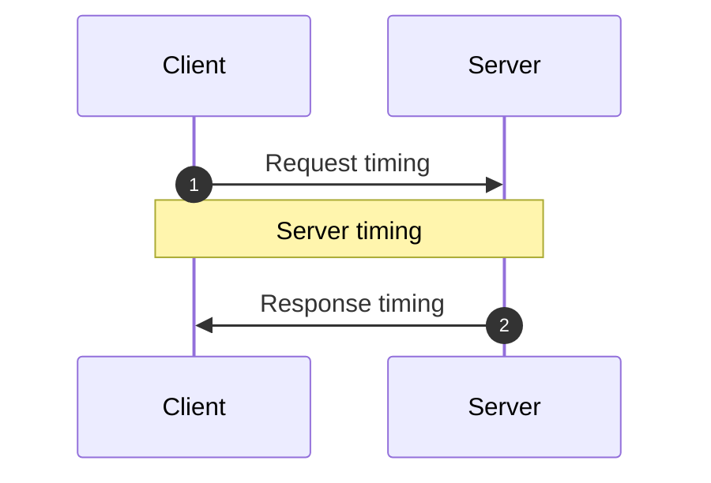

<head>
  <meta name="docsearch:pagerank" content="40"/>
</head>

import FrameworkPlayground from '@site/src/components/FrameworkPlayground';
import {RestEndpoint} from '@data-client/rest';
import { todoFixtures } from '@site/src/fixtures/todos';
import OptimisticTransform from '../shared/\_optimisticTransform.mdx';
import OptimisticRace from '@site/src/components/OptimisticRace';

export const timingDemo = [
  { delay: 800, store: 'open' },
  { delay: 1000, click: 'button.upvote' },
  { delay: 250, click: 'button.upvote' },
  { delay: 250, click: 'button.upvote' },
  { delay: 250, click: 'button.upvote' },
  // past the slowest increment response (the fixture's 4.7s), so the
  // timeline holds every response
  { wait: 5000 },
  { click: { in: 'store', selector: 'button[aria-label="Diff"]' } },
  // the first action (the count's load), then on through each change, time
  // to read each diff: 5 = the changes the 4 clicks make, as Diff's "Next
  // change" counts them (more would idle at the end before the close)
  {
    click: {
      in: 'store',
      selector: '[role="group"][aria-label^="Scrubber"] button[data-id]',
    },
  },
  ...Array.from({ length: 5 }, () => ({
    delay: 1500,
    click: { in: 'store', selector: 'button[aria-label="Next change"]' },
  })),
  // Store → Code: back to the code that did it
  { delay: 2000, store: 'close' },
];

# 乐观更新

乐观更新会在服务器响应之前就展示变更的结果。它假定请求会成功，因此
界面无需等待网络。

乐观更新会带来新的竞态条件。Reactive Data Client 会为你处理它们。

## Resources {#resources}

要让 [resource()](../api/resource.md) 变成乐观的，请设置 [optimistic: true](../api/resource.md#optimistic)。

<FrameworkPlayground defaultOpen="n" row fixtures={todoFixtures}>

```ts title="TodoResource" {16}
import { Entity, resource } from '@data-client/rest';

export class Todo extends Entity {
  id = 0;
  userId = 0;
  title = '';
  completed = false;

  static key = 'Todo';
}
export const TodoResource = resource({
  urlPrefix: 'https://jsonplaceholder.typicode.com',
  path: '/todos/:id',
  searchParams: {} as { userId?: string | number } | undefined,
  schema: Todo,
  optimistic: true,
});
```

:::react

```tsx title="TodoItem" collapsed
import { useController } from '@data-client/react';
import { TodoResource, type Todo } from './TodoResource';

export default function TodoItem({ todo }: { todo: Todo }) {
  const ctrl = useController();
  const handleChange = e =>
    ctrl.fetch(
      TodoResource.partialUpdate,
      { id: todo.id },
      { completed: e.currentTarget.checked },
    );
  const handleDelete = () =>
    ctrl.fetch(TodoResource.delete, {
      id: todo.id,
    });
  return (
    <div className="listItem nogap">
      <label>
        <input
          type="checkbox"
          checked={todo.completed}
          onChange={handleChange}
        />
        {todo.title}
      </label>
      <CancelButton onClick={handleDelete} />
    </div>
  );
}
```

```tsx title="CreateTodo" collapsed
import { useController } from '@data-client/react';
import { TodoResource } from './TodoResource';

export default function CreateTodo({ userId }: { userId: number }) {
  const ctrl = useController();
  const handleKeyDown = async e => {
    if (e.key === 'Enter') {
      ctrl.fetch(TodoResource.getList.push, {
        userId,
        title: e.currentTarget.value,
      });
      e.currentTarget.value = '';
    }
  };
  return (
    <div className="listItem nogap">
      <label>
        <input type="checkbox" name="new" checked={false} disabled />
        <input
          type="text"
          aria-label="New todo"
          placeholder="New todo"
          onKeyDown={handleKeyDown}
        />
      </label>
      <CancelButton />
    </div>
  );
}
```

```tsx title="TodoList" collapsed
import { useSuspense } from '@data-client/react';
import { TodoResource } from './TodoResource';
import TodoItem from './TodoItem';
import CreateTodo from './CreateTodo';

function TodoList() {
  const userId = 1;
  const todos = useSuspense(TodoResource.getList, { userId });
  return (
    <div className="list">
      {todos.map(todo => (
        <TodoItem key={todo.pk()} todo={todo} />
      ))}
      <CreateTodo userId={userId} />
    </div>
  );
}
render(<TodoList />);
```

:::

:::vue

```html title="TodoItem.vue" collapsed
<script setup lang="ts">
  import { useController } from '@data-client/vue';
  import { TodoResource, type Todo } from './TodoResource';

  const props = defineProps<{ todo: Todo }>();
  const ctrl = useController();
  const handleChange = e =>
    ctrl.fetch(
      TodoResource.partialUpdate,
      { id: props.todo.id },
      { completed: e.currentTarget.checked },
    );
  const handleDelete = () =>
    ctrl.fetch(TodoResource.delete, {
      id: props.todo.id,
    });
</script>

<template>
  <div class="listItem nogap">
    <label>
      <input type="checkbox" :checked="todo.completed" @change="handleChange" />
      {{ todo.title }}
    </label>
    <CancelButton @click="handleDelete" />
  </div>
</template>
```

```html title="CreateTodo.vue" collapsed
<script setup lang="ts">
  import { useController } from '@data-client/vue';
  import { TodoResource } from './TodoResource';

  const props = defineProps<{ userId: number }>();
  const ctrl = useController();
  const handleKeyDown = async e => {
    if (e.key === 'Enter') {
      ctrl.fetch(TodoResource.getList.push, {
        userId: props.userId,
        title: e.currentTarget.value,
      });
      e.currentTarget.value = '';
    }
  };
</script>

<template>
  <div class="listItem nogap">
    <label>
      <input type="checkbox" name="new" :checked="false" disabled />
      <input
        type="text"
        aria-label="New todo"
        placeholder="New todo"
        @keydown="handleKeyDown"
      />
    </label>
    <CancelButton />
  </div>
</template>
```

```html title="TodoList.vue" collapsed
<script setup lang="ts">
  import { useSuspense } from '@data-client/vue';
  import { TodoResource } from './TodoResource';
  import TodoItem from './TodoItem.vue';
  import CreateTodo from './CreateTodo.vue';

  const userId = 1;
  const todos = await useSuspense(TodoResource.getList, { userId });
</script>

<template>
  <div class="list">
    <TodoItem v-for="todo in todos" :key="todo.pk()" :todo="todo" />
    <CreateTodo :userId="userId" />
  </div>
</template>
```

:::

</FrameworkPlayground>

这样它的所有变更都会使用以下默认的乐观响应：

### update/getList.push/getList.unshift {#updategetlistpushgetlistunshift}

```ts
function optimisticUpdate(
  snap: SnapshotInterface,
  params: any,
  body: any,
) {
  return {
    ...params,
    ...ensureBodyPojo(body),
  };
}

function ensureBodyPojo(body: any) {
  return body instanceof FormData
    ? Object.fromEntries((body as any).entries())
    : body;
}
```

创建操作（push/unshift）的 body 中通常没有可用于计算 pk 的 `id`。因此
<abbr title="Reactive Data Client">Data Client</abbr> 会创建一个随机的 `pk`。

在服务器创建新对象之前，对它的变更通常会失败。因此在
`POST` 完成之前，请禁止对它进行其他变更。例如，检查该 Entity 是否有真实的 `id`。

### partialUpdate {#partialupdate}

```ts
function optimisticPartial(schema: Queryable) {
  return function (snap: SnapshotInterface, params: any, body: any) {
    const data = snap.get(schema, params);
    if (!data) throw snap.abort;
    return {
      ...params,
      ...data,
      // even tho we don't always have two arguments, the extra one will simply be undefined which spreads fine
      ...ensurePojo(body),
    };
  };
}
```

部分更新不会发送完整的 body。预期响应中省略的字段会保留其
缓存值，因此 Entity 只需要包含它的[主键](../api/Entity.md#pk)和发生变化的字段。
如果该 Entity 尚不在 store 中，更新会[中止](/docs/api/Snapshot#abort)，而不是展示一个只由变化字段
组成的 Entity。[Snapshots](/docs/api/Snapshot) 可以安全地读取 store 中的当前值，不会出现竞态
条件。

### delete {#delete}

```ts
function optimisticDelete(snap: SnapshotInterface, params: any) {
  return params;
}
```

要只让部分 endpoint 变成乐观的，或者要适配特殊的 API，请通过
[Resource.extend()](../api/resource.md#extend) 设置
[getOptimisticResponse()](../api/RestEndpoint.md#getoptimisticresponse)。

## 乐观变换 {#optimistic-transforms}

有些更新依赖于之前的值，比如切换一个布尔值或递增一个计数器。这个示例使用
一个计数器。

<OptimisticTransform />

Reactive Data Client 会处理由网络时序引起的竞态条件。它会跟踪每次获取开始的时间，将每个
响应与对应的乐观更新配对，并在请求 resolve 或失败时回滚该更新。

即使没有乐观更新，其他库也存在这些竞态条件。乐观更新会让情况更糟。

### 竞态条件示例 {#example-race-condition}

这个示例请求了两次递增。第一个响应比第二个更晚到达。

<OptimisticRace />

没有乐观更新时，其他库依次显示 0、2、1；有乐观更新时，则显示 0、1、2、2、1。两种情况最终都停在错误的计数上，过程中还会出现卡顿的更新。Data Client 依次显示 0、1、2，并在较早的响应最后到达时保持 2。

### 补偿服务器时序差异 {#server-timings}



在异步变更中，有三种时序可能发生变化：

1. 请求时序
1. 服务器时序
1. 响应时序

Reactive Data Client 会为你处理请求时序和响应时序。这通常已经足够，因为服务器通常
按请求到达的顺序处理它们。如果服务器以不同的顺序保存请求，竞态条件就依然
存在。

要解决它，请用同一个时钟维护一个[全序](https://en.wikipedia.org/wiki/Total_order)。服务器和客户端的时钟
可能不同，而乐观更新发生在客户端，因此请使用客户端的时钟：

1. 通过 [getRequestInit()](../api/RestEndpoint.md#getRequestInit) 在 `updatedAt` header 中发送请求时间。
1. 服务器按 `updatedAt` 的顺序处理请求，把 `updatedAt` 存储在 Entity 中，并在每个
   响应中返回它。
1. 覆盖 [shouldReorder](../api/Entity.md#shouldreorder)，按 `updatedAt` 对乱序的响应重新排序。

[getOptimisticResponse](../api/RestEndpoint.md#getoptimisticresponse) 使用了 [snap.fetchedAt](/docs/api/Snapshot#fetchedat)。
它表示获取开始的时刻，与 `updatedAt` header 的时间相同。

<FrameworkPlayground fixtures={[
{
endpoint: new RestEndpoint({path: '/api/count'}),
args: [],
response: { count: 0, updatedAt: Date.now() }
},
{
endpoint: new RestEndpoint({
path: '/api/count/increment',
method: 'POST',
body: undefined,
}),
fetchResponse(input, init) {
return ({
"count": (this.count = this.count + 1),
"updatedAt": JSON.parse(init.body).updatedAt,
});
},
delay: () => 200 + Math.random() * 4500,
delayCollapse:true,
}
]}
getInitialInterceptorData={() => ({ count: 0 })}
row
autoRun={timingDemo}
>

```ts title="count" {11-13} collapsed
import { Entity, RestEndpoint } from '@data-client/rest';

export class CountEntity extends Entity {
  count = 0;
  updatedAt = 0;

  pk() {
    return `SINGLETON`;
  }

  static shouldReorder(existingMeta, incomingMeta, existing, incoming) {
    return incoming.updatedAt < existing.updatedAt;
  }
}
export const getCount = new RestEndpoint({
  path: '/api/count',
  schema: CountEntity,
  name: 'get',
});
```

```ts title="increment" {10-16,22}
import { RestEndpoint } from '@data-client/rest';
import { CountEntity } from './count';

export const increment = new RestEndpoint({
  path: '/api/count/increment',
  method: 'POST',
  body: undefined,
  name: 'increment',
  schema: CountEntity,
  getRequestInit() {
    // this is a substitute for super.getRequestInit()
    // since we aren't in a class context
    return RestEndpoint.prototype.getRequestInit.call(this, {
      updatedAt: Date.now(),
    });
  },
  getOptimisticResponse(snap) {
    const data = snap.get(CountEntity, {});
    if (!data) throw snap.abort;
    return {
      count: data.count + 1,
      updatedAt: snap.fetchedAt,
    };
  },
});
```

:::react

```tsx title="CounterPage" collapsed
import React from 'react';
import { useController, useSuspense } from '@data-client/react';
import NumberFlow from '@number-flow/react';
import { getCount } from './count';
import { increment } from './increment';

function CounterPage() {
  const ctrl = useController();
  const { count } = useSuspense(getCount);
  const [clicks, setClicks] = React.useState(count);
  const clickHandler = () => {
    setClicks(c => c + 1);
    return ctrl.fetch(increment);
  };
  return (
    <>
      <header className="appHeader">
        <h1 className="appTitle">Votes</h1>
      </header>
      <div className="listItem">
        <button className="upvote" onClick={clickHandler} aria-label="Upvote" />
        <dl className="stats">
          <div>
            <dt>Data Client</dt>
            <dd><NumberFlow value={count} /></dd>
          </div>
          <div>
            <dt>Clicks</dt>
            <dd><NumberFlow value={clicks} /></dd>
          </div>
        </dl>
      </div>
    </>
  );
}
render(<CounterPage />);
```

:::

:::vue

```html title="CounterPage.vue" collapsed
<script setup lang="ts">
  import { ref } from 'vue';
  import { useController, useSuspense } from '@data-client/vue';
  import NumberFlow from '@number-flow/vue';
  import { getCount } from './count';
  import { increment } from './increment';

  const ctrl = useController();
  const data = await useSuspense(getCount);
  const clicks = ref(data.value.count);
  const clickHandler = () => {
    clicks.value += 1;
    return ctrl.fetch(increment);
  };
</script>

<template>
  <header class="appHeader">
    <h1 class="appTitle">Votes</h1>
  </header>
  <div class="listItem">
    <button class="upvote" @click="clickHandler" aria-label="Upvote" />
    <dl class="stats">
      <div>
        <dt>Data Client</dt>
        <dd><NumberFlow :value="data.count" /></dd>
      </div>
      <div>
        <dt>Clicks</dt>
        <dd><NumberFlow :value="clicks" /></dd>
      </div>
    </dl>
  </div>
</template>
```

:::

</FrameworkPlayground>
