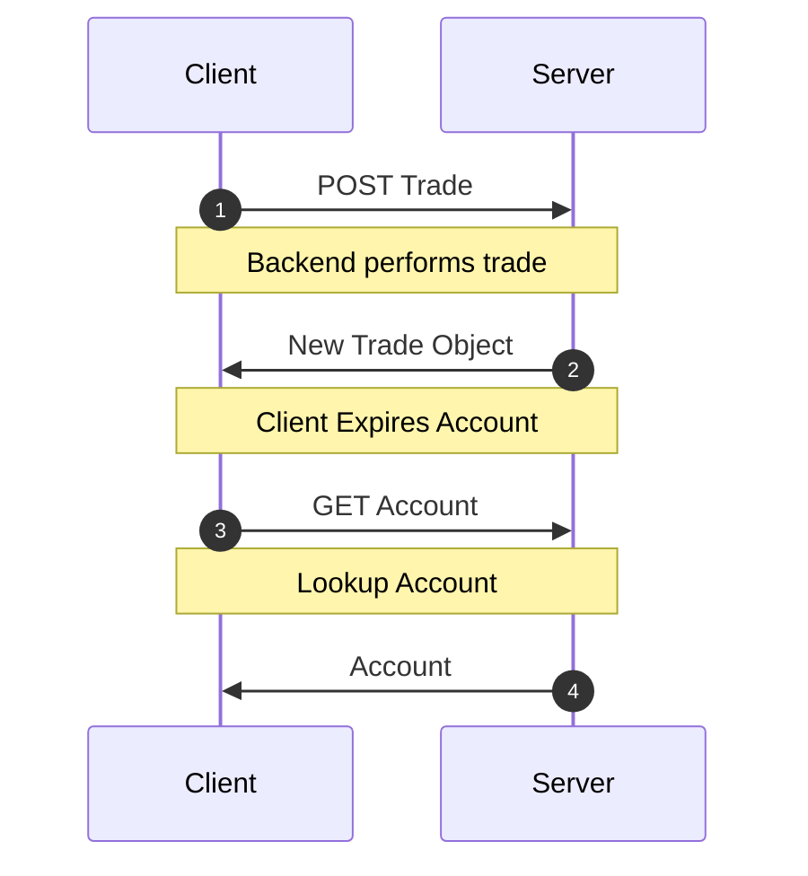
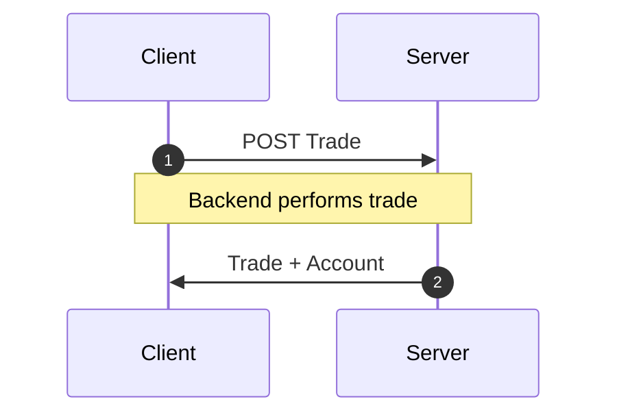

当一次变更修改了多个资源时，不要[让其他资源过期](/docs/api/Controller#expireAll)。
让它们过期会引发缓慢的级联重新获取。相反，应在变更的响应中包含_所有_被修改的资源。
这样变更依然是原子的，并且只需要一次请求。

<div style={{display: 'grid', gridTemplateColumns: '1fr 1fr', columnGap: '15px'}}>

<div>
<h4 style={{textAlign: 'center'}}>网络级联</h4>



</div>
<div>
<h4 style={{textAlign: 'center'}}> 响应打包</h4>



</div>

</div>

## 示例 {#example}

一个加密货币交易平台在每笔交易时都会更新用户的账户余额。因此 `POST /trade/` 会返回新的
交易和更新后的账户。

```json title="POST /trade/"
{
  "trade": {
    "id": 2893232,
    "user": 1,
    "amount": "50.2335324",
    "coin": "doge",
    "created_at": ""
  },
  "account": {
    "id": 899,
    "user": 1,
    "balance": "1337.00",
    "coin_value": "3.50"
  }
}
```

把账户添加到 endpoint 的 `schema` 中。

```typescript title="resources/Trade.ts"
import { resource, Entity } from '@data-client/rest';
import { Account } from './Account';

export class Trade extends Entity {
  id = 0;
  user = 0;
  amount = '0';
  coin = '';
  created_at = '';
}

export const TradeResource = resource({
  path: '/trade/:id',
  schema: Trade,
}).extend(Base => ({
  createTrade: Base.getList.push.extend({
    schema: {
      trade: Base.getList.push.schema,
      account: Account,
    },
  }),
}));
```

`createTrade` 扩展自 [getList.push](../api/resource.md#push)。`POST` 完成后，store 会同时更新新的
交易和账户。

:::react

```typescript title="CreateTrade.tsx"
export default function CreateTrade() {
  const ctrl = useController();
  const handleSubmit = payload =>
    ctrl.fetch(TradeResource.createTrade, {}, payload);
  //...
}
```

:::

:::vue

```html title="CreateTrade.vue"
<script setup lang="ts">
  import { useController } from '@data-client/vue';
  import { TradeResource } from './resources/Trade';

  const ctrl = useController();
  const handleSubmit = payload =>
    ctrl.fetch(TradeResource.createTrade, {}, payload);
  //...
</script>
```

:::

:::note

为任何自定义 endpoint 定义一个新的 [RestEndpoint](../api/RestEndpoint.md)。它的 `schema` 会告诉 Data Client 如何
存储响应。

:::
